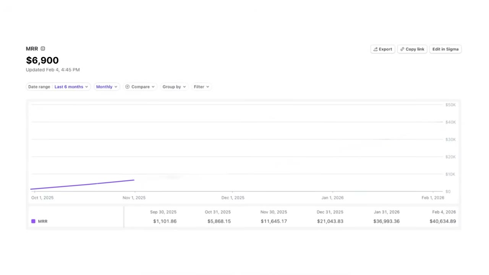
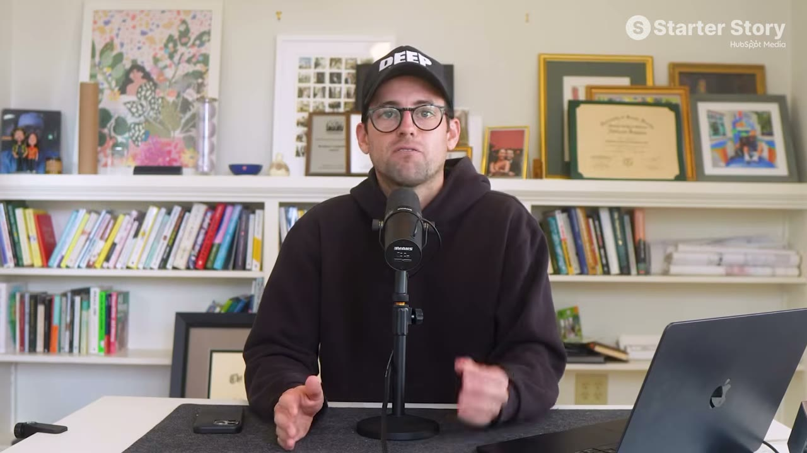
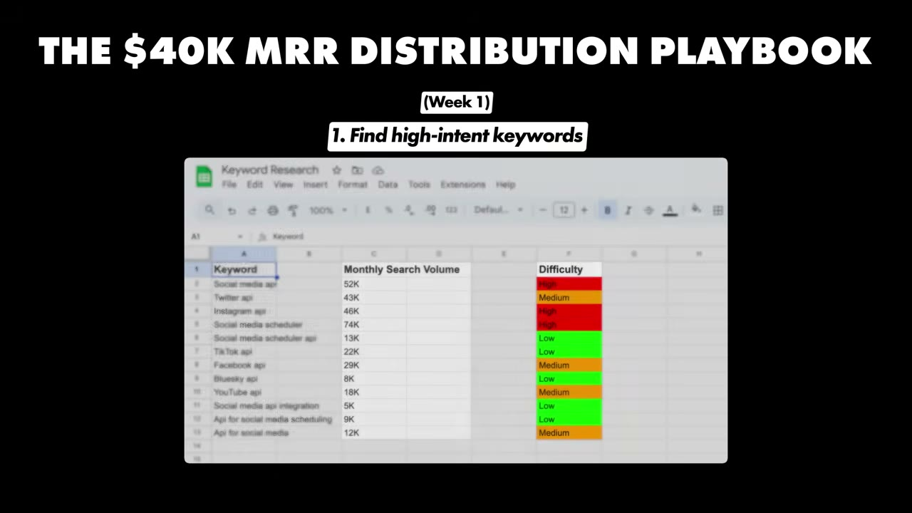

# Zero to $40K/Month With One Marketing Channel (No Social Media)

✅ **Đã phân tích sâu** → [`case.md`](case.md)

| | |
|---|---|
| **Video** | <https://www.youtube.com/watch?v=E_rX4JJrYkY> |
| **Đăng** | 04/03/2026 |
| **Thời lượng** | 19:46 |
| **Lượt xem** | 54,074 |
| **Lượt thích** | 1,336 |
| **Video ID** | `E_rX4JJrYkY` |

## Trong thư mục này

| File | Nội dung |
|---|---|
| [`case.md`](case.md) | **Phân tích đầy đủ** — ý tưởng, validate, GTM, áp dụng ở VN |
| [`meta.json`](meta.json) | Metadata gốc (chapters, heatmap, mô tả) |
| [`screenshots/`](screenshots/) | 10 ảnh 720p |

## Mô tả gốc

This is the story of how Miquel grew Late to $40K/month with just one marketing system. 
This video is an educational case study of this founder’s experience. It is not financial advice and does not guarantee any income or results. Every business is different and your results may vary.
0:00 - Zero to $40K in 7 months
0:50 - Need an app idea?
1:09 - App overview
2:41 - Founder background
3:40 - Distribution overview
4:44 - Is your app compliant?
5:44 - Deep dive on Google 
6:50 - The SEO (Organic) Strategy
8:00 - The Paid Ads Strategy
9:20 - Find your $1M idea (free template)
10:06 - Google Pla

## Số liệu bắt được từ transcript

> Các đoạn founder nhắc tới con số, kèm timestamp để tua thẳng tới đó trong video.

_(không bắt được con số nào)_

## Chương

- `00:00` Zero to $40K in 7 months
- `00:50` Need an app idea?
- `01:09` App overview
- `02:41` Founder background
- `03:40` Distribution overview
- `04:44` Is your app compliant?
- `05:44` Deep dive on Google
- `06:50` The SEO (Organic) Strategy
- `08:00` The Paid Ads Strategy
- `09:20` Find your $1M idea (free template)
- `10:06` Google Playbook for 2026
- `13:28` Late demo
- `14:55` Tech stack and costs
- `15:21` Advice to young founders
- `16:16` Pat and Gus reflections
- `17:31` Is SEO really dead?
- `19:19` Time to build your idea!

## Ảnh

1. `01_00m36s_usd-40-000-m.jpg` — 
2. `02_01m21s_ch-app-overview.jpg` — 
3. `03_02m53s_ch-founder-background.jpg` — 
4. `04_03m52s_ch-distribution-overview.jpg` — 
5. `05_04m47s_usd-40-000.jpg` — 
6. `06_05m32s_usd-1-000.jpg` — 
7. `07_07m02s_ch-the-seo-organic-strategy.jpg` — 
8. `08_09m11s_usd-8-000.jpg` — 
9. `09_11m08s_replay.jpg` — 
10. `10_15m17s_replay.jpg` — 

---

← [Quay lại index](../../index.md) · [Toàn bộ video](../README.md)
