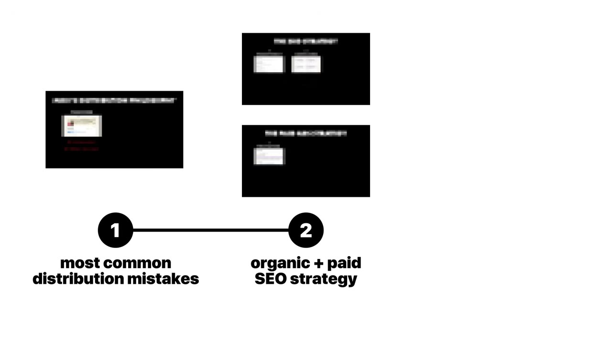
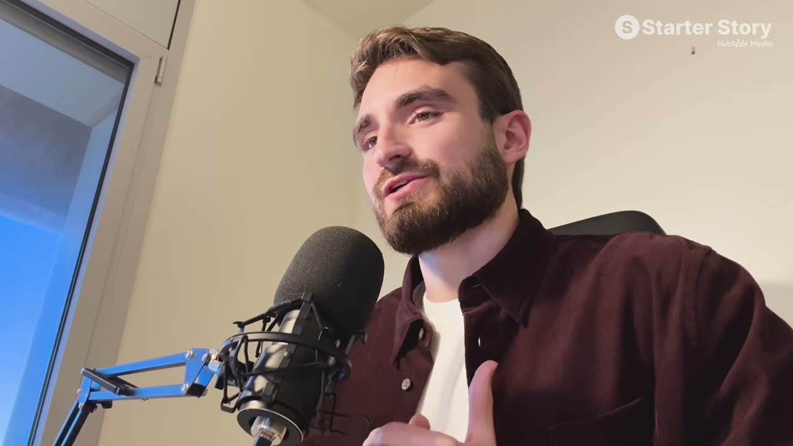
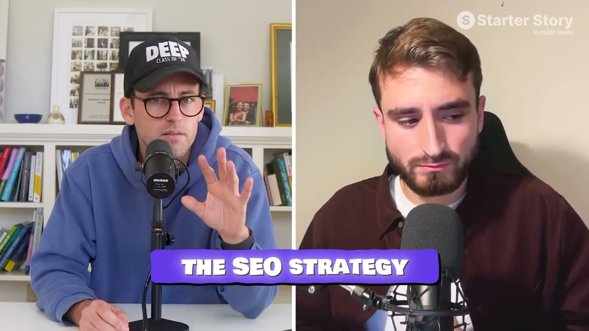
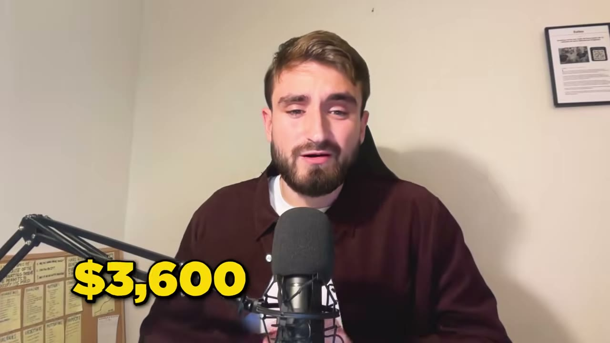

# Late — $40K/tháng trong 7 tháng, chỉ dùng Google

> **Tóm tắt 30 giây:** Miquel không đuổi theo trend TikTok, không xây thương hiệu cá nhân. Anh chọn **một kênh duy nhất** — Google — và chạy nó như một bài toán số học: viết nội dung nhắm từ khoá đáy phễu, trang nào lên hạng tự nhiên thì để yên, trang nào không lên thì **chạy quảng cáo trên chính nội dung đó**. Kết quả sau 7 tháng: **$40K MRR**, 700+ khách trả tiền, churn dưới 10%. Công thức của anh gói trong một câu: *"giỏi một kênh tốt hơn 100 lần so với tầm thường ở 10 kênh."*

## 1. Con số

| Chỉ số | Giá trị |
|---|---|
| MRR | ~$40.000 (7 tháng từ con số 0) |
| Tổng đăng ký | 50.000 |
| Khách trả tiền | Hơn 700 |
| Churn | **Dưới 10%** |
| MRR từ SEO organic | ~$8.000 |
| MRR từ Google Ads | ~$15.000 |
| Chi quảng cáo | ~$8.000/tháng |
| ROAS | **$2,5 doanh thu trên mỗi $1 chi** |
| Target CPA | $120 |

*Trong video có vài chỗ số bị đọc lệch (30K/40K/"4K"). Tôi lấy $40K vì đó là con số nhất quán với tiêu đề, với ảnh dashboard và với phép cộng $8K + $15K + phần còn lại.*

## 2. Sản phẩm: bán thứ khó chịu mà không ai muốn tự làm ⭐⭐

Late là **API mạng xã hội** — bọc quanh các API chính thức của Facebook, Instagram, Twitter, LinkedIn.

Giá trị nằm ở chỗ Miquel gánh hộ khách phần đau đớn:
- Đi qua **toàn bộ quy trình xin quyền** của từng nền tảng
- **Trả tiền gói cao nhất** của mỗi nền tảng để có đủ tính năng
- Đưa lại cho khách **một API duy nhất, không giới hạn**

Tính tiền theo **số tài khoản kết nối**, ba gói: Build (bắt đầu tích hợp) → Accelerate (nhiều tài khoản hơn) → Unlimited.

Nguồn gốc ý tưởng: anh nhận ra khoảng trống thị trường — *"không có API nào đơn giản và giá phải chăng cho việc tự động hoá mạng xã hội. Hầu hết công cụ hoặc quá đắt, quá phức tạp, hoặc **thiếu tài liệu tốt — thứ tối quan trọng với developer**."*

> **Mẫu hình đáng ghi nhớ:** đây là dạng doanh nghiệp "gánh nỗi đau hành chính". Giá trị không nằm ở công nghệ khó mà ở việc **chịu đựng thay khách** một quy trình phiền phức (xin quyền, trả gói đắt, theo dõi thay đổi API). Loại này khó bị sao chép hơn vẻ ngoài, vì đối thủ cũng phải chịu đúng nỗi đau đó.

## 3. Luận điểm nền: bắt ý định có sẵn, đừng tạo ra nó ⭐⭐⭐

> *"Mạng xã hội thì ồn ào, quá bão hoà. Organic reach đã chết với hầu hết doanh nghiệp và rất rất khó làm. Trong khi đó có những người **đang chủ động tìm** 'social media scheduling API' hay 'Twitter automation tool' — họ có ý định mua **cao gấp 10 lần**. Chúng tôi ở đây để **bắt lấy ý định đã tồn tại sẵn**, thay vì cố tạo ra nó bằng nội dung viral."*

Lý do anh chọn kênh này, nói theo ngôn ngữ tài chính:

> *"Chúng tôi tập trung 100% vào SEO và Google search ads vì chúng có **kinh tế đơn vị dự đoán được** và **không phụ thuộc vào may mắn hay trend**."*

Đây là cùng một luận điểm với [YouTube Search của Ben](../2026-03-19_i-make-17k-month-with-one-strategy/case.md), chỉ khác nền tảng. Cả hai đều từ chối "tạo nhu cầu" để đi "bắt nhu cầu".

## 4. Cơ chế: một nội dung, hai đường thu hoạch ⭐⭐⭐

Đây là ý tưởng gọn nhất trong video:

> *"Chúng tôi tạo nội dung trên website hữu ích cho người dùng mục tiêu. Một số lên hạng tự nhiên trên Google, một số thì không. **Cái không lên thì chúng tôi chạy quảng cáo cho nó.** Cùng một nội dung phục vụ cả hai mục đích."*

Pat tóm lại chính xác: *"Bạn chỉ thật sự phải làm một hành động."*

**Nghĩa là:** bạn không có hai chiến dịch marketing. Bạn có **một** thư viện nội dung, và Google quyết định trang nào miễn phí, trang nào phải trả tiền. Trang nào chạy ads tốt → viết thêm nội dung organic quanh từ khoá đó. Trang nào organic lên hạng → tắt bớt ads. Hai kênh **nạp dữ liệu cho nhau**.

### Bên organic (~$8K MRR)

- **Chỉ nhắm từ khoá đáy phễu.** Tiêu chí cụ thể: **300-800 lượt tìm/tháng**, **cạnh tranh thấp**, **ý định rất cao**. Ví dụ: *"social media API"*, *"scheduling API for Twitter"*.
- Viết **hướng dẫn chuyên sâu** trả lời đúng ý định. Ví dụ: *"how to schedule Instagram posts automatically"*.
- Giữ cấu trúc site sạch, tải nhanh, tối ưu mobile, metadata đúng.
- **Link building** — vừa qua công cụ, vừa liên hệ thủ công **và trả tiền cho người ta**.
- Theo dõi mọi thứ bằng Ahrefs + Google Search Console, liên tục tối ưu CTR.

> Lưu ý con số **300-800 lượt tìm/tháng**: đây là ngưỡng thấp một cách đáng ngạc nhiên. Hầu hết người mới bỏ qua những từ khoá này vì trông "quá nhỏ". Đó chính là lý do chúng còn trống và chuyển đổi cao.

### Bên trả phí (~$15K MRR)

- Đấu giá **đúng bộ từ khoá thương mại** đang nhắm organic.
- **Mỗi ad group có landing page riêng** khớp với từ khoá và ý định. Ví dụ: "Instagram API" có trang riêng cho Instagram.
- **Automated bidding với target CPA $120** — Google tự tối ưu để đạt ngưỡng đó.
- Ad copy tập trung vào **giá trị**, không phải tính năng: *"scale 30 days of social media in 1 hour"*, *"reach 100k followers fast with our API"*.
- A/B test liên tục headline, description, landing page. Theo dõi qua PostHog.

## 5. Playbook Google 5 bước ⭐⭐⭐

**Bước 1 — Tìm bộ từ khoá lõi.**
Từ khoá ý định cao, sát với đề xuất giá trị. Dùng Ahrefs/SEMrush, nhưng Miquel nhấn mạnh: *"có những từ khoá lõi bạn **không cần phải đi tìm**. Bạn đã biết chúng liên quan trực tiếp tới sản phẩm rồi. Với chúng tôi là 'social media API' — quá hiển nhiên."* Lập bảng tính: từ khoá, lượt tìm/tháng, độ khó. **Chỉ tập trung vào chúng và không gì khác**, hướng tới lên hạng trong 3-6 tháng.

**Bước 2 — Tạo nội dung cho chính những từ khoá đó.**
Chất lượng cao. Có thể là blog, landing page, **hoặc một công cụ miễn phí**. Gắn CTA lớn về trang đăng ký. Thêm internal link sang các bài khác.
> *"Đẩy 10-15 bài chất lượng cao trong tuần đầu để tạo đà. Cũng quan trọng là **đừng tạo quá nhiều nội dung — Google không thích thế**. Thà có nội dung chất lượng."*

**Bước 3 — Bật quảng cáo với dữ liệu và nội dung đã có.**
Tạo ad group theo đúng bộ từ khoá đang nhắm organic. **3-5 biến thể** ad copy. Tập trung vào đề xuất giá trị hơn là liệt kê tính năng.

**Bước 4 — Tối ưu và mở rộng theo dữ liệu.**
Xác định từ khoá nào **mang về khách hàng mới** (không phải từ khoá nào nhiều click). Nhân đôi vào các từ khoá ROI cao. Cập nhật headline, copy, CTA theo cái gì chuyển đổi tốt nhất. **Tăng ngân sách tháng này qua tháng khác chừng nào ROAS còn dương.**

**Bước 5 — Theo dõi và cải thiện chi phí thu hút.**
Dashboard (Google Sheets, Data Studio, hay công cụ bất kỳ) theo dõi CAC, ROAS, doanh thu và traffic theo kênh.

> **Chuẩn số học cần thuộc:** *"CAC tốt là **20-40% của LTV**. Mục tiêu là giữ CAC dưới **30% doanh thu năm đầu**."*

Mỗi tháng A/B test từ khoá mới, ad copy mới, landing page mới dựa trên kết quả tháng trước.

## 6. "SEO đã chết chưa?" — câu trả lời phân định ⭐⭐

Cuối video Pat và Gus xử lý thẳng câu hỏi này, và đây là phần đáng đọc nhất cho việc ra quyết định:

> **Pat:** *"Sự thật là: Google search chưa chết, nhưng **truy vấn thông tin thì chết rồi**. Nếu bạn tìm 'cách tạo một bài đăng mạng xã hội hay', bạn sẽ khó lên hạng — và những người đó sẽ dùng ChatGPT để có câu trả lời tuỳ chỉnh và tốt hơn nhiều. Nhưng nếu họ tìm 'social media scheduler'... cuối cùng họ vẫn gõ vào Google, họ vẫn click sang phần mềm của bạn và mua nó."*

**Quy tắc rút ra — dùng để chọn từ khoá:**

| Loại truy vấn | Ví dụ | Còn đáng đầu tư? |
|---|---|---|
| Thông tin ("cách làm X") | "cách viết caption hay" | ❌ ChatGPT ăn hết |
| Ý định mua ("công cụ làm X") | "social media scheduling API" | ✅ Vẫn sống khoẻ |

Gus bổ sung một nhận xét về **con người** rất đáng giá cho việc chọn kênh:

> *"Đây là chiến lược phân phối tuyệt vời cho những người **không muốn lên camera** và có thể hơi thiên về kiểu tài chính, thích lập bảng tính từ khoá, xem ý định và nhìn con số. **Không phải ai cũng sinh ra để lên hình và tạo nội dung viral.**"*

## 7. Tech stack

| Hạng mục | Công cụ | Chi phí |
|---|---|---|
| Code | **Claude Code** | — |
| Phân bổ doanh thu | **DataFast** | — |
| Quảng cáo | Google Ads | ~$8.000/tháng |
| SEO | **Ahrefs** | ~$200/tháng |
| Analytics / A/B test | PostHog | — |

Đáng chú ý: stack cực kỳ gọn. Không có gì lạ. Toàn bộ ngân sách nằm ở **quảng cáo** và **công cụ SEO** — tức là ở phân phối, không phải ở kỹ thuật.

## 8. Lời khuyên cuối

> *"Lời khuyên của tôi là **đừng cố trở thành tất cả với tất cả mọi người**. Khi tôi nhận ra rằng chọn một kênh tăng trưởng và trở nên thật giỏi ở nó — với chúng tôi là paid search — **nó tốt hơn 100 lần so với việc tầm thường ở 10 kênh**. Hãy chọn đòn bẩy tăng trưởng tốt nhất của bạn, ám ảnh với nó, và đo lường nó không ngừng."*

Pat củng cố: *"Bạn có thể thắng chỉ với một kênh. Bạn có thể xây doanh nghiệp triệu đô, mười triệu đô, có thể cả trăm triệu đô chỉ với một kênh."*

## 9. Áp dụng cho tôi (indie hacker VN)

**Vì sao case này hợp với tôi:**

- **Không cần lên hình, không cần tiếng Anh nói.** Đây là điểm khác biệt lớn nhất so với các case dựa vào video. Nội dung viết có thể chỉnh sửa, có thể nhờ AI kiểm tra. Với người Việt bán ra quốc tế, đây là kênh **ít bất lợi ngôn ngữ nhất**.
- **Kinh tế đơn vị minh bạch.** ROAS 2,5x, CAC dưới 30% doanh thu năm đầu — đây là những con số tôi tự kiểm chứng được với ngân sách nhỏ, không cần đặt cược lớn.
- **Có thể bắt đầu chỉ với organic.** $8K MRR của anh đến từ nội dung miễn phí. Tôi có thể chạy phần organic trước khi có tiền quảng cáo.

**Thứ tự tôi sẽ làm (khác thứ tự của anh — có lý do):**
1. Làm **bước 1 và 2** (từ khoá + nội dung) trước, hoàn toàn miễn phí, trong 4-8 tuần.
2. Chỉ bật Google Ads khi **đã có dữ liệu chuyển đổi** từ organic — để biết trang nào đáng đổ tiền vào.

Miquel làm song song được vì anh có vốn từ công ty trước (anh từng gọi vốn cho một công ty giờ hơn 100 nhân viên). Tôi thì không, nên **organic trước, ads sau** là thứ tự an toàn hơn.

**Rào cản thật:**

- **$8.000/tháng tiền quảng cáo là rào cản vốn nghiêm túc.** Với ROAS 2,5x thì nó tự nuôi, nhưng bạn cần đủ tiền để chịu **30-60 ngày** trước khi doanh thu về. Không giống [Google Ads cho app Android của Journable](../2026-03-25_i-built-a-100k-month-android-app/case.md) nơi có thể bắt đầu nhỏ, target CPA $120 nghĩa là mỗi khách hàng thử nghiệm tốn $120 — sai lầm ở đây đắt.
- **Ahrefs $200/tháng** là chi phí cố định thật với người mới ở VN. Có thể thay bằng công cụ rẻ hơn giai đoạn đầu, nhưng đừng bỏ hẳn việc nghiên cứu từ khoá.
- **Link building "trả tiền cho người ta"** là vùng xám của Google. Anh nói thẳng là có làm. Rủi ro phạt tồn tại thật — cân nhắc kỹ trước khi sao chép phần này.
- **3-6 tháng mới lên hạng.** Đây không phải kênh cho người cần doanh thu tháng sau.
- **Sản phẩm này phụ thuộc API của Meta/X/LinkedIn.** Nếu một nền tảng đổi điều khoản hoặc giá, biên lợi nhuận bị ăn ngay. Anh đang **trả gói cao nhất của mọi nền tảng** — đó là chi phí cố định lớn và nằm ngoài tầm kiểm soát.

**Khi nào KHÔNG dùng mô hình này:** khi sản phẩm của bạn giải vấn đề mà **chưa ai biết cách gọi tên**. Toàn bộ playbook giả định có người đang gõ một cụm từ cụ thể vào Google. Sản phẩm tạo ra danh mục mới không có từ khoá để nhắm — với loại đó, [lifetime deal](../2026-03-29_my-app-made-120k-in-24-hours/case.md) hoặc nội dung ngắn phù hợp hơn.

**Case liên quan:** [FollowBuddy](../2026-03-19_i-make-17k-month-with-one-strategy/case.md) (cùng logic, nền tảng YouTube) · [SuperDemo](../2026-03-11_how-this-250k-month-saas-got-its-first-100-users-ste/case.md) (SEO đáy phễu + trang so sánh đối thủ) · [Journable](../2026-03-25_i-built-a-100k-month-android-app/case.md) (Google Ads cho app)

## Nguồn

- Video: <https://www.youtube.com/watch?v=E_rX4JJrYkY> (19:46, đăng 04/03/2026, 54.074 view)
- [Transcript đầy đủ](transcript.md) · [Ảnh chụp](screenshots/)
