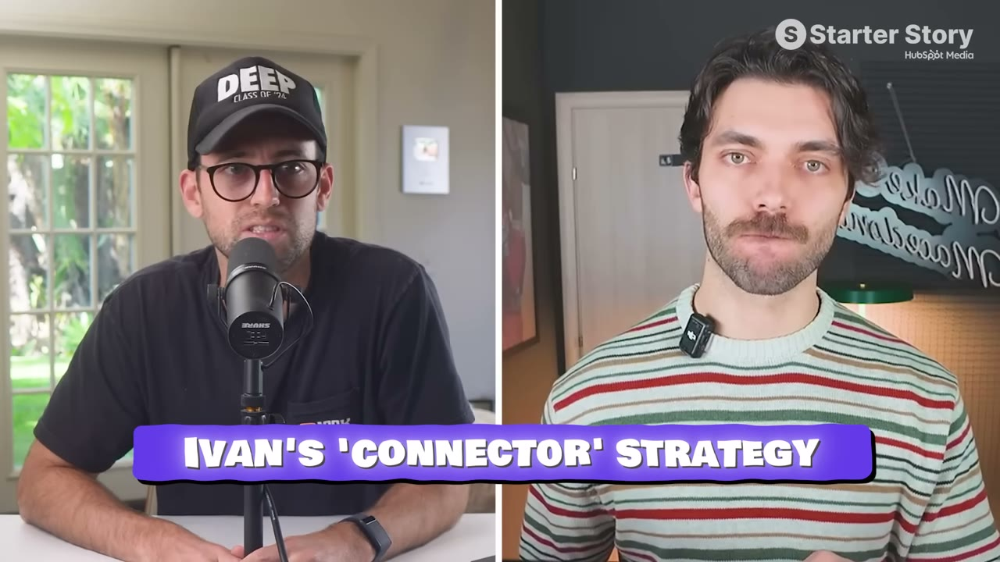

# I Built a $10K/Month SaaS Using Other People's Customers

✅ **Đã phân tích sâu** → [`case.md`](case.md)

| | |
|---|---|
| **Video** | <https://www.youtube.com/watch?v=LKARRA0MvY4> |
| **Đăng** | 08/03/2026 |
| **Thời lượng** | 16:22 |
| **Lượt xem** | 41,750 |
| **Lượt thích** | 1,017 |
| **Video ID** | `LKARRA0MvY4` |

## Trong thư mục này

| File | Nội dung |
|---|---|
| [`case.md`](case.md) | **Phân tích đầy đủ** — ý tưởng, validate, GTM, áp dụng ở VN |
| [`meta.json`](meta.json) | Metadata gốc (chapters, heatmap, mô tả) |
| [`screenshots/`](screenshots/) | 10 ảnh 720p |

## Mô tả gốc

Ivan built a $10K/Month SaaS without finding a single customer himself. Instead, he found the people who already had them. This is his exact playbook
This video is an educational case study of this founder’s experience. It is not financial advice and does not guarantee any income or results. Every business is different and your results may vary.
0:00 - Zero to $10K MRR
1:18 - Founder and App overview
2:32 - Ideas and opportunities
5:31 - Build your own AI agent
6:41 - Growth strategy and tactics
9:30 - His distribution playbook
12:20 - Tech stack and costs
13:36 - Final advice
15:24 - Pat's re

## Số liệu bắt được từ transcript

> Các đoạn founder nhắc tới con số, kèm timestamp để tua thẳng tới đó trong video.

_(không bắt được con số nào)_

## Chương

- `00:00` Zero to $10K MRR
- `01:18` Founder and App overview
- `02:32` Ideas and opportunities
- `05:31` Build your own AI agent
- `06:41` Growth strategy and tactics
- `09:30` His distribution playbook
- `12:20` Tech stack and costs
- `13:36` Final advice
- `15:24` Pat's reflections on the episode

## Ảnh

1. `01_00m15s_ch-zero-to-10k-mrr.jpg` — 
2. `02_01m30s_ch-founder-and-app-overview.jpg` — 
3. `03_02m25s_usd-2.jpg` — 
4. `04_05m43s_ch-build-your-own-ai-agent.jpg` — 
5. `05_06m53s_ch-growth-strategy-and-tactics.jpg` — 
6. `06_07m32s_usd-200.jpg` — 
7. `07_09m42s_ch-his-distribution-playbook.jpg` — 
8. `08_12m47s_usd-10-000.jpg` — 
9. `09_13m48s_ch-final-advice.jpg` — 
10. `10_15m07s_usd-10-000.jpg` — 

---

← [Quay lại index](../../index.md) · [Toàn bộ video](../README.md)
