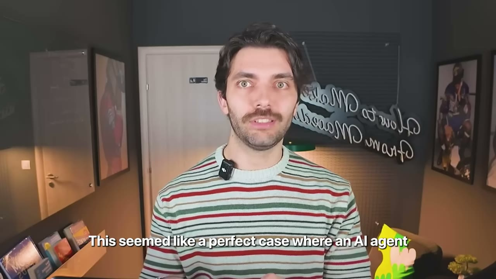
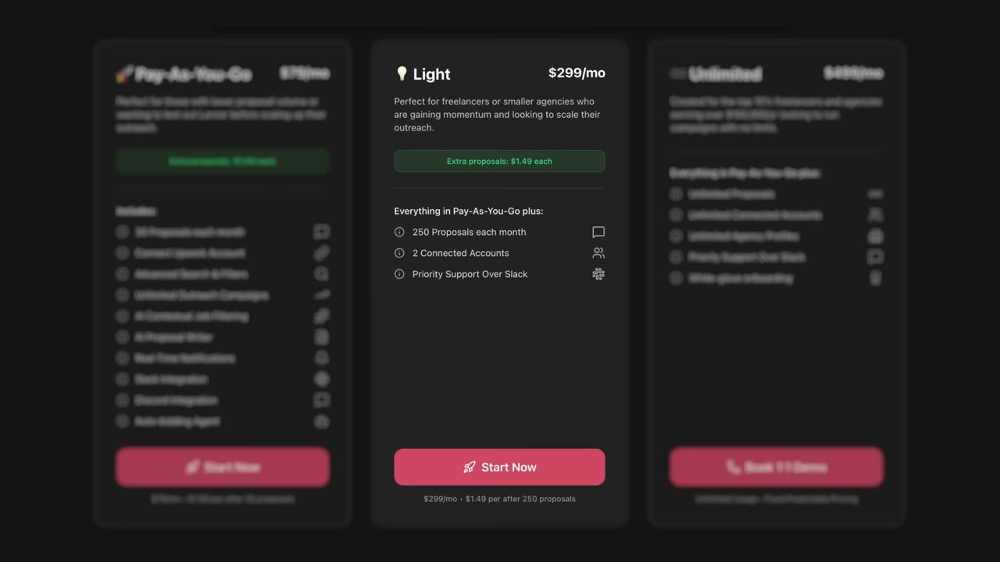
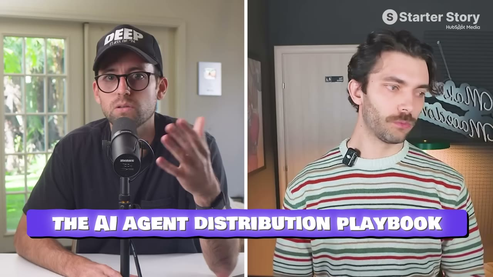
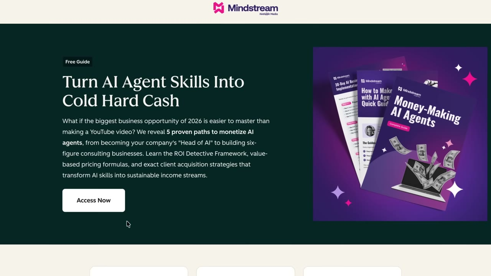
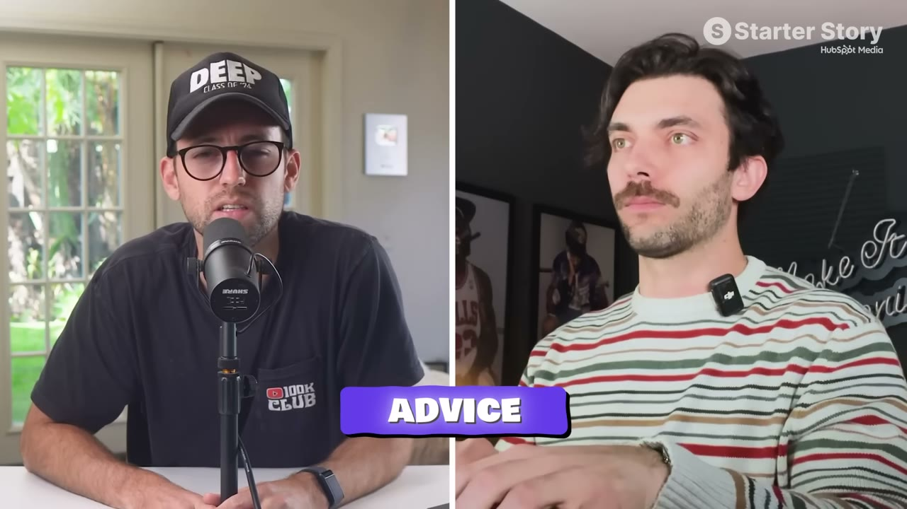

# Lancer — $10K/tháng bằng khách hàng của người khác

> **Tóm tắt 30 giây:** Ivan chạy agency dev ở Macedonia 5 năm, doanh thu 7 con số, gần 20 nhân viên. Kênh kiếm khách chính là Upwork — nơi có **200.000 job đăng mỗi tháng**, mỗi job mất ~10 phút để lọc và viết proposal cá nhân hoá. Anh xây AI agent làm việc đó, dùng nội bộ, thấy hiệu quả, rồi tách thành sản phẩm. Đạt **$10.000/tháng vào tháng thứ 3-4**, với **$0 quảng cáo** và **không tự đi tìm một khách hàng nào**. Thay vào đó anh tìm **"connector"** — những người đã sở hữu sẵn tập khách của anh.

## 1. Con số

| Chỉ số | Giá trị |
|---|---|
| Doanh thu | $10.000/tháng, đạt vào **tháng thứ 3-4** sau ra mắt |
| Chi quảng cáo | **$0** |
| Nguồn tăng trưởng chính | **Đúng 2 người** (hai Upwork coach) |
| Giá | $79 / $300 / $500 mỗi tháng (xem bên dưới) |
| Hoa hồng affiliate | 30% trọn đời (chốt trọn gói) · 20% (chỉ giới thiệu) |

**Cơ cấu giá — đáng học riêng:** đây là mô hình lai giữa subscription và tiêu hao (credit).

| Gói | Giá | Bao gồm | Vượt hạn mức |
|---|---|---|---|
| Pay-as-you-go | $79 | 30 proposal | $2/proposal |
| Light | $300 | 250 proposal | $1,50/proposal |
| Unlimited | $500/tháng | không giới hạn | — |

Giá đơn vị **giảm dần theo gói lớn** ($2,63 → $1,20 → thấp hơn nữa), đẩy khách lên gói cao một cách tự nhiên. Đây là cách định giá hợp lý cho mọi sản phẩm mà mỗi lần dùng đều tốn chi phí LLM thật.

## 2. Chiến lược "connector" — điểm vàng của case này ⭐⭐⭐

Cách nghĩ của Ivan, nguyên văn:

> *"Với tôi, cách bán trực giác nhất là trước hết xác định ICP. Rồi **thay vì đi thẳng tới họ** bằng quảng cáo hay cold email quy mô lớn, tôi xác định **tầng nằm trên họ** — chân dung người dùng đã có sẵn quyền tiếp cận họ. Tôi gọi đó là **connector**, và về cơ bản là thuyết phục họ làm affiliate."*

Và đây là câu giải thích vì sao nó hiệu quả về mặt kinh tế:

> *"Thuyết phục một connector bán sản phẩm của bạn trở thành **một cuộc gọi bán hàng giá trị cao**, so với việc nhảy vào hàng trăm cuộc gọi để thuyết phục người ta dùng thử sản phẩm SaaS $200/tháng."*

**Connector đúng là người có đủ ba yếu tố:**
1. Có **mạng lưới** đông người thuộc đúng ICP của bạn
2. Có **uy tín và niềm tin** rất lớn trong mạng lưới đó
3. *(Điểm cộng)* Giỏi bán hàng

**Với Lancer, connector là Upwork coach.** Vì sao họ hoàn hảo:
- Mỗi coach có **5-20 khách trả tiền mới mỗi tháng**
- Khách trả họ **$600 đến hơn $1.000** để được giúp kiếm lead trên Upwork
- Họ có profile Upwork xịn, đánh giá tốt → có sẵn inbound
- Bán thêm Lancer cho khách của họ là việc **cực kỳ dễ** — nó chính là thứ khách đang cần

## 3. Anh tiếp cận hai coach đó thế nào ⭐⭐

**Coach thứ nhất — qua giới thiệu:** một beta user của Lancer tình cờ làm việc với coach này, giới thiệu và kết nối. *"Tất cả những gì tôi phải làm là demo sản phẩm. Anh ta choáng với thứ chúng tôi xây được và bắt đầu giới thiệu cho mọi khách hàng kể từ đó."*

**Coach thứ hai — mua thẳng sự chú ý:**

> *"Người thứ hai khó hơn một chút. Tôi cold outreach qua LinkedIn và về cơ bản tôi **đề nghị trả thẳng $1.000 để anh ta lên một cuộc gọi với tôi** — trả tiền để anh ta trở thành người dùng của chúng tôi."*

Đây là chi tiết đáng nhớ nhất trong video. Trả $1.000 cho **một** cuộc gọi nghe như điên rồ, cho tới khi bạn đặt cạnh con số: người này sau đó mang về phần lớn tăng trưởng của một doanh nghiệp $10K/tháng. Ivan nói rõ nguyên tắc:

> *"Chốt được một affiliate [khác hẳn] chốt một người đăng ký ngẫu nhiên cho nền tảng SaaS của bạn. Với một affiliate, **bạn có đủ khả năng để làm điều này**."*

**Ý nghĩa với bạn:** ngân sách bạn dành cho *một* khách hàng và ngân sách dành cho *một người phân phối* là hai loại hoàn toàn khác nhau. Đừng dùng cùng một thước đo.

## 4. Playbook 5 bước — sao chép cho nền tảng khác ⭐⭐⭐

**Bước 1 — Định nghĩa ICP.**
Không phải "ai dùng được sản phẩm", mà là ai **sẵn sàng và đủ khả năng trả tiền**. Ivan lưu ý: *"Trước khi bạn thật sự có người dùng trả tiền, bạn không thể biết ICP của mình là ai."* ICP tốt cho SaaS: onboard rất dễ, ma sát thấp, tự onboard được, và **ở lại lâu / không churn**. Với Lancer, hoá ra đó là **chủ agency** chứ không phải freelancer đơn lẻ — vì họ gửi proposal khối lượng lớn.

**Bước 2 — Đi lên một tầng.**
Câu hỏi cần trả lời: *ai là người có mạng lưới gồm rất nhiều khách hàng lý tưởng của tôi, và được những người đó tin tưởng ở mức cao?*

**Bước 3 — Viết pitch cho connector.**
Cá nhân hoá **rất sâu**. Nghiên cứu kỹ về họ, nhắc đến những điều cụ thể về họ, thậm chí quay hẳn một video Loom dài, tham chiếu tới công việc của chính họ.

**Bước 4 — Đàm phán điều khoản.**
Chuẩn thị trường: **20-30% hoa hồng trọn đời**. Có thể điều chỉnh theo quy mô mạng lưới, mức độ hoạt động trên mạng xã hội, số follower, và **các thoả thuận sẵn có với đối thủ**. Có thể trả trước một khoản.

**Bước 5 — Theo dõi và chi trả hàng tháng.**
Ivan dùng **Tolt** (phần mềm affiliate marketing) để tự động hoá. *"Điều hay là một khi bạn chốt được một connector, bạn nhận được doanh thu Stripe inbound hoặc lịch hẹn tự động."*

## 5. Cơ hội lớn hơn: tự động hoá trên nền tảng ⭐⭐⭐

Đây là phần có giá trị nhất cho việc **tìm ý tưởng**.

> *"AI agent và việc tự động hoá các phần trong quy trình **sống trên nền các nền tảng phần mềm sẵn có** là cực kỳ mạnh. Điều này cũng cho phép bạn tiếp cận khách dễ hơn nhiều vì **người dùng vốn đã sống trên nền tảng đó**. Trên Upwork, bạn xác định ICP hoàn hảo vì tất cả đều công khai — đó là một sàn nhân lực công khai. **Mọi nền tảng có lượng người dùng khổng lồ đều là thứ bạn có thể tự động hoá và xây thêm lên trên.**"*

Pat bổ sung cách tìm ý tưởng cụ thể ngay trong video:

> *"Nếu tôi đang xem video này, tôi sẽ vào ChatGPT và tra các nền tảng tương tự Upwork mà đòi hỏi nhiều công việc thủ công tẻ nhạt, nơi một AI agent nào đó có thể giúp tiết kiệm thời gian."*

Producer Gus liệt kê các nền tảng kênh đã gặp: **Fiverr, LinkedIn, Poshmark, Pinterest, Photoshop**.

> **Vì sao đây là cửa sổ cơ hội thật:** *"Đây là ví dụ tuyệt vời về một sản phẩm **không thể tồn tại trước đây** mà cực kỳ giá trị và lớn rất nhanh. Điều này thậm chí còn không khả thi vài năm trước."*

**Ba lợi thế cấu trúc của mô hình "agent trên nền tảng":**
1. **ICP hiện ra công khai** — không phải đoán khách là ai, họ có profile công khai
2. **Vấn đề đã được xác thực sẵn** — công việc tẻ nhạt đó tồn tại vì nền tảng bắt người ta làm
3. **Có sẵn nơi tụ tập** — coach, cộng đồng, forum của nền tảng đó chính là kênh phân phối

## 6. Cách anh xác thực: dùng nội bộ trước ⭐⭐

Trình tự rất đáng học:

1. Xây công cụ nội bộ cho agency của chính mình — **làm trong một cuối tuần**, còn xa mới thành sản phẩm thương mại.
2. Dùng trong agency → *"nó cực kỳ hiệu quả cho chúng tôi"*.
3. Beta: mời vài người bạn cũng là chủ agency.
4. **Tín hiệu quyết định:** giữa họ với nhau, họ chốt được **3 khách hàng 5 con số trong vòng 2 tuần** dùng công cụ.
5. Lúc đó mới xây MVP thương mại trong 3 tháng và ra mắt độc lập.

Đây là dạng xác thực mạnh nhất trong cả kho: **không phải khảo sát, không phải waitlist, mà là tiền thật chảy vào túi người dùng thử.** So sánh với [SuperDemo phỏng vấn 100+ founder](../2026-03-11_how-this-250k-month-saas-got-its-first-100-users-ste/case.md) — cả hai đều xác thực trước khi xây thương mại, nhưng bằng chứng của Ivan mạnh hơn vì nó đo bằng kết quả kinh doanh của người dùng.

## 7. Tech stack

| Hạng mục | Công cụ |
|---|---|
| Ngôn ngữ | TypeScript (cả frontend và backend) |
| Framework | Next.js + Node.js |
| Hosting | Hetzner + GCP |
| Database | Firestore |
| Tìm kiếm | Elasticsearch (truy vấn job và dữ liệu lưu trữ) |
| LLM | **OpenRouter** (một API cho nhiều model) |
| Kết nối Upwork | Nhiều nhà cung cấp **proxy** |
| Affiliate | **Tolt** |
| Code | Cursor với Opus 4.5 |

> *"Dù ở thời điểm này chúng tôi đều dùng Cursor với Opus 4.5 và **gần như không đụng vào ngôn ngữ lập trình thật sự nào**."*

LLM được dùng ở **đúng hai chỗ**: lọc job và viết proposal. Đây là kiến trúc tiết chế đáng học — không nhét AI vào mọi ngóc ngách.

## 8. Lời khuyên cuối — bài học về chi phí cơ hội ⭐⭐

> *"Nếu tôi có thể khuyên Ivan của vài năm trước, đó sẽ là **bắt tay xây sản phẩm phần mềm ngay lúc đó**. Tôi đã trì hoãn việc bước vào cái mà tôi gọi là đấu trường, để tối ưu cho thu nhập và an toàn tài chính. Nhiều người xem Starter Story sẽ thấy mình trong đó. Với phần lớn, đó là một công việc lương cao. Với tôi, đó là điều hành một agency dev — **rất lãi, nhưng có trần rất cứng** và thiếu cơ hội học những kỹ năng thú vị, cấp cao."*

Chi tiết đau nhất: anh và co-founder **đã bàn chuyện dồn toàn lực vào sản phẩm AI ngay khi OpenAI phát hành API đầu tiên**. Họ chọn tiếp tục phát triển agency.

> *"Dù nó kiếm cho chúng tôi khá nhiều tiền, giờ tôi nghĩ đó có lẽ là hướng đi sai — vì những vấn đề bạn được giải khi xây và phát triển một sản phẩm phần mềm ngày nay có **đòn bẩy rất cao** và áp dụng được cho gần như mọi việc kinh doanh online. **Thành thạo chúng đáng giá hơn bất kỳ khoản thu nhập nào bạn kiếm được trong một hai năm** — kể cả mức lương sáu con số."*

## 9. Áp dụng cho tôi (indie hacker VN)

**Đây là case có tỉ lệ sao chép cao nhất tính tới giờ, vì ba lý do:**

- **Ivan ở Macedonia**, không phải Silicon Valley. Anh bán cho khách quốc tế từ một nước Đông Âu — bài toán y hệt bài toán của tôi ở VN.
- **$0 quảng cáo.** Rào cản vốn bằng không. Tài sản duy nhất cần có là khả năng thuyết phục **một người**.
- **Không cần audience, không cần lên hình.** Toàn bộ tăng trưởng đến từ hai cuộc trò chuyện.

**Chiến thuật connector đặc biệt hợp với người Việt bán ra quốc tế.** Lý do: rào cản lớn nhất của tôi khi bán cho khách Mỹ/EU là **niềm tin** — họ không biết tôi là ai. Connector giải đúng vấn đề đó: **tôi mượn uy tín của người họ đã tin.** Tôi không cần xây thương hiệu cá nhân bằng tiếng Anh trong hai năm; tôi cần thuyết phục một coach đã có uy tín sẵn.

**Cách tôi sẽ bắt đầu:**
1. Chọn một nền tảng có nhiều việc thủ công tẻ nhạt và có cộng đồng người kiếm sống trên đó.
2. Tìm những người **dạy** cách kiếm tiền trên nền tảng đó (coach, người bán khoá học, người có newsletter). Đó là connector.
3. Xây agent giải đúng việc tẻ nhạt nhất, dùng nó cho chính mình trước.
4. Pitch cá nhân hoá cực sâu cho 5-10 connector. Chuẩn bị sẵn tinh thần **trả tiền cho cuộc gọi đầu tiên**.
5. Dùng Tolt (hoặc tương đương) để track — đừng làm thủ công.

**Rào cản thật:**

- **Rủi ro nền tảng ở mức cao nhất trong nhóm này.** Lancer tự động hoá Upwork và phải dùng **proxy để kết nối an toàn vào tài khoản Upwork** — chi tiết này nói lên rằng sản phẩm hoạt động ở vùng xám của điều khoản dịch vụ. Upwork siết là sản phẩm chết. Đây là rủi ro nặng hơn cả [FollowBuddy dùng export data hợp lệ của Instagram](../2026-03-19_i-make-17k-month-with-one-strategy/case.md) hay [Packager phụ thuộc Microsoft Intune](../2026-03-15_i-make-60k-month-from-the-most-boring-saas-on-the-in/case.md) — hai cái đó dùng đường chính thức, Lancer thì không. **Nếu làm mô hình này, hãy đọc kỹ ToS của nền tảng trước, và đừng xây đời mình lên nó.**
- **Chi phí LLM là chi phí biến đổi thật.** Giá theo proposal của Ivan không phải ngẫu nhiên — mỗi proposal tốn tiền API. Đừng bán unlimited nếu chưa biết chi phí thực tế mỗi lần dùng.
- **Tìm connector cần kỹ năng bán hàng.** Đây không phải việc kỹ thuật. Nếu bạn ngại pitch người lạ, đây là rào cản thật chứ không phải rào cản tưởng tượng — nhưng nó là **một** cuộc trò chuyện khó, không phải hàng trăm.
- **Trả trước $1.000 là rủi ro vốn thật** với người VN. Ivan có agency 7 con số làm đệm. Với tôi, hãy bắt đầu bằng đề nghị hoa hồng cao hơn (35-40%) thay vì tiền mặt trả trước, cho tới khi có dòng tiền.

**Khi nào KHÔNG dùng mô hình này:** khi ICP của bạn **không tụ tập quanh ai cả**. Connector chỉ tồn tại ở những thị trường có "người dạy nghề" — nơi mọi người phải học cách kiếm tiền trên một nền tảng. Với sản phẩm tiêu dùng đại chúng (app đếm calo, app ảnh), không có coach nào để mượn uy tín — dùng quảng cáo hoặc nội dung ngắn thay thế.

## Nguồn

- Video: <https://www.youtube.com/watch?v=LKARRA0MvY4> (16:22, đăng 08/03/2026, 41.750 view)
- [Transcript đầy đủ](transcript.md) · [Ảnh chụp](screenshots/)
