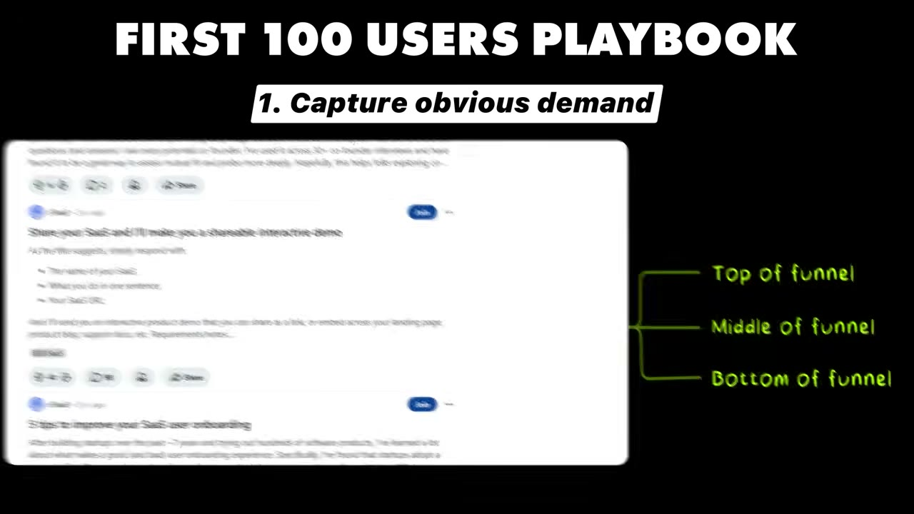
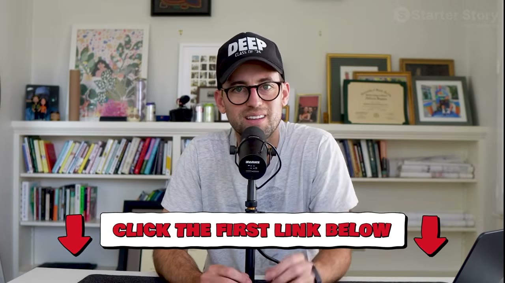

# How This $250K/Month SaaS Got Its First 100 Users (Steal This Playbook)

✅ **Đã phân tích sâu** → [`case.md`](case.md)

| | |
|---|---|
| **Video** | <https://www.youtube.com/watch?v=l4WEqPX52Cg> |
| **Đăng** | 11/03/2026 |
| **Thời lượng** | 14:44 |
| **Lượt xem** | 104,114 |
| **Lượt thích** | 2,586 |
| **Video ID** | `l4WEqPX52Cg` |

## Trong thư mục này

| File | Nội dung |
|---|---|
| [`case.md`](case.md) | **Phân tích đầy đủ** — ý tưởng, validate, GTM, áp dụng ở VN |
| [`meta.json`](meta.json) | Metadata gốc (chapters, heatmap, mô tả) |
| [`screenshots/`](screenshots/) | 10 ảnh 720p |

## Mô tả gốc

This is the story of how a $3M/year business got its first 100 paying customers. Every tactic, step by step, so you can do the same.
This video is an educational case study of this founder’s experience. It is not financial advice and does not guarantee any income or results. Every business is different and your results may vary.
0:00 - The $3M SaaS
1:29 - App overview and data
2:30 - Founder background
3:38 - Early app validation
4:30 - First 100 customers (part 1)
6:35 - Find your $1M MVP
7:32 - First 100 customers (part 2)
8:03 - Do things that don't scale
9:08 - Be everywhere your users are

## Số liệu bắt được từ transcript

> Các đoạn founder nhắc tới con số, kèm timestamp để tua thẳng tới đó trong video.

_(không bắt được con số nào)_

## Chương

- `00:00` The $3M SaaS
- `01:29` App overview and data
- `02:30` Founder background
- `03:38` Early app validation
- `04:30` First 100 customers (part 1)
- `06:35` Find your $1M MVP
- `07:32` First 100 customers (part 2)
- `08:03` Do things that don't scale
- `09:08` Be everywhere your users are
- `10:00` What early saas founders get wrong
- `10:52` App demo
- `12:38` Tech stack
- `13:23` One piece of advice
- `14:09` Pat's reflections

## Ảnh

1. `01_00m15s_ch-the-3m-saas.jpg` — 
2. `02_02m15s_metric.jpg` — 
3. `03_03m50s_ch-early-app-validation.jpg` — 
4. `04_04m42s_ch-first-100-customers-part-1.jpg` — 
5. `05_05m22s_replay.jpg` — 
6. `06_06m47s_ch-find-your-1m-mvp.jpg` — 
7. `07_07m28s_usd-1-m.jpg` — 
8. `08_08m15s_ch-do-things-that-don-t-scale.jpg` — 
9. `09_09m20s_ch-be-everywhere-your-users-are.jpg` — 
10. `10_13m59s_usd-3-m.jpg` — 

---

← [Quay lại index](../../index.md) · [Toàn bộ video](../README.md)
