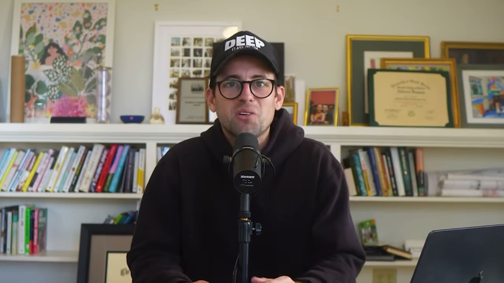
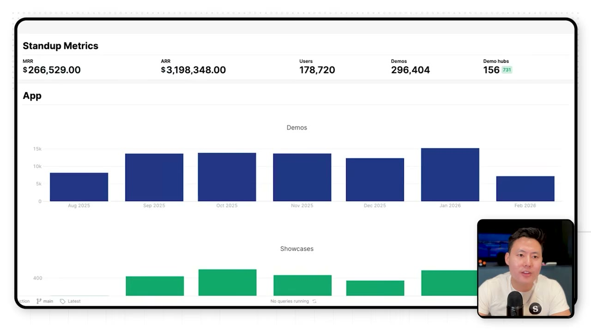
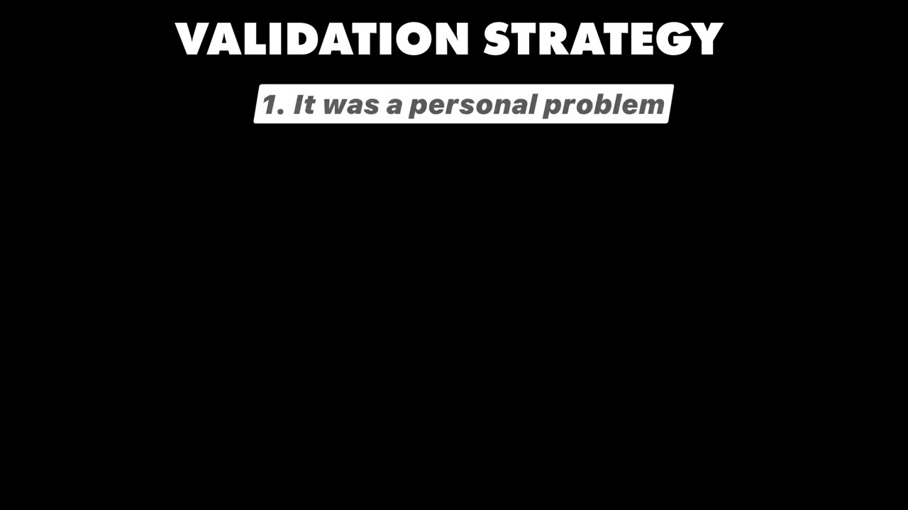
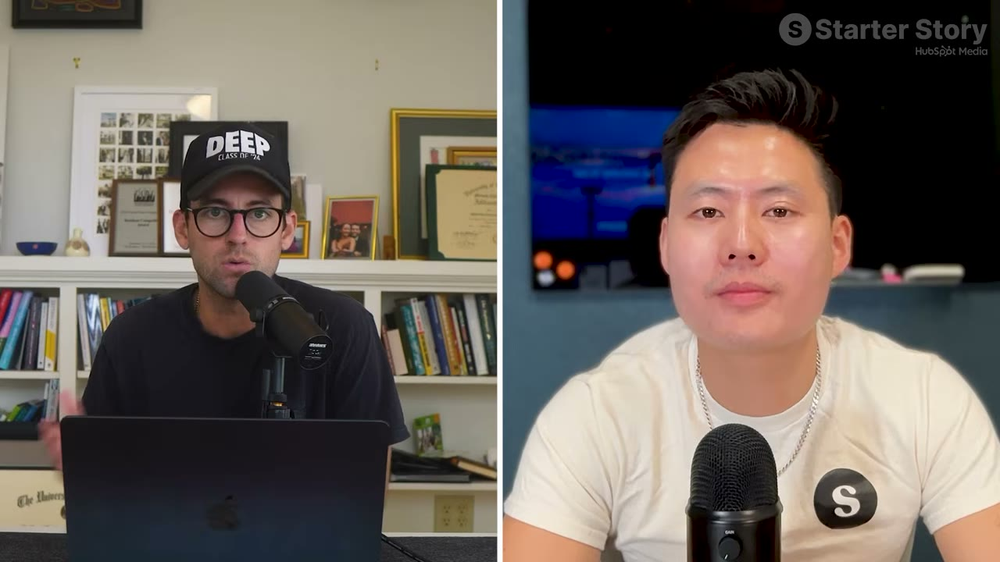
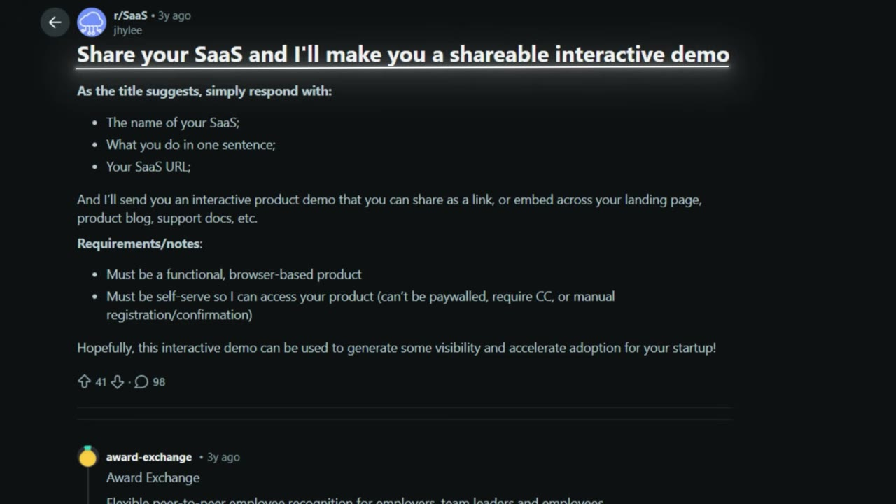
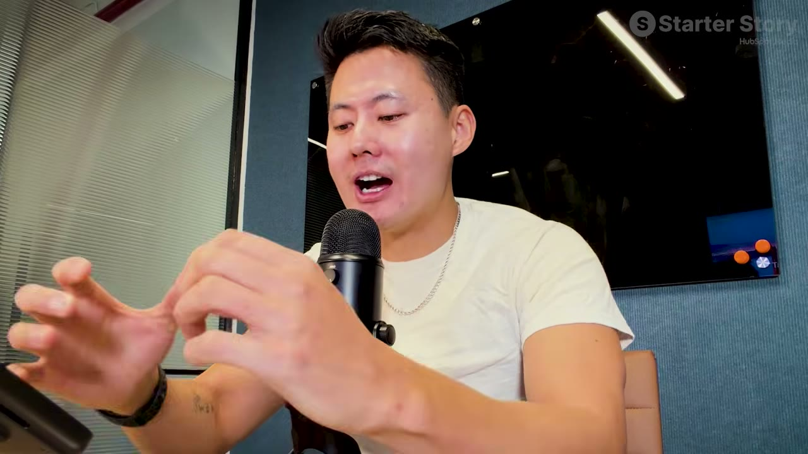
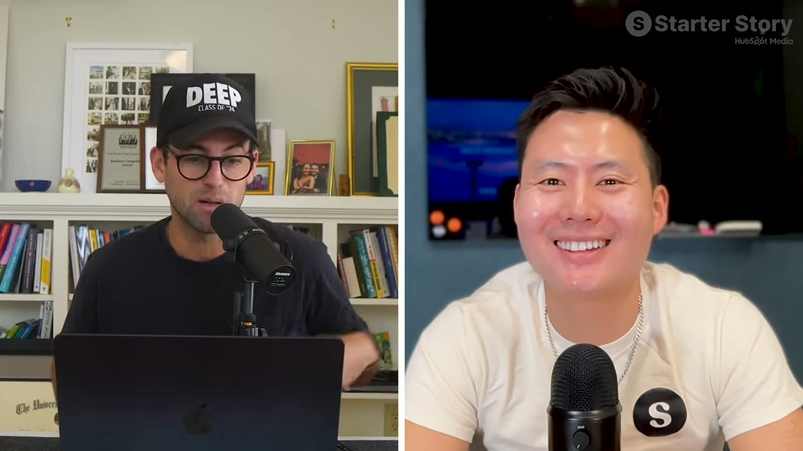

# SuperDemo — playbook lấy 100 khách trả tiền đầu tiên

> **Tóm tắt 30 giây:** Joseph đã đưa **hai** sản phẩm khác nhau vượt $3 triệu ARR. Video này không nói về viral hay triệu lượt tải — nó là quy trình ba bước để đi từ 0 đến 100 khách trả tiền. Luận điểm nền: *"Nếu bạn lấy được 100, bạn lấy được hàng nghìn."* SuperDemo hiện làm hơn **$250K/tháng**, 150.000+ người dùng, đứng **số 5 sản phẩm tăng trưởng nhanh nhất trên G2 năm 2025**.

## 1. Con số

| Chỉ số | Giá trị |
|---|---|
| MRR | Hơn $250.000 |
| ARR | Hơn $3.000.000 |
| Người dùng | Hơn 150.000 |
| Thời gian | ~2,5 năm từ con số 0 |
| Xếp hạng | G2 — số 5 sản phẩm tăng trưởng nhanh nhất 2025 |
| Free tools → traffic | ~20% tổng lượng truy cập |
| Free tools → chuyển đổi | 15-20% khách truy cập thành đăng ký |

## 2. Sản phẩm làm gì

Demo tương tác: bản sao **clickable, chân thực** của sản phẩm bạn, nhúng được vào bất cứ đâu — website, tài liệu.

> *"Nó nhìn và cảm giác đúng như sản phẩm thật vì nó là bản clone của sản phẩm, nhưng nó cho người ta trải nghiệm khoảnh khắc aha mà **không cần đăng ký gói hay nói chuyện với sales**."*

Đó cũng là mô hình tăng trưởng: **product-led growth**, phần lớn traffic vào thẳng gói starter/premium.

## 3. Xác thực: 100+ cuộc trò chuyện trước khi build ⭐⭐

Joseph khởi nghiệp từ năm 14-15 tuổi — mua bán đồ điện tử trên Craigslist, làm nến đậu nành hữu cơ, công ty quần áo, agency số, rồi một sàn thuỷ hải sản B2B có vốn đầu tư.

Vấn đề lặp đi lặp lại qua tất cả những lần đó: **rất khó để trình bày giá trị sản phẩm**. Anh quay Loom liên tục, video thì lỗi thời nhanh và người mua thật lại không xem.

Cách anh xác thực:
1. Xác nhận **anh có vấn đề này** — với tư cách người xây doanh nghiệp nhiều năm.
2. Hỏi câu quyết định: **người khác có gặp vấn đề này không, và họ đang chống chế bằng cách nào?**
3. Nói chuyện với **hơn 100 founder** trong ngành B2B SaaS.
4. Điểm chung: *"Đúng, đây là vấn đề rất đau. Người ta ghét làm demo sản phẩm. Người ta ghét nghe giọng của chính mình."*
5. Rồi mới làm thí nghiệm bán thử: **có ai chịu trả tiền không?**

## 4. Playbook 100 khách đầu tiên — 3 bước ⭐⭐⭐

### Bước 1 — Hái quả thấp: bắt nhu cầu đã hiện hữu

Nhắm người **đã đang đi tìm giải pháp**. Nội dung làm theo cả ba tầng phễu:

**Đáy phễu — trang so sánh với đối thủ.**
> *"Trang so sánh chi tiết đặt SuperDemo cạnh đối thủ. Và khi tôi nói đối thủ, tôi nói **mọi đối thủ bạn tìm được** trong lĩnh vực của bạn, vì đó là cách dễ nhất để ăn ké traffic của họ."*

Chi tiết đắt giá: họ dựng bản 1.0 **chưa hoàn hảo nhưng sống** để được xếp hạng và **được các LLM trích dẫn sớm**. Sau đó xem trang đối thủ nào đang thật sự được trích dẫn và có traction → quay lại tối ưu đúng những trang đó.

**Giữa phễu — hàng chục công cụ miễn phí, không cần đăng ký.**
Họ làm rất nhiều tool nhỏ ở các mảng lân cận (chụp màn hình, tạo SOP). Điểm xoay:
> *"Chúng tôi để **toàn bộ trải nghiệm sản phẩm không cần đăng nhập**. Người ta không phải tạo tài khoản hay mở bản dùng thử."*

Kết quả hôm nay: các tool miễn phí này mang **~20% tổng traffic** và chuyển đổi **15-20%** khách truy cập thành người đăng ký.

**Đỉnh phễu — SEO theo chương trình, gắn demo tương tác.**
Hàng nghìn trang cho hàng nghìn quy trình/từ khoá: *"cách xuất Figma sang PDF"*, *"cách gộp ô trong Excel"* — mỗi trang nhúng một SuperDemo giải quyết câu hỏi đó một cách tương tác. Cược của họ: đủ số người trong đó thuộc đúng tập khách lý tưởng và sẽ nghĩ *"cái này hay thật"*.

### Bước 2 — Làm những việc không scale được ⭐⭐⭐

Đây là chiến thuật hay nhất trong video, và sao chép được nguyên si:

1. Joseph lên **Reddit và Indie Hackers**, đề nghị **tự tay làm demo miễn phí** cho các founder.
2. Anh bảo họ đăng **link sản phẩm** của họ.
3. Anh lấy link đó, **tự làm SuperDemo cho sản phẩm của họ**.
4. Anh **comment thẳng vào bài của họ** kèm demo tương tác — để họ chỉ việc đăng ký, nhân bản demo đó và dùng ngay.

> **Đòn bẩy nằm ở chỗ làm công khai:** *"Lợi ích cộng thêm là những người khác — kể cả người không hề comment — nhìn thấy tất cả sản phẩm và link được đăng, họ click, họ tương tác với nó và nói: 'Ồ, cái này hay quá. Tôi cũng sẽ nhờ anh ta làm cho tôi một cái, hoặc tôi tự đăng ký làm luôn vì trông có vẻ dễ.'"*

Rồi họ lặp lại biến thể của đúng chiêu này trên rất nhiều kênh khác.

Pat gọi tên chiến thuật này là **"đánh giáp lá cà"** (hand-to-hand combat):
> *"Bạn không phải làm thế mãi mãi, nhưng nếu bạn làm được 100 lần, một tỉ lệ trong đó sẽ thành khách hàng."*

### Bước 3 — Có mặt ở mọi nơi khách ở

> *"Điều khó về phân phối năm 2026 là **không còn kênh thần kỳ nào nữa**. Không có mẹo vặt nào cả. Với chúng tôi, tất cả là câu hỏi: làm sao đạt được **mật độ phân phối**?"*

Tỷ trọng nguồn traffic thật của họ:

| Nguồn | Tỷ trọng |
|---|---|
| SEO + được LLM trích dẫn | 30-40% |
| Truyền miệng / watermark / giới thiệu | ~30% |
| Build in public trên LinkedIn | ~20% |

**Vòng lặp lan truyền đáng chú ý:** khách tạo SuperDemo rồi chia sẻ cho người khác — bản demo mang watermark → người nhận biết đến sản phẩm. Sản phẩm tự phân phối chính nó. Nếu bạn làm công cụ tạo ra thứ gì đó được chia sẻ, hãy thiết kế vòng lặp này ngay từ đầu.

## 5. Sai lầm phổ biến — và một sắc thái quan trọng ⭐⭐

Hỏi: founder SaaS giai đoạn đầu hay làm sai gì nhất?

> *"Điều lớn nhất tôi nghĩ tới là **không ra mắt từ hôm qua** và đuổi theo sự hoàn hảo. Càng ra mắt sớm, kết quả càng cộng dồn nhanh, và bạn càng sớm biết được: tôi có cần khai tử cái này không? Tôi có scale được nó bằng dữ liệu không? Hay tôi cần pivot?"*

Nhưng rồi anh **phản biện chính câu châm ngôn nổi tiếng nhất của giới startup**:

> *"Lời khuyên sáo mòn mà nhiều người đưa ra là 'nếu bạn không thấy xấu hổ vì phiên bản đầu tiên thì bạn đã ra mắt quá muộn'. **Tôi không nghĩ điều đó còn đúng**, theo nghĩa là mọi sản phẩm đều phải có tay nghề tử tế trong kỷ nguyên AI-first. Nhưng với tư cách founder, **lợi thế duy nhất bạn có trước kẻ đang thống trị là sự khẩn trương và tốc độ**."*

### Mâu thuẫn với các case khác — và điều kiện phân định

| Quan điểm | Ai nói | Đúng khi nào |
|---|---|---|
| Ship bản xấu hổ, gắn nút mua để validate | [Marc Lou](../2026-04-26_how-i-work-77k-month-solopreneur/case.md) | Sản phẩm build dưới một tuần; thị trường B2C; đối thủ không nhiều |
| Ra mắt nhanh **nhưng phải có craftsmanship** | Joseph (case này) | B2B, khách trả tiền doanh nghiệp, đã có sản phẩm lớn thống trị thị trường |
| Validate xong mới viết dòng code nào | [Once](../2026-05-10_i-built-a-20k-month-app-in-83-days/case.md) | Sản phẩm cần trên một tháng để build |

**Cách tôi hoà giải ba quan điểm:** trục quyết định là **chi phí sai lầm**. B2C, build 3 ngày → ship luôn, thị trường trả lời rẻ hơn phỏng vấn. B2B, khách là doanh nghiệp → một bản dở làm mất luôn cơ hội với khách đó, và trong kỷ nguyên AI ai cũng ship được nhanh nên chất lượng lại thành yếu tố phân biệt. Điểm chung của cả ba: **tốc độ ra quyết định**, không phải tốc độ viết code.

## 6. Cách sản phẩm hoạt động

1. Cài Chrome extension, bấm nút → chọn loại demo (ví dụ "guided HTML").
2. Bấm ghi, click qua đúng luồng muốn trình bày.
3. Dừng ghi → SuperDemo **clone toàn bộ các bước**, đưa vào trình soạn thảo dạng module giống slide PowerPoint.
4. Sửa được: thêm chương, sửa thẳng HTML, thêm voice-over (có thể **clone giọng của bạn**), quay cả khuôn mặt nếu muốn kiểu Loom.
5. Một template demo dùng lại cho **hàng trăm khách tiềm năng** khác nhau.

Joseph demo tạo xong trong **khoảng 2 phút**. Pat tóm gọn: *"Thay vì video, nó thực sự lưu lại toàn bộ HTML."*

## 7. Tech stack

| Hạng mục | Công cụ |
|---|---|
| AI coding | **Claude Code, Cursor, Codex** — xoay vòng cả ba tuỳ model nào mạnh nhất lúc đó |
| Quản lý việc | Linear (nối với Slack và với Claude) |
| Hosting | AWS |
| Email giao dịch | Postmark |
| Onboarding / hỗ trợ / email marketing | Intercom |
| GTM & CS | Ahrefs, Clay, Zapier |

> *"Chúng tôi lớn rất nhanh nên mỗi tháng xoay vòng qua hơn 50 công cụ khác nhau."*

Chi tiết đáng chú ý cho người làm kỹ thuật: họ **không trung thành với một AI coding tool nào** — chuyển qua lại giữa Claude Code, Cursor và Codex tuỳ tác vụ.

## 8. Lời khuyên cuối

> *"Đừng ám ảnh về đối thủ và về ý tưởng — cứ bắt đầu build đi. Nếu bạn xác định đúng vấn đề, thế giới rất rất rộng. Ở hầu hết mọi nơi đều còn đủ thị trường cho tất cả mọi người. **Phần lớn công ty chết là chết vì tự bốc cháy từ bên trong, chứ không phải vì đối thủ.**"*

## 9. Áp dụng cho tôi (indie hacker VN)

**Sao chép được ngay, gần như không tốn tiền:**

- **Chiến thuật "làm miễn phí rồi comment công khai" (Bước 2) là thứ tôi làm được tối nay.** Không cần vốn, không cần audience, không cần tiếng Anh hoàn hảo — chỉ cần bỏ công. Đây là dạng lao động mà lợi thế chi phí sinh hoạt ở VN thật sự có ý nghĩa: thời gian của tôi rẻ hơn thời gian của founder Mỹ, nên tôi làm được nhiều "việc không scale" hơn họ.
- **Trang so sánh đối thủ** là món SEO rẻ nhất và có ý định mua cao nhất. Liệt kê mọi đối thủ, làm một trang cho mỗi cái.
- **Công cụ miễn phí không cần đăng ký** — với AI coding, làm một tool nhỏ giờ mất vài giờ. Con số 15-20% chuyển đổi của họ đáng để thử.
- **Thiết kế vòng lặp watermark** vào sản phẩm ngay từ ngày đầu nếu sản phẩm tạo ra thứ được chia sẻ.

**Rào cản thật:**

- **Đây là case khó nhất trong ba case cùng đợt.** Joseph không phải người mới: anh đã đưa **hai** sản phẩm lên $3M ARR, khởi nghiệp từ 14 tuổi, từng gọi vốn. Playbook thì sao chép được, nhưng tốc độ thực thi của anh đến từ 15 năm kinh nghiệm. Đừng so tiến độ của mình với tiến độ của anh.
- **SEO theo chương trình cần vốn và kiên nhẫn.** Hàng nghìn trang không dựng trong một tuần, và Google ngày càng khắt khe với nội dung sinh hàng loạt.
- **B2B SaaS bán cho công ty phương Tây** đòi hỏi hạ tầng: hoá đơn, hợp đồng, hỗ trợ theo múi giờ của họ, và sớm muộn là các câu hỏi về tuân thủ — giống rào cản đã nêu ở [case Packager](../2026-03-15_i-make-60k-month-from-the-most-boring-saas-on-the-in/case.md).
- **"Được LLM trích dẫn" là kênh mới và chưa ổn định.** Nó đang hiệu quả với họ, nhưng chưa ai biết Google/OpenAI sẽ thay đổi cách chọn nguồn ra sao. Coi đây là cơ hội ngắn hạn, đừng xây cả doanh nghiệp lên nó — bài học từ [Jacky Chow bị AI Overviews xoá sổ mảng content](../2026-03-22_i-make-250k-month-from-13-businesses-after-losing-ev/case.md).

**Khi nào KHÔNG dùng mô hình này:** khi bạn làm B2C. Toàn bộ playbook này giả định khách hàng của bạn là **doanh nghiệp có thể tìm thấy được** — họ có website, họ ở trên Reddit/Indie Hackers/LinkedIn, họ tìm kiếm giải pháp bằng từ khoá nghề nghiệp. Với người dùng cá nhân đại chúng, cách này không tiếp cận được — dùng quảng cáo hoặc nội dung ngắn thay thế.

**Case liên quan:** [Postiz](../2026-07-30_how-postiz-went-from-17k-to-143k-month-in-4-months/case.md) (build in public) · [Fastlane](../2026-08-30_the-insanely-obvious-secret-behind-this-69k-month-sa/case.md) · [Task Magic](../2026-04-19_i-spent-24-hours-with-a-saas-millionaire/case.md)

## Nguồn

- Video: <https://www.youtube.com/watch?v=l4WEqPX52Cg> (14:44, đăng 11/03/2026, 104.114 view)
- [Transcript đầy đủ](transcript.md) · [Ảnh chụp](screenshots/)
