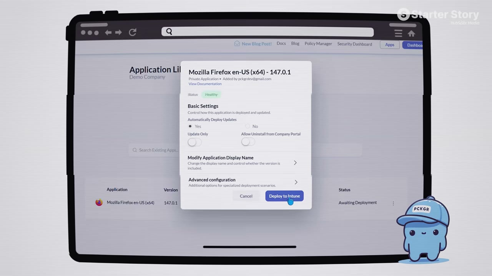
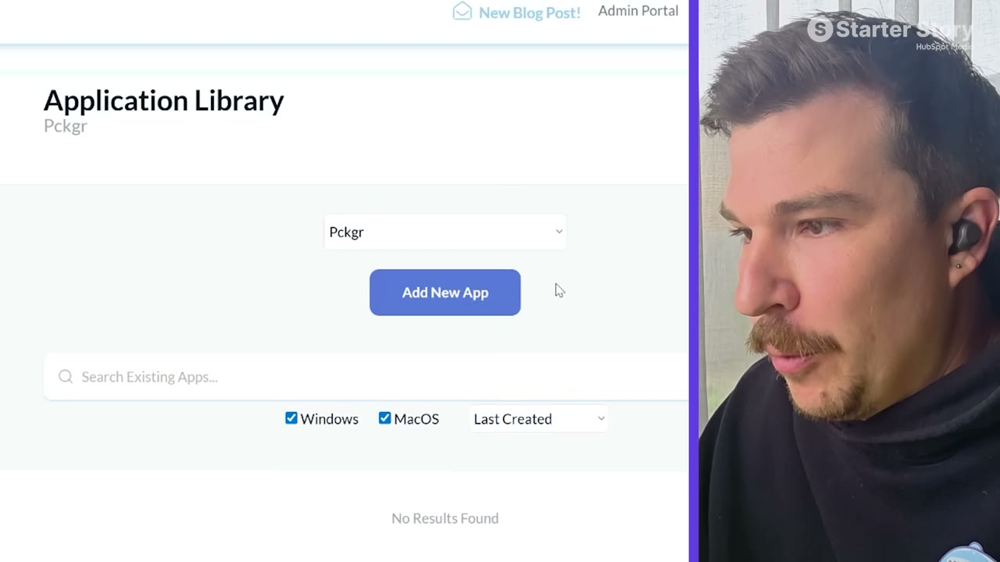

# I Make $60K/Month From the Most Boring SaaS on the Internet

✅ **Đã phân tích sâu** → [`case.md`](case.md)

| | |
|---|---|
| **Video** | <https://www.youtube.com/watch?v=LRX8TWC2hTM> |
| **Đăng** | 15/03/2026 |
| **Thời lượng** | 12:06 |
| **Lượt xem** | 256,592 |
| **Lượt thích** | 5,138 |
| **Video ID** | `LRX8TWC2hTM` |

## Trong thư mục này

| File | Nội dung |
|---|---|
| [`case.md`](case.md) | **Phân tích đầy đủ** — ý tưởng, validate, GTM, áp dụng ở VN |
| [`meta.json`](meta.json) | Metadata gốc (chapters, heatmap, mô tả) |
| [`screenshots/`](screenshots/) | 10 ảnh 720p |

## Mô tả gốc

Tom was an IT admin doing the most tedious job imaginable. Nobody was solving it, so he built the solution himself. Now it makes $60K/month with 1,000+ customers. This is his exact playbook for finding and building in boring niches.
This video is an educational case study of this founder’s experience. It is not financial advice and does not guarantee any income or results. Every business is different and your results may vary.
0:00 - Riches in (boring) niches
1:32 - Business Overview
2:10 - Coming up with the idea
3:05 - Finding first customers
4:37 - Make sure your app is compliant
5:24 - How

## Số liệu bắt được từ transcript

> Các đoạn founder nhắc tới con số, kèm timestamp để tua thẳng tới đó trong video.

_(không bắt được con số nào)_

## Chương

- `00:00` Riches in (boring) niches
- `01:32` Business Overview
- `02:10` Coming up with the idea
- `03:05` Finding first customers
- `04:37` Make sure your app is compliant
- `05:24` How to find a niche saas idea
- `07:11` Hundreds of micro-saas ideas
- `07:57` Boring saas demo
- `09:08` Doesn't have to be fancy!
- `09:30` Tech stack
- `09:59` Final piece of advice (Just Start)
- `10:59` Pat and Gus reflections
- `11:39` Start building your idea

## Ảnh

1. `01_00m36s_usd-60-000.jpg` — 
2. `02_01m45s_replay.jpg` — 
3. `03_02m22s_ch-coming-up-with-the-idea.jpg` — 
4. `04_03m48s_usd-25.jpg` — 
5. `05_04m33s_usd-60-000.jpg` — 
6. `06_05m36s_ch-how-to-find-a-niche-saas-idea.jpg` — 
7. `07_07m08s_usd-60-000.jpg` — 
8. `08_08m09s_ch-boring-saas-demo.jpg` — 
9. `09_09m20s_ch-doesn-t-have-to-be-fancy.jpg` — 
10. `10_10m11s_ch-final-piece-of-advice-just-start.jpg` — 

---

← [Quay lại index](../../index.md) · [Toàn bộ video](../README.md)
