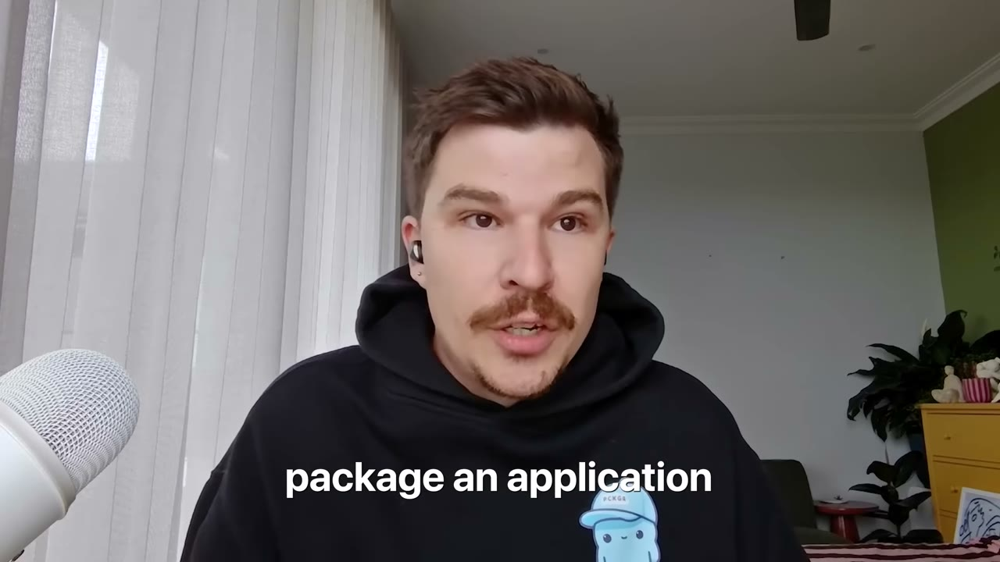
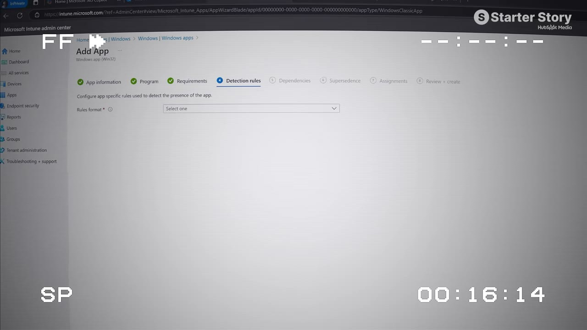
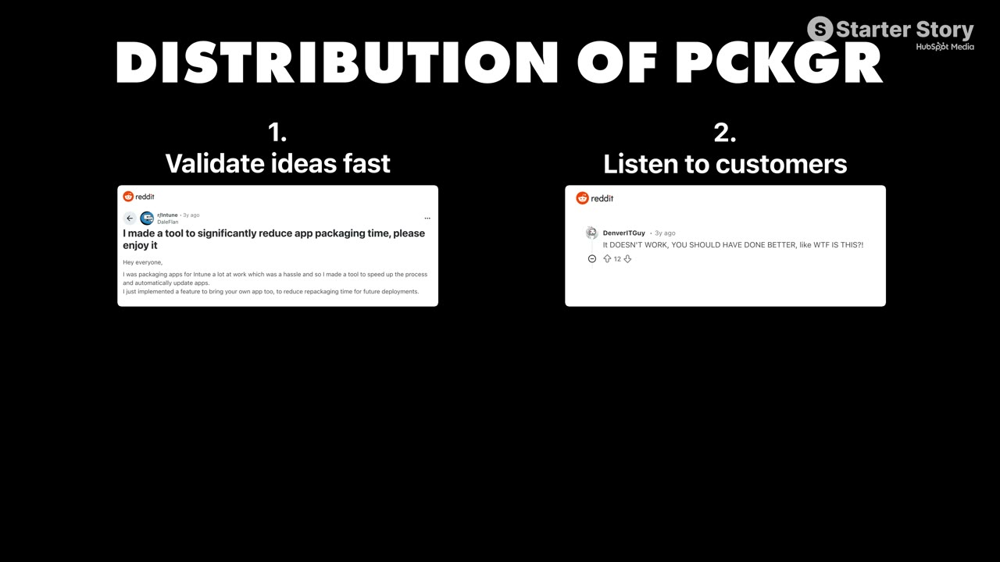
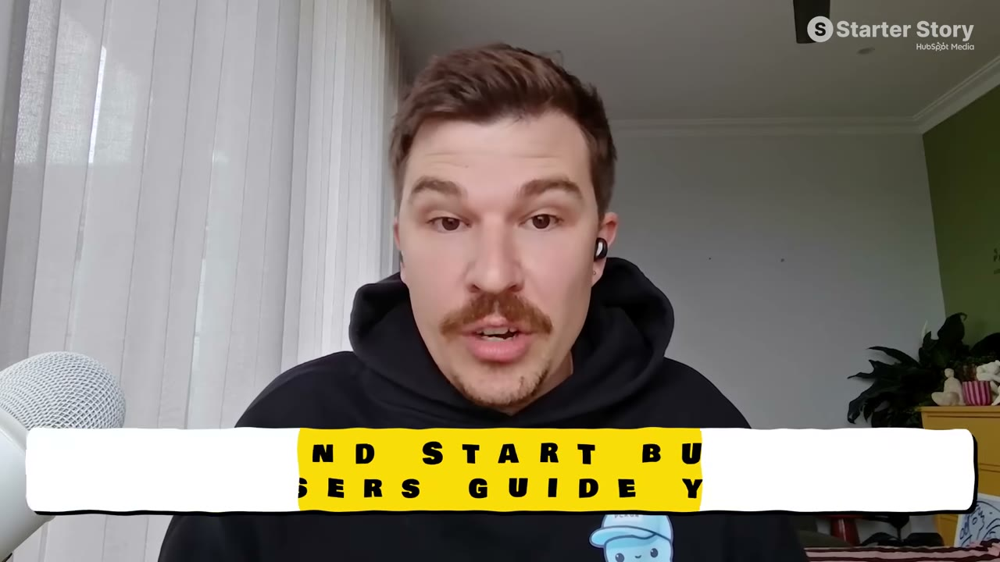

# Packager — $60K/tháng từ SaaS "chán nhất Internet"

> **Tóm tắt 30 giây:** Thomas làm IT admin, mỗi lần đóng gói một ứng dụng để triển khai qua Microsoft Intune mất tới **một tiếng**. Anh lên forum, thấy hàng loạt IT admin khác kêu đúng vấn đề đó. Các giải pháp có sẵn thì *"quá kỹ thuật hoặc quá đắt"*. Anh tự build một công cụ chạy trên trình duyệt làm **đúng một việc**: triển khai app bằng một click. Giờ nó thu **$60.000/tháng** với hơn 1.000 khách hàng, bootstrap 100%, chạy trên **Bubble.io**.

## 1. Con số

| Chỉ số | Giá trị |
|---|---|
| Doanh thu | ~$60.000/tháng |
| Khách hàng | Hơn 1.000 |
| Giá khởi điểm | $25/tháng (đặt ngay trong beta) |
| Vốn ngoài | $0 — bootstrap hoàn toàn |
| Nền tảng build | **Bubble.io** (no-code) |
| Churn | Rất thấp — khách là IT admin doanh nghiệp |

*Trong video có nhắc "447k so với 910k" khi khoe dashboard nhưng không nói rõ đơn vị/kỳ so sánh, nên tôi không đưa vào bảng.*

## 2. Vì sao "chán" lại là lợi thế ⭐⭐⭐

Mở đầu video là một câu đối lập đáng nhớ:

> *"Nếu bạn lên mạng lúc này, đúng nghĩa là ai cũng đang đuổi theo cùng một mớ ý tưởng app AI. Nhưng nếu tôi nói với bạn rằng xây trong một ngách chán mới là nơi có tiền thật thì sao?"*

Producer Gus đóng đinh luận điểm ở cuối video — và đây là phần đáng đọc nhất:

> *"Tôi dành nhiều thời gian trên X. Rất nhiều người xem cái này cũng vậy — cố tìm ý tưởng từ cái buồng vọng âm mạng xã hội về mấy ý tưởng app AI. Nếu bạn muốn tìm một ý tưởng thật sự kiếm được tiền dài hạn như doanh nghiệp của anh ấy... Anh ấy không đưa ra con số này, nhưng tôi đoán churn cực thấp. Khách là IT admin dùng thứ này bên trong doanh nghiệp. **Nếu nó chán và nó không hợp lý, đó có thể chính là hướng nên đi.**"*

**Cơ chế kinh tế đằng sau câu đó** (phần này Gus không nói, tôi bổ sung): SaaS B2B nội bộ doanh nghiệp có churn thấp vì đổi công cụ đồng nghĩa với đổi quy trình, đào tạo lại người, và xin duyệt lại ngân sách. Một khách $25/tháng ở lại 4 năm đáng giá hơn nhiều một khách B2C $50/tháng bỏ đi sau 2 tháng — dù con số đầu trông nhỏ hơn.

## 3. Nguồn gốc ý tưởng: nỗi đau của chính mình ⭐⭐

1. Thomas làm việc với Microsoft Intune hằng ngày.
2. Nhận ra việc đóng gói + kiểm tra một ứng dụng có thể mất **một tiếng**.
3. Lên forum → thấy **rất nhiều IT admin khác** cùng vấn đề. (Bước xác thực, gần như miễn phí.)
4. Xem các giải pháp có sẵn → *"quá kỹ thuật hoặc quá đắt"*.
5. Kết luận: có chỗ trống cho một công cụ **giá phải chăng, chạy trên trình duyệt, hiện đại, làm đúng một việc**.

Anh nói rõ một chi tiết về thời điểm: *"Khi tôi build cái này, chưa có công cụ AI như Cursor hay Claude Code. Rất nhiều thứ tôi phải tự viết tay."* — nghĩa là hôm nay bạn làm lại việc này sẽ nhanh hơn nhiều.

## 4. Khách đầu tiên: Reddit, miễn phí, rồi thu tiền ⭐⭐

- Có MVP mà nhóm anh *nghĩ* là chạy được → **cần biết có ai quan tâm thật không**.
- Chọn **Reddit** vì đó là nơi IT admin tụ tập.
- Ra mắt **hoàn toàn miễn phí** → kéo được traction nhanh.
- Phản hồi chia ba loại: người thích, người góp ý tốt, và *"một số người thẳng thừng thô lỗ, để lại bình luận khá cay nghiệt"*.

> Bài học anh rút ra: *"Nếu bạn muốn thành công, bạn phải chấp nhận được rằng một số người đơn giản là sẽ không thích thứ bạn làm."*

- Sửa bug, ổn định nền tảng → **áp phí $25/tháng**.
- Khoảnh khắc anh nhớ nhất: thông báo đầu tiên trên điện thoại báo có người trả tiền cho thứ anh làm ra.

**Sau beta, chiến thuật hiệu quả nhất — và anh khuyên mọi người làm:** hợp tác với **người chuyên sâu về nền tảng đó**. Với anh là các **Microsoft MVP**. Họ làm video demo sản phẩm cho đúng tập khán giả cực kỳ nhắm trúng.

> *"Tôi rất thích việc gieo hạt cho marketing. Một video YouTube chẳng hạn — ai đó có thể tình cờ thấy nó 2 năm sau và trở thành khách hàng. Thứ bạn đã trả tiền từ rất lâu. Lợi tức đầu tư đó là khổng lồ."*

**So sánh chéo:** đây cùng logic với [YouTube Search của Ben](../2026-03-19_i-make-17k-month-with-one-strategy/case.md) — nội dung là tài sản không hết hạn, khác hẳn quảng cáo tắt tiền là tắt khách.

## 5. Playbook tìm ngách — 5 bước ⭐⭐⭐

**Bước 1 — Build ở nơi bạn đã có uy tín.**
Với Thomas là Microsoft Intune: *"với thế giới bên ngoài thì nó chán, nhưng tôi sống và thở với Intune."* Khách hàng nhận ra được điều đó khi nói chuyện với anh.

**Bước 2 — Tìm điểm đau, đừng tìm ý tưởng.**
Nếu bạn thấy người quanh chỗ làm **phàn nàn** về cái gì đó, xem có giải pháp nào bạn build được mà người ta chịu trả tiền không.

**Bước 3 — Tránh đánh nhau với đám đông.**
*"Trong khi họ giành nhau thị trường khổng lồ, luôn có cơ hội nhắm vào nhóm nhỏ hơn muốn thứ khác."* Cụ thể: đối thủ của anh tập trung vào khách hàng có **hàng triệu thiết bị**; anh nhắm **doanh nghiệp nhỏ** — *"và có rất nhiều, đủ để tôi sống toàn thời gian."*

**Bước 4 — Thu tiền sớm, dù giá thấp.**
*"Chúng tôi tính tiền ngay trong beta và điều đó xác thực rằng khách sẵn sàng trả. Không có lý do gì đuổi theo một ý tưởng mà ngay giai đoạn đầu không ai chịu trả tiền cả."*

**Bước 5 — Tối ưu cho tự do, không phải quy mô bằng mọi giá.**
Đội nhỏ, chi phí thấp → *"thu nhập kiếm được là của mình, làm việc tại nhà, có cân bằng cuộc sống. Tôi thật lòng nói rằng tôi đã xây được một cuộc đời mà tôi thấy hạnh phúc."*

## 6. Sản phẩm: đơn giản đến mức Pat không hiểu nổi

Demo trong video:
1. Vào thư viện app, chọn công ty.
2. "Add an app" — chọn app tự upload hoặc lấy từ catalog có sẵn.
3. Chọn 7-Zip từ catalog → trạng thái "awaiting deployment".
4. Vào deployment, chỉnh vài tuỳ chọn → **"deploy to Intune"**.
5. Backend đóng gói app và đẩy lên Microsoft tenant, kèm metadata, mô tả, logo.
6. Gán cho tất cả thiết bị. Xong.

Phản ứng của Pat rất đáng chú ý — và là bài học:

> *"Tôi hoàn toàn không hiểu bạn vừa làm gì vì tôi chẳng biết gì về Microsoft Intune. Nhưng cái tôi thấy hay là app của bạn làm một việc khá đơn giản... khi tôi nhìn nó, nó chẳng có thiết kế hoa mỹ nào cả. Nó làm một việc hữu ích cho các công ty và nó kiếm $60.000/tháng."*

## 7. Tech stack — SaaS $60K/tháng chạy trên no-code ⭐⭐

| Hạng mục | Công cụ |
|---|---|
| Frontend | **Bubble.io** (no-code) |
| Build & test package | GitHub Actions |
| Serverless | Microsoft Azure |
| Quản lý việc | monday.com |
| Nội bộ | Microsoft 365 |

Đây là dữ kiện đáng nhớ nhất về mặt kỹ thuật trong cả kho: **một SaaS B2B $720K/năm chạy frontend trên Bubble**. Nếu bạn đang tự nhủ "tôi không code đủ giỏi để làm SaaS" — case này là câu trả lời.

## 8. Lời khuyên cuối

> *"Lời khuyên của tôi, và điều này đúng với tất cả mọi người, là **cứ bắt đầu đi**. Với các công cụ hôm nay — low-code và ChatGPT — làm phần mềm chưa bao giờ dễ tiếp cận đến thế. Nhưng mặt trái là **người khác có thể build ý tưởng của bạn trong lúc bạn còn ngồi lên kế hoạch**. Nên tốc độ là chìa khoá."*

Sau đó: ra mắt sớm, chia sẻ với đúng tập khách, **lắng nghe kỹ phản hồi**, rồi lặp vòng cải tiến liên tục.

## 9. Áp dụng cho tôi (indie hacker VN)

**Đây là mô hình phù hợp nhất với người đang đi làm ở VN.** Lý do:

- **Bạn đã có sẵn ngách.** Công việc hiện tại của bạn *là* nguồn ý tưởng. Pat nói đúng: *"Tôi nghĩ về tất cả những lần ngồi trong công việc 9-5 và nghĩ: trời, giá mà cái này dễ hơn."* Mỗi thao tác thủ công lặp lại hàng ngày ở công ty bạn là một ứng viên.
- **Không cần vốn.** Bootstrap, no-code, khách trả tiền từ beta.
- **Không cần giỏi code.** Bubble + GitHub Actions.
- **Không cần tiếng Anh giao tiếp tốt.** Khách B2B mua qua sản phẩm và tài liệu, không qua video mặt bạn. Đây là khác biệt lớn so với các case B2C dựa vào nội dung.
- **Churn thấp = doanh thu dự đoán được**, hợp với người cần thay thế lương dần dần thay vì trúng số.

**Rào cản thật:**

- **Rủi ro nền tảng nghiêm trọng.** Toàn bộ sản phẩm là phần phụ trợ cho Microsoft Intune. Nếu Microsoft ra tính năng "deploy một click" native, sản phẩm mất lý do tồn tại. Đây là rủi ro cấu trúc của mọi công cụ "vá lỗ hổng của nền tảng lớn" — cùng loại với [FollowBuddy phụ thuộc Instagram](../2026-03-19_i-make-17k-month-with-one-strategy/case.md). Chiến lược giảm thiểu: bám sát khách hàng để mở rộng sang việc kế tiếp trong quy trình của họ trước khi nền tảng lấp lỗ.
- **Bán B2B cho phương Tây từ VN cần chuẩn bị:** khách loại này sẽ hỏi **SOC 2 / ISO 27001** (chính video này có tài trợ của Vanta vì lý do đó). Chi phí tuân thủ là thật và không nhỏ. Với khách SMB có thể hoãn được, nhưng đừng bất ngờ.
- **Bạn phải thật sự ở trong ngành đó.** Bước 1 của anh là "uy tín sẵn có". Nếu bạn chọn một ngách chán mà bạn không sống trong đó, bạn sẽ không biết đâu là điểm đau thật, cũng không biết forum nào để tìm khách. Đây là mô hình **không** sao chép được bằng cách đọc case study — nó đòi bạn khai thác chính trải nghiệm nghề nghiệp của mình.
- **Thị trường VN quá nhỏ cho mô hình này.** Số IT admin VN dùng Intune ở doanh nghiệp SMB không đủ. Phải bán quốc tế ngay từ đầu — nghĩa là thanh toán quốc tế, hỗ trợ theo múi giờ khác, hoá đơn.

**Khi nào KHÔNG dùng mô hình này:** khi bạn cần tiền nhanh. B2B ngách chán tăng trưởng chậm và đều — không có cú nổ như [lifetime deal của Floga ($117K/24 giờ)](../2026-03-29_my-app-made-120k-in-24-hours/case.md). Đổi lại nó không sụp trong một đêm.

**Case liên quan trong kho:** [Savvy Nomad](../2026-05-21_i-make-1-7m-year-in-the-most-boring-niche-imaginable/case.md) (ngách chán, $1.7M/năm) · [Hero Analytics](../2026-06-10_i-built-a-1m-saas-in-a-hidden-niche/case.md) (ngách ẩn) · [Shipper](../2026-05-28_i-built-a-micro-version-of-a-1b-saas-now-i-make-50k/case.md) (bản thu nhỏ của SaaS tỉ đô) · [Profit AI](../2026-06-24_i-turned-this-spreadsheet-into-a-30k-month-micro-saa/case.md) (bảng tính → micro-SaaS)

## Nguồn

- Video: <https://www.youtube.com/watch?v=LRX8TWC2hTM> (12:06, đăng 15/03/2026, 256.592 view)
- [Transcript đầy đủ](transcript.md) · [Ảnh chụp](screenshots/)
