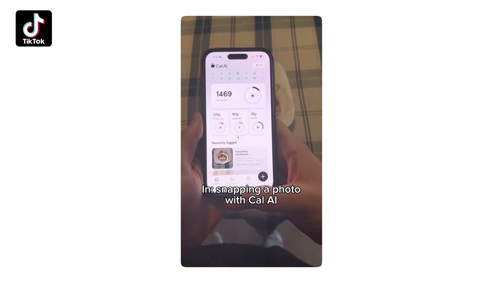
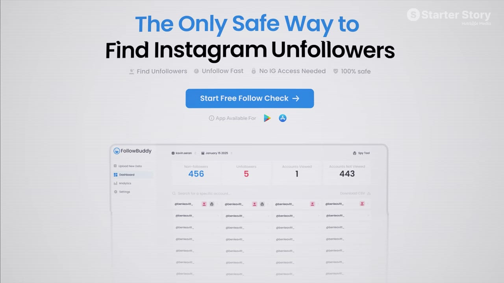
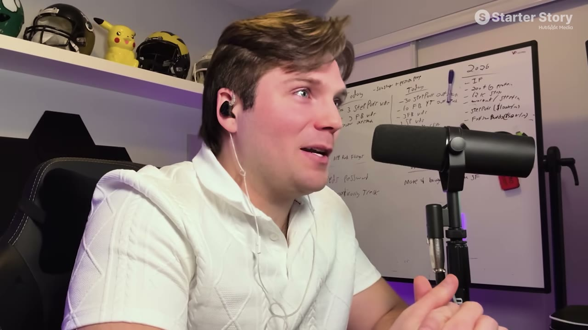
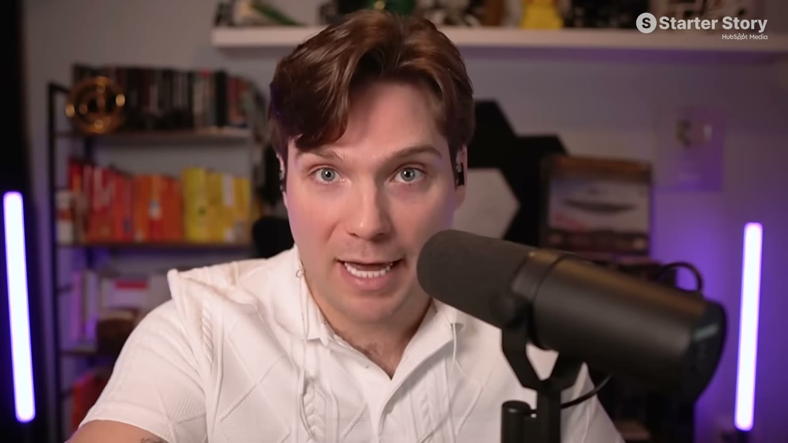
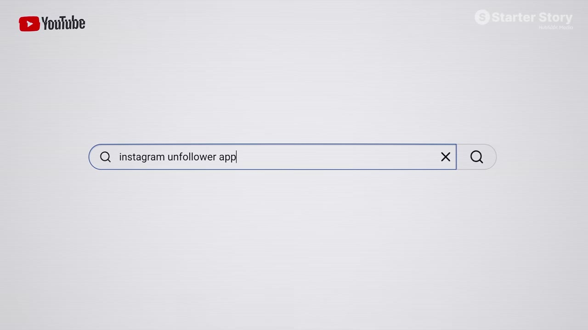
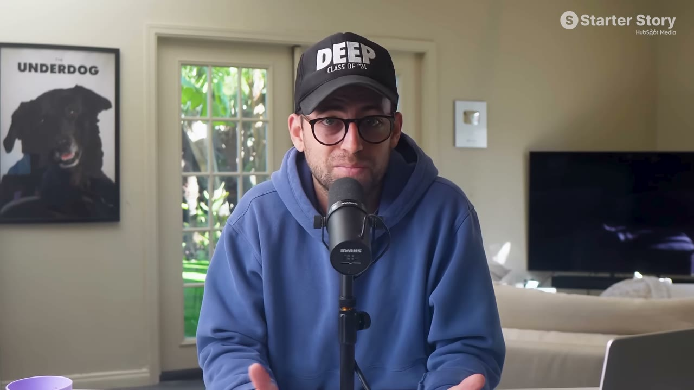
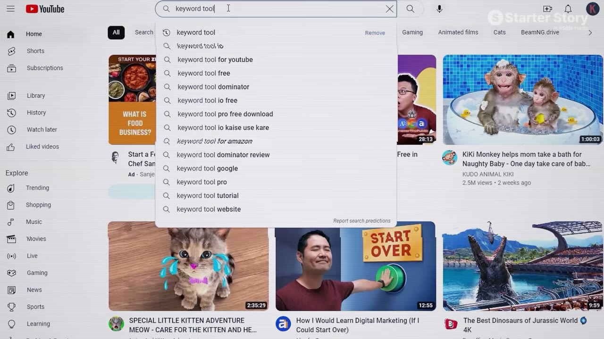
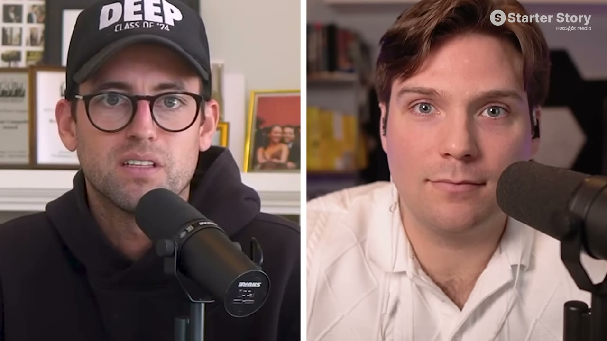
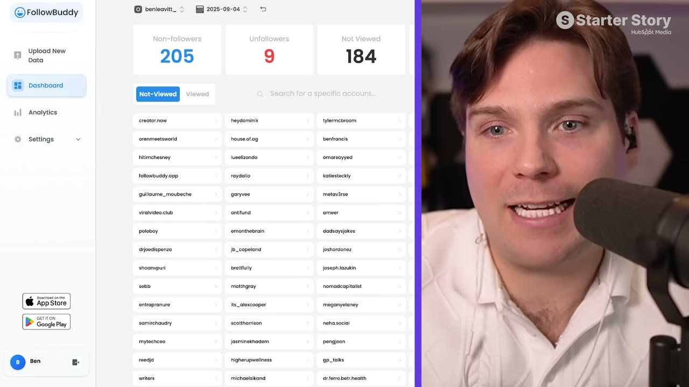

# I Make $17K/Month With One Strategy

✅ **Đã phân tích sâu** → [`case.md`](case.md)

| | |
|---|---|
| **Video** | <https://www.youtube.com/watch?v=4KfFB-dh71Y> |
| **Đăng** | 19/03/2026 |
| **Thời lượng** | 17:55 |
| **Lượt xem** | 53,250 |
| **Lượt thích** | 1,626 |
| **Video ID** | `4KfFB-dh71Y` |

## Trong thư mục này

| File | Nội dung |
|---|---|
| [`case.md`](case.md) | **Phân tích đầy đủ** — ý tưởng, validate, GTM, áp dụng ở VN |
| [`meta.json`](meta.json) | Metadata gốc (chapters, heatmap, mô tả) |
| [`screenshots/`](screenshots/) | 10 ảnh 720p |

## Mô tả gốc

Ben makes $17K/month from a SaaS he grew without ads, going viral, or being creative. His strategy: make the same video over and over again. This is his full breakdown.
This video is an educational case study of this founder’s experience. It is not financial advice and does not guarantee any income or results. Every business is different and your results may vary.
0:00 - I dare you to try this strategy
0:44 - Business stats and data
1:55 - Founder background
2:36 - Finding the business idea
4:08 - How he gets customers
5:37 - Find YOUR micro-saas idea
6:30 - The YouTube Search playbook
12:22 -

## Số liệu bắt được từ transcript

> Các đoạn founder nhắc tới con số, kèm timestamp để tua thẳng tới đó trong video.

_(không bắt được con số nào)_

## Chương

- `00:00` I dare you to try this strategy
- `00:44` Business stats and data
- `01:55` Founder background
- `02:36` Finding the business idea
- `04:08` How he gets customers
- `05:37` Find YOUR micro-saas idea
- `06:30` The YouTube Search playbook
- `12:22` What if I don't have experience?
- `13:00` How FollowBuddy works
- `13:51` Tech stack
- `14:17` Advice for non-technical founders
- `15:08` Move fast on small ideas
- `16:02` Pat and Gus reflections
- `17:29` Build your idea!

## Ảnh

1. `01_00m15s_ch-i-dare-you-to-try-this-strategy.jpg` — 
2. `02_00m52s_usd-0.jpg` — 
3. `03_02m07s_ch-founder-background.jpg` — 
4. `04_02m48s_ch-finding-the-business-idea.jpg` — 
5. `05_04m20s_ch-how-he-gets-customers.jpg` — 
6. `06_05m49s_ch-find-your-micro-saas-idea.jpg` — 
7. `07_06m42s_ch-the-youtube-search-playbook.jpg` — 
8. `08_07m35s_replay.jpg` — 
9. `09_12m34s_ch-what-if-i-don-t-have-experience.jpg` — 
10. `10_13m12s_ch-how-followbuddy-works.jpg` — 

---

← [Quay lại index](../../index.md) · [Toàn bộ video](../README.md)
