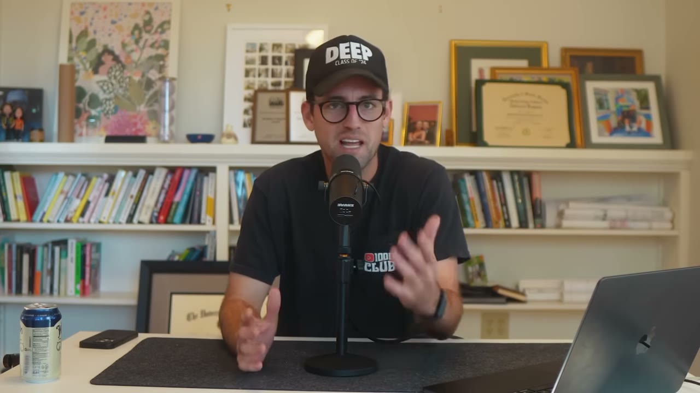
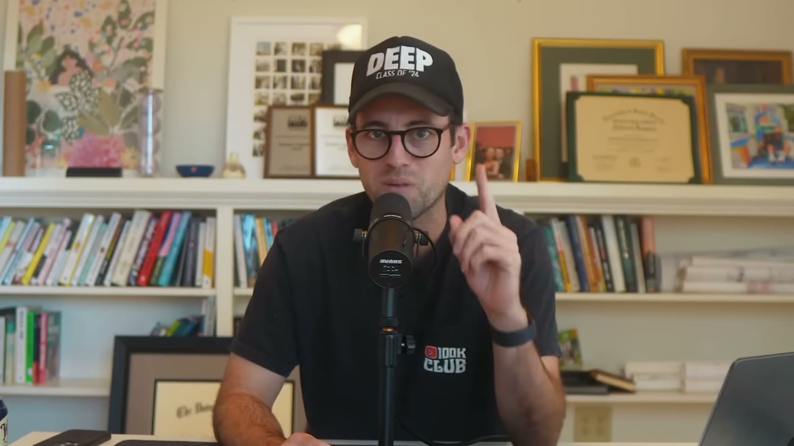
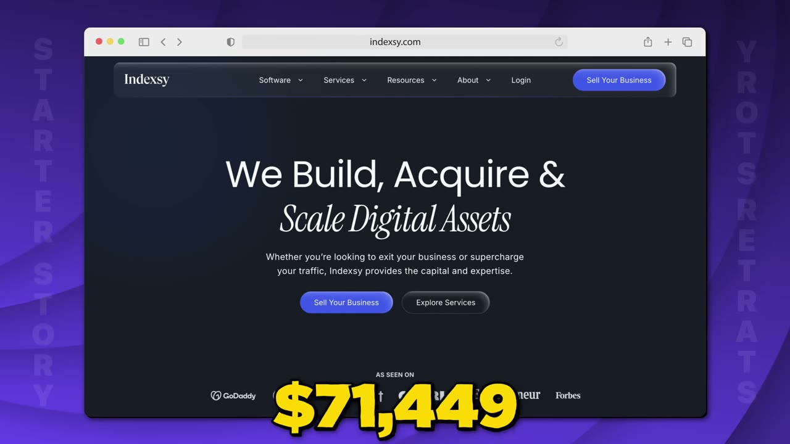
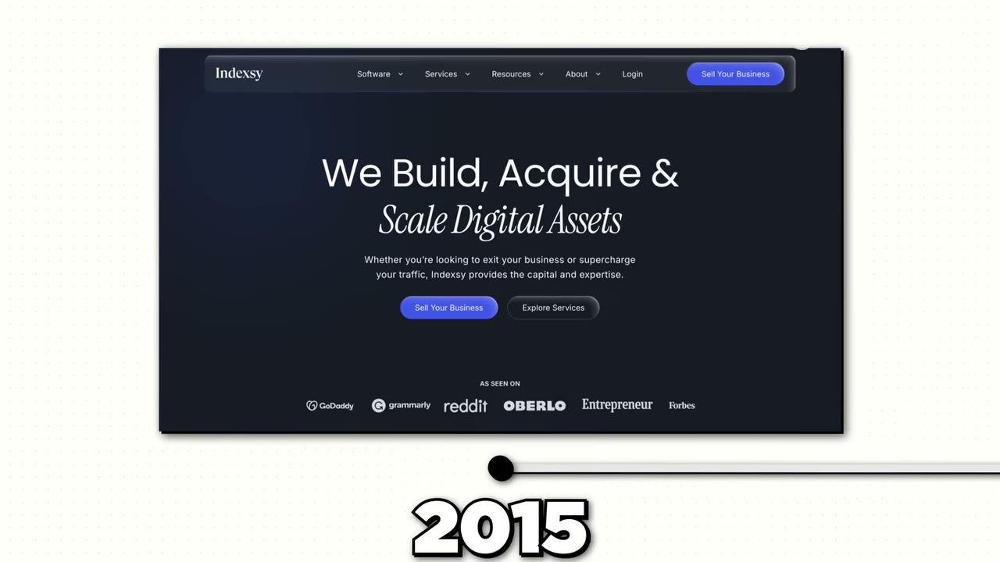
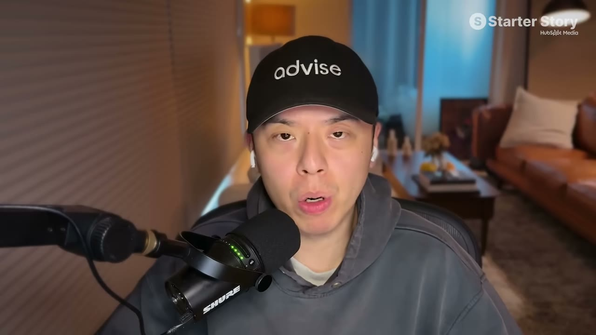
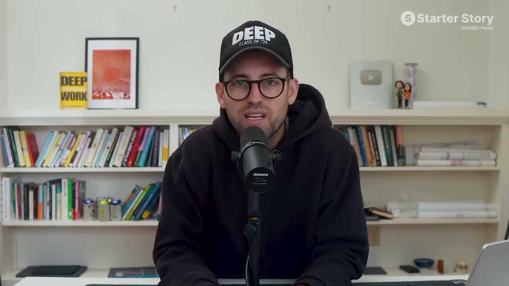
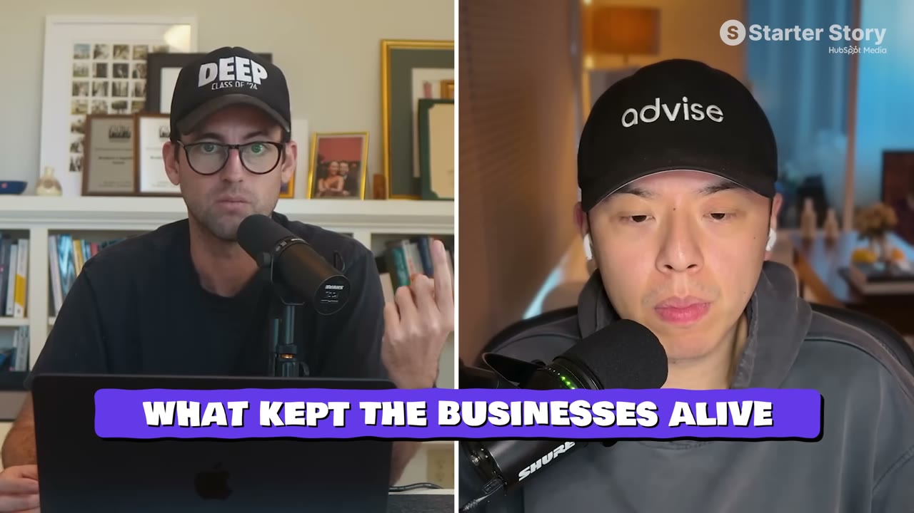
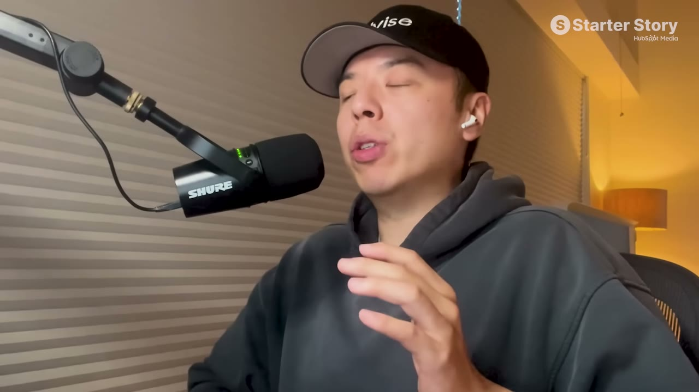
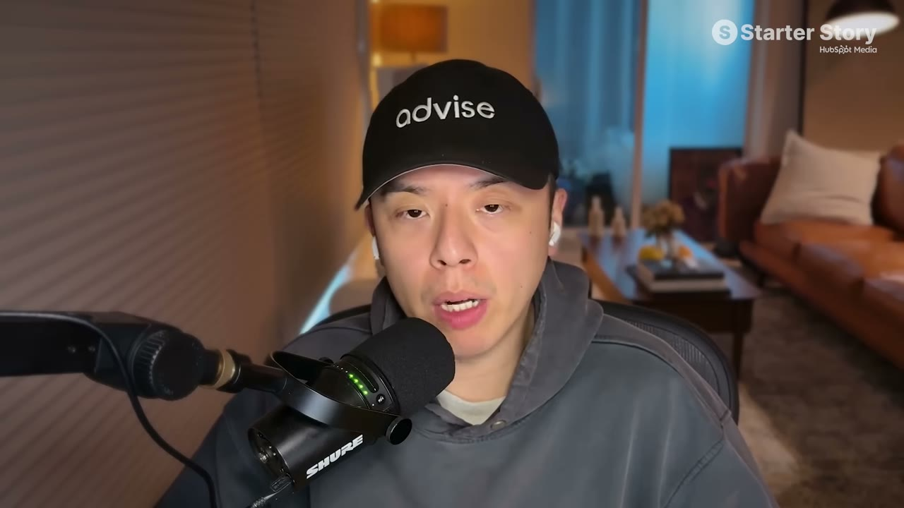
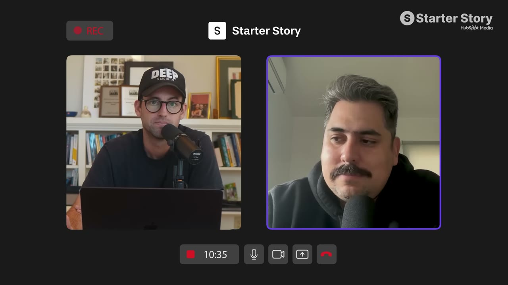

# I Make $250K/Month From 13 Businesses (After Losing Everything to AI)

✅ **Đã phân tích sâu** → [`case.md`](case.md)

| | |
|---|---|
| **Video** | <https://www.youtube.com/watch?v=spiC5m6AJNs> |
| **Đăng** | 22/03/2026 |
| **Thời lượng** | 11:45 |
| **Lượt xem** | 44,829 |
| **Lượt thích** | 1,264 |
| **Video ID** | `spiC5m6AJNs` |

## Trong thư mục này

| File | Nội dung |
|---|---|
| [`case.md`](case.md) | **Phân tích đầy đủ** — ý tưởng, validate, GTM, áp dụng ở VN |
| [`meta.json`](meta.json) | Metadata gốc (chapters, heatmap, mô tả) |
| [`screenshots/`](screenshots/) | 10 ảnh 720p |

## Mô tả gốc

Jacky was making $500K/month. Then AI and Google's algorithm updates wiped out nearly everything. This is how he rebuilt to $250K/month across 13 different businesses... and the one distribution strategy that made the comeback possible.
This video is an educational case study of this founder’s experience. It is not financial advice and does not guarantee any income or results. Every business is different and your results may vary.
0:00 - Don’t focus on just one thing
1:46 - Business breakdowns
2:31 - Jacky’s background
3:07 - AI almost killed his business
4:03 - Find your next idea
4:40 - The 

## Số liệu bắt được từ transcript

> Các đoạn founder nhắc tới con số, kèm timestamp để tua thẳng tới đó trong video.

_(không bắt được con số nào)_

## Chương

- `00:00` Don’t focus on just one thing
- `01:46` Business breakdowns
- `02:31` Jacky’s background
- `03:07` AI almost killed his business
- `04:03` Find your next idea
- `04:40` The platform that saved his business
- `05:37` YouTube strategy overview
- `06:12` How to get started on YouTube
- `08:50` Diversify your revenue
- `09:28` Pat and Gus reflections

## Ảnh

1. `01_00m15s_ch-don-t-focus-on-just-one-thing.jpg` — 
2. `02_00m52s_usd-250-000.jpg` — 
3. `03_01m55s_usd-250-000.jpg` — 
4. `04_02m43s_ch-jacky-s-background.jpg` — 
5. `05_03m19s_ch-ai-almost-killed-his-business.jpg` — 
6. `06_04m15s_ch-find-your-next-idea.jpg` — 
7. `07_04m52s_ch-the-platform-that-saved-his-business.jpg` — 
8. `08_05m49s_ch-youtube-strategy-overview.jpg` — 
9. `09_06m24s_ch-how-to-get-started-on-youtube.jpg` — 
10. `10_10m34s_usd-250-000.jpg` — 

---

← [Quay lại index](../../index.md) · [Toàn bộ video](../README.md)
