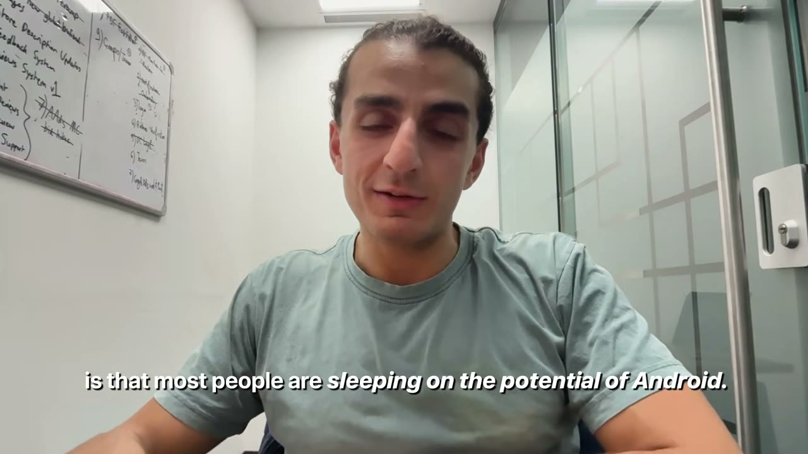
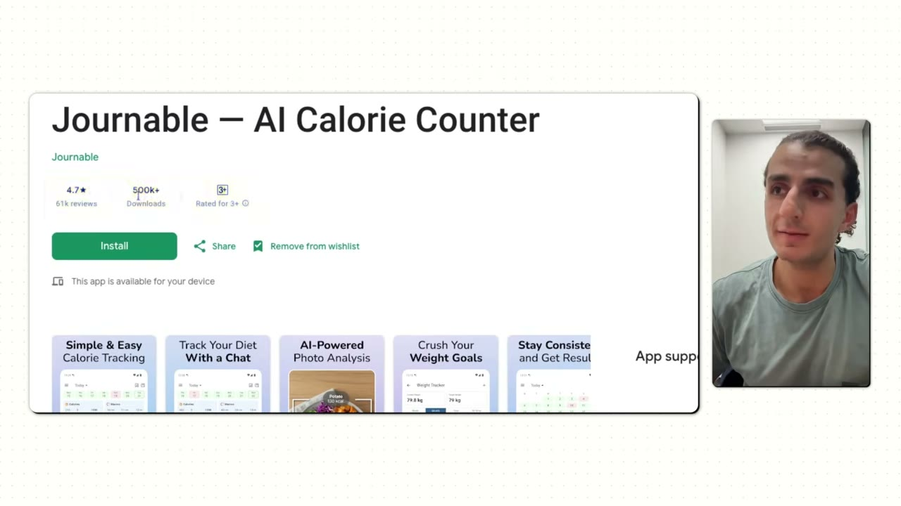
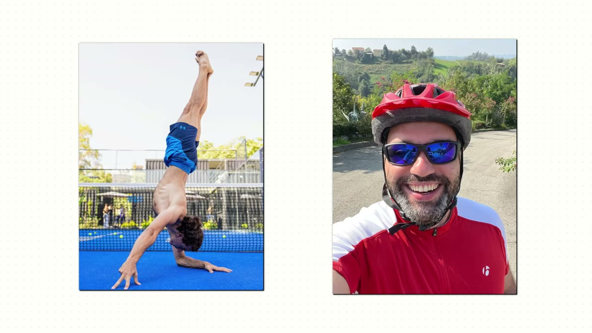
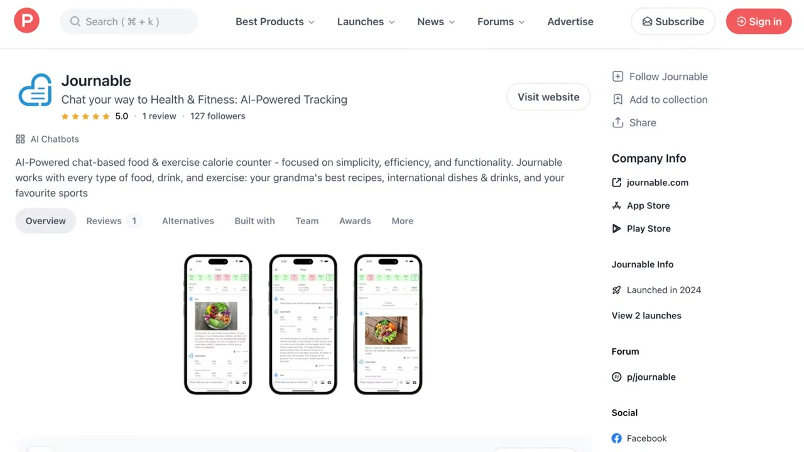
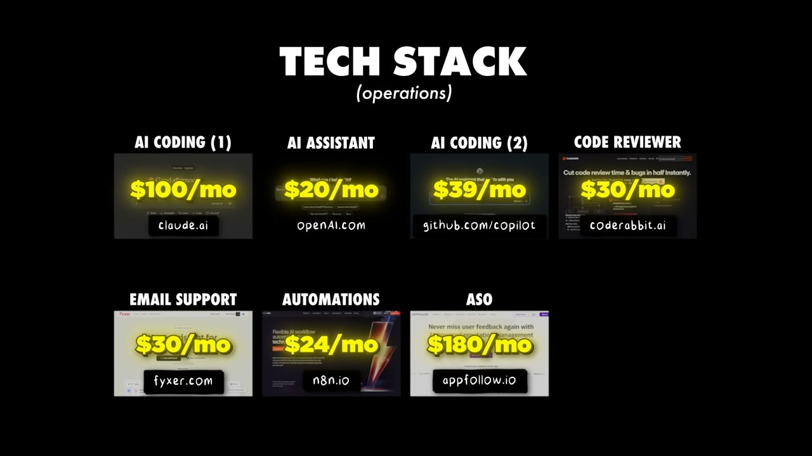

# I Built a $100K/Month Android App

✅ **Đã phân tích sâu** → [`case.md`](case.md)

| | |
|---|---|
| **Video** | <https://www.youtube.com/watch?v=0pp4X58q_0s> |
| **Đăng** | 25/03/2026 |
| **Thời lượng** | 24:10 |
| **Lượt xem** | 102,942 |
| **Lượt thích** | 2,944 |
| **Video ID** | `0pp4X58q_0s` |

## Trong thư mục này

| File | Nội dung |
|---|---|
| [`case.md`](case.md) | **Phân tích đầy đủ** — ý tưởng, validate, GTM, áp dụng ở VN |
| [`meta.json`](meta.json) | Metadata gốc (chapters, heatmap, mô tả) |
| [`screenshots/`](screenshots/) | 10 ảnh 720p |

## Mô tả gốc

While everyone else fights over iOS, 92% of Steve's mobile app revenue comes from Android. This is his exact playbook.
This video is an educational case study of this founder’s experience. It is not financial advice and does not guarantee any income or results. Every business is different and your results may vary.
0:00 - Everyone is sleeping on Android
1:05 - Founder intro
1:25 - Business overview and metrics
2:40 - Finding the idea for Journable
3:54 - Android vs iOS
5:42 - Growth overview
6:56 - Google ads strategy
7:38 - Ad example
8:43 - Mobile app growth tactics
9:16 - The Android playbo

## Số liệu bắt được từ transcript

> Các đoạn founder nhắc tới con số, kèm timestamp để tua thẳng tới đó trong video.

_(không bắt được con số nào)_

## Chương

- `00:00` Everyone is sleeping on Android
- `01:05` Founder intro
- `01:25` Business overview and metrics
- `02:40` Finding the idea for Journable
- `03:54` Android vs iOS
- `05:42` Growth overview
- `06:56` Google ads strategy
- `07:38` Ad example
- `08:43` Mobile app growth tactics
- `09:16` The Android playbook
- `14:11` Android app ideas
- `16:44` How Journable works
- `18:05` Tech stack
- `19:07` Start documenting your journey
- `20:31` Pat and Gus reflections: what we learned

## Ảnh

1. `01_00m15s_ch-everyone-is-sleeping-on-android.jpg` — 
2. `02_01m07s_usd-1-000.jpg` — 
3. `03_01m55s_usd-125-000.jpg` — 
4. `04_02m52s_ch-finding-the-idea-for-journable.jpg` — 
5. `05_04m06s_ch-android-vs-ios.jpg` — 
6. `06_05m52s_replay.jpg` — 
7. `07_07m06s_usd-500-000.jpg` — 
8. `08_07m50s_ch-ad-example.jpg` — 
9. `09_18m11s_replay.jpg` — 
10. `10_18m57s_usd-24.jpg` — 

---

← [Quay lại index](../../index.md) · [Toàn bộ video](../README.md)
