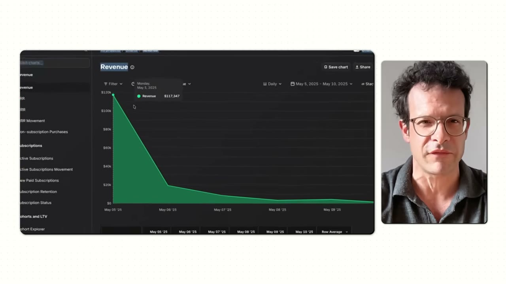
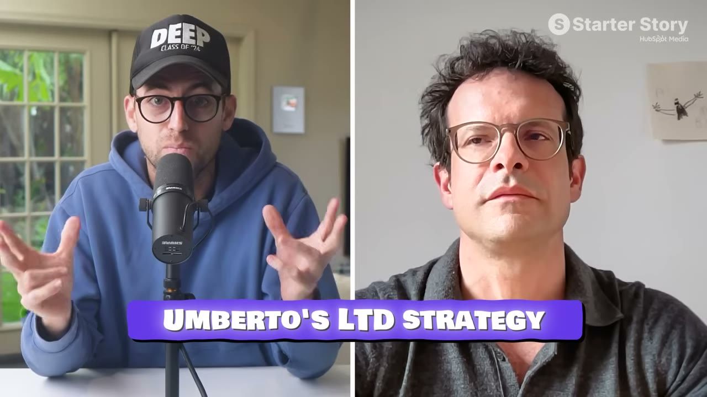

# Floga — $120K trong 24 giờ, bằng lifetime deal cho app chưa hoàn thiện

> **Tóm tắt 30 giây:** Umberto không phải developer — anh học kinh tế, từng gọi vốn seed cho một startup **thất bại** năm 2012, rồi bỏ hẳn mảng công nghệ để làm **huấn luyện viên trượt tuyết và nhiếp ảnh gia thời trang**. Quay lại 2016 làm chiến lược gia quảng cáo và tăng trưởng. Thời COVID, anh và bạn gái làm **Play Pause Be** — bộ bài dạy chuỗi động tác yoga — và **gọi được hơn $200.000 trên Kickstarter trong tháng đầu**. Anh mang đúng tư duy đó sang phần mềm: **pre-launch app Floga bằng lifetime deal và thu $117.000 trong 24 giờ** — khi app còn chưa xong.

---

## 1. Con số

| Chỉ số | Giá trị |
|---|---|
| **Ngày ra mắt (24 giờ)** | **$117.000** |
| Khách mua lifetime | **500-600 người** |
| MRR hiện tại (sau khi mở subscription) | **$9.000-10.000** |
| Người dùng hoạt động | ~4.000 (cả trả phí và miễn phí) |
| Thời gian pre-launch | **~5 tuần** |
| Chi phí vận hành | **$25/tháng** (Firebase) |

**Ba bậc giá lifetime:**

| Bậc | Giá | Nội dung |
|---|---|---|
| 1 | **$109** | Truy cập trọn đời một tập tính năng giới hạn |
| 2 | **$199** | Nhiều tính năng hơn |
| 3 | **$349** | **Toàn bộ tầm nhìn** — mọi thứ họ dự định xây |

> **Tâm lý học phía sau:** *"Hai bậc đầu thực chất giúp anh bán bậc đắt nhất, vì chúng tạo ra một điểm tham chiếu. Và chúng cũng bắt được nhóm khách hoài nghi chưa thật sự chắc chắn về sản phẩm."*

---

## 2. Vì sao lifetime deal — lập luận đầy đủ ⭐⭐⭐

Pat phản biện thẳng: nhà đầu tư sẽ nói lifetime deal là **tệ**, vì anh từ bỏ toàn bộ doanh thu tương lai từ khách đó.

**Câu trả lời của Umberto có bốn vế, và đây là phần đáng giá nhất của case:**

**Vế 1 — Biến giả định thành tiền thật**
> Khi anh còn sớm, **anh không có dữ liệu**. Anh không biết LTV, không biết churn. **Anh chỉ có giả định.** Lifetime deal **biến những giả định đó thành tiền thật trong tài khoản ngân hàng.**

**Vế 2 — Động lực khác hẳn nhau** ⭐
> **Người trả theo tháng có QUYỀN CHỌN. Người mua lifetime có CAM KẾT. Và điều đó thay đổi mọi thứ.**
>
> Người trả theo tháng, nếu có gì hỏng hoặc có bug, **chỉ việc huỷ đăng ký, để lại một đánh giá tệ, và không phản hồi gì.** Còn người đã mua app thì **muốn app trở nên tuyệt vời** — họ sẽ báo lỗi, gửi phản hồi chi tiết.

Họ thậm chí **lập một nhóm Telegram** với nhóm khách hàng đầu tiên này, và nó mang lại **giá trị khổng lồ**.

**Vế 3 — Có một nhóm người ghét subscription**
> Trong nhóm đó, **mức sẵn sàng chi trả cho lifetime dễ dàng cao gấp 3-5 lần so với gói năm.**

**Vế 4 — Đây thực chất là gọi vốn**
> **"Anh đang huy động vốn TỪ CHÍNH KHÁCH HÀNG mà không phải cho đi cổ phần, quyền kiểm soát, ghế hội đồng quản trị — và còn nhận được phản hồi tuyệt vời. Tôi không nghĩ có gì tốt hơn thế."**

**Pat bổ sung góc nhìn thực dụng:** hãy coi lifetime deal đơn giản là **một chiến lược ĐỊNH GIÁ**. Nếu anh ước tính người dùng sẽ đăng ký 24 tháng, hãy tính tổng doanh thu đó và **định giá lifetime bằng con số ấy, thu tiền trước** — về mặt kỹ thuật anh không mất gì.

> **Lifetime deal xuất hiện lần thứ ba trong knowledge base** — [Cat on Chair](../2026-07-26_this-simple-app-makes-18k-month/case.md) (phần lớn doanh thu từ gói lifetime $29,99) và [Task Magic](../2026-04-19_i-spent-24-hours-with-a-saas-millionaire/case.md) (*"lifetime deal rồi định giá theo mức sử dụng"* để tự cấp vốn giai đoạn đầu). **Ba founder độc lập, cùng kết luận: với bootstrapper giai đoạn đầu, lifetime deal là công cụ gọi vốn tốt nhất.**

⚠️ **Nhưng phải nhìn con số thật:** ngày ra mắt $117K, nhưng **MRR hiện tại chỉ $9-10K**. Lifetime deal cho anh **vốn khởi động và nhóm khách trung thành**, không cho anh **doanh thu định kỳ**. Đây là đánh đổi có ý thức, không phải bữa trưa miễn phí.

---

## 3. Chuỗi email pre-launch ⭐⭐

Pre-launch kéo dài **khoảng 5 tuần**. Cấu trúc rất rõ:

| Email | Nội dung |
|---|---|
| **1** | **Kể chuyện, KHÔNG tiết lộ gì cả.** Chỉ tạo sự quan tâm và đặt nền để người đọc hiểu những gì sắp được cho xem |
| **2** | Tiếp tục kể chuyện, **tiết lộ thêm một chút**. Cố ý **tạo bối rối** — đặt sản phẩm vật lý ra sau, đưa một thứ mới ra trước để người ta không đoán được đó là sản phẩm vật lý khác hay thứ hoàn toàn khác |
| **3** | **Vén màn** — cho xem app, giải thích ngắn gọn vì sao họ làm nó, và **dẫn tới một video** anh trình bày toàn bộ tính năng |
| **Cuối** | Giải thích cơ chế lifetime deal: **giới hạn số lượng và giới hạn thời gian** |

**Hai nguyên tắc vận hành quan trọng:**

**1. Khan hiếm để chống trì hoãn**
> Lifetime deal **luôn giới hạn cả số lượng lẫn khung thời gian**. Điều này tạo đòn bẩy **giảm sự trì hoãn mà ai cũng có** — và nó hiệu quả rất mạnh. Anh khuyến nghị **tối đa 5-7 ngày**.

**2. TUYỆT ĐỐI không cho biết giá trước ngày ra mắt** ⭐
> **"Tôi không bao giờ cho thấy giá sản phẩm trước ngày ra mắt, vì nếu không, người ta sẽ ra quyết định mua DỰA TRÊN GIÁ."**
>
> Trong giai đoạn hâm nóng, họ **chỉ nên đánh giá sản phẩm dựa trên TÍNH NĂNG và TẦM NHÌN DÀI HẠN**. Nếu anh đưa giá vào, **anh phá hỏng toàn bộ, vì có thêm một yếu tố mà họ không thể "nhìn thấy rồi quên đi" được nữa.**

> **Đây là chi tiết tinh tế nhất của case và gần như không ai nói tới.** So sánh với [Kleo](../2026-01-11_how-my-app-hit-60k-month-in-2-months/case.md) — cũng nuôi dưỡng waitlist bằng 10+ email không bán hàng, cũng dùng khan hiếm (500 suất). **Hai case độc lập, cùng một kiến trúc ra mắt.**

---

## 4. Playbook ra mắt 6 bước ⭐

### Bước 1 — Validate TRƯỚC khi build
> Trước khi viết một dòng code, **nói chuyện với 5-10 người trong thị trường mục tiêu**. Hỏi họ về vấn đề anh định giải, **nhưng đừng bao giờ nói vì sao anh hỏi** — để có phản ứng trung thực, không thiên lệch.

Anh làm điều này với chính khách hàng của sản phẩm vật lý, và **có phản hồi rất tốt chính vì không dẫn dắt họ**. Anh giới thiệu thẳng cuốn **The Mom Test**.

> Cuốn sách này xuất hiện lần thứ ba — [Fastlane](../2026-08-30_the-insanely-obvious-secret-behind-this-69k-month-sa/case.md), [Once](../2026-05-10_i-built-a-20k-month-app-in-83-days/case.md). **Nếu anh chỉ đọc một cuốn từ toàn bộ kho này, đọc nó.**

### Bước 2 — Định nghĩa "sản phẩm tối thiểu có thể RA MẮT"
> Không phải MVP theo nghĩa thông thường, mà là: **giai đoạn phát triển tối thiểu mà sản phẩm truyền tải đủ giá trị để người dùng sớm CHỊU TRẢ TIỀN.**

Khi biết nó trông như thế nào và mất bao lâu để xây, anh mới lên kế hoạch mọi thứ khác quanh mốc thời gian đó.

### Bước 3 — Xây "cỗ máy nội dung" TRƯỚC khi quảng bá
> Trước khi bắt đầu bất kỳ hoạt động thu hút nào, **phải có sẵn một kho nội dung**: email, đồ hoạ, video, landing page — tất cả.

Và một điểm quan trọng: **đặt mình vào vị trí người dùng.** Có những thứ hiển nhiên với người đang xây sản phẩm nhưng **cần được giải thích đơn giản và rõ ràng cho người dùng cuối** — bao gồm cả việc tạo niềm tin và hướng dẫn họ về nền tảng.

### Bước 4 — Định giá có cấu trúc, đừng ném đại một con số ⭐
> **"Tôi thấy rất nhiều founder định giá rất thấp vì sợ không ai mua, vì sản phẩm chưa hoàn thiện. Tôi tin đó là sai lầm — anh đang để lại rất nhiều tiền trên bàn."**

→ Ba bậc giá như bảng ở mục 1.

### Bước 5 — Cơ chế ra mắt: minh bạch tuyệt đối
> **Cho thấy app đang hoạt động ra sao. Nói rõ hiện tại có gì, giới hạn hiện tại là gì, và anh dự định cải thiện thế nào.**
>
> Rồi **vạch một ranh giới rõ ràng: KHÔNG HOÀN TIỀN.** Nếu không, lifetime deal của anh bị phá vỡ. Ai còn nghi ngờ hoặc muốn dùng thử thì **chờ gói subscription ra sau.**

Anh nói thẳng trong video ra mắt: *app hiện hoạt động như thế này; chúng tôi sẽ phát triển thêm những tính năng kia; muốn có thì mua lifetime ngay bây giờ, nhưng tuyệt đối không hoàn tiền; muốn dùng thử thì đợi vài tháng nữa.*

### Bước 6 — Giới hạn thời gian và số lượng
Tối đa **5-7 ngày**. Buộc người ta ra quyết định thay vì trì hoãn.

---

## 5. Vì sao nhóm khách hàng đầu tiên quý hơn tiền ⭐

> **"Nếu ai đó đã đầu tư, họ sẽ quan tâm tới việc làm cho app chạy được. Nên họ sẽ đưa ra những gợi ý rất tốt. Họ thậm chí sẽ cổ vũ anh."**
>
> **"Rất nhiều tính năng chúng tôi đưa vào trong các tháng sau đó đều dựa trên phản hồi từ nhóm người dùng đầu tiên này. Chúng tôi đã không thể làm được nếu không có họ."**

**Pat mở rộng thành nguyên tắc:**
> Đừng nghĩ về nhóm khách lifetime như những người anh **sẽ không thu được tiền trong tương lai**. Hãy nghĩ về họ như **dữ liệu cực kỳ giá trị** và những người **sẽ lan truyền về app của anh**. Và vì lifetime deal chỉ diễn ra trong thời gian ngắn, anh **kéo về phía trước toàn bộ nhóm người dùng đã cam kết** — những người có thể sẽ không bao giờ thật sự dùng app nếu chỉ có bản dùng thử miễn phí.
>
> **"Gần như là đang xây một cộng đồng ban đầu."**

---

## 6. Tech stack — $25/tháng

Flutter (phát triển) · **Firebase** ($25/tháng) · RevenueCat (quản lý subscription) · **Vimeo** (host video — họ đã dùng sẵn cho business kia) · OneSignal (push notification).

**Lời khuyên cuối:**
> **"Đừng chờ sự hoàn hảo. Hoàn hảo chỉ là NỖI SỢ được nguỵ trang thành sự chuẩn bị. Bước đột phá thật sự xảy ra ngay khoảnh khắc anh đặt một thứ — có thể còn dang dở — trước mặt người thật."**
>
> **"Hãy đi sớm hơn, ship sớm hơn, và tin vào quá trình. Anh học nhanh hơn khi làm công khai so với khi làm một mình."**

---

## 7. Cảnh báo thiên kiến nguồn ⚠️

**Ba con số cho cùng một ngày.** Tiêu đề: **$120K**. Umberto ở `01:32`: *"hơn $120.000 trong 24 giờ"*. Umberto ở `02:07`, khi **mở dashboard ra**: *"đến cuối ngày chúng tôi tạo ra **$117.000**"*. Pat suốt cả video: **"$100.000"** (ít nhất tám lần). Con số duy nhất có bằng chứng màn hình là **$117K**; hai con số kia là làm tròn lên (tiêu đề) và làm tròn xuống (host).

**Có dashboard — nhưng đó là doanh thu GỘP ngày ra mắt, và không ai hỏi phí nền tảng.** Nếu 500-600 lifetime deal đó bán qua **in-app purchase của App Store, Apple lấy 30%** → $117K gộp chỉ còn khoảng **$82K**. Nếu bán qua website bằng Stripe thì mất ~3%. **Video không bao giờ làm rõ bán ở đâu** — mà đây là chênh lệch $35.000. Ngoài ra $117K là **tiền một lần**, không phải doanh thu tháng; con số vận hành thật của Floga hôm nay là **$9-10K MRR**.

**Nhà tài trợ chèn giữa — HubSpot, và không khớp với chính câu chuyện.** `06:38-07:30` Pat cắt ngang để phát *"iOS Playbook — chạy nước rút 9 ngày từ ý tưởng tới app thật trên App Store, **mà không phải tự viết một dòng code nào**"*; link trong mô tả là **`clickhubspot.com/gfd`**, và mô tả gọi nó là *"khoá học miễn phí: ship app iOS đầu tiên trong **7 ngày**"* — **9 ngày hay 7 ngày, chính họ cũng không thống nhất**. Quan trọng hơn: **Floga được viết bằng Flutter bởi một developer anh THUÊ**, không phải AI dựng trong 9 ngày. Quảng cáo mượn uy tín của một câu chuyện mà nó không mô tả đúng. Thêm `01:02` gài mồi và `23:11` chào bán lần cuối.

**Người dẫn có lợi ích thương mại trong chính chiến thuật đang được bảo vệ.** Ở `21:38-22:10`, sau khi "phản biện" lifetime deal một cách rất nhẹ, Gus tự khai: *"ở Starter Story chúng tôi đã làm rất nhiều chuỗi email kiểu này và cả lifetime deal vào Black Friday hay cuối năm — tôi từng trực tiếp viết những email đó."* Pat tiếp lời bằng một đoạn dài bênh vực việc gửi *"cực nhiều email, cực nhiều deal"*. **Đây không phải một cuộc kiểm chứng độc lập; đó là hai người bán cùng một chiến thuật đang xác nhận lẫn nhau.**

**Bối cảnh bị làm mờ — và nó là toàn bộ lý do $117K xảy ra:**
- **Anh đã có một thương hiệu và một tệp KHÁCH ĐÃ TỪNG TRẢ TIỀN.** Play Pause Be gọi **hơn $200.000 trên Kickstarter trong tháng đầu**. Chuỗi email ra mắt Floga gửi tới **chính những người đó** — người đã mua sản phẩm của anh một lần và hài lòng. Đây không phải danh sách lạnh.
- **Anh là chiến lược gia quảng cáo và tăng trưởng chuyên nghiệp từ 2016**, từng *"giúp nhiều công ty scale"*, và **đã gọi vốn seed năm 2012**. Kỹ năng dựng "cỗ máy" email + landing page + ad creative là nghề của anh.
- **Anh có chạy lead generation trả tiền** (`05:37`: *"tôi cũng làm lead generation để tiếp cận những người chưa từng nghe về chúng tôi"*) — **chi phí không bao giờ được nêu**. Một phần của $117K đã được mua bằng tiền quảng cáo, không rõ bao nhiêu.
- **Có đồng sáng lập (bạn gái) và một developer thuê.** Không phải solo.
- **Vimeo có sẵn từ business cũ** — hạ tầng video, khoản tốn nhất của một app yoga, đã được business khác trả tiền.

**Thiếu số liệu quan trọng:**
- **Kích thước danh sách email không bao giờ được nêu.** Không có mẫu số này thì tỉ lệ chuyển đổi bằng 0 thông tin, và toàn bộ playbook không tái lập được.
- **Không rõ trong 4.000 người dùng "cả trả phí lẫn miễn phí" thì bao nhiêu người trả tiền.**
- **Không có churn** của mô hình subscription hiện tại, **không có LTV**, **không có CAC** — trớ trêu thay, đó đúng là ba con số anh nói lifetime deal giúp anh **khỏi phải biết**.
- **Không có chi phí developer** — khoản lớn nhất của dự án.
- **Chính sách "không hoàn tiền" không được soi chiếu pháp lý.** Anh ở châu Âu, nơi luật bảo vệ người tiêu dùng với sản phẩm số khá chặt. Video coi đây thuần tuý là đòn bẩy tâm lý.

---

## 8. Áp dụng cho tôi (indie hacker VN)

**Đây là playbook ra mắt tốt nhất cho người CHƯA có sản phẩm hoàn chỉnh nhưng ĐÃ có một nhóm khán giả nhỏ.**

**Quy trình áp dụng:**

| Bước | Việc | Ghi chú |
|---|---|---|
| **1** | Nói chuyện 5-10 người theo **Mom Test**, không tiết lộ ý định | Miễn phí |
| **2** | Xác định **sản phẩm tối thiểu ĐỦ ĐỂ BÁN**, không phải đủ để dùng | |
| **3** | Chuẩn bị **toàn bộ kho nội dung trước** khi bắt đầu quảng bá | |
| **4** | Pre-launch **4-5 tuần**: email kể chuyện → hé lộ dần → vén màn → giải thích cơ chế | **Không lộ giá** |
| **5** | Ra mắt **3 bậc giá lifetime**, giới hạn **5-7 ngày** và giới hạn số suất | Minh bạch về giới hạn hiện tại, **không hoàn tiền** |
| **6** | Lập **nhóm Telegram/Zalo** với nhóm khách đầu tiên | Đây là tài sản, không phải chi phí hỗ trợ |

**Vì sao rất hợp với thị trường VN:**
- ✅ **Người Việt vốn ngại subscription định kỳ** — mức sẵn sàng trả cho "mua đứt" cao hơn hẳn. Đây là lợi thế văn hoá, không phải hạn chế.
- ✅ **Không cần vốn** — chính khách hàng cấp vốn cho anh
- ✅ **Email marketing ở VN ít cạnh tranh**; Zalo OA cũng dùng được
- ✅ Phù hợp với người đã có **cộng đồng nhỏ** (group Facebook, kênh TikTok, học viên cũ)

**Rào cản thật:**
- ⚠️ **Anh ấy đã có sẵn danh sách khách hàng** từ business sản phẩm vật lý (Kickstarter $200K). **Không có danh sách thì không có $117K.** Đây là điều kiện tiên quyết, không phải chi tiết phụ.
- ⚠️ **MRR chỉ $9-10K** sau tất cả — lifetime deal đánh đổi doanh thu dài hạn lấy vốn ngắn hạn. Nếu mục tiêu của anh là MRR ổn định, cân nhắc kỹ.
- ⚠️ **"Không hoàn tiền" cần cực kỳ minh bạch** — ở VN, chính sách này dễ gây phản ứng nếu không nói rõ từ đầu. Phải công khai giới hạn hiện tại của sản phẩm.
- ⚠️ **Bán lifetime cho app có chi phí vận hành cao (AI, video) là rủi ro thật** — khách dùng mãi mà anh trả chi phí mãi. Floga an toàn vì chi phí $25/tháng.
- ⚠️ Anh có nền **chiến lược gia tăng trưởng và quảng cáo nhiều năm** — kỹ năng dựng chuỗi email này không tự nhiên mà có

**Khi KHÔNG nên dùng mô hình này:**

- **Khi bạn chưa có danh sách những người ĐÃ TỪNG trả tiền cho bạn.** $117K không đến từ chuỗi email — nó đến từ việc chuỗi email đó được gửi tới tệp khách đã bỏ tiền mua bộ bài Play Pause Be trên Kickstarter. Với một danh sách lạnh thu bằng lead magnet, đúng sáu email đó cho ra gần bằng không. Nếu bạn chưa từng bán được gì cho ai, việc cần làm là bán một thứ nhỏ trước, không phải dựng chuỗi pre-launch 5 tuần.
- **Khi chi phí phục vụ mỗi người dùng tăng theo thời gian.** Floga bán trọn đời an toàn vì hạ tầng của nó là **Firebase $25/tháng** và video đã nằm sẵn trên Vimeo của business cũ. Nếu sản phẩm của bạn đốt token AI, chuyển mã video, hay lưu trữ theo dung lượng, mỗi lifetime deal là một **khoản lỗ tăng dần vĩnh viễn** — bạn đã thu tiền một lần và cam kết trả chi phí mãi mãi.
- **Khi bạn định gọi vốn hoặc bán công ty trong 1-2 năm tới.** Sau khi thu $117K tiền mặt, Floga chỉ còn **$9-10K MRR** — và 500-600 khách nhiệt tình nhất sẽ **không bao giờ trả thêm đồng nào**. Nhà đầu tư và người mua định giá theo doanh thu định kỳ; xem [DuckMath bán với giá bằng 8 tháng doanh thu](../2026-03-01_i-make-15k-month-from-one-website/case.md) để thấy thị trường trừng phạt dòng tiền không bền như thế nào. Lifetime deal là cách **đổi định giá tương lai lấy tiền mặt hôm nay** — chỉ đúng khi tiền mặt hôm nay là thứ quyết định bạn sống hay chết.

---

## Nguồn

- Video: [My App Made $120K in 24 Hours](https://www.youtube.com/watch?v=DkmStHS8NP0) — Starter Story, 29/03/2026, 23:35, 220K views
- Sản phẩm: Floga · business trước: Play Pause Be
- [`transcript.md`](transcript.md) · [`screenshots/`](screenshots/)
