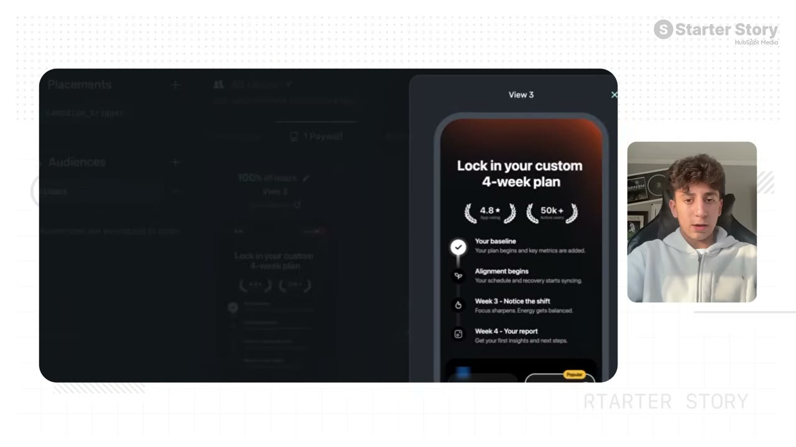
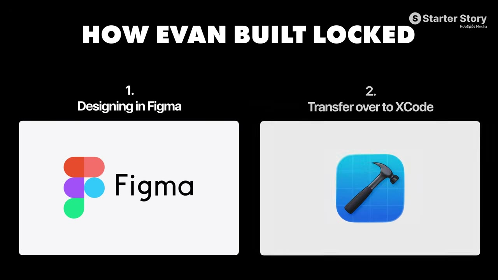
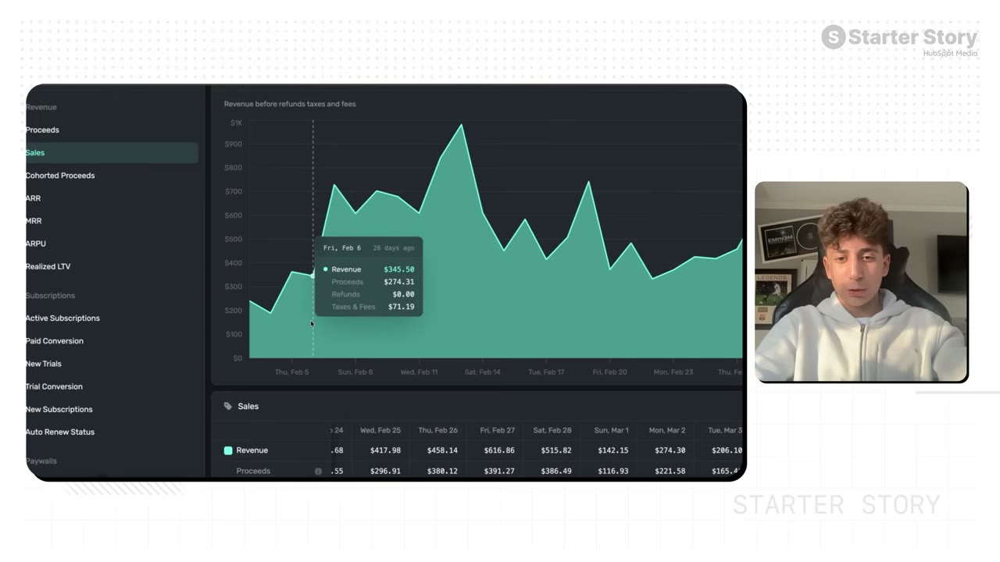
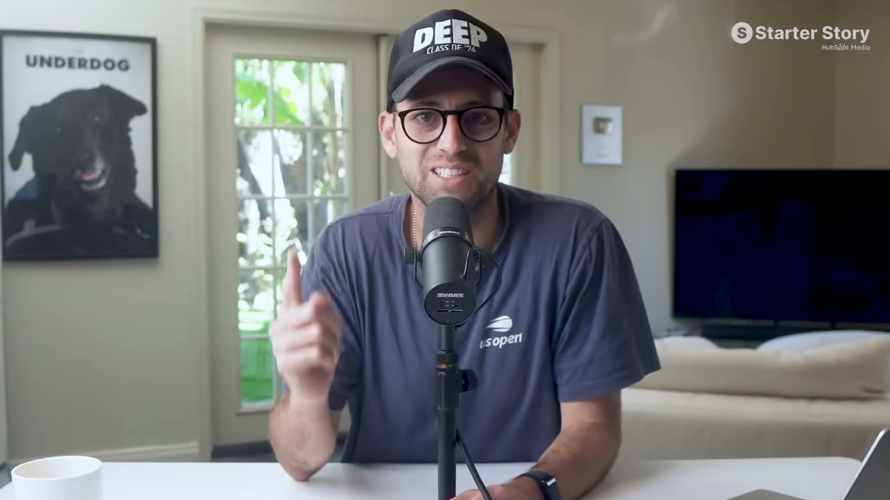
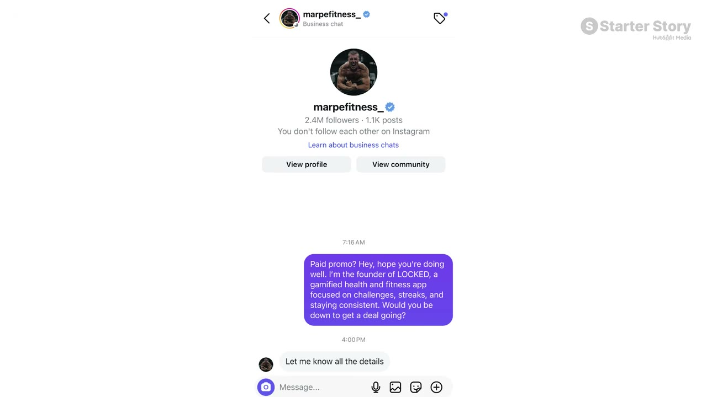
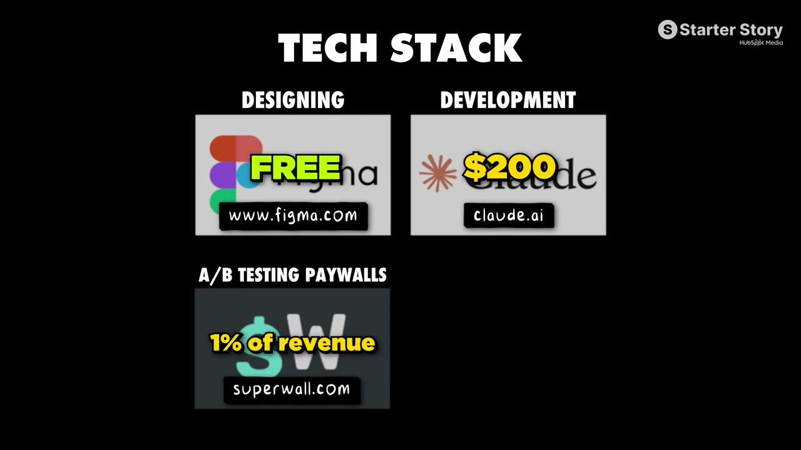

# I'm 14 And I Built A $14K/Month App

✅ **Đã phân tích sâu** → [`case.md`](case.md)

| | |
|---|---|
| **Video** | <https://www.youtube.com/watch?v=dWeoSKLt_fc> |
| **Đăng** | 01/04/2026 |
| **Thời lượng** | 13:28 |
| **Lượt xem** | 281,495 |
| **Lượt thích** | 9,836 |
| **Video ID** | `dWeoSKLt_fc` |

## Trong thư mục này

| File | Nội dung |
|---|---|
| [`case.md`](case.md) | **Phân tích đầy đủ** — ý tưởng, validate, GTM, áp dụng ở VN |
| [`meta.json`](meta.json) | Metadata gốc (chapters, heatmap, mô tả) |
| [`screenshots/`](screenshots/) | 10 ảnh 720p |

## Mô tả gốc

Evan built a mobile app and scaled it to $14K/month in just 4 months. And he did it with just ONE strategy. This is his exact playbook for building a successful mobile app in 2026. 
This video is an educational case study of this founder’s experience. It is not financial advice and does not guarantee any income or results. Every business is different and your results may vary.
We received signed permission from Evan's parent/guardian for him to appear on this channel.
0:00 - Meet the kid making $14K/month
1:29 - What’s your story?
1:45 - App overview and metrics
2:39 - Founder background
3:36 

## Số liệu bắt được từ transcript

> Các đoạn founder nhắc tới con số, kèm timestamp để tua thẳng tới đó trong video.

_(không bắt được con số nào)_

## Chương

- `00:00` Meet the kid making $14K/month
- `01:29` What’s your story?
- `01:45` App overview and metrics
- `02:39` Founder background
- `03:36` Build timeline
- `04:05` Growth strategy overview
- `04:43` Influencer content example
- `05:30` Data behind the content
- `06:27` Organic Short Form Playbook
- `07:19` The Influencer Playbook
- `09:17` How the app works (Locked demo)
- `10:01` App tech stack
- `10:32` Advice to other founders
- `11:24` Pat and Gus: what did you think?

## Ảnh

1. `01_00m15s_ch-meet-the-kid-making-14k-month.jpg` — 
2. `02_01m42s_usd-14-000.jpg` — 
3. `03_02m27s_usd-7.jpg` — 
4. `04_03m48s_ch-build-timeline.jpg` — 
5. `05_04m55s_ch-influencer-content-example.jpg` — 
6. `06_05m48s_usd-300.jpg` — 
7. `07_06m39s_ch-organic-short-form-playbook.jpg` — 
8. `08_07m45s_replay.jpg` — 
9. `09_08m38s_usd-500.jpg` — 
10. `10_10m26s_replay.jpg` — 

---

← [Quay lại index](../../index.md) · [Toàn bộ video](../README.md)
