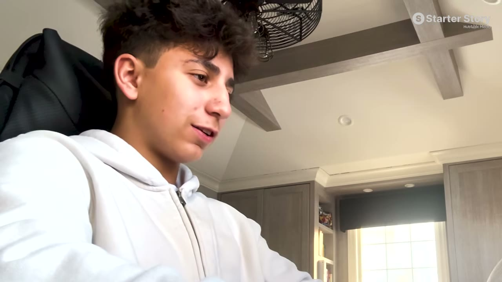
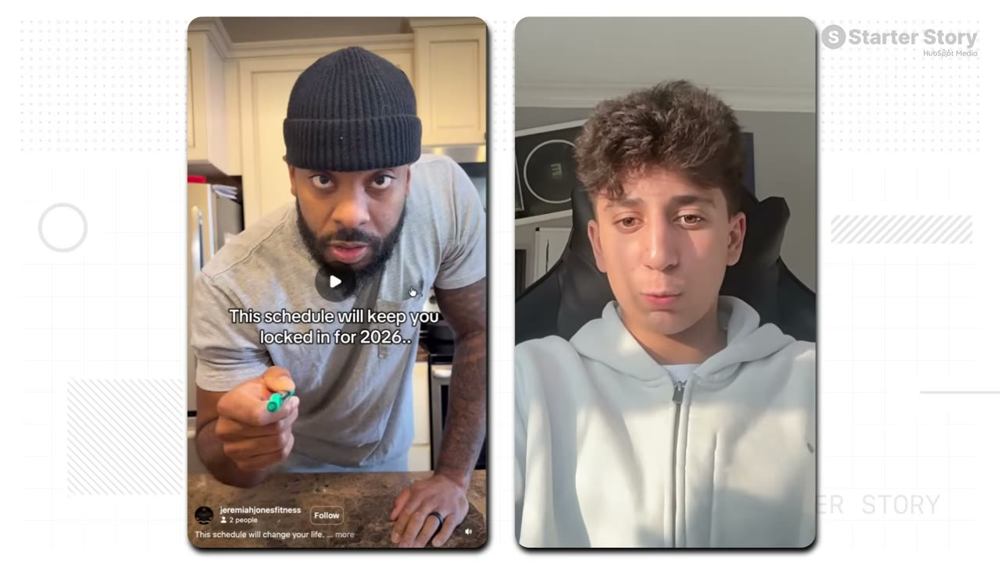

# Locked — $14K/tháng ở tuổi 14, và bộ khung đàm phán influencer

> **Tóm tắt 30 giây:** Evan, **14 tuổi**, mê kinh doanh từ nhỏ — 9 tuổi đã làm game Roblox thay vì chơi. Anh thử dropshipping, bán lại hàng, clipping, máy bán hàng tự động — **tất cả đều thất bại**. Rồi anh trai gợi ý mảng app. App đầu (**Problem Pal**) đạt đỉnh **$2.000/tháng và anh đã bán nó**. App thứ hai không đi tới đâu. App thứ ba — **Locked**, app thói quen được game hoá với nhân vật, XP, bảng xếp hạng, huy hiệu — đạt **$14.000/tháng trong 4 tháng**. Giá trị lớn nhất của case này: **bốn cấu trúc hợp đồng influencer cụ thể và công thức CPM < RPM.**

---

## 1. Con số & mô hình giá

| Chỉ số | Giá trị |
|---|---|
| Doanh thu | **$14.000/tháng** |
| Thời gian | **4 tháng** |
| Thời gian build | **1,5 tháng** (2 tuần thiết kế Figma + code) |
| Giá | **$40/năm** hoặc **$7/tuần** (gói năm có 3 ngày dùng thử) |
| **Paywall thoát ra** | Nếu người dùng bấm thoát → hiện ưu đãi **giảm còn $20/năm** |

> ⭐ **"Paywall thoát ra" (transaction abandon paywall) là chi tiết ít ai nhắc:** thay vì để người dùng bỏ đi, đưa ngay một mức giá thấp hơn. Đây là kỹ thuật rẻ và dễ triển khai (Superwall làm được), và nó bắt lại nhóm nhạy cảm về giá.

**Sản phẩm:** app thói quen được game hoá — chọn nhân vật ngay từ onboarding, có **bảng xếp hạng, huy hiệu, cấp độ, XP**, và một màn hình động lực.

> **Anh nói rõ vì sao game hoá:** *"Tôi không muốn làm thêm một habit tracker chán ngắt nữa."*
>
> Cùng nguyên tắc với [Cat on Chair](../2026-07-26_this-simple-app-makes-18k-month/case.md): khi không đổi mới được ở tính năng, **đổi mới ở cảm xúc và cơ chế game**.

**Nhận xét của producer về mảng habit tracker:** anh thường hoài nghi vì có quá nhiều app loại này. Nhưng bí mật là **ASO — tối ưu tìm kiếm trên App Store**: một app trông ngầu, chạy tốt trên mạng xã hội, xếp hạng tốt trên App Store thì vẫn sống khoẻ.

---

## 2. Công thức nền tảng: CPM < RPM ⭐⭐⭐

Đây là đóng góp lớn nhất của case, và nó biến influencer marketing từ canh bạc thành phép tính.

**Hai chỉ số:**

| Chỉ số | Nghĩa | Của Evan |
|---|---|---|
| **RPM** | Doanh thu anh thu về trên **1.000 view** | **$2-3** |
| **CPM** | Chi phí anh trả cho **1.000 view** | Chốt ở **$1-1,5** |

> **"Tôi biết mình phải chốt creator ở mức CPM THẤP HƠN con số đó."**

> **Nguyên tắc: biết RPM của mình trước, rồi chỉ ký hợp đồng có CPM thấp hơn.** Nếu chưa biết RPM, anh đang đánh bạc chứ không phải làm marketing.
>
> Đây là phiên bản cụ thể của nguyên lý ROAS ở [Chart Detector AI](../2026-07-23_i-make-50k-per-month-working-5-hours-a-week/case.md) — nhưng áp cho influencer thay vì ads.

**Vì sao influencer hiệu quả hơn quảng cáo thường:**
> **Hầu hết influencer đã có sẵn NIỀM TIN với khán giả của họ. Khi họ giới thiệu một app, nó cảm giác chân thực hơn nhiều so với một quảng cáo truyền thống** — và điều đó thường dẫn tới kết quả mạnh hơn hẳn.

---

## 3. Bốn cấu trúc hợp đồng influencer ⭐⭐⭐

Đây là phần chi tiết nhất về đàm phán trong toàn bộ knowledge base.

| # | Loại deal | Cách làm | Dùng khi nào |
|---|---|---|---|
| **1** | **Giá cố định** | $500/reel hoặc $1.200/4 reel | Chỉ dùng với creator **luôn đạt nhiều view ổn định**, và anh tự tin họ đạt được CPM mục tiêu **mà không cần điều khoản ràng buộc** |
| **2** | **Theo CPM** | $1-2 cho mỗi 1.000 view | ⚠️ **PHẢI CÓ TRẦN.** Nếu creator đạt 10 triệu view mà trần là $500 thì anh chỉ trả $500 |
| **3** | **Bảo đảm lượt xem (MVC)** ⭐ | $500 kèm cam kết tối thiểu 500.000 view | **Đây là loại anh gần như luôn chọn** — nó giữ CPM nằm dưới RPM |
| **4** | **Thưởng thêm** | $500/video, đạt 1 triệu view thì thêm $500 | Khi muốn khuyến khích creator đẩy mạnh |

**Ví dụ thật của anh:** trả khoảng **$800 kèm cam kết tối thiểu 600.000 view**. Nếu đạt → xong, và họ có thể nâng lên hợp đồng lớn hơn. **Nếu không đạt → creator có quyền đăng thêm vài video nữa để chạm mốc và vẫn được trả tiền.**

> **Điều khoản "bảo đảm lượt xem" xuất hiện lần thứ ba trong knowledge base** — [Erly](../2026-07-05_this-insanely-simple-app-makes-50k-month/case.md) gọi đây là điều khoản quan trọng nhất, [CardStock](../2026-06-07_i-built-two-apps-that-make-120k-month/case.md) trả theo view qua nền tảng Noise. **Ba founder độc lập, cùng một kết luận: đừng bao giờ trả theo bài đăng, hãy trả theo lượt xem thực nhận.**

### Quy trình 5 bước

1. **Tìm creator trong ngách:** tra từ khoá liên quan trên Instagram/TikTok → lướt video → vào tài khoản → **gửi cùng một tin nhắn cho mọi người, luôn bắt đầu bằng "paid promo?"**
2. **Đưa họ lên một cuộc gọi**
3. **Chốt ở mức có lãi** — CPM thấp hơn RPM
4. **Chọn một trong bốn cấu trúc trên**
5. **Khởi động:** gửi yêu cầu về video + hợp đồng, **cho deadline 1 tuần** cho video đầu. Hiệu quả tốt thì tiếp tục hợp tác.

> **Chi tiết "paid promo?" rất đáng chú ý:** ngắn gọn, thẳng thắn, không vòng vo. Đối lập với lời khuyên "cá nhân hoá thật kỹ" của [Flo](../2026-04-05_how-this-app-makes-35k-month/case.md).
>
> **Cách hoà giải:** Evan tìm **nhiều creator giao dịch một lần** — cần khối lượng, nên tin nhắn phải ngắn để gửi được nhiều. Flo tìm **một đối tác dài hạn chia lợi nhuận** — nên phải đầu tư vào quan hệ. **Chiến lược quyết định cách tiếp cận.**

---

## 4. Ba tiêu chí chọn video/creator ⭐

Anh phân tích một video thành công và nêu ba lý do nó chạy:

1. **Creator có tương tác tốt** — *"video của anh ấy đầy bình luận chất lượng. Đó là cách tôi biết anh ấy có khán giả tuyệt vời, và đó gần như là yếu tố quan trọng nhất."*
2. **Nội dung của creator khớp với app** — kênh của anh ta nói về việc giữ tập trung và kỷ luật, khớp hoàn hảo với Locked
3. **Tích hợp liền mạch** — việc thêm app vào **có lý do hợp lý và vừa vặn**

**Và một yêu cầu bắt buộc:**
> **Anh ta cho thấy app trong 15 GIÂY ĐẦU. Đó luôn là thứ anh phải yêu cầu influencer làm.**

> **Ba tiêu chí này gần trùng khớp với [Flo](../2026-04-05_how-this-app-makes-35k-month/case.md)** (khán giả khớp + creator có trả lời bình luận) và [Erly](../2026-07-05_this-insanely-simple-app-makes-50k-month/case.md) (app phải lồng vào tự nhiên). **Chất lượng bình luận là chỉ báo tốt hơn số follower.**

**Kết quả video đó:** khoảng **1 triệu view trên các nền tảng** → **~$3.000 doanh thu và ~1.800 lượt tải**. Doanh thu ngày nhảy từ **$300 lên $600-1.000**.

---

## 5. Bối cảnh: 5 năm thất bại trước đó

Đây là phần cần đọc để không hiểu sai case này:

- **9 tuổi:** làm game Roblox (bạn bè chơi, anh thì phát triển). **Không kiếm được tiền.**
- Sau đó: **dropshipping, bán lại hàng, clipping, máy bán hàng tự động — tất cả đều thất bại**
- Anh trai gợi ý mảng app
- **Problem Pal** — app đầu, đỉnh $2.000/tháng, **đã bán**
- **Clear AI** — build trong vài tuần, **không đi tới đâu**
- **Locked** — $14.000/tháng

**Producer nhận xét rất đúng:**
> Nhiều người xem sẽ thấy nản khi thấy một người trẻ thành công. Nhưng **anh ấy đã khởi nghiệp nhiều năm rồi** — cảm giác "còn trẻ quá" là ảo giác. **Anh ấy đã đi trước nhiều năm trong cuộc chơi và đã trải qua đủ thứ thất bại.**

> Cùng thông điệp với [Marc Lou](../2026-04-26_how-i-work-77k-month-solopreneur/case.md) (tỉ lệ trúng 5%) và [Jordan](../2026-04-12_i-made-1-5m-from-an-app-youve-never-heard-of/case.md) (*"không có thành công sau một đêm — tôi mất 10 năm"*).

**Và nhận xét về thời đại:**
> Khi Pat và producer còn nhỏ, **thậm chí không có cách nào để xây một business như thế này**. Bây giờ **anh không cần xin phép ai để build bất cứ thứ gì** — mở công cụ vibe coding, build, đưa lên mạng, và bất kỳ ai cũng có thể đăng ký.

**Tech stack:** Figma (thiết kế) · **Claude Code** ($200/tháng) · **Superwall** (A/B test paywall, lấy 1% doanh thu) · **Supabase** (miễn phí).

**Lời khuyên cuối của anh:** anh cho rằng nên **bớt lo về trường học và dành nhiều thời gian hơn cho việc xây dựng business**, vì người ta bị đóng khung vào đúng một con đường: học giỏi → đại học tốt → công việc ổn định → hạnh phúc.

> ⚠️ **Đây là lời khuyên từ một người 14 tuổi đang thắng.** Cần đọc với sự cân nhắc — nó không tính tới hàng nghìn người bỏ học mà không có kết quả. Với hoàn cảnh Việt Nam, **kết hợp cả hai** hợp lý hơn nhiều so với đánh đổi một chiều.

---

## 6. Cảnh báo thiên kiến nguồn ⚠️

**"Không chạy quảng cáo trả tiền" là câu sai nhất trong video.** Phần dẫn ở `00:15` nói: *"Cậu ấy **không** ra mắt với một lượng khán giả lớn và **không chạy quảng cáo trả tiền**. Cậu chỉ có một chiến lược duy nhất."* Chiến lược duy nhất đó là **trả $500-$1.200 tiền mặt cho mỗi video của influencer**, ứng trước, kèm hợp đồng. Đó **chính là** mua lượt tiếp cận — chỉ khác chỗ hoá đơn không mang tên Meta hay TikTok Ads. Cách đóng khung này khiến người xem tưởng đây là mô hình không cần vốn, trong khi nó là mô hình **cần vốn ứng trước ngay từ ngày đầu**.

**Nhà tài trợ chèn giữa — và nó mâu thuẫn trực tiếp với câu chuyện.** `06:27-07:17`, Pat cắt ngang để phát *"**Organic** Short Form Playbook — hệ thống tìm ý tưởng viral, mổ xẻ cái đang chạy trên short form"*, link mô tả là **`clickhubspot.com/sml`** (lead magnet của HubSpot). Nhưng Evan **không làm organic short form** — cậu **mua** short form của người khác. Đoạn quảng cáo bán đúng thứ mà case này KHÔNG chứng minh, ngay giữa lúc đang kể về hợp đồng influencer. Thêm `01:04` gài mồi và `13:04` chào bán lần cuối.

**Có ảnh chụp dashboard, nhưng là doanh thu GỘP của App Store.** Evan mở bảng doanh thu theo ngày ở `05:43` (*"khoảng $300/ngày, rồi vọt lên $728, $600, $700, $678, $600, gần $1.000"*) — đây là bằng chứng tốt cho cú tăng vọt. Nhưng:
- **Apple giữ 15%** (chương trình Small Business) và **Superwall lấy 1%** — chính Evan nói vậy ở phần tech stack. **$14.000 gộp ≈ $11.700 thực nhận.** Không ai nhắc tới điều này.
- **$300/ngày × 30 = $9.000/tháng**, không phải $14.000. Con số nền và con số tiêu đề không khớp, và không có khung hình nào cho thấy tổng của một tháng đầy đủ.
- **Quy kết $3.000 cho một video là ước lượng của chính cậu** (*"tôi đoán là khoảng $3.000"*), tính bằng mắt trên biểu đồ, không phải bằng link theo dõi. Trừ đi mức nền $300/ngày, phần tăng thêm thật sự gần **$2.500**; trừ 15% của Apple và $800 trả creator, deal này lãi khoảng **$1.300**, không phải $2.200 như phép trừ thô $3.000 − $800.

**Bối cảnh bị làm mờ:**
- **Đây không phải case một cậu bé 14 tuổi làm một mình.** Evan nói **"chúng tôi"** xuyên suốt (*"thiết kế của **chúng tôi** mất 2 tuần"*, *"**chúng tôi** trả họ $800"*). **Anh trai Zach** là người đưa cậu vào mảng app. Frontmatter đã ghi đúng "Evan + anh trai", nhưng tiêu đề video thì không.
- **Cậu đã kinh doanh nhiều năm trước đó** — Roblox từ 9 tuổi, rồi dropshipping, bán lại hàng, clipping, máy bán hàng tự động, **hai app trước Locked** (một app đã bán). Pat nói thẳng ở `12:49`: *"cậu ấy đã ở trong cuộc chơi nhiều năm rồi."* Con số "14 tuổi" là **cái móc câu**, không phải điểm xuất phát.
- **Toàn bộ phần pháp lý và tài chính bị bỏ trắng.** Ở tuổi 14, cậu không thể tự đứng tên tài khoản Apple Developer, không tự ký hợp đồng influencer, không tự nhận thanh toán. Phải có một người lớn đứng tên — video chỉ ghi *"chúng tôi có giấy phép của phụ huynh/người giám hộ"* rồi thôi. Ai thật sự sở hữu và điều hành business này là câu hỏi không được đặt ra.

**Chi tiết bị lướt qua nhanh nhất:** giá **$7/tuần** (= **$364/năm**) đặt cạnh $40/năm, và paywall thoát ra hạ xuống $20/năm. Đây là cấu trúc giá được thiết kế để nhóm không đọc kỹ chọn nhầm gói đắt gấp chín lần — và **khán giả của Locked là người trẻ theo dõi các influencer đó**. Không ai trong video đặt câu hỏi về điều này.

**Thiếu số liệu quan trọng:**
- **Không có churn.** Ứng dụng theo dõi thói quen là loại có tỉ lệ bỏ cao nhất, và app mới **4 tháng tuổi** — chưa có chu kỳ gia hạn năm nào diễn ra.
- **Không có tổng chi cho influencer mỗi tháng.** Ta biết giá một deal, không biết cậu ký bao nhiêu deal — tức **không tính được lợi nhuận**.
- **Không có tỉ lệ chuyển đổi từ dùng thử 3 ngày sang trả tiền**, không có tỉ lệ hoàn tiền.
- **Không biết bao nhiêu deal influencer đã LỖ.** Chỉ có một ví dụ được chọn ra — đúng cái đã thắng.

---

## 7. Áp dụng cho tôi (indie hacker VN)

**Giá trị lớn nhất: bộ khung đàm phán influencer. Dùng được ngay, không cần sản phẩm giống.**

**Làm ngay:**
1. **Tính RPM của anh** — doanh thu chia cho mỗi 1.000 view đã nhận. Chưa có số này thì chưa nên chi tiền cho influencer.
2. **Chỉ ký hợp đồng có CPM thấp hơn RPM**
3. **Mặc định dùng deal "bảo đảm lượt xem"** — an toàn nhất
4. **Luôn có TRẦN** nếu ký theo CPM
5. **Yêu cầu app xuất hiện trong 15 giây đầu**
6. **Chọn creator theo CHẤT LƯỢNG BÌNH LUẬN**, không theo số follower
7. Thêm **paywall thoát ra** với giá giảm — bắt lại nhóm nhạy cảm về giá

**Vì sao hợp với VN:**
- ✅ **CPM ở Việt Nam rẻ hơn nhiều** → khoảng cách CPM/RPM dễ dương hơn
- ✅ **Micro-influencer Việt rất đông** và quen nhận deal ngắn
- ✅ Tin nhắn "paid promo?" ngắn gọn, dễ gửi hàng loạt
- ✅ Chi phí build gần bằng 0 (Supabase free, Figma free)

**Rào cản thật:**
- ⚠️ **Cần vốn ứng trước** — $500-800/video trước khi biết kết quả
- ⚠️ **RPM ở thị trường VN sẽ thấp hơn nhiều** ($2-3 RPM là mức thị trường Mỹ). Nếu RPM của anh chỉ $0,5 thì gần như không ký được deal nào có lãi → **cân nhắc làm sản phẩm tiếng Anh nhắm quốc tế.**
- ⚠️ **Habit tracker là ngách cực kỳ đông** — chỉ thắng nếu có góc nhìn thật khác (game hoá, nhân vật) và ASO tốt
- ⚠️ $14K/tháng sau 4 tháng **chưa chứng minh được độ bền** — habit app có churn cao theo bản chất

**Khi KHÔNG nên dùng mô hình này:**

- **Khi RPM của bạn thấp hơn CPM rẻ nhất bạn mua được.** Toàn bộ mô hình đứng trên một bất đẳng thức: **CPM < RPM**. Evan có RPM $2-3 nên mua được ở $1-1,5. Nếu sản phẩm của bạn nhắm người dùng Việt Nam với RPM khoảng $0,5, **không tồn tại mức CPM nào làm phép tính này dương** — bạn phải đổi sang sản phẩm tiếng Anh nhắm thị trường trả tiền cao, hoặc đi tìm thị trường có CPM rẻ bất thường như [CalBuddy làm với tiếng Do Thái](../2026-08-09_i-copied-a-huge-app-now-i-make-80k-month/case.md).
- **Khi bạn không có sẵn vài nghìn đô để đốt vào các deal hỏng.** Mỗi hợp đồng là **$500-1.200 trả trước**, và bạn chỉ biết nó lãi hay lỗ sau khi video đã đăng. Video chỉ cho xem **một** deal — deal đã thắng. Nếu số vốn thử của bạn chỉ đủ một hai deal, bạn đang cược tất cả vào việc trúng ngay lần đầu, còn Evan thì có ngân sách để lặp.
- **Khi sản phẩm của bạn không lồng được vào nội dung creator trong 15 giây đầu.** Điều kiện thắng do chính Evan nêu: Jeremiah làm nội dung về *"staying locked in"* và app tên **Locked** — sự trùng khớp gần như hoàn hảo. Công cụ B2B, phần mềm nội bộ, hay bất cứ thứ gì cần giải thích mới hiểu ([Packager bán cho đội IT doanh nghiệp](../2026-03-15_i-make-60k-month-from-the-most-boring-saas-on-the-in/case.md) là ví dụ) không có khoảnh khắc 15 giây đó — và không có nó thì tiền trả creator là tiền vứt đi.

---

## Nguồn

- Video: [I'm 14 And I Built A $14K/Month App](https://www.youtube.com/watch?v=dWeoSKLt_fc) — Starter Story, 01/04/2026, 13:28, 281K views
- Sản phẩm: Locked
- [`transcript.md`](transcript.md) · [`screenshots/`](screenshots/)
