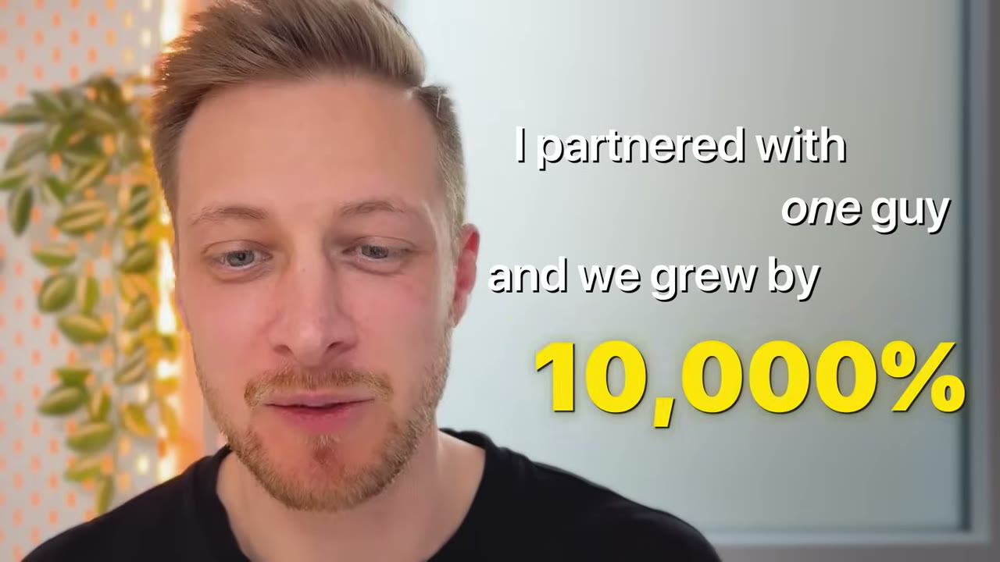
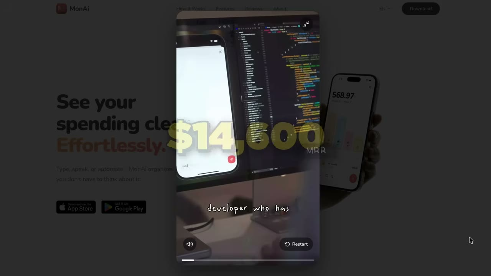
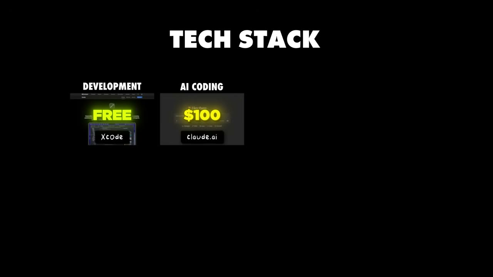

# How This App Makes $35K/Month

✅ **Đã phân tích sâu** → [`case.md`](case.md)

| | |
|---|---|
| **Video** | <https://www.youtube.com/watch?v=rGLXc1GmsaI> |
| **Đăng** | 05/04/2026 |
| **Thời lượng** | 21:48 |
| **Lượt xem** | 162,659 |
| **Lượt thích** | 4,075 |
| **Video ID** | `rGLXc1GmsaI` |

## Trong thư mục này

| File | Nội dung |
|---|---|
| [`case.md`](case.md) | **Phân tích đầy đủ** — ý tưởng, validate, GTM, áp dụng ở VN |
| [`meta.json`](meta.json) | Metadata gốc (chapters, heatmap, mô tả) |
| [`screenshots/`](screenshots/) | 10 ảnh 720p |

## Mô tả gốc

Flo's app was stuck at a few hundred bucks for over a year. Then one partnership changed everything and grew his app to $35K/month. 
This video is an educational case study of this founder’s experience. It is not financial advice and does not guarantee any income or results. Every business is different and your results may vary.
0:00 - Distribution is harder than ever before
1:02 - What's your story?
1:28 - App overview and stats
2:17 - Founder background
2:57 - How he found the app idea
3:45 - Distribution overview
4:41 - How Flo works with the influencer
6:58 - Influencer example and impact

## Số liệu bắt được từ transcript

> Các đoạn founder nhắc tới con số, kèm timestamp để tua thẳng tới đó trong video.

_(không bắt được con số nào)_

## Chương

- `00:00` Distribution is harder than ever before
- `01:02` What's your story?
- `01:28` App overview and stats
- `02:17` Founder background
- `02:57` How he found the app idea
- `03:45` Distribution overview
- `04:41` How Flo works with the influencer
- `06:58` Influencer example and impact
- `08:31` Learn distribution from successful founders
- `09:26` Influencer marketing playbook
- `14:09` MonAI demo
- `15:30` Tech stack and tools
- `16:30` Flo's final advice
- `18:06` Pat and Gus reflections

## Ảnh

1. `01_00m15s_ch-distribution-is-harder-than-ever-before.jpg` — 
2. `02_01m23s_usd-300-m.jpg` — 
3. `03_02m58s_usd-30-000-m.jpg` — 
4. `04_03m46s_usd-300-m.jpg` — 
5. `05_04m53s_ch-how-flo-works-with-the-influencer.jpg` — 
6. `06_07m10s_ch-influencer-example-and-impact.jpg` — 
7. `07_08m43s_ch-learn-distribution-from-successful-founder.jpg` — 
8. `08_09m38s_ch-influencer-marketing-playbook.jpg` — 
9. `09_15m46s_replay.jpg` — 
10. `10_16m33s_usd-30-000.jpg` — 

---

← [Quay lại index](../../index.md) · [Toàn bộ video](../README.md)
