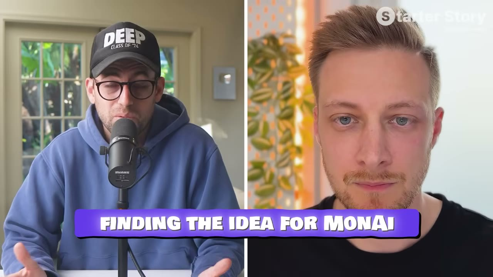
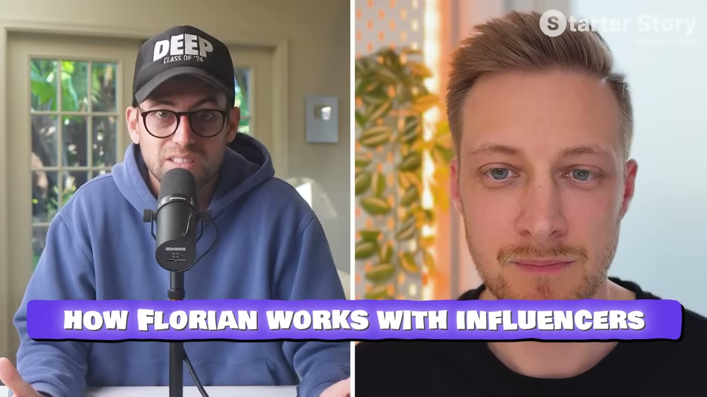

# MonAI — từ $300 lên $35K MRR nhờ đúng MỘT đối tác influencer

> **Tóm tắt 30 giây:** Flo là lập trình viên iOS người Đức, từng làm mobile UX lead. Anh làm **MonAI** — app ghi chi tiêu tối giản, nhập bằng **giọng nói** và tự động hoá. Anh tự marketing suốt **1,5 năm và chỉ đạt $300 MRR**. Rồi một **influencer người Colombia** chủ động liên hệ (vì tìm thấy mạng xã hội của anh **trong app**). Họ ký hợp đồng **chia lợi nhuận + retainer cố định**. Video đầu tiên đăng cuối 2024 → **trong một tuần MRR tăng 10 lần**, trong một tháng lên gần $8K. Nay **$35K MRR** — tăng **hơn 10.000%** — với **chỉ 3 video mỗi tháng**.

---

## 1. Con số

| Giai đoạn | MRR |
|---|---|
| 1,5 năm đầu, tự làm marketing | **$300** |
| 1 tuần sau video đầu của influencer | **~$3.000** (×10) |
| 1 tháng sau | **~$8.000** |
| Sau vài video nữa | **$13.000** |
| Hiện tại | **$35.000** |

**Tăng trưởng: hơn 10.000%** — và chỉ với **3 video mỗi tháng**.

**Nhận xét quan trọng của Pat, đúng trọng tâm:**
> Rất nhiều dev nghĩ *"chắc mình chưa có product-market fit, chắc app mình có gì đó sai."* **"Thứ duy nhất sai với app của anh là KHÔNG AI NHÌN THẤY NÓ."**

> **Đây là chẩn đoán sai lầm phổ biến nhất với người biết build.** Sản phẩm không đổi trong suốt quá trình từ $300 lên $35K. **Chỉ có phân phối đổi.**

---

## 2. Insight cốt lõi: MỘT đối tác chất lượng > 20 influencer ⭐⭐⭐

Đây là điểm khiến case này khác hẳn mọi case influencer khác trong kho.

**Cấu trúc hợp đồng:**
| Thành phần | Chi tiết |
|---|---|
| **Chia % LỢI NHUẬN** (không phải doanh thu) | Họ từng chia theo **doanh thu** và nhận ra **không scale tốt** |
| **Retainer cố định hằng tháng** | Đảm bảo thu nhập ổn định cho đối tác |
| **Nhịp** | Chỉ **3 video/tháng** |

**Vì sao chia theo LỢI NHUẬN quan trọng:**
> Vì thu nhập của anh ấy chủ yếu dựa trên lợi nhuận, **anh ấy được thúc đẩy làm điều tốt nhất cho app**. Không phải kiểu nhân viên giao video xong rồi thôi — **anh ấy liên tục nghĩ nên làm gì, làm sao ra video hay nhất.**

> **Chi tiết "lợi nhuận thay vì doanh thu" là bài học vận hành thật:** chia doanh thu khiến đối tác không quan tâm chi phí (server, ads, phí Apple) — và khi scale, phần chia có thể vượt lợi nhuận thực. Chia lợi nhuận đặt hai bên cùng một phía.

**Về chất lượng thay vì số lượng:**
> Họ chỉ đăng **3 video/tháng**, **chất lượng rất cao**, luôn **kể chuyện**. Họ **thường không đạt hàng triệu view** — nhưng những view có được thì **chuyển đổi ở tỉ lệ khá cao**.

**Và điều quan trọng với một dev đơn độc:**
> **Influencer chịu trách nhiệm nghĩ ý tưởng video** — nên Flo **không phải liên tục nghĩ ý tưởng viral**. Anh ấy là **bộ não sáng tạo**.

> ⚠️ **Đối lập trực tiếp với [Nicole](../2026-05-17_my-two-apps-make-150k-month-each/case.md)** (200+ creator, 400-500 triệu view/tháng) và [Benji](../2026-05-31_i-built-a-30k-month-app-heres-my-exact-process/case.md) (phỏng vấn 100 creator để lọc 10).
>
> **Cách hoà giải:** Nicole và Benji vận hành **hệ thống công nghiệp** — cần đội ngũ và vốn. Flo là **một dev đơn độc không phải người làm nội dung**. Với anh, **một đối tác có phần trong cuộc chơi** là mô hình duy nhất bền vững.
>
> **Chọn theo tài sản bạn có:** có đội + vốn → hệ thống UGC. Một mình + giỏi kỹ thuật → **một đối tác chia lợi nhuận**.

Producer nói thẳng quan điểm này:
> Anh **hoài nghi** với chiến lược liên hệ 100 influencer, chốt 10, hy vọng 1 người hiệu quả — vì sau đó phải trả tiền lại và mọi thứ phức tạp dần. **Khi phỏng vấn nhiều người làm playbook influencer, thường chỉ có ĐÚNG MỘT influencer thật sự tạo ra kết quả**, dù họ liên hệ rất nhiều.

Và anh dự đoán: **mô hình "influencer đổi cổ phần/lợi nhuận" sẽ còn lớn hơn** — đặc biệt tốt cho người như Flo, rõ ràng không phải content creator nhưng là dev giỏi.

---

## 3. Playbook 5 bước tiếp cận influencer ⭐⭐

Flo trao đổi với chính đối tác của mình để đúc kết bộ này:

### Bước 1 — Tìm đối tác THỰC SỰ khớp
Trước khi liên hệ, đảm bảo **lối sống, giọng điệu, khán giả** của influencer khớp với sản phẩm.

Anh tìm gì:
- Cá tính tốt, có sức hút
- ⭐ **Có kết nối với người xem — cụ thể là CÓ TRẢ LỜI BÌNH LUẬN.** Rất quan trọng nếu anh bán app, vì khán giả sẽ hỏi về nó.
- **Không thuần tuý là influencer công nghệ**, mà là **công nghệ + lối sống** — nhờ đó khán giả không chỉ quan tâm thông số, mà quan tâm **câu chuyện của anh ta**

### Bước 2 — Làm ấm mối quan hệ trước
Theo dõi họ từ trước. Những influencer đó **thường để ý ai hay bình luận** trên video của mình.
> Nếu không có thời gian làm việc này, **hãy thẳng thắn** — **đừng giả vờ** rằng đã theo dõi cả tháng.

### Bước 3 — Tiếp cận thật CỤ THỂ
> **Đừng gửi kiểu "tôi thích nội dung của anh, hợp tác nhé"** — thứ đó không ăn thua.
>
> Thay vào đó, **nhắc tới một video cụ thể, một khoảnh khắc cụ thể, một câu đùa họ từng nói** — để họ biết anh thật sự xem và thật sự quan tâm.

### Bước 4 — Nối vào sản phẩm
Sau khi thể hiện sự trân trọng, họ phải **nhìn thấy sự tương thích**. Đừng để nó giống một giao dịch kiểu *"tôi muốn trả tiền, làm cho tôi cái này."*
> Với Flo: khán giả của influencer đó **coi trọng thẩm mỹ và công nghệ đẹp**, còn sản phẩm của anh **tối giản, đẹp, nhưng vẫn nặng phần công nghệ** với AI và tự động hoá — **chồng lấn hoàn hảo.**

### Bước 5 — Thừa nhận giá trị của họ và ra tín hiệu sẵn sàng trả tiền, TỪ RẤT SỚM ⭐
Anh cho rằng đây là bước **quan trọng nhất**.
> Phải nói rõ ngay rằng họ **sẽ được đền đáp bằng cách này hay cách khác**. Điều đó lập tức **tách anh khỏi phần còn lại**.

**Và một mẹo rất khôn:** cho họ thấy **ví dụ các sản phẩm cùng ngách đang kiếm rất nhiều tiền** (tra trên Sensor Tower). Đại ý: *tôi hiểu giá trị của anh — một video của anh chạm tới hàng triệu người. Tôi muốn anh làm đối tác dài hạn và chia lợi nhuận app. Ban đầu có thể không nhiều, nhưng các app khác trong ngách này kiếm $50-100K/tháng nếu phân phối đúng.*
> Câu đó cho họ một **mô hình tinh thần về tương lai** của sự hợp tác.

**Ba mẹo bổ sung:**
- **Viết ngắn.** Những creator này nhận **hàng trăm email mỗi tuần**.
- **Điểm cộng lớn: gửi video cá nhân hoá** có nhắc tên và nội dung của họ — *"hầu hết mọi người sẽ không làm điều này, và đó chính là lý do anh nên làm."*
- ⭐ **Đặt tài khoản mạng xã hội của anh NGAY TRONG APP.** Đây chính là cách đối tác tìm thấy Flo — **influencer chủ động liên hệ anh**, và khi đó **anh đàm phán được điều khoản tốt hơn nhiều.**

> **Mẹo cuối cùng này là thứ rẻ nhất và bị bỏ qua nhiều nhất: thêm link mạng xã hội vào app ngay hôm nay.**

---

## 4. Nhắm thị trường NGOÀI nước Mỹ ⭐

> **"Quan trọng nhất là hãy nhìn sang các thị trường khác ngoài Mỹ. Có rất nhiều content creator giỏi ở ngoài đó."**

Flo người Đức, đối tác người **Colombia**, app phục vụ thị trường nói tiếng Tây Ban Nha.

**Producer nhấn mạnh:** App Store rất lớn ở các nước khác. Họ đã phỏng vấn nhiều founder bùng nổ ở giai đoạn đầu nhờ nhắm thị trường khác — **Pháp, Argentina** được nhắc tên.

> **Đây là mẫu hình lặp lại thứ tư trong knowledge base:** [CalBuddy](../2026-08-09_i-copied-a-huge-app-now-i-make-80k-month/case.md) (CPM Israel rẻ), [Chart Detector](../2026-07-23_i-make-50k-per-month-working-5-hours-a-week/case.md) (*"ROI ở nước khác tốt hơn nhiều"*), [Cat on Chair](../2026-07-26_this-simple-app-makes-18k-month/case.md) (Đài Loan/Trung Quốc). **Với người Việt, đây là lợi thế cấu trúc, không phải hạn chế.**

**Và về việc "ý tưởng đã có người làm":** producer nói thẳng — đây **lại là một app ghi chi tiêu nữa**, thể loại bão hoà nhất. *"Vậy mà năm 2026 người ta vẫn kiếm tiền được với thứ này."*
> Pat bổ sung: **trong mảng quản lý chi tiêu không có người thắng rõ ràng.** Anh xem demo xong **lập tức muốn dùng thử**.

---

## 5. Sản phẩm & định giá

**Ý tưởng đến từ chính anh:** anh muốn quay lại việc ghi chép chi tiêu, đã thử nhiều app nhưng **luôn bỏ vì quá phiền phức**. Đúng lúc AI trở nên dùng được, anh ghép hai thứ lại — **dùng AI để giảm ma sát.**

**Bài học từ thất bại trước:** app trước anh làm mất **2 năm**, launch xong **không ai quan tâm**. Nên lần này anh muốn **ship nhanh nhất có thể** — bản đầu mất **1-2 tháng**, rồi liên tục cải tiến.

**Định giá:** từng làm **freemium**, nhưng **A/B test cho thấy hard paywall + dùng thử 7 ngày hoạt động tốt hơn**.
> Cùng kết luận với [Chart Detector AI](../2026-07-23_i-make-50k-per-month-working-5-hours-a-week/case.md) — hard paywall là mẫu hình lặp lại trên kênh.

**Tech stack (~$900/tháng):** Xcode (miễn phí) · **Claude Code** gói Max ($100) · **RevenueCat** (~$400, dùng cho A/B test là chính) · **Appwrite** ($25, backend + auth + database) · **OpenAI** cho tác vụ đơn giản + **Anthropic** cho phân tích sâu (~$200) · **Helm** (mua lifetime ~$175, đỡ khổ với App Store Connect) · Figma bản free.

---

## 6. Lời khuyên cuối — tiếc vì không chạy ads sớm hơn

> Anh **rất ngần ngại với Meta Ads** vì thấy nó đáng sợ và **sợ phí tiền**. Nhưng anh nhận ra: **đối tác của anh làm video rất hay, và những video đó dùng để thử nghiệm với Meta Ads rất dễ.** Họ mới bắt đầu vài tuần và đã thấy kết quả tốt.
>
> **"Chúng tôi đã có thể kiếm được nhiều tiền hơn nếu lên chuyến tàu đó sớm hơn."**

Pat xác nhận mẫu hình: **phải tìm ra nội dung trước** — nội dung chạy trên ads phải tốt — **rồi mới đổ dầu vào lửa**.

> Đây chính là công thức lặp lại của [Go Tall](../2026-07-19_this-stupidly-simple-app-makes-100k-month/case.md) và [Benji](../2026-05-31_i-built-a-30k-month-app-heres-my-exact-process/case.md): **organic chứng minh creative → ads khuếch đại.**

---

## 7. Cảnh báo thiên kiến nguồn ⚠️

**Playbook tiếp cận influencer trong video này CHƯA TỪNG ĐƯỢC FLO DÙNG.** Đây là phát hiện quan trọng nhất của case. Sự thật là **influencer chủ động tìm tới anh** (`04:13`: *"anh ấy liên hệ với tôi vì tìm thấy mạng xã hội của tôi trong app"*). Khi Pat hỏi "nếu làm lại thì anh sẽ tiếp cận creator thế nào", Flo trả lời thẳng: *"**Tôi đã nói chuyện với đối tác của mình về chuyện này và chúng tôi nghĩ ra playbook này.**"* Tức 5 bước từ `09:38` đến `12:49` là một quy trình **được dựng ra cho video**, không phải quy trình đã tạo ra $35K MRR. Vẫn đáng đọc, nhưng hãy đọc nó như **giả thuyết**, không phải như bằng chứng.

**Thứ đang đẩy tăng trưởng hôm nay không chỉ là 3 video/tháng.** Ở `16:44`, gần cuối video, Flo tiết lộ: *"chúng tôi **vừa bắt đầu chạy Meta Ads vài tuần trước** và đã thấy kết quả rất tốt... lẽ ra chúng tôi đã kiếm được nhiều tiền hơn nếu lên chuyến tàu đó sớm hơn."* Nghĩa là con số $35K hiện tại **đã bao gồm cả quảng cáo trả tiền**, trong khi toàn bộ video được đóng khung là *"một đối tác duy nhất, không cần đội quân TikTok"*. Ngoài ra `07:50`: **Apple mời anh tham dự WWDC** — một cú hích uy tín và PR mà không playbook nào tái lập được, được nhắc thoáng qua như một chi tiết phụ.

**Nhà tài trợ chèn giữa — mâu thuẫn với chính case, lần thứ hai trên kênh.** `08:21-09:15`: Pat phát *"**Organic** Short Form Playbook"* miễn phí, link mô tả là **`clickhubspot.com/wsf`** (lead magnet HubSpot). Nhưng Flo **không làm organic short form** — anh **chia lợi nhuận cho một creator** và **chạy Meta Ads**. Cùng kiểu lệch pha với [case Locked](../2026-04-01_im-14-and-i-built-a-14k-month-app/case.md), nơi đúng lead magnet này được phát giữa một câu chuyện thuần hợp đồng influencer trả tiền. Thêm `21:09` chào bán lần cuối.

**Ba con số cho một doanh thu.** Flo: *"hơn 35K MRR một chút"*. Pat: *"hơn **$30.000**"* (dùng ít nhất sáu lần). Dòng chữ trên màn hình: **`$30,000/m`** và **`$30,000`**. Tiêu đề: **$35K**. Ở đây host làm tròn **xuống**, nên sai lệch không có lợi cho founder — nhưng nó cho thấy con số trên màn hình của kênh này không đáng tin cậy tới từng nghìn đô.

**Bối cảnh bị làm mờ:**
- **Flo là mobile UX lead chuyên nghiệp**, học khoa học máy tính, tự học lập trình iOS. App đẹp và tối giản — đúng thứ khiến một creator mảng công nghệ/lifestyle muốn gắn tên vào. Đây là điều kiện tiên quyết, không phải may mắn.
- **Anh chỉ nghỉ việc "đầu năm nay"** — tức suốt 1,5 năm ở mức $300 MRR, anh vẫn **có lương toàn thời gian**. Không có sàn thu nhập đó thì không ai chờ được 18 tháng.
- **Anh từng bỏ 2 năm cho một app khác và nó thất bại hoàn toàn** (*"tôi ra mắt và rõ ràng chẳng ai quan tâm"*). MonAI là lần thử sau nhiều năm.
- **Đối tác không được nêu tên, không được định lượng.** Kênh của anh ta bao nhiêu người theo dõi? Thị trường Colombia lớn cỡ nào? Không có con số nào — nên **không ai kiểm chứng được rằng "một creator đúng" là đủ**, hay Flo đã trúng một creator ngoại hạng.

**Thiếu số liệu quan trọng — và ở case này chỗ thiếu ảnh hưởng trực tiếp tới tiền của bạn:**
- **Không biết đối tác lấy bao nhiêu phần trăm lợi nhuận, retainer cố định là bao nhiêu.** Đây là chi phí lớn nhất của mô hình, và nó **vĩnh viễn**. $35K MRR là doanh thu của business, không phải thu nhập của Flo.
- **Không có giá bán.** Cả video không nêu app giá bao nhiêu — nên không tính được số người trả tiền, không tính được ARPU, không so sánh được với case khác.
- **Không có churn**, dù đây là app tài chính cá nhân — loại có tỉ lệ bỏ rất cao sau vài tháng.
- **Không trừ 15-30% của Apple**, không nêu ngân sách Meta Ads đang chạy.
- **Quy kết doanh thu là công cụ tự anh viết.** *"Tôi tự làm một công cụ nhỏ để trực quan hoá"* — các vòng tròn đánh dấu ngày đăng video đặt cạnh đường MRR. Đó là tương quan trên đồ thị, không phải phân bổ theo link.

---

## 8. Áp dụng cho tôi (indie hacker VN)

**Đây là mô hình phân phối phù hợp nhất cho một dev đơn độc không giỏi làm nội dung — và rất hợp với anh.**

**Làm ngay hôm nay:**
1. ⭐ **Thêm link mạng xã hội của anh vào trong app** — miễn phí, và đây là cách Flo được tìm thấy
2. Lập danh sách creator trong ngách: khớp **lối sống + giọng điệu + khán giả**, và **có trả lời bình luận**
3. **Theo dõi và bình luận thật** vài tuần trước khi liên hệ
4. Nhắn **ngắn, cụ thể** (nhắc đúng một video/khoảnh khắc), **nêu rõ sẽ trả tiền ngay từ đầu**
5. Đề xuất **chia % LỢI NHUẬN + retainer**, không phải trả theo bài
6. Nhắm **3 video/tháng chất lượng cao**, không phải số lượng

**Vì sao rất hợp với thị trường VN:**
- ✅ **Không cần vốn quảng cáo lớn** — trả bằng phần lợi nhuận
- ✅ **Không cần anh giỏi làm nội dung** — đối tác lo phần đó
- ✅ **KOC Việt Nam đông, chi phí hợp lý, và mô hình chia hoa hồng đã quen thuộc**
- ✅ **Có thể nhắm thị trường nước ngoài** — Flo (Đức) + đối tác (Colombia) là ví dụ trực tiếp
- ✅ Đội **1 người + 1 đối tác**

**Rào cản thật:**
- ⚠️ **Tìm đúng MỘT người rất khó** — và toàn bộ business phụ thuộc vào họ. Nếu họ nghỉ, tăng trưởng dừng. Đây là **rủi ro tập trung nghiêm trọng**.
- ⚠️ **Chia lợi nhuận là cam kết dài hạn** — cần hợp đồng rõ ràng về cách tính lợi nhuận, chi phí nào được trừ
- ⚠️ **1,5 năm đầu anh chỉ có $300 MRR.** Đây không phải con đường nhanh; nó đòi hỏi sản phẩm đã tốt sẵn khi cơ hội tới.
- ⚠️ Anh có nền **mobile UX lead** — thiết kế app đẹp là lợi thế thật khiến influencer muốn hợp tác

**Khi KHÔNG nên dùng mô hình này:**

- **Khi sản phẩm của bạn chưa đủ tốt để một creator dám gắn tên và nhận chia lợi nhuận.** Đối tác của Flo được trả **theo phần trăm LỢI NHUẬN** — nghĩa là anh ta chỉ có tiền nếu người dùng ở lại và tiếp tục trả. Không ai ký kiểu hợp đồng đó với một app còn thô. Flo đã mài MonAI **1,5 năm** và có nền mobile UX lead trước khi cơ hội tới. Nếu app của bạn mới ra hai tuần, thứ duy nhất bạn mua được là [deal trả tiền theo bài như Locked](../2026-04-01_im-14-and-i-built-a-14k-month-app/case.md) — và đó là mô hình cần vốn, khác hẳn.
- **Khi sản phẩm không có "khoảnh khắc wow" quay được trong một video kể chuyện.** Cả cỗ máy chạy bằng **3 video/tháng** — tức mỗi video phải tự nó bán được hàng. MonAI có cảnh nói *"cà phê Starbucks 50 đô"* rồi giao dịch tự hiện ra. Nếu giá trị sản phẩm của bạn chỉ lộ ra sau nhiều tuần dùng, hoặc cần giải thích mới hiểu, ba video một tháng sẽ không đủ, và bạn buộc phải quay lại cuộc chơi số lượng.
- **Khi bạn không chấp nhận đánh cược toàn bộ tăng trưởng vào MỘT người — vĩnh viễn.** Nếu đối tác nghỉ, ốm, đổi hướng nội dung hoặc mất khán giả, kênh phân phối duy nhất của bạn biến mất trong một tháng. Và phần chia lợi nhuận là **khoản trừ vĩnh viễn** khỏi biên lợi nhuận lẫn giá trị doanh nghiệp khi bán. Đây đúng là [rủi ro tập trung mà Jacky Chow trả giá](../2026-03-22_i-make-250k-month-from-13-businesses-after-losing-ev/case.md) — chỉ khác là ở đây nút thắt là một con người thay vì một thuật toán.

---

## Nguồn

- Video: [How This App Makes $35K/Month](https://www.youtube.com/watch?v=rGLXc1GmsaI) — Starter Story, 05/04/2026, 21:48, 162K views
- Sản phẩm: MonAI
- [`transcript.md`](transcript.md) · [`screenshots/`](screenshots/)
