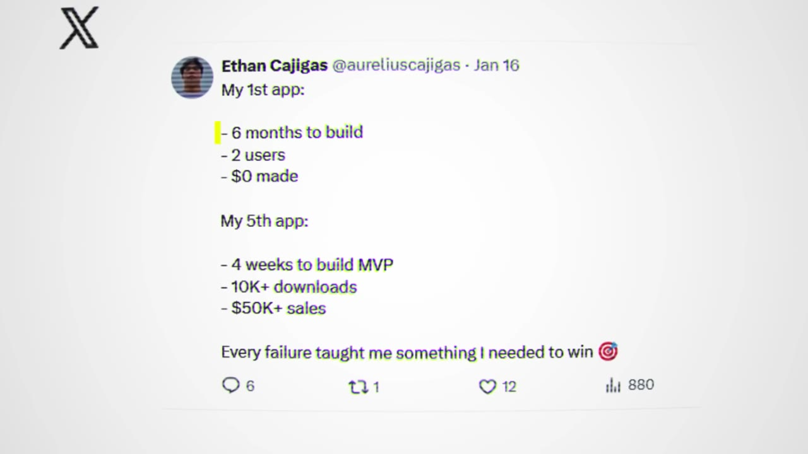
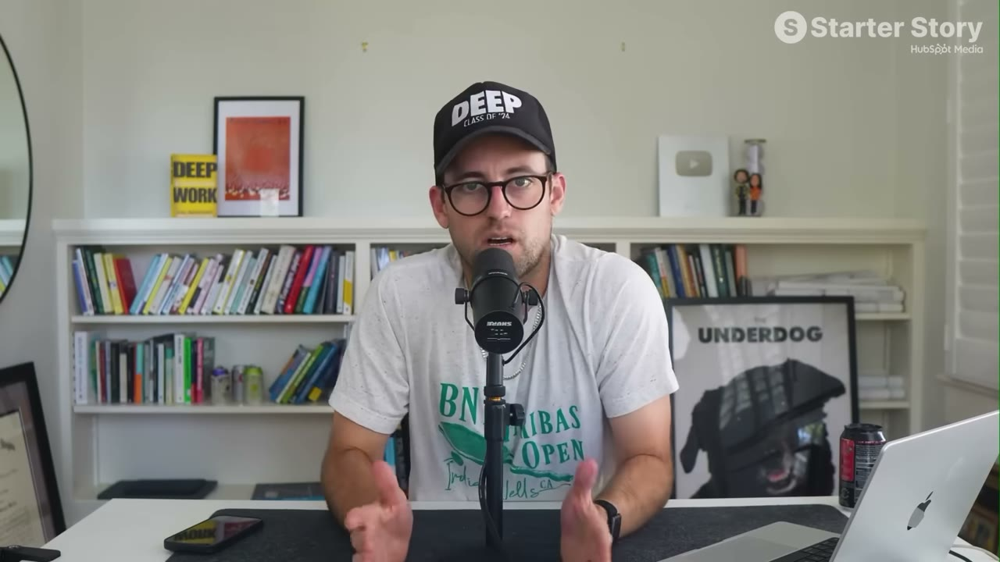

# My App Makes $20K/Month: How I Found A Simple Idea And Turned It Into A Profitable Business

✅ **Đã phân tích sâu** → [`case.md`](case.md)

| | |
|---|---|
| **Video** | <https://www.youtube.com/watch?v=PIXXEAfo6MY> |
| **Đăng** | 08/04/2026 |
| **Thời lượng** | 14:08 |
| **Lượt xem** | 59,314 |
| **Lượt thích** | 1,500 |
| **Video ID** | `PIXXEAfo6MY` |

## Trong thư mục này

| File | Nội dung |
|---|---|
| [`case.md`](case.md) | **Phân tích đầy đủ** — ý tưởng, validate, GTM, áp dụng ở VN |
| [`meta.json`](meta.json) | Metadata gốc (chapters, heatmap, mô tả) |
| [`screenshots/`](screenshots/) | 10 ảnh 720p |

## Mô tả gốc

Ethan dropped out of college after realizing AI could build in a day what took him a week. 6 months later, his app makes $20K/month. This is his exact playbook for finding, building, and marketing a niche app.
This video is an educational case study of this founder’s experience. It is not financial advice and does not guarantee any income or results. Every business is different and your results may vary.
0:00 - Don't build for anyone
1:07 - What's your story?
1:38 - App dashboards and data
2:32 - Ethan's background
3:27 - Finding the niche app idea
4:30 - How he built the app
5:15 - Learn to b

## Số liệu bắt được từ transcript

> Các đoạn founder nhắc tới con số, kèm timestamp để tua thẳng tới đó trong video.

_(không bắt được con số nào)_

## Chương

- `00:00` Don't build for anyone
- `01:07` What's your story?
- `01:38` App dashboards and data
- `02:32` Ethan's background
- `03:27` Finding the niche app idea
- `04:30` How he built the app
- `05:15` Learn to build an iOS app
- `06:01` Niche app playbook
- `07:57` Tech stack
- `08:24` App marketing playbook
- `09:35` How he scaled to $20K/month
- `10:45` CutCoach app demo
- `11:45` Advice to younger self
- `12:41` Pat and Gus reflections
- `13:48` Go build your own niche app!

## Ảnh

1. `01_00m37s_usd-20-000.jpg` — 
2. `02_01m23s_usd-0.jpg` — 
3. `03_02m44s_ch-ethan-s-background.jpg` — 
4. `04_03m24s_usd-20-000.jpg` — 
5. `05_05m16s_usd-20-000.jpg` — 
6. `06_06m13s_ch-niche-app-playbook.jpg` — 
7. `07_08m24s_replay.jpg` — 
8. `08_09m47s_ch-how-he-scaled-to-20k-month.jpg` — 
9. `09_10m57s_ch-cutcoach-app-demo.jpg` — 
10. `10_11m57s_ch-advice-to-younger-self.jpg` — 

---

← [Quay lại index](../../index.md) · [Toàn bộ video](../README.md)
