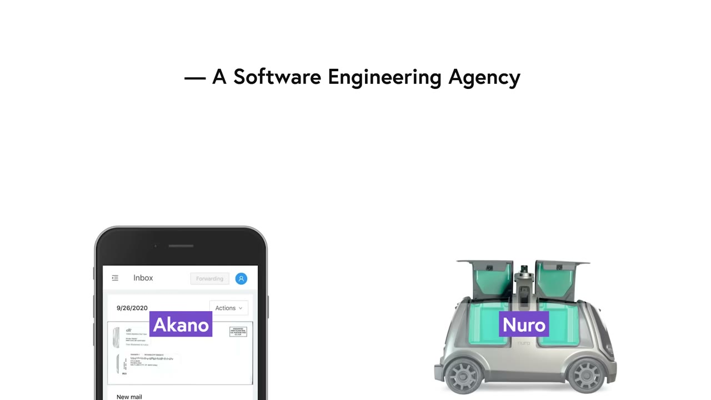
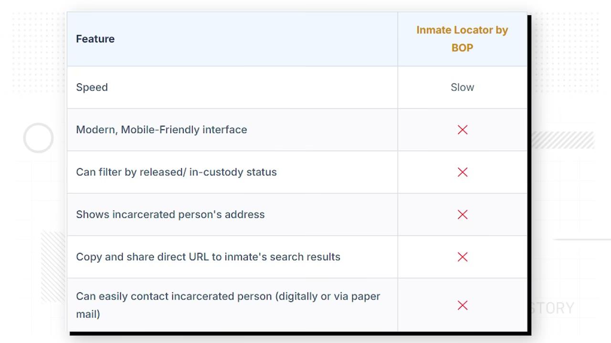

# I Made $1.5M From An App You’ve Never Heard Of

✅ **Đã phân tích sâu** → [`case.md`](case.md)

| | |
|---|---|
| **Video** | <https://www.youtube.com/watch?v=bq3-qH-CpYQ> |
| **Đăng** | 12/04/2026 |
| **Thời lượng** | 14:21 |
| **Lượt xem** | 89,314 |
| **Lượt thích** | 2,441 |
| **Video ID** | `bq3-qH-CpYQ` |

## Trong thư mục này

| File | Nội dung |
|---|---|
| [`case.md`](case.md) | **Phân tích đầy đủ** — ý tưởng, validate, GTM, áp dụng ở VN |
| [`meta.json`](meta.json) | Metadata gốc (chapters, heatmap, mô tả) |
| [`screenshots/`](screenshots/) | 10 ảnh 720p |

## Mô tả gốc

An unexpected phone call gave Jordan Rejaud the idea for an app that's now done $1.5M in revenue. And he's done it with zero ads, no content, and a customer base most founders would never think to build for.
This video is an educational case study of this founder’s experience. It is not financial advice and does not guarantee any income or results. Every business is different and your results may vary.
0:00 - You've never heard of this app
0:54 - What's your story?
1:26 - Founder background
2:03 - Building the app
2:28 - Find a niche app idea
3:11 - Tech stack (and why it doesn't matter)
4:27 

## Số liệu bắt được từ transcript

> Các đoạn founder nhắc tới con số, kèm timestamp để tua thẳng tới đó trong video.

_(không bắt được con số nào)_

## Chương

- `00:00` You've never heard of this app
- `00:54` What's your story?
- `01:26` Founder background
- `02:03` Building the app
- `02:28` Find a niche app idea
- `03:11` Tech stack (and why it doesn't matter)
- `04:27` How he found the app idea
- `05:28` Validating the idea
- `06:20` Advice for actually validating ideas
- `07:35` Growth
- `08:43` What does this app do?
- `09:42` How does it make money?
- `10:11` App revenue and statistics
- `11:27` Advice: Make more mistakes
- `12:58` Pat and Gus reflections: build niche apps!

## Ảnh

1. `01_00m15s_ch-you-ve-never-heard-of-this-app.jpg` — 
2. `02_01m06s_ch-what-s-your-story.jpg` — 
3. `03_02m38s_usd-300-000.jpg` — 
4. `04_03m23s_ch-tech-stack-and-why-it-doesn-t-matter.jpg` — 
5. `05_04m26s_usd-300-000.jpg` — 
6. `06_05m05s_replay.jpg` — 
7. `07_05m40s_ch-validating-the-idea.jpg` — 
8. `08_06m32s_ch-advice-for-actually-validating-ideas.jpg` — 
9. `09_07m47s_ch-growth.jpg` — 
10. `10_08m49s_replay.jpg` — 

---

← [Quay lại index](../../index.md) · [Toàn bộ video](../README.md)
