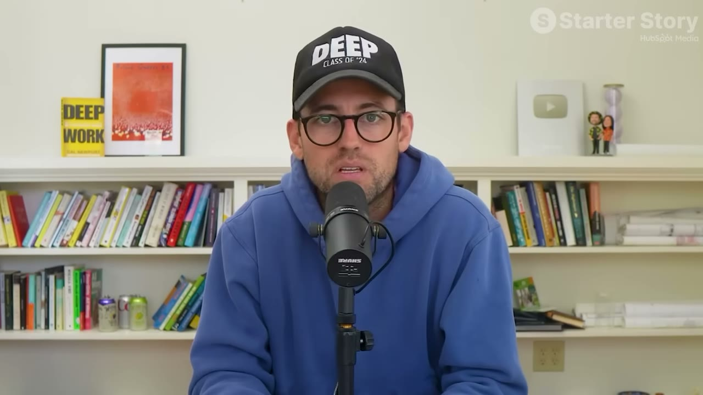

# Parakeet Chat — $1,5 triệu từ một thị trường gần như không ai biết là thị trường

> **Tóm tắt 30 giây:** Jordan là kỹ sư (từng làm robot thám hiểm mặt trăng thời cao học, rồi làm nghiên cứu ở một tập đoàn Fortune 100). Khi làm freelance ở San Francisco, một khách hàng của anh **bị đi tù**. Anh giữ liên lạc bằng **thư giấy** suốt vài năm, và người này kể rằng **các dịch vụ trong tù phần lớn là hình thức bóc lột — chất lượng kém, giá rất cao**. Anh nghĩ mình làm tốt hơn được. Kết quả: **Parakeet Chat** — hệ thống cho phép phạm nhân dùng chính email nội bộ nhà tù để trò chuyện với AI và liên lạc với gia đình. **200 khách trả tiền và có lãi ngay trong tháng đầu.** Tổng tích luỹ **$1,5 triệu**, ~**30.000 người đã dùng — khoảng 20% dân số nhà tù liên bang Mỹ**.

---

## 1. Con số

| Chỉ số | Giá trị |
|---|---|
| Doanh thu 2025 | **hơn $300.000** |
| **Tổng tích luỹ** | **$1.500.000** |
| Người từng dùng | **~30.000** — khoảng **20% toàn bộ dân số nhà tù liên bang Mỹ** |
| Tin nhắn đã gửi | **~9 triệu** |
| Kết nối gia đình tạo ra | **gần 100.000** |
| Giá | **$15-20/tháng**, giảm nếu trả theo năm |
| Nhân sự | **1** |
| Thời gian tới khi có lãi | **2 tháng** (1 tháng prototype + 1 tháng hệ thống thanh toán) |

> Anh cũng đã tự bootstrap **hai** business, mỗi cái tổng doanh thu vượt $1 triệu. Cái đầu anh mô tả là *"khá chán, bình thường"* — làm xe tự lái và drone cho các công ty lớn.

---

## 2. Insight về mô hình: NGƯỜI DÙNG ≠ NGƯỜI TRẢ TIỀN ⭐⭐

Đây là cấu trúc đáng học nhất của case.

> **"Ở phần lớn business, khách hàng và người dùng là cùng một người. Ở đây thì khác. NGƯỜI DÙNG là người đang ở bên trong. KHÁCH HÀNG là gia đình họ ở bên ngoài."**

Gia đình trả một khoản subscription hằng tháng.

> **Vì sao cấu trúc này mạnh:** người dùng có nhu cầu cực kỳ cấp thiết nhưng **không có khả năng chi trả**; người trả tiền có khả năng chi trả và **động lực cảm xúc rất lớn**. Tách hai vai này ra là chìa khoá.
>
> **Bộ lọc dùng được: có nhóm người nào cần thứ này tha thiết nhưng không tự trả được — và có ai đó yêu thương họ sẵn sàng trả thay không?** Áp dụng được cho: người già, trẻ em, người bệnh, người học nghề, người ở xa.

**Sản phẩm thực chất là gì:** **không có app nào để tải cả.** Phạm nhân dùng **hệ thống email nội bộ của nhà tù** — họ gửi email tới một địa chỉ cụ thể, bot của anh xử lý và trả lời. Về bản chất đó là **một chatbot chạy qua email**, tra cứu ChatGPT, tra thống kê thể thao.

> **Bài học thiết kế: anh không chống lại giới hạn của môi trường — anh xây BÊN TRONG nó.** Nhà tù không cho phép app; nhưng có email. Vậy sản phẩm là email.

**Người ta dùng nó để làm gì:** phần lớn là **nghiên cứu luật và án lệ** — anh đoán là về chính vụ án của họ, để hiểu quyền của mình, vì **nguồn lực họ có rất hạn chế**. Ngoài ra là liên lạc với gia đình.

Anh kể một phản hồi khiến ta hiểu vì sao truyền miệng mạnh đến vậy: có người nói **nhờ hệ thống này họ nói chuyện được với con gái mình sau nhiều năm không liên lạc**.

> Anh cũng nhận xét: họ nhận **rất nhiều câu hỏi về khởi nghiệp** từ nền tảng, và **nhiều câu thông minh hơn mức trung bình anh gặp ở bên ngoài.**

---

## 3. Cách tìm ra ý tưởng — không tìm, mà gặp

Anh đang làm freelance, sắp hoàn thành một app cho khách. Trong buổi họp Zoom cuối, **bạn gái của khách xuất hiện, rất buồn bã, và báo rằng anh ta đã bị đưa vào tù.**

> **"Hôm nay anh ta còn ở đây, đang nói chuyện, đang làm việc cùng nhau — hôm sau anh ta biến mất."**

Anh giữ liên lạc **vài năm bằng thư giấy** — anh đùa: *"rất công nghệ cao."* Qua đó anh biết được thực trạng các dịch vụ trong tù.

> **Đây là dạng nguồn ý tưởng không thể lên kế hoạch: nó đến từ việc GIỮ QUAN HỆ với một người trong hoàn cảnh bất thường.** Không có framework nào tạo ra được nó. Nhưng bài học vẫn dùng được: **những thị trường bị bỏ quên nhất thường nằm sau một mối quan hệ cá nhân, không nằm trong bảng phân tích thị trường.**

---

## 4. Validate — khi không thể validate theo cách thông thường ⭐

**Vấn đề đặc thù:** nhà tù là **hệ sinh thái đóng**. Không thể gửi link landing page, không thể thu email.

> **"Trong bước này, validate ý tưởng và xây MVP là MỘT. Tôi phải build MVP và đưa nó tới trước mặt họ thì mới validate được."**

**Cách anh làm:** nói với những người anh quen trong tù — *đây là công cụ tôi muốn làm; tôi nghe nói các anh đang dùng công nghệ cũ, chạy không tốt, giá quá cao; đây là thứ tôi hình dung sẽ tốt hơn.*

Phản hồi rất mạnh. **Người ta kể cho người khác.** Trong vòng một tháng: **200 người dùng.** Với anh, thế là đủ.

### Quan điểm về validate — phần đáng giá nhất ⭐⭐

> **"Chi tiết CÁCH validate không quan trọng bằng việc anh PHẢI validate."**

Và anh chỉ ra vấn đề thật:

> **Rất nhiều người khởi nghiệp YÊU ý tưởng của mình.** Họ nói *"tôi có ý tưởng cho một app"* rồi dành **12 tháng** làm ra app hoàn hảo. **Họ chưa cho ai xem. Họ không có phản hồi nào từ khách hàng thật.**
>
> **"Validate không phải là một chiến lược cụ thể. Nó là: anh CÓ MUỐN validate hay không? Vì ngay khi anh validate, ý tưởng của anh đi từ một thứ nhỏ bé trong đầu mà anh yêu và bảo vệ — ra ngoài thế giới. Và thế giới rất có thể sẽ nhổ vào nó. Họ sẽ ghét nó. Họ sẽ thấy nó chán."**
>
> **"Anh có thể tra trên mạng trong 5 phút cách validate bất cứ thứ gì. Vấn đề là PHẦN LỚN NGƯỜI TA KHÔNG MUỐN VALIDATE. Vì nếu validate, nghĩa là anh có thể VÔ HIỆU HOÁ ý tưởng của mình. Và với hầu hết mọi người, đó là chuyện cảm xúc. Họ đầu tư cảm xúc quá nhiều vào việc ĐƯỢC LÀM MỘT NGƯỜI KHỞI NGHIỆP."**
>
> **"Hãy chấp nhận rằng anh PHẢI validate, và anh phải sẵn sàng để ý tưởng của mình CHẾT."**

> **Đây là chẩn đoán chính xác nhất về việc vì sao người ta không validate — và nó khớp hoàn toàn với [Gaurabh](../2026-08-22_he-built-100-apps-and-made-0-can-he-fix-it-in-30-day/case.md)** (72 app, $0, chẩn đoán là **sợ bị từ chối**) và với nhận xét của Pat ở [Once](../2026-05-10_i-built-a-20k-month-app-in-83-days/case.md): AI khiến việc build trở thành **nơi trú ẩn** khỏi việc phải hỏi người thật.

---

## 5. Tăng trưởng: truyền miệng thuần tuý

> **"Nhà tù là hệ sinh thái đóng. Rất khó liên lạc từ ngoài vào và ngược lại. Tôi có vài người ở bên trong mà tôi trao đổi về dự án, và họ cho người khác xem. Rồi những người đó lại cho người khác xem nữa."**

**Lý do nó lan được:**
> **"Nếu anh tạo ra một sản phẩm tốt và nó cộng hưởng với người ta, họ sẽ thành TÍN ĐỒ của anh."** Anh dẫn câu quen thuộc: Apple không có khách hàng, họ có tín đồ — **hơi phóng đại, nhưng đúng.**

**Thứ duy nhất anh chủ động xây:** **hệ thống giới thiệu nội bộ** — khách giới thiệu được người mới bắt đầu trả tiền thì được **khoảng một tháng credit miễn phí**.

> **"Tôi biết người ta muốn một câu trả lời ngầu hơn, nhưng không — tất cả chỉ là truyền miệng."**

**Và cách anh nghĩ về tăng trưởng:**
> **Hãy nghĩ về tăng trưởng và khởi nghiệp như một NHÀ KHOA HỌC. Sẵn sàng thí nghiệm, sẵn sàng thất bại, nghĩ ra một chiến lược — nó có thể rất tệ, nhưng anh sẽ nhận được DỮ LIỆU và từ đó lặp lại.**

---

## 6. Tech stack — và vì sao nó không quan trọng

TypeScript · React · Postgres · Redis (bộ nhớ đệm + hàng đợi) · Auth0 (*"không ai muốn tự viết hệ thống đăng nhập"*) · Prisma · Zod · nhiều Docker container.

**Nhưng anh nói thẳng:**
> **"Tôi chưa mở code editor 3-6 tháng nay. Tôi để hệ thống AI viết toàn bộ code. Ý tôi là: AI CHÍNH LÀ tech stack mới."**

**Và câu trả lời cho câu hỏi anh hay nhận nhất:**
> *"Tôi có một ý tưởng tuyệt vời, tôi nên dùng ngôn ngữ gì?"* → **"Không quan trọng lắm. Làm cái anh thấy hiệu quả, cái anh thấy thú vị. Tech stack không quan trọng bằng TỐC ĐỘ THUẦN TUÝ."**

---

## 7. Lời khuyên cuối — về việc mắc sai lầm ⭐

> **"Nếu quay lại được, tôi sẽ nói với Jordan trẻ: MỌI THỨ CẬU NGHĨ VỀ KINH DOANH ĐỀU SAI. Và không chỉ chuyện khởi nghiệp — nói chung. Nếu cậu chưa từng làm kinh doanh, hay bất kỳ lĩnh vực cụ thể nào, thì mọi điều cậu tin có lẽ đều sai."**

> **"Lý do mọi thứ diễn ra khá tốt ở dự án này không phải vì tôi là thiên tài. Mà vì tôi ĐÃ MẮC NHỮNG SAI LẦM ĐÓ TỪ 10 NĂM TRƯỚC. Nên tôi mất 10 năm để tới được điểm này. Người ta nói 'thành công sau một đêm' — không có chuyện đó. Nó không tồn tại."**

> **"Nếu muốn thành công, anh phải bắt đầu NGAY BÂY GIỜ. Hãy nghĩ ra một ý tưởng ngu ngốc, một ý tưởng ngớ ngẩn mà ai cũng bảo sẽ không chạy — và làm nó ngay bây giờ. Kể cả khi anh BIẾT nó sẽ thất bại. Càng tốt nếu anh biết trước nó sẽ thất bại, vì lúc đó anh không còn ảo tưởng nào."**
>
> **"Làm nó theo cách có kiểm soát — đừng để nó phá sản anh hay khiến anh bị bắt. Và anh sẽ học được từ lần thất bại đó nhiều hơn đọc 20 cuốn sách."**

> Cùng thông điệp với [Hero Analytics](../2026-06-10_i-built-a-1m-saas-in-a-hidden-niche/case.md) (*"mất 10 năm để xây Hero"*) và [Marc Lou](../2026-04-26_how-i-work-77k-month-solopreneur/case.md) (tỉ lệ trúng 5%). **Producer cũng chỉ ra điều này khi nói về các founder 22-23 tuổi: họ vẫn đi trước 6-10 năm, chỉ là họ bắt đầu sớm hơn và đã mắc hết sai lầm rồi.**

---

## 8. Cảnh báo thiên kiến nguồn ⚠️

**$1,5 triệu là con số CỘNG DỒN cả đời sản phẩm — và phép trừ nói một điều không ai nói ra.** Jordan nêu hai con số ở `10:03`: *"Năm ngoái, 2025, Parakeet Chat kiếm hơn 300K doanh thu, và tổng cộng cả đời, nó đã kiếm **1,5 triệu đô la Mỹ**."* Lấy $1,5 triệu trừ $300K = **$1,2 triệu đến từ những năm TRƯỚC 2025**. Nếu sản phẩm đang tăng trưởng, năm gần nhất phải là năm lớn nhất. Ở đây thì ngược lại. **Rất có thể đỉnh của Parakeet Chat đã ở phía sau**, và $300K/năm (~$25K/tháng) là con số hiện tại đang đi xuống — nhưng **không ai hỏi, và video không đưa ra một đường doanh thu theo năm nào**. Ngay chính đội biên tập cũng lẫn: lời dẫn giữa video gọi đây là *"business SaaS **$300.000/năm**"*, còn tiêu đề dùng **$1,5 triệu**.

**Không có ảnh chụp dashboard — nhưng có thứ tốt hơn, một nửa.** Jordan không mở màn hình doanh thu nào; 10 ảnh chụp của case chỉ có dòng chữ `$300,000` do đội biên tập dập lên. Bù lại, anh nói ở `10:18`: *"tháng vừa rồi, bạn có thể **kiểm tra trực tiếp trên TrustMRR** nếu không tin tôi."* Đây là dịch vụ xác minh doanh thu bên thứ ba nối thẳng vào Stripe — mức minh bạch cao hơn hầu hết khách mời. **Nhưng nó chỉ xác minh MRR tháng gần nhất**, không xác minh $1,5 triệu tích luỹ, và trong video không ai mở nó ra xem.

**Nhà tài trợ chèn giữa — HubSpot, có công bố rõ ràng, nhưng không liên quan tới câu chuyện.** `02:33-03:10`: *"hợp tác với **HubSpot**, chúng tôi làm một cơ sở dữ liệu miễn phí gồm hơn **190 ý tưởng micro SaaS** đã được chứng minh"* (link `clickhubspot.com/emfw`), và `13:58` chào bán lại. Điểm đáng nói: **ý tưởng của Jordan không thể nào nằm trong một danh sách như thế**. Nó đến từ việc một khách hàng của anh đi tù và anh viết thư giấy cho người đó suốt nhiều năm. Đoạn quảng cáo bán đúng cái ngược lại với bài học của case: **thị trường ẩn không nằm trong cơ sở dữ liệu — theo định nghĩa.**

**Bối cảnh bị làm mờ — rất nặng:**
- **Jordan ĐÃ có một business khác kiếm trên $1 triệu** trước đó. Anh nói ngay câu đầu: *"tôi đã bootstrap solo **hai** business, **mỗi cái** đều đạt trên một triệu tổng doanh thu."* Đây không phải người làm lần đầu, và anh không cần Parakeet Chat để sống.
- **Bằng thạc sĩ khoa học, làm robot thám hiểm mặt trăng, nghiên cứu viên cho tập đoàn Fortune 100, kỹ sư freelance ở San Francisco, ~10 năm viết phần mềm.** Chính anh nói: *"tôi mất 10 năm để tới được điểm này."*
- **Cửa vào là một mối quan hệ cá nhân nhiều năm**, duy trì bằng thư tay. Không có nó thì không validate được, không có 200 người dùng đầu, không có truyền miệng.
- **Trần thị trường đã gần chạm.** 30.000 người đã dùng = **20% dân số nhà tù liên bang Mỹ**. Đây là con số ấn tượng, nhưng nó cũng nghĩa là **80% còn lại là toàn bộ dư địa còn lại** — trong một thị trường không tăng trưởng. Nó khớp với dấu hiệu doanh thu đi ngang/giảm ở trên.
- **Rủi ro tồn vong không được nhắc một lần nào.** Sản phẩm chạy **qua hệ thống email nội bộ nhà tù do nhà thầu vận hành**. Một thay đổi chính sách của Cục Nhà tù hoặc của nhà thầu là sản phẩm biến mất trong một đêm. Đây là rủi ro nền tảng ở mức cao nhất trong cả kho case, và không ai đặt câu hỏi.
- **Một căng thẳng đạo đức bị bỏ qua:** Jordan mô tả các dịch vụ trong tù là *"một trò lừa quy mô lớn — chất lượng kém, giá rất cao"*, rồi chính anh thu **$15-20/tháng của gia đình phạm nhân** cho một cầu nối tới ChatGPT. Có thể vẫn rẻ hơn và tốt hơn nhiều — nhưng video không hề soi chiếu điểm này, cũng không nói gì về tuân thủ pháp lý.

**Thiếu số liệu quan trọng:**
- **Không có ngày bắt đầu.** Không biết $1,5 triệu trải trên 3 năm hay 6 năm — nên **không tính được tốc độ tăng trưởng**, và đó chính là con số cần nhất ở đây.
- **Không biết bao nhiêu người ĐANG trả tiền.** "30.000 người từng dùng" là con số tích luỹ; ở $15-20/tháng, $25K/tháng tương đương khoảng **1.300-1.700 thuê bao đang hoạt động** — tức khoảng **5% số người từng thử**.
- **Không có churn** — chỉ số quyết định trong một thị trường mà khách hàng ra tù rồi ngừng dùng.
- **Không có chi phí token AI**, dù sản phẩm là một lớp bọc quanh ChatGPT và đã gửi ~9 triệu tin nhắn.

---

## 9. Áp dụng cho tôi (indie hacker VN)

**Đánh giá thẳng: đây KHÔNG phải case để sao chép mô hình** — thị trường nhà tù liên bang Mỹ không tồn tại ở VN theo cách này, và ngách này có rào cản pháp lý, đạo đức, vận hành rất đặc thù.

**Nhưng ba thứ tách ra rất giá trị:**

- ✅ **Tách NGƯỜI DÙNG khỏi NGƯỜI TRẢ TIỀN.** Bộ lọc: *ai cần thứ này tha thiết nhưng không tự trả được, và ai yêu thương họ sẵn sàng trả thay?*
  **Ngách VN đáng soi:** con cái ở xa mua dịch vụ cho cha mẹ già ở quê · phụ huynh trả cho con học · người đi xuất khẩu lao động và gia đình ở nhà · người chăm sóc bệnh nhân.
- ✅ **Xây BÊN TRONG giới hạn của môi trường, không chống lại nó.** Không có app? Dùng email. Không có internet? Dùng SMS/Zalo. **Ràng buộc là bản thiết kế.**
- ✅ **Tư duy validate:** vấn đề không phải phương pháp, mà là **anh có sẵn sàng để ý tưởng của mình chết hay không.**

**Bài học về thị trường bị bỏ quên:**
> Producer nhận xét đúng: *"thật sự có business ở khắp mọi nơi."* Và Pat bổ sung: **xây app ngách cho các cộng đồng nhỏ có thể chính là tương lai của việc làm business với AI.**
>
> Ở Việt Nam, các cộng đồng bị bỏ quên tương tự: người khiếm thị/khiếm thính, người lao động ở nước ngoài, ngư dân, người bệnh mạn tính, người ở vùng sóng yếu. **Điểm chung: nhu cầu rất thật, gần như không ai build cho họ, và thường có người thân sẵn sàng trả tiền.**

**Rào cản thật:**
- ⚠️ **Cần một cửa vào thật.** Anh có mối quan hệ cá nhân nhiều năm với người bên trong. Không có cửa đó thì không thể validate, không thể lan truyền.
- ⚠️ **Rủi ro pháp lý và đạo đức cao** — bất kỳ dịch vụ nào cho nhóm dễ tổn thương đều cần cực kỳ cẩn trọng
- ⚠️ **Truyền miệng thuần tuý không phải chiến lược lặp lại được.** Nó chạy vì hệ sinh thái đóng và nhu cầu quá lớn. Ở thị trường mở, anh vẫn phải làm marketing.
- ⚠️ Anh có **10 năm kinh nghiệm viết phần mềm** trước dự án này

**Khi KHÔNG nên dùng mô hình này:**

- **Khi bạn không có cửa vào thật vào cộng đồng đó.** Không phải "tôi quan tâm tới nhóm này" — mà là **một người bên trong tin bạn**. Jordan có một mối quan hệ nhiều năm duy trì bằng thư tay, và chính người đó là kênh validate lẫn kênh phân phối đầu tiên. Với hệ sinh thái đóng, không có cửa vào thì bạn **không thể validate bằng bất kỳ cách nào khác** — không landing page, không quảng cáo, không khảo sát. Nếu bạn chỉ đọc về một cộng đồng bị bỏ quên trên báo, bạn chưa có gì cả.
- **Khi thị trường của bạn là thị trường MỞ.** Truyền miệng thuần tuý chạy được ở đây vì người dùng bị giam cùng nhau, gần như không có lựa chọn thay thế, và không tồn tại kênh marketing nào khác để cạnh tranh. Ở một thị trường mở nơi khách hàng có mười lựa chọn và bị quảng cáo bủa vây, "chỉ cần sản phẩm tốt rồi người ta tự kể nhau" **không phải chiến lược, mà là hy vọng** — xem [ChartDB vẫn phải chọn đúng Hacker News làm bệ phóng](../2026-02-25_i-built-a-niche-app-to-9k-mrr/case.md) dù sản phẩm tốt và miễn phí.
- **Khi bạn không chịu nổi việc một bên gác cổng có thể xoá sổ bạn trong một đêm.** Toàn bộ Parakeet Chat đi qua **hệ thống email nội bộ nhà tù do một nhà thầu vận hành**. Không có hợp đồng, không có API chính thức, không có đường lui — chỉ cần một thay đổi chính sách là hết. Nếu bạn cần một tài sản có thể vay ngân hàng, gọi vốn hay bán lại, đừng xây trên nền một kênh mà bạn không có quyền gì; [Jacky Chow đã mất cả mảng content site theo đúng kiểu đó](../2026-03-22_i-make-250k-month-from-13-businesses-after-losing-ev/case.md).

---

## Nguồn

- Video: [I Made $1.5M From An App You've Never Heard Of](https://www.youtube.com/watch?v=bq3-qH-CpYQ) — Starter Story, 12/04/2026, 14:21, 89K views
- Sản phẩm: Parakeet Chat
- [`transcript.md`](transcript.md) · [`screenshots/`](screenshots/)
