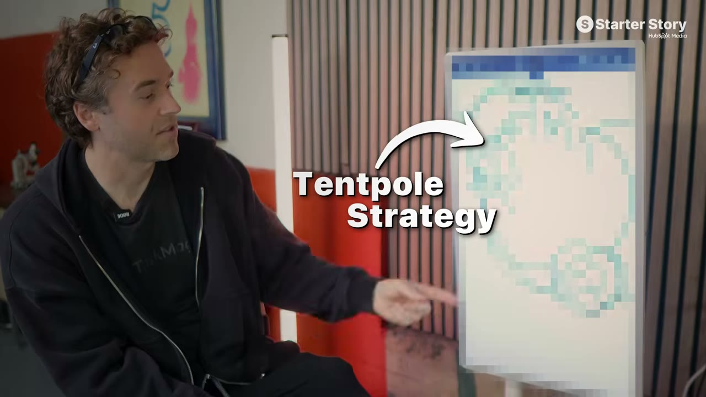
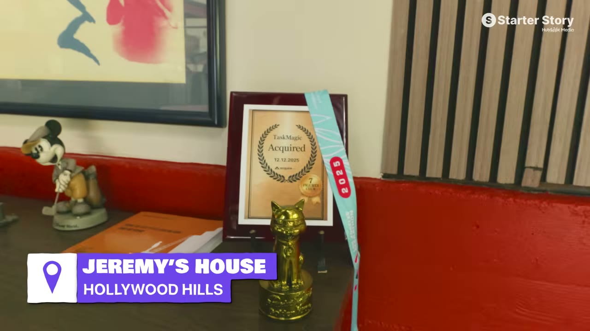
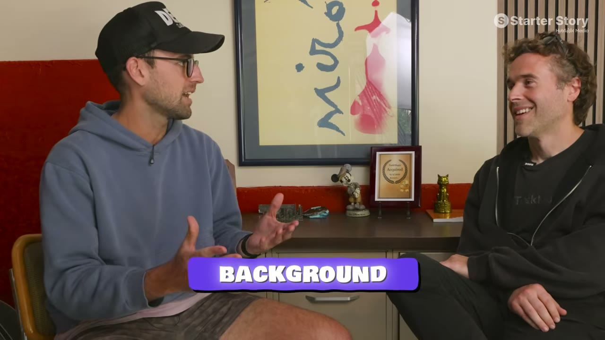
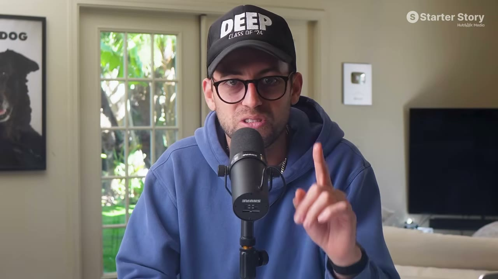
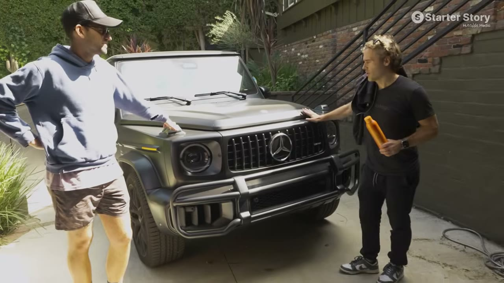
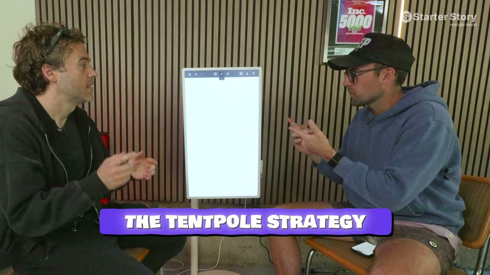
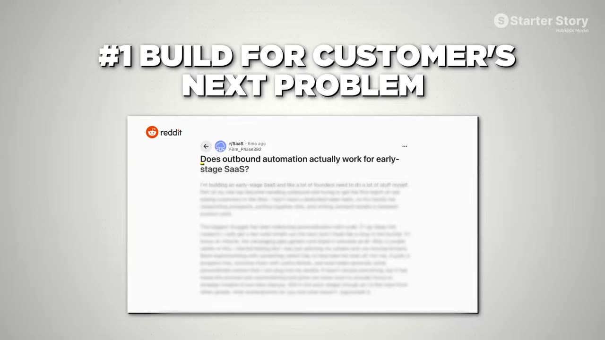
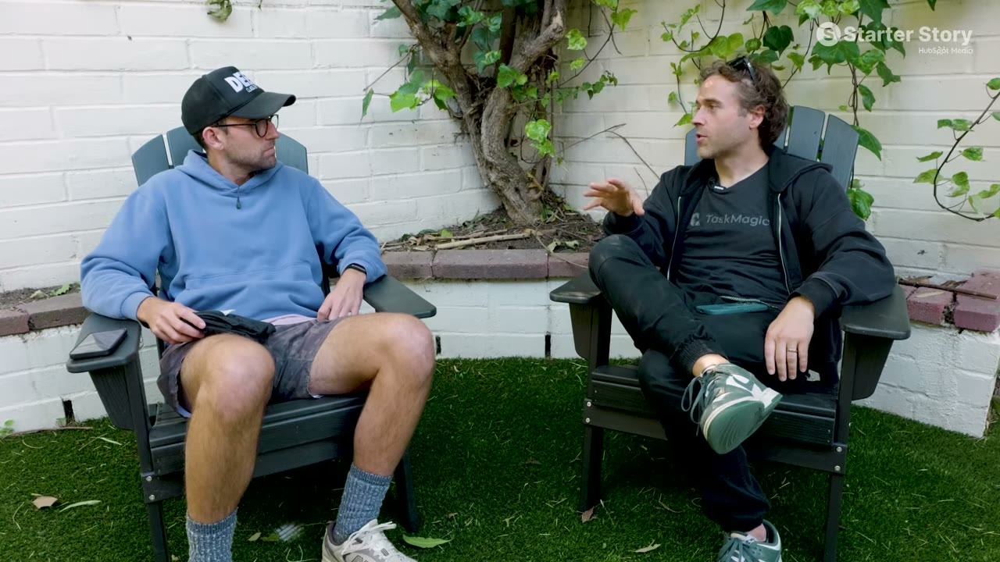
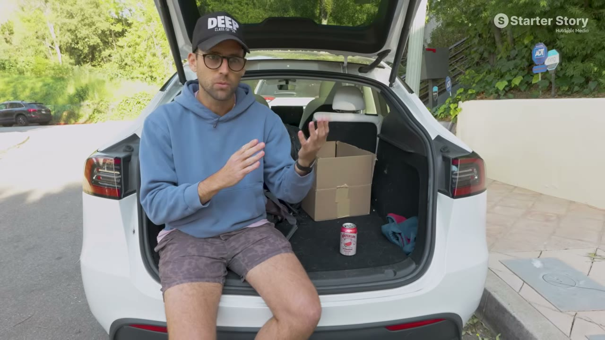

# I Spent 24 Hours With A SaaS Millionaire

✅ **Đã phân tích sâu** → [`case.md`](case.md)

| | |
|---|---|
| **Video** | <https://www.youtube.com/watch?v=iVy5J7iE-3Q> |
| **Đăng** | 19/04/2026 |
| **Thời lượng** | 16:03 |
| **Lượt xem** | 118,531 |
| **Lượt thích** | 3,596 |
| **Video ID** | `iVy5J7iE-3Q` |

## Trong thư mục này

| File | Nội dung |
|---|---|
| [`case.md`](case.md) | **Phân tích đầy đủ** — ý tưởng, validate, GTM, áp dụng ở VN |
| [`meta.json`](meta.json) | Metadata gốc (chapters, heatmap, mô tả) |
| [`screenshots/`](screenshots/) | 10 ảnh 720p |

## Mô tả gốc

I traveled to Los Angeles, CA to spend 24 hours with Jeremy Redman and dive deep into his $3M SaaS business. 
This video is an educational case study of this founder’s experience. It is not financial advice and does not guarantee any income or results. Every business is different and your results may vary.
0:00 - Most Successful Solopreneur OAT
0:49 - Is SaaS dead?
1:33 - Meet Jeremy Redman
2:05 - Business overview and stats
3:48 - House tour 
4:10 - Jeremy's background
5:12 - Find your $1M idea
5:58 - The FU purchase
6:24 - The tentpole strategy overview
7:24 - Tentpole step-by-step breakdown

## Số liệu bắt được từ transcript

> Các đoạn founder nhắc tới con số, kèm timestamp để tua thẳng tới đó trong video.

_(không bắt được con số nào)_

## Chương

- `00:00` Most Successful Solopreneur OAT
- `00:49` Is SaaS dead?
- `01:33` Meet Jeremy Redman
- `02:05` Business overview and stats
- `03:48` House tour
- `04:10` Jeremy's background
- `05:12` Find your $1M idea
- `05:58` The FU purchase
- `06:24` The tentpole strategy overview
- `07:24` Tentpole step-by-step breakdown
- `10:18` Advice for starting over
- `11:03` What it's really like to sell your business
- `13:54` Advice to founders
- `14:59` Pat's final reflections

## Ảnh

1. `01_00m15s_ch-most-successful-solopreneur-oat.jpg` — 
2. `02_01m01s_ch-is-saas-dead.jpg` — 
3. `03_01m45s_ch-meet-jeremy-redman.jpg` — 
4. `04_04m18s_usd-3-m.jpg` — 
5. `05_05m24s_ch-find-your-1m-idea.jpg` — 
6. `06_06m00s_replay.jpg` — 
7. `07_06m36s_ch-the-tentpole-strategy-overview.jpg` — 
8. `08_07m36s_ch-tentpole-step-by-step-breakdown.jpg` — 
9. `09_12m07s_replay.jpg` — 
10. `10_15m11s_usd-3-m.jpg` — 

---

← [Quay lại index](../../index.md) · [Toàn bộ video](../README.md)
