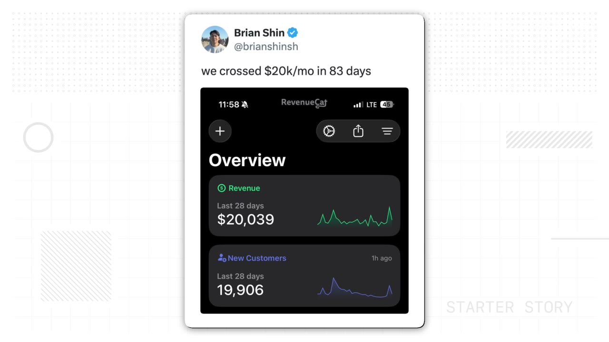
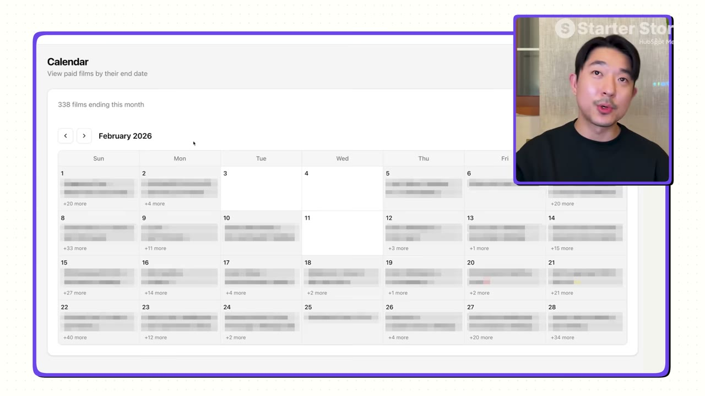
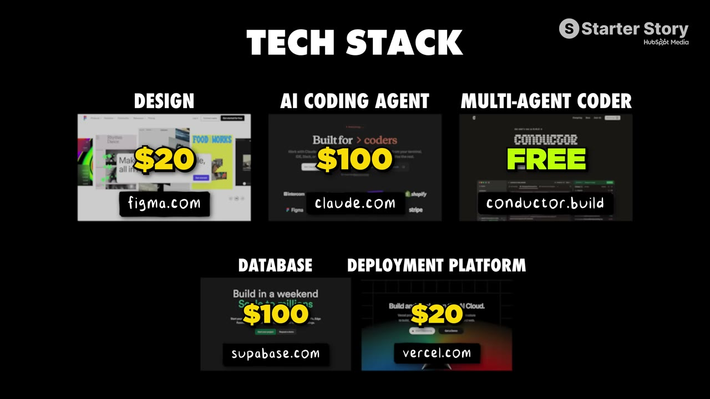

# I Built a $20K/Month App in 83 Days

✅ **Đã phân tích sâu** → [`case.md`](case.md)

| | |
|---|---|
| **Video** | <https://www.youtube.com/watch?v=r4R_Hlw7sbo> |
| **Đăng** | 10/05/2026 |
| **Thời lượng** | 16:14 |
| **Lượt xem** | 287,001 |
| **Lượt thích** | 5,666 |
| **Video ID** | `r4R_Hlw7sbo` |

## Trong thư mục này

| File | Nội dung |
|---|---|
| [`case.md`](case.md) | **Phân tích đầy đủ** — ý tưởng, validate, GTM, áp dụng ở VN |
| [`meta.json`](meta.json) | Metadata gốc (chapters, heatmap, mô tả) |
| [`screenshots/`](screenshots/) | 10 ảnh 720p |

## Mô tả gốc

In this video, we break down how a simple mobile app turned into a $20K/month business. But the real story is about how he validated the idea BEFORE writing a single line of code. By the end of this video, you will have playbook you can use to go validate your app. 
0:00 - The commitment metric
0:56 - Meet Brian Shin
1:27 - Business breakdown
2:35 - Mobile app growth tactics
3:22 - Founder background
4:25 - App idea
5:48 - Build process 
6:35 - Tech Stack
7:07 - Validating the app
8:30 - Validation Playbook
11:23 - How the app works
12:18 - Stop overthinking!
13:15 - Pat and Gus reflections

## Số liệu bắt được từ transcript

> Các đoạn founder nhắc tới con số, kèm timestamp để tua thẳng tới đó trong video.

_(không bắt được con số nào)_

## Chương

- `00:00` The commitment metric
- `00:56` Meet Brian Shin
- `01:27` Business breakdown
- `02:35` Mobile app growth tactics
- `03:22` Founder background
- `04:25` App idea
- `05:48` Build process
- `06:35` Tech Stack
- `07:07` Validating the app
- `08:30` Validation Playbook
- `11:23` How the app works
- `12:18` Stop overthinking!
- `13:15` Pat and Gus reflections

## Ảnh

1. `01_00m35s_usd-20-000.jpg` — 
2. `02_01m22s_usd-20-000.jpg` — 
3. `03_02m23s_usd-22-000.jpg` — 
4. `04_03m34s_ch-founder-background.jpg` — 
5. `05_04m28s_usd-20-000.jpg` — 
6. `06_06m00s_ch-build-process.jpg` — 
7. `07_07m02s_replay.jpg` — 
8. `08_08m42s_ch-validation-playbook.jpg` — 
9. `09_11m35s_replay.jpg` — 
10. `10_12m30s_ch-stop-overthinking.jpg` — 

---

← [Quay lại index](../../index.md) · [Toàn bộ video](../README.md)
