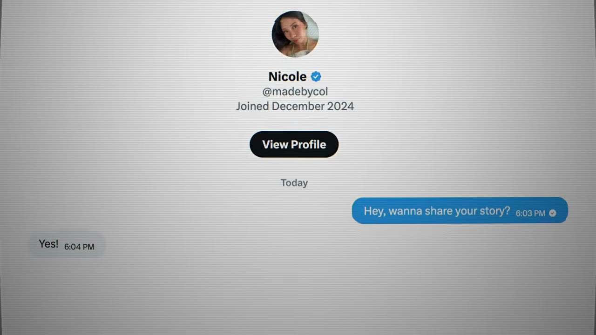
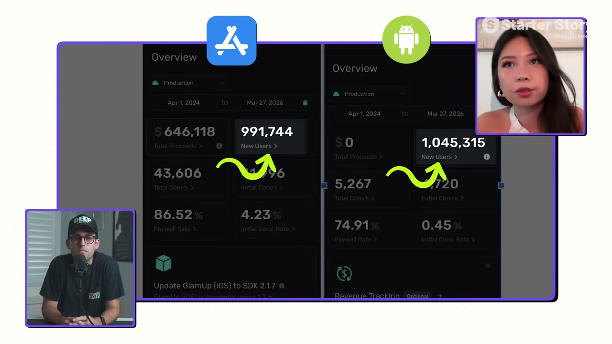
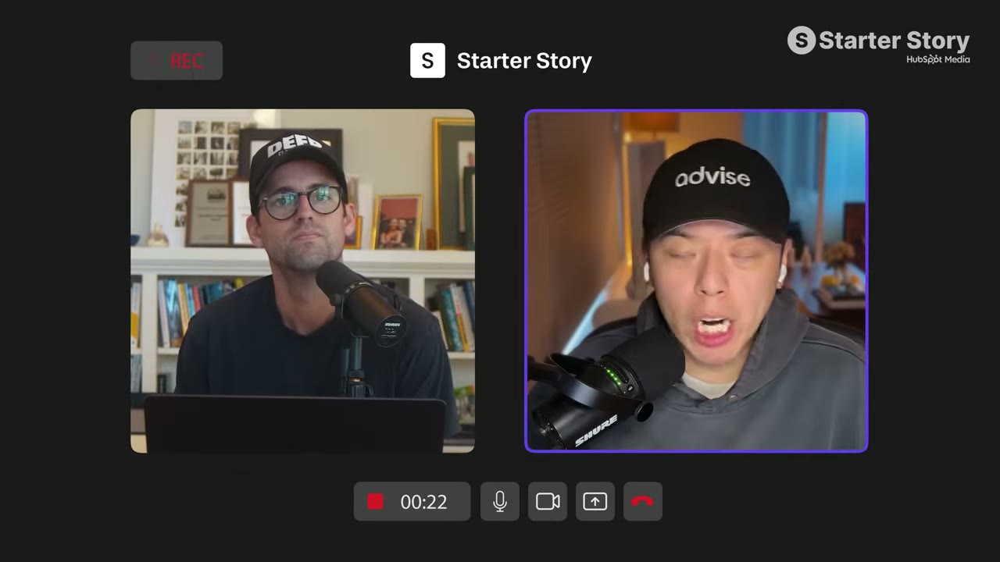
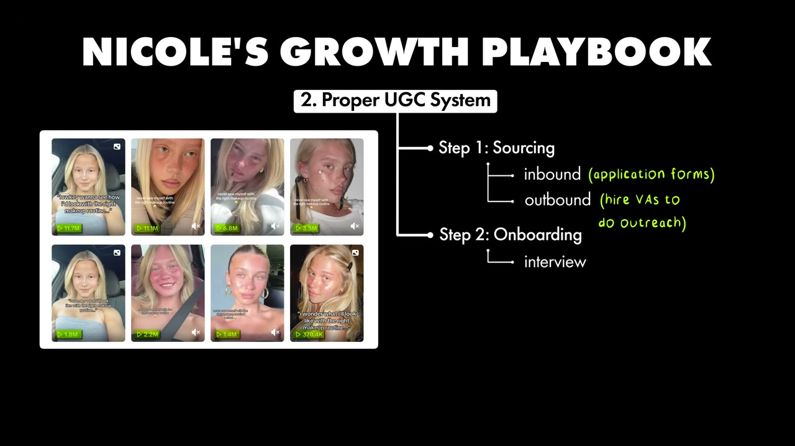

# My Two Apps Make $150K/Month Each

✅ **Đã phân tích sâu** → [`case.md`](case.md)

| | |
|---|---|
| **Video** | <https://www.youtube.com/watch?v=32vqaJa90kw> |
| **Đăng** | 17/05/2026 |
| **Thời lượng** | 16:32 |
| **Lượt xem** | 168,084 |
| **Lượt thích** | 5,484 |
| **Video ID** | `32vqaJa90kw` |

## Trong thư mục này

| File | Nội dung |
|---|---|
| [`case.md`](case.md) | **Phân tích đầy đủ** — ý tưởng, validate, GTM, áp dụng ở VN |
| [`meta.json`](meta.json) | Metadata gốc (chapters, heatmap, mô tả) |
| [`screenshots/`](screenshots/) | 10 ảnh 720p |

## Mô tả gốc

Nicole has multiple apps to over $150K/month. The questions is... how? What's the secret? How did she do it? Turns out, it's a finely tuned system that she has perfected. In this video, we break down what that system is and how anyone can put it into practice. 
0:00 - I couldn’t believe this post…
1:07 - Who is Nicole? 
1:55 - App background and data
3:15 - Founder background
4:01 - Building is easy, Marketing is (still) hard!
4:59 - Finding the app idea
5:56 - Growth overview
6:40 - Data and numbers behind the content
7:26 - App growth playbook
7:44 - Where to market your app
8:33 - Building 

## Số liệu bắt được từ transcript

> Các đoạn founder nhắc tới con số, kèm timestamp để tua thẳng tới đó trong video.

_(không bắt được con số nào)_

## Chương

- `00:00` I couldn’t believe this post…
- `01:07` Who is Nicole?
- `01:55` App background and data
- `03:15` Founder background
- `04:01` Building is easy, Marketing is (still) hard!
- `04:59` Finding the app idea
- `05:56` Growth overview
- `06:40` Data and numbers behind the content
- `07:26` App growth playbook
- `07:44` Where to market your app
- `08:33` Building a UGC system
- `09:01` Source content creators
- `09:36` Onboard creators for your app
- `10:25` Managing UGC creators
- `10:54` System and optimize your system
- `11:58` App demo
- `12:52` Build and tech stack
- `13:24` Final advice
- `14:06` Pat and Gus takeaways

## Ảnh

1. `01_00m15s_ch-i-couldn-t-believe-this-post.jpg` — 
2. `02_01m23s_replay.jpg` — 
3. `03_02m15s_metric.jpg` — 
4. `04_03m27s_ch-founder-background.jpg` — 
5. `05_04m38s_usd-50-000.jpg` — 
6. `06_06m42s_usd-100-000.jpg` — 
7. `07_07m38s_ch-app-growth-playbook.jpg` — 
8. `08_08m45s_ch-building-a-ugc-system.jpg` — 
9. `09_09m48s_ch-onboard-creators-for-your-app.jpg` — 
10. `10_12m56s_usd-100-000.jpg` — 

---

← [Quay lại index](../../index.md) · [Toàn bộ video](../README.md)
