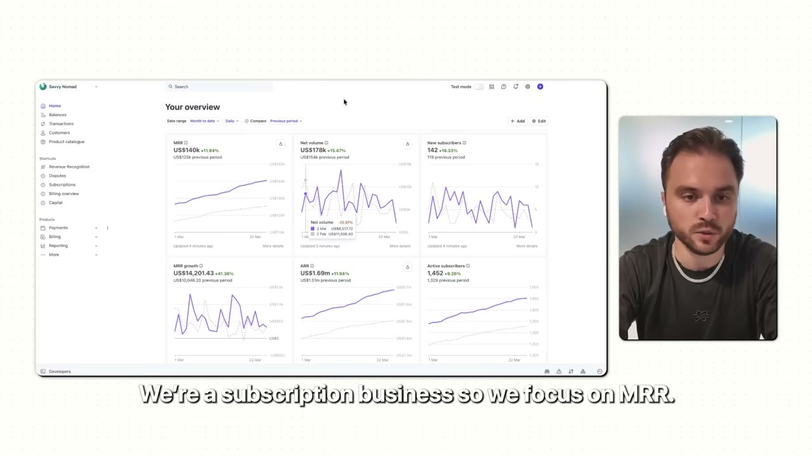

# Savvy Nomad — $1,7 triệu/năm trong ngách chán nhất có thể tưởng tượng

> **Tóm tắt 30 giây:** Bo đồng sáng lập **Savvy Nomad** — giúp công dân Mỹ sống ở nước ngoài **đóng ít thuế bang hơn**. Không AI, không TikTok, không trend. Chỉ là thuế. Nay: **$140.000 MRR, $1,7 triệu ARR, hơn 1.400 khách hàng, 6 nhân viên** — và họ đã tiết kiệm khoảng **$10 triệu tiền thuế** cho khách. Sản phẩm **xây trên Bubble** (no-code). Giá trị lớn nhất của case này là **khung tư duy chọn ngách "chán"** và **ba ý tưởng cụ thể** anh cho không.

---

## 1. Con số

| Chỉ số | Giá trị |
|---|---|
| MRR | **$140.000** |
| ARR | **$1.700.000** |
| Khách hàng | **hơn 1.400** |
| Khách mới mỗi tháng | **120-150** |
| Nhân sự | **6** |
| Giá trị đã tạo cho khách | ~**$10 triệu** tiền thuế bang tiết kiệm được |

**Mô hình:** ba gói subscription (cơ bản / trung / premium), thu tiền trước.

> **Bối cảnh cá nhân:** vì chiến tranh ở Ukraine, anh phải xây dựng lại cuộc sống trong một thực tế quốc tế hơn — điều đó kéo anh vào thế giới thuế quốc tế. Startup trước của anh trong mảng thuế cho dân du mục số **đã đóng cửa**.

---

## 2. Bốn lý do ngách "chán" lại thắng ⭐⭐⭐

Đây là khung tư duy giá trị nhất của case.

### 1. Cạnh tranh thấp trên nhu cầu THẬT

> **Ở các thị trường kém hấp dẫn, có ít founder tài năng đuổi theo những vấn đề rất thật — và tỉ lệ giữa CƠ HỘI và CẠNH TRANH tốt hơn hẳn.**

### 2. Sẵn sàng chi trả cực cao

> **Thuế, tuân thủ, cư trú — người ta KHÔNG MUỐN dính vào. Họ chỉ muốn thuê ai đó, trả tiền cho ai đó để quên nó đi. Đó chính xác là lý do họ sẵn sàng trả.**

### 3. Giá trị CỤ THỂ và ĐỊNH LƯỢNG ĐƯỢC ⭐

Đây là điểm sắc nhất:

> **Trong rất nhiều danh mục startup, anh đang bán một tương lai tươi sáng hơn, hoặc một lời hứa mơ hồ. Với thuế, anh nói được: "đây là lợi ích tài chính khả dĩ, và đây là chi phí dịch vụ của chúng tôi."**
>
> **Nó khiến quyết định của khách trở nên lý trí và thẳng thắn. Anh phải BÁN ÍT HƠN.**

Pat diễn giải rất rõ: nếu số tiền khách tiết kiệm được **lớn hơn** chi phí dịch vụ → đó là quyết định mua **hiển nhiên**. Dễ bán hơn nhiều so với một app AI **không có kết quả định lượng được**.

> **Bộ lọc dùng ngay: sản phẩm của anh có nói được câu "bạn tiết kiệm/kiếm được X, bạn trả Y, X > Y" không?** Nếu có, anh gần như không cần marketing. Nếu không, anh phải bán rất nhiều.
>
> Trùng với bộ lọc của [Benji (Snag)](../2026-05-31_i-built-a-30k-month-app-heres-my-exact-process/case.md): *"app giúp kiếm tiền hoặc tiết kiệm tiền có tỉ lệ chuyển đổi cao nhất."*

### 4. Khớp với thế mạnh của đội

Không chỉ là thị trường kém hấp dẫn có cơ hội — mà là thị trường mà **thế mạnh của họ bổ trợ nhau một cách bất thường**.

---

## 3. Playbook 3 bước xây business trong ngách "chán" ⭐⭐

Khi được hỏi *"nếu bắt đầu lại từ $0 thì làm gì?"*:

### Bước 1 — Bắt đầu từ vấn đề ĐAU nơi người ta ĐANG TRẢ QUÁ NHIỀU

> **Tìm những danh mục nơi người ta căng thẳng, bối rối, đang mất tiền.**

Các danh mục anh nghĩ tới: **thuế · tuân thủ · pháp lý · lao động · cư trú · ngân hàng · giấy tờ.**

> **"Người ta càng KHÔNG muốn tự dính vào vấn đề đó, thì giải nó hộ họ càng có giá trị."**

**Rồi xem họ đang giải nó bằng cách nào — thường rơi vào hai cực:**

| Cực | Cách làm | Vấn đề |
|---|---|---|
| **Tự làm** | Bài blog rải rác, thread Reddit | Rối, không đáng tin, tốn thời gian |
| **Thuê chuyên gia** | Trả hàng nghìn đô | Quá đắt |

> **Khoảng trống nằm chính giữa hai cực đó.** Đây là mẫu hình lặp lại: [Live Tourney](../2026-07-15_i-quit-my-job-at-meta-to-build-a-30k-month-saas/case.md) (Golf Genius quá đắt/phức tạp), [Profit AI](../2026-06-24_i-turned-this-spreadsheet-into-a-30k-month-micro-saa/case.md) (Deloitte tính hàng chục nghìn đô), [Flame](../2026-06-21_i-built-a-10k-month-app-with-this-one-system/case.md) (trị liệu $200/buổi).

### Bước 2 — Đánh giá cạnh tranh TƯƠNG ĐỐI với cơ hội ⭐

> **Rất nhiều founder chỉ nghĩ tới quy mô thị trường. Hãy hỏi thêm: có bao nhiêu founder thông minh, có năng lực đang THỰC SỰ CHỌN xây ở đây?**
>
> Trong các danh mục hấp dẫn (app AI, mạng xã hội, công cụ creator), **thị trường có thể khổng lồ nhưng anh đang cạnh tranh với hàng trăm đội được rót vốn dày.**
>
> Trong thị trường kém hấp dẫn, anh có điều ngược lại: **nhu cầu thật, sẵn sàng chi trả cao, và rất ít người muốn động vào danh mục đó.**
>
> **"Sự bất đối xứng đó chính là lợi thế của anh."**

### Bước 3 — Chọn MỘT quy trình, sản phẩm hoá nó, rồi xây tầng định kỳ lên trên

> **Đừng cố xây một nền tảng. Hãy chọn quy trình phổ biến nhất, đau đớn nhất, và biến nó thành một sản phẩm lặp lại được, từng bước một.**
>
> **"Với chúng tôi, đó là việc đổi nơi cư trú thuế giữa các bang. Chúng tôi KHÔNG cố giải toàn bộ thuế quốc tế — chúng tôi giải MỘT việc thật tốt."**

---

## 4. Ba ý tưởng anh cho không ⭐⭐

Đây là phần hiếm — một founder trong ngành nêu thẳng ba cơ hội cụ thể:

### Ý tưởng 1 — Sản phẩm hoá quy trình nhập cư
> Rất nhiều người muốn chuyển tới Mỹ và đang trả cho agency **$8.000, $10.000, có khi $15.000** cho thứ về bản chất chỉ là **một bài toán quy trình**. Một sản phẩm nằm ở giữa — hướng dẫn quy trình, mẫu biểu, có thể thêm một luật sư rà cuối — **thu $1.000-2.000 vẫn khiến khách thấy hời**.

### Ý tưởng 2 — Giúp người ta chuyển tới nơi thuế thân thiện và rời khỏi nơi "dính"
> **Hai mặt của cùng đồng xu.** Một bên là người chuyển tới **Dubai, Costa Rica, Malaysia** và lo làm sai. Bên kia là người **rời Canada, Anh, Tây Ban Nha** — có thủ tục xuất cảnh, yêu cầu thông báo, đôi khi cả **thuế xuất cảnh**. **Sản phẩm hoá cả đầu vào lẫn đầu ra.**

### Ý tưởng 3 — Ngân hàng quốc tế, nắm giữ tài sản, hoạch định di sản
> Founder và nhà đầu tư trải khắp nhiều quốc gia cần hỗ trợ mở tài khoản ngân hàng ở Singapore, chọn đúng khu vực pháp lý để nắm giữ bất động sản hoặc tài sản trí tuệ. **Hiện chưa có sản phẩm thật nào cho việc này.**

**Và nhận xét sắc nhất của anh về ba ý tưởng:**
> **"Khách hàng thường là CÙNG MỘT NGƯỜI ở các giai đoạn khác nhau. Đây không phải ba khách hàng riêng biệt — đây là một khách hàng và nhiều sự kiện doanh thu."**

**Pat bổ sung luận điểm vĩ mô đáng ghi nhớ:**
> Có rất nhiều quy định và bộ máy nhà nước đã tích tụ qua nhiều năm quanh thuế, tuân thủ, nhập cư — và **chúng sẽ không biến mất**. Nhưng giờ có **hai thứ mới: AI và phần mềm** có thể đơn giản hoá và sản phẩm hoá những dịch vụ này **trên toàn thế giới**.

---

## 5. Tech stack — no-code, tối ưu cho tốc độ

> **"Chúng tôi tối ưu cho tốc độ và cho việc người KHÔNG kỹ thuật vận hành được."**

| Hạng mục | Công cụ |
|---|---|
| **Toàn bộ sản phẩm** | **Bubble** (no-code) |
| Website marketing | Framer |
| Xuất bản nội dung | Ghost |
| Vận hành | ChatGPT + Claude |
| SEO | Ahrefs |
| Email | Customer.io |
| Báo cáo | Power BI + BigQuery |
| Phân tích churn | TurnKey |
| Thanh toán | Stripe · Đặt lịch: SavvyCal |

> **Toàn bộ sản phẩm $1,7 triệu ARR chạy trên Bubble.** Đây là bằng chứng mạnh rằng với business kiểu này, **chuyên môn ngành quan trọng hơn kỹ thuật rất nhiều.**

**Về sản phẩm:** onboarding hỏi các câu định tính, rồi **cho thấy luôn người dùng có thể tiết kiệm bao nhiêu** — chính là "giá trị định lượng" ở mục 2. Đa số khách hoàn tất phần online **trong chưa tới một giờ**.

---

## 6. Lời khuyên cuối

> **"Khác biệt giữa người thắng và người thua là người thắng đã thử THÊM MỘT LẦN NỮA."**
>
> Anh đã **đóng cửa startup trước và cảm thấy thất bại**. Anh đã có thể dừng ở đó, nhưng có gì đó trong anh vẫn muốn đi tiếp. **Và mọi founder thành công anh biết đều có một câu chuyện y hệt như vậy.**

**Pat chốt:**
> **"Tôi thà kiếm $2 triệu/năm trong một business chán còn hơn $20.000/năm với một app AI hào nhoáng."**

Producer nêu một điểm rất thật về tác hại của mạng xã hội:
> Anh lên Twitter mỗi ngày và thấy công cụ AI mới liên tục ra, cảm giác **không thể theo kịp**. Nhưng Bo **không cần theo kịp** — vì anh ấy đang **giải một vấn đề thật**.

---

## 7. Cảnh báo thiên kiến nguồn

- **Đoạn tài trợ HubSpot cắt ngang phút 02:18–03:08** để phát báo cáo miễn phí *"30+ Business Ideas in Unsexy Niches"* qua link `clickhubspot.com`. **Không liên quan gì tới Bo** — anh không nhắc HubSpot, tech stack của anh cũng không có nó. Nó được nhắc lại ở cuối (15:49) — nhưng lần này Pat nói **"50 ý tưởng chán nữa"**, trong khi mô tả video ghi **"30+"**. Cùng một tài liệu, hai con số khác nhau trong cùng một video.
- **Chính Pat cũng thừa nhận đoạn giữa là quảng cáo:** ở phút 12:23 anh nói nguyên văn *"Chắc mọi người đang tự hỏi: sao chúng tôi lại để anh ấy quảng cáo sản phẩm trên đây?"*. Phần demo sản phẩm + tech stack là một đoạn giới thiệu Savvy Nomad có chủ đích. Mô tả video còn kèm LinkedIn, YouTube và Instagram của Bo — anh nhận được lợi ích xây dựng hình ảnh cá nhân, không chỉ là chia sẻ kiến thức.
- **Con số bị thổi lên ngay trong lời dẫn.** ARR thật là **$1,7 triệu**, nhưng Pat nói **"gần $2 triệu một năm"** hai lần (00:17 và 14:13). Làm tròn lên 18%.
- **Có bật dashboard Stripe** (MRR, ARR, số subscriber) — điểm cộng so với đa số case trên kênh. Nhưng **con số "$10 triệu tiền thuế đã tiết kiệm cho khách" là lời tự khai hoàn toàn không có bằng chứng**, và nó lại chính là con số marketing mạnh nhất của họ.
- **Bối cảnh bị làm mờ — và nó lật ngược cách hiểu case:** tiêu đề chương là *"Bo tìm ra ý tưởng Savvy Nomad thế nào"*, nhưng lời anh nói là: **co-founder của anh mới là người phát hiện cơ hội và ĐÃ XÂY BẢN ĐẦU TIÊN**; Bo được tuyển vào sau với vai trò **co-founder marketing/kinh doanh**. Ngoài ra Bo **đã có một startup trước trong đúng mảng thuế cho dân du mục số** (đã đóng cửa) và là **kỹ sư phần mềm**. Đây là nhiều năm ngâm trong ngành, không phải người ngoài chọn một ngách chán rồi thắng.
- **Kênh tăng trưởng KHÔNG hề được nêu.** Video giải thích rất kỹ *tại sao* ngách chán thắng, nhưng **không một câu nào về việc 120-150 khách mới mỗi tháng đến từ đâu**. Ahrefs trong tech stack gợi ý SEO, nhưng đó là suy đoán. **Đây là lỗ hổng lớn nhất của case: nó cho anh bộ lọc chọn ngách, không cho anh cách bán.**
- **Thiếu toàn bộ mặt kinh tế đơn vị.** Không có: churn (họ dùng TurnKey để phân tích churn nhưng không nêu con số), CAC, chi phí marketing, giá từng gói, và **chi phí nhân sự để thực sự làm dịch vụ** — 6 nhân viên phục vụ 1.400 khách nghĩa là có người trong quy trình, tức đây **không phải phần mềm biên 90%**.

## 8. Áp dụng cho tôi (indie hacker VN)

**Đây là mô hình có tỉ lệ thành công cao nhất cho người có chuyên môn ngành — và ít cạnh tranh nhất.**

**Quy trình tìm ngách "chán" cho anh:**

| Bước | Việc |
|---|---|
| **1** | Liệt kê các lĩnh vực **người ta căng thẳng, bối rối, mất tiền** — và **không muốn tự làm** |
| **2** | Với mỗi cái, kiểm tra hai cực: người ta đang **tự mò trên Google/Facebook group** hay **trả hàng chục triệu cho dịch vụ**? |
| **3** | Hỏi: **có bao nhiêu founder giỏi đang chọn xây ở đây?** Càng ít càng tốt |
| **4** | Chọn **MỘT quy trình duy nhất**, sản phẩm hoá nó. Đừng làm nền tảng. |
| **5** | Bắt buộc: nói được **"bạn tiết kiệm X, trả Y, X > Y"** |

**Ngách "chán" ở Việt Nam đáng soi:**
- **Thủ tục hành chính doanh nghiệp** — đăng ký kinh doanh, thay đổi giấy phép, giải thể
- **Thuế cho freelancer/người làm remote cho công ty nước ngoài** — đúng mẫu hình Savvy Nomad, nhu cầu đang tăng nhanh ở VN
- **Hộ chiếu, visa, thủ tục du học/định cư** — người Việt đang trả agency rất nhiều tiền
- **Bảo hiểm xã hội, thủ tục lao động cho doanh nghiệp nhỏ**
- **Đăng ký nhãn hiệu, sở hữu trí tuệ**
- **Thủ tục xuất nhập khẩu, hải quan cho shop bán hàng quốc tế**

> **Trong mọi ngách trên, hai cực đều tồn tại rõ:** hoặc tự mò trong group Facebook, hoặc trả dịch vụ hàng chục triệu. **Khoảng trống ở giữa rất rộng.**

**Vì sao rất hợp với anh:**
- ✅ **No-code làm được** — Bubble chạy được $1,7 triệu ARR
- ✅ **Không cần đuổi theo trend** — quy định không biến mất
- ✅ **Sẵn sàng chi trả cao**, ít nhạy cảm về giá
- ✅ **Cạnh tranh thấp** vì không ai muốn làm
- ✅ **Bán ít hơn** vì giá trị định lượng được
- ✅ Nếu nhắm khách quốc tế (người Việt ở nước ngoài, freelancer thu USD) thì **né được vấn đề ARPU**

**Rào cản thật:**
- ⚠️ **Bắt buộc phải có chuyên môn ngành thật.** Bo đã sống nhiều năm trong thế giới thuế quốc tế. Không có nền này thì rất rủi ro — và ở ngành pháp lý/thuế, **sai là gây hậu quả thật cho khách.**
- ⚠️ **Rủi ro pháp lý và trách nhiệm nghề nghiệp.** Tư vấn thuế/pháp lý ở VN có quy định về chứng chỉ hành nghề. Cần cấu trúc sản phẩm cẩn thận (công cụ + quy trình, có chuyên gia rà cuối — đúng như ý tưởng nhập cư anh nêu).
- ⚠️ **Quy định thay đổi** → sản phẩm phải cập nhật liên tục, nếu không thành nguy hiểm
- ⚠️ **Không "hào nhoáng"** — sẽ không ai khen anh trên mạng xã hội. Đó vừa là cái giá, vừa chính là lợi thế.

**Khi KHÔNG nên dùng mô hình này:**

- **Khi sản phẩm của anh không nói được câu "bạn tiết kiệm X, trả Y, X > Y".** Toàn bộ lợi thế "bán ít hơn" của Savvy Nomad đến từ con số tiết kiệm hiện ngay trong onboarding. Nếu giá trị của anh là mơ hồ hoặc cảm tính, ngách chán không cứu được anh — anh vẫn phải xây cỗ máy phân phối kiểu [Nicole](../2026-05-17_my-two-apps-make-150k-month-each/case.md), và ngách chán thì không có creator nào chịu quay.
- **Khi anh chưa từng làm trong ngành đó và không có ai chịu trách nhiệm chuyên môn.** Bo đã đốt cả một startup trước trong mảng thuế du mục số; co-founder anh đã dựng xong bản đầu trước khi anh vào. Ở thuế/pháp lý/nhập cư, **sai một lần là khách chịu hậu quả thật** — đây là ngành duy nhất trong kho mà "học khi làm" là rủi ro pháp lý.
- **Khi anh cần một mô hình solo, biên cao, không có con người trong quy trình.** 6 nhân viên cho 1.400 khách nghĩa là mỗi khách vẫn tiêu tốn thời gian người thật. Nếu anh muốn kiểu một người vận hành hết, mô hình [ScreenshotOne](../2024-11-22_how-i-built-it-12k-month-micro-saas/case.md) hay [Bank Statement Converter](../2025-07-20_i-make-40k-month-with-this-one-website/case.md) — phần mềm thuần, không dịch vụ — phù hợp hơn.

---

## Nguồn

- Video: [I Make $1.7M/Year In The Most Boring Niche Imaginable](https://www.youtube.com/watch?v=BHhg-l9AZpM) — Starter Story, 21/05/2026, 16:23, 62K views
- Sản phẩm: Savvy Nomad
- [`transcript.md`](transcript.md) · [`screenshots/`](screenshots/)
