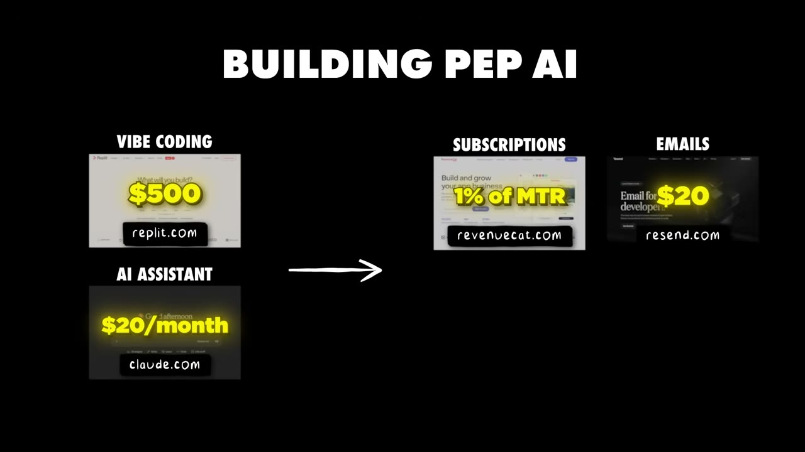

# I Built A $30K/Month in 35 Days

✅ **Đã phân tích sâu** → [`case.md`](case.md)

| | |
|---|---|
| **Video** | <https://www.youtube.com/watch?v=vbEKEWtnndU> |
| **Đăng** | 24/05/2026 |
| **Thời lượng** | 18:20 |
| **Lượt xem** | 85,389 |
| **Lượt thích** | 2,275 |
| **Video ID** | `vbEKEWtnndU` |

## Trong thư mục này

| File | Nội dung |
|---|---|
| [`case.md`](case.md) | **Phân tích đầy đủ** — ý tưởng, validate, GTM, áp dụng ở VN |
| [`meta.json`](meta.json) | Metadata gốc (chapters, heatmap, mô tả) |
| [`screenshots/`](screenshots/) | 10 ảnh 720p |

## Mô tả gốc

Cedric Roberge built an app called Pep AI. In just ONE MONTH, he hit 10,000 users and $30K in revenue (wow!!). This video breaks down how a college student found a trending niche, built the app, and scaled to $30K/month. 
0:00 - Knowing where to look
0:53 - Who is Cedric?
1:13 - App data and overview
2:20 - Founder background
3:19 - Build timeline and tech stack
4:44 - Start building with AI
5:40 - How to find a great app idea
6:51 - Identifying viral ideas
8:09 - Find ideas on social media
9:11 - Review existing apps
9:59 - Growth and Marketing 
12:06 - App Demo
13:348 - Advice to founders
15

## Số liệu bắt được từ transcript

> Các đoạn founder nhắc tới con số, kèm timestamp để tua thẳng tới đó trong video.

_(không bắt được con số nào)_

## Chương

- `00:00` Knowing where to look
- `00:53` Who is Cedric?
- `01:13` App data and overview
- `02:20` Founder background
- `03:19` Build timeline and tech stack
- `04:44` Start building with AI
- `05:40` How to find a great app idea
- `06:51` Identifying viral ideas
- `08:09` Find ideas on social media
- `09:11` Review existing apps
- `09:59` Growth and Marketing
- `12:06` App Demo
- `15:13` Pat and Gus reflections: the power of building with AI

## Ảnh

1. `01_00m15s_ch-knowing-where-to-look.jpg` — 
2. `02_01m06s_usd-50-000.jpg` — 
3. `03_01m55s_usd-45.jpg` — 
4. `04_02m43s_metric.jpg` — 
5. `05_03m44s_replay.jpg` — 
6. `06_04m56s_ch-start-building-with-ai.jpg` — 
7. `07_05m52s_ch-how-to-find-a-great-app-idea.jpg` — 
8. `08_07m03s_ch-identifying-viral-ideas.jpg` — 
9. `09_09m58s_replay.jpg` — 
10. `10_10m56s_usd-4-000.jpg` — 

---

← [Quay lại index](../../index.md) · [Toàn bộ video](../README.md)
