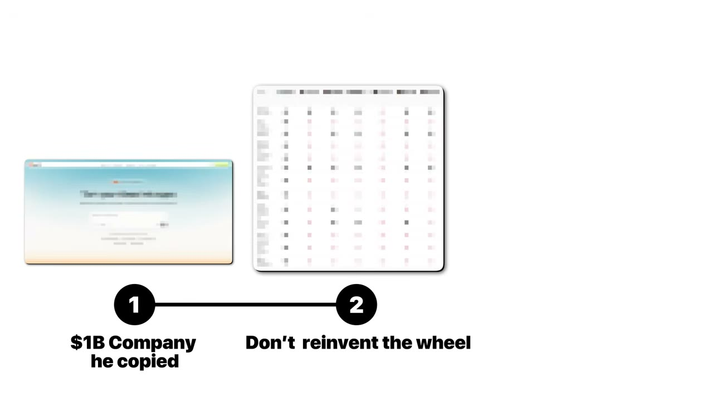
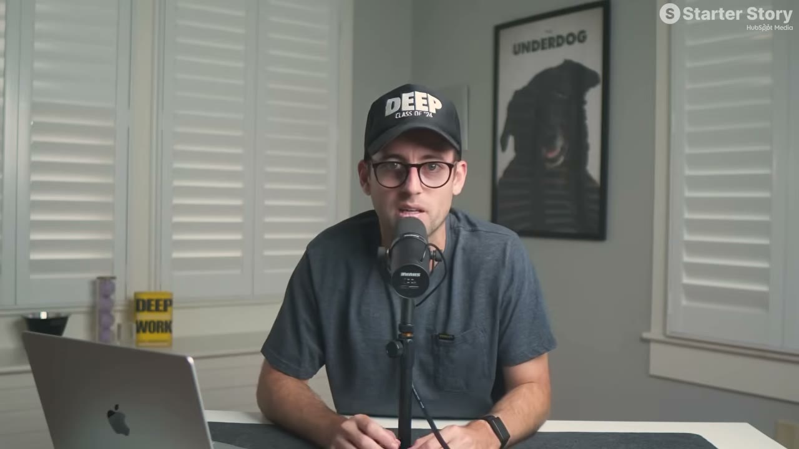
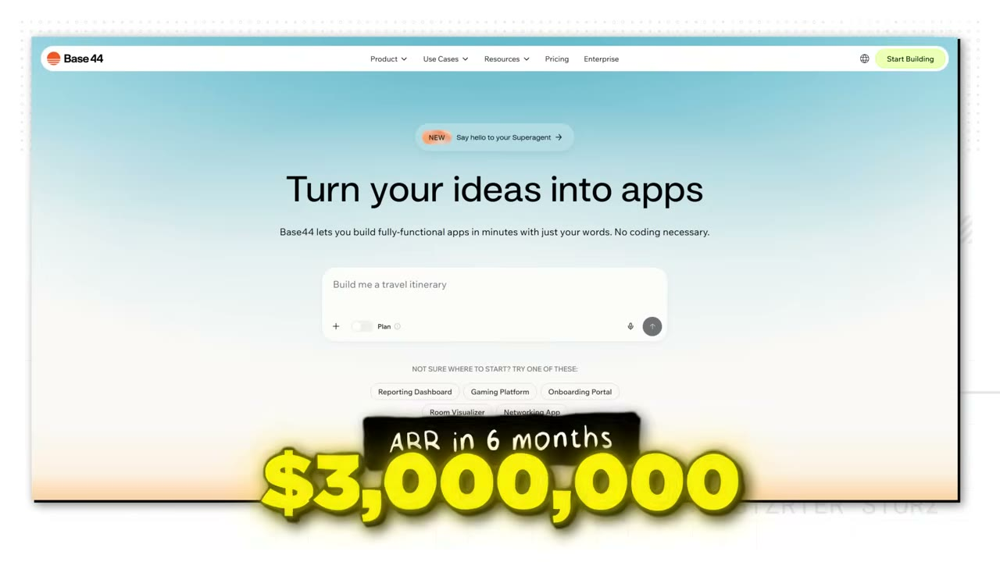
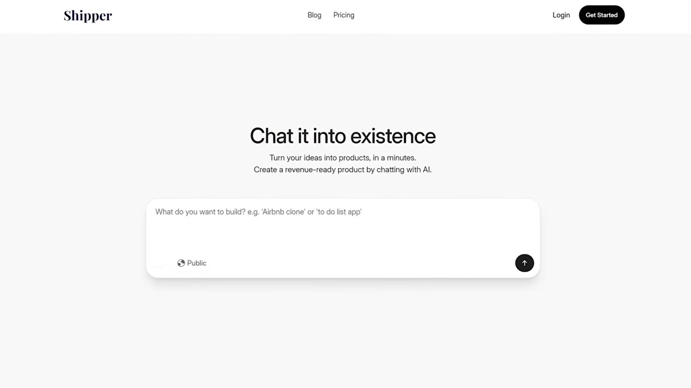
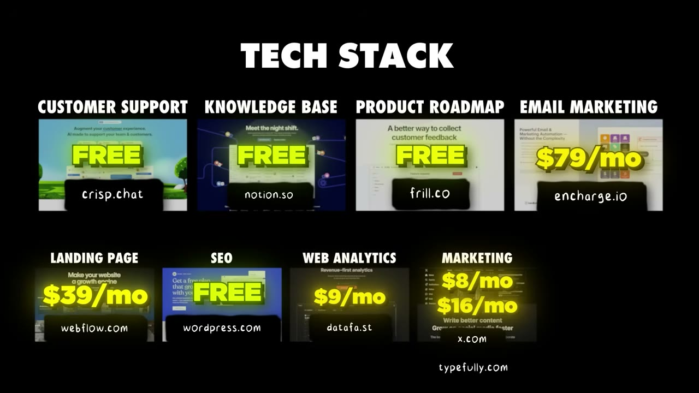

# I Built A Micro-Version Of A $1B SaaS. Now I Make $50K/Month

✅ **Đã phân tích sâu** → [`case.md`](case.md)

| | |
|---|---|
| **Video** | <https://www.youtube.com/watch?v=Nnpz1wsTjBI> |
| **Đăng** | 28/05/2026 |
| **Thời lượng** | 11:47 |
| **Lượt xem** | 79,122 |
| **Lượt thích** | 1,998 |
| **Video ID** | `Nnpz1wsTjBI` |

## Trong thư mục này

| File | Nội dung |
|---|---|
| [`case.md`](case.md) | **Phân tích đầy đủ** — ý tưởng, validate, GTM, áp dụng ở VN |
| [`meta.json`](meta.json) | Metadata gốc (chapters, heatmap, mô tả) |
| [`screenshots/`](screenshots/) | 10 ảnh 720p |

## Mô tả gốc

David (and his brother Daniel) launched Shipper, an AI app builder. But here's the secret... they didn't reinvent the wheel. They just saw a billion-dollar opportunity and thought, "if we capture just 1% of the market, maybe it could change our lives?" This is the story of how they grew shipper to over $50K/month by building a micro-version of a billion-dollar market.
0:00 - Every idea is taken… 
0:49 - What’s your story?
1:27 - Business breakdown
2:46 - Founder background
3:29 - More AI App Ideas
4:14 - Idea behind the business
4:54 - Build story
5:45 - Tech stack
6:17 - Growth and marketing

## Số liệu bắt được từ transcript

> Các đoạn founder nhắc tới con số, kèm timestamp để tua thẳng tới đó trong video.

_(không bắt được con số nào)_

## Chương

- `00:00` Every idea is taken…
- `00:49` What’s your story?
- `01:27` Business breakdown
- `02:46` Founder background
- `03:29` More AI App Ideas
- `04:14` Idea behind the business
- `04:54` Build story
- `05:45` Tech stack
- `06:17` Growth and marketing
- `07:21` Finding the 1% difference
- `09:15` Advice to younger self
- `10:05` Pat and Gus reflections: Copy & Paste

## Ảnh

1. `01_00m36s_usd-1.jpg` — 
2. `02_01m36s_metric.jpg` — 
3. `03_02m56s_usd-50-000.jpg` — 
4. `04_03m41s_ch-more-ai-app-ideas.jpg` — 
5. `05_04m26s_ch-idea-behind-the-business.jpg` — 
6. `06_05m06s_ch-build-story.jpg` — 
7. `07_06m04s_replay.jpg` — 
8. `08_06m44s_usd-50-m.jpg` — 
9. `09_07m33s_ch-finding-the-1-difference.jpg` — 
10. `10_09m27s_ch-advice-to-younger-self.jpg` — 

---

← [Quay lại index](../../index.md) · [Toàn bộ video](../README.md)
