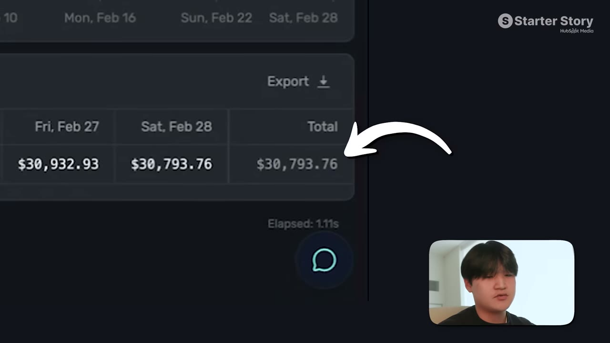

# I Built A $30K/Month App: Here's My Exact Process

✅ **Đã phân tích sâu** → [`case.md`](case.md)

| | |
|---|---|
| **Video** | <https://www.youtube.com/watch?v=P4QodeA_lQ0> |
| **Đăng** | 31/05/2026 |
| **Thời lượng** | 14:13 |
| **Lượt xem** | 220,189 |
| **Lượt thích** | 6,209 |
| **Video ID** | `P4QodeA_lQ0` |

## Trong thư mục này

| File | Nội dung |
|---|---|
| [`case.md`](case.md) | **Phân tích đầy đủ** — ý tưởng, validate, GTM, áp dụng ở VN |
| [`meta.json`](meta.json) | Metadata gốc (chapters, heatmap, mô tả) |
| [`screenshots/`](screenshots/) | 10 ảnh 720p |

## Mô tả gốc

Benjamin Chen is a 20-year-old NYU student who’s built 45+ apps and scaled his latest app to $30K/month. What makes Benji different is he has a repeatable system that’s helped him build, launch, and grow his apps fast. This video breaks down the exact system he uses to scale apps profitably.
0:00 - The system behind a successful app
1:05 - Who is Benji?
1:26 - App breakdown
2:25 - Founder background
3:37 - Build process
4:14 - Build your own iOS apps!!
4:50 - Tech stack and tools
5:39 - Finding app ideas
6:39 - Marketing apps
8:11 - UGC example
8:50 - Paid ads strategy
9:42 - App Playbook (Ste

## Số liệu bắt được từ transcript

> Các đoạn founder nhắc tới con số, kèm timestamp để tua thẳng tới đó trong video.

_(không bắt được con số nào)_

## Chương

- `00:00` The system behind a successful app
- `01:05` Who is Benji?
- `01:26` App breakdown
- `02:25` Founder background
- `03:37` Build process
- `04:14` Build your own iOS apps!!
- `04:50` Tech stack and tools
- `05:39` Finding app ideas
- `06:39` Marketing apps
- `08:11` UGC example
- `08:50` Paid ads strategy
- `09:42` App Playbook (Step-by-Step)
- `11:59` Advice
- `13:02` Pat and Gus reflections: the proven system

## Ảnh

1. `01_00m15s_ch-the-system-behind-a-successful-app.jpg` — 
2. `02_01m40s_usd-80-000.jpg` — 
3. `03_02m37s_ch-founder-background.jpg` — 
4. `04_03m49s_ch-build-process.jpg` — 
5. `05_04m26s_ch-build-your-own-ios-apps.jpg` — 
6. `06_05m36s_replay.jpg` — 
7. `07_06m51s_ch-marketing-apps.jpg` — 
8. `08_08m11s_metric.jpg` — 
9. `09_08m57s_usd-50.jpg` — 
10. `10_09m54s_ch-app-playbook-step-by-step.jpg` — 

---

← [Quay lại index](../../index.md) · [Toàn bộ video](../README.md)
