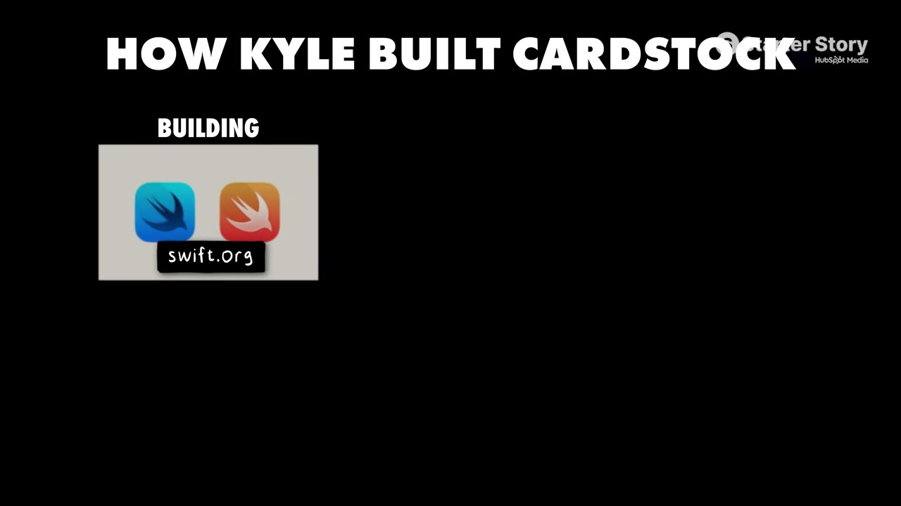
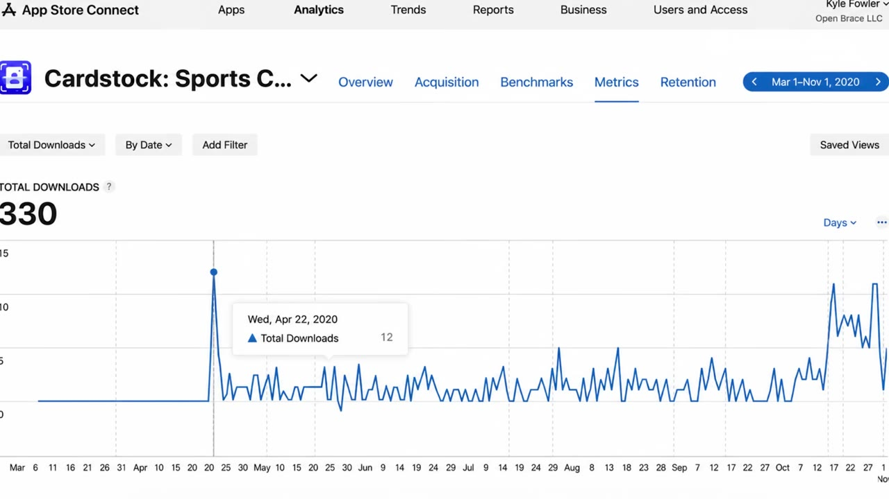
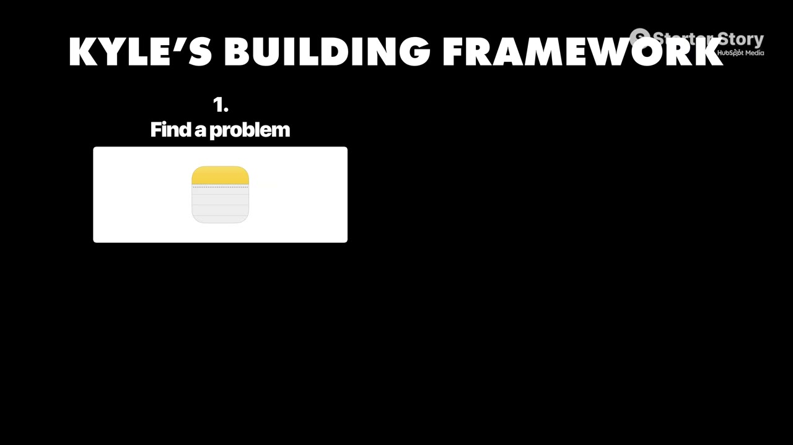
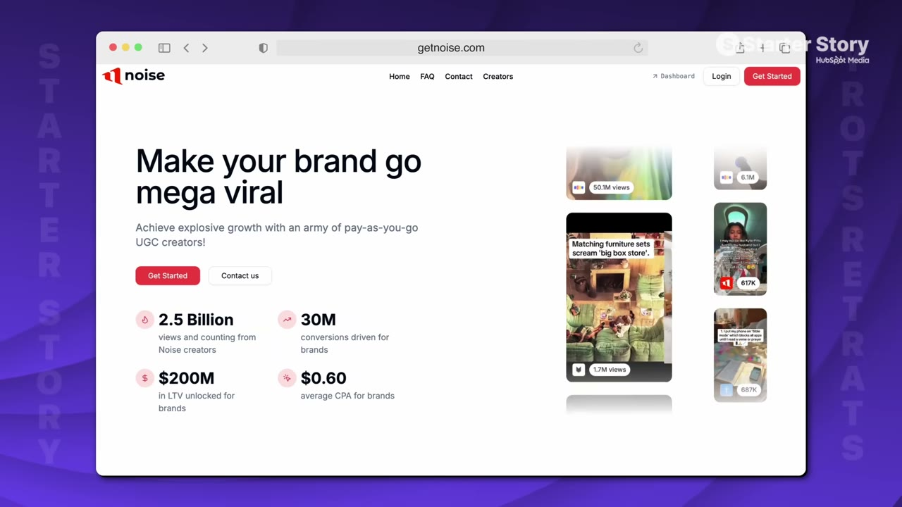

# I Built Two Apps That Make $120K/Month

✅ **Đã phân tích sâu** → [`case.md`](case.md)

| | |
|---|---|
| **Video** | <https://www.youtube.com/watch?v=xWnqY2Mav4s> |
| **Đăng** | 07/06/2026 |
| **Thời lượng** | 14:50 |
| **Lượt xem** | 77,624 |
| **Lượt thích** | 1,925 |
| **Video ID** | `xWnqY2Mav4s` |

## Trong thư mục này

| File | Nội dung |
|---|---|
| [`case.md`](case.md) | **Phân tích đầy đủ** — ý tưởng, validate, GTM, áp dụng ở VN |
| [`meta.json`](meta.json) | Metadata gốc (chapters, heatmap, mô tả) |
| [`screenshots/`](screenshots/) | 10 ảnh 720p |

## Mô tả gốc

Kyle Fowler is a regular guy who runs two mobile apps that together do over $120,00K per month. This is the story of how a self-taught developer turned a hobby into one successful app... and then did it again. 
0:00 - Building from your hobbies
0:57 - What’s your story?
1:30 - App businesses breakdown
2:51 - Founder background
3:58 - Solve your own problems!
4:44 - Building the apps
5:23 - Timeline and launch
6:05 - Tech stack and costs
6:28 - Idea and validation
7:59 - Finding $1M app ideas
9:20 - Marketing apps in 2026
10:11 - App demo
11:01 - Final advice
12:08 - Pat and Gus reflections

## Số liệu bắt được từ transcript

> Các đoạn founder nhắc tới con số, kèm timestamp để tua thẳng tới đó trong video.

_(không bắt được con số nào)_

## Chương

- `00:00` Building from your hobbies
- `00:57` What’s your story?
- `01:30` App businesses breakdown
- `02:51` Founder background
- `03:58` Solve your own problems!
- `04:44` Building the apps
- `05:23` Timeline and launch
- `06:05` Tech stack and costs
- `06:28` Idea and validation
- `07:59` Finding $1M app ideas
- `09:20` Marketing apps in 2026
- `10:11` App demo
- `11:01` Final advice
- `12:08` Pat and Gus reflections

## Ảnh

1. `01_00m37s_usd-1-m.jpg` — 
2. `02_01m42s_ch-app-businesses-breakdown.jpg` — 
3. `03_03m03s_ch-founder-background.jpg` — 
4. `04_04m10s_ch-solve-your-own-problems.jpg` — 
5. `05_04m56s_ch-building-the-apps.jpg` — 
6. `06_05m35s_ch-timeline-and-launch.jpg` — 
7. `07_06m26s_replay.jpg` — 
8. `08_08m11s_ch-finding-1m-app-ideas.jpg` — 
9. `09_09m51s_replay.jpg` — 
10. `10_11m13s_ch-final-advice.jpg` — 

---

← [Quay lại index](../../index.md) · [Toàn bộ video](../README.md)
