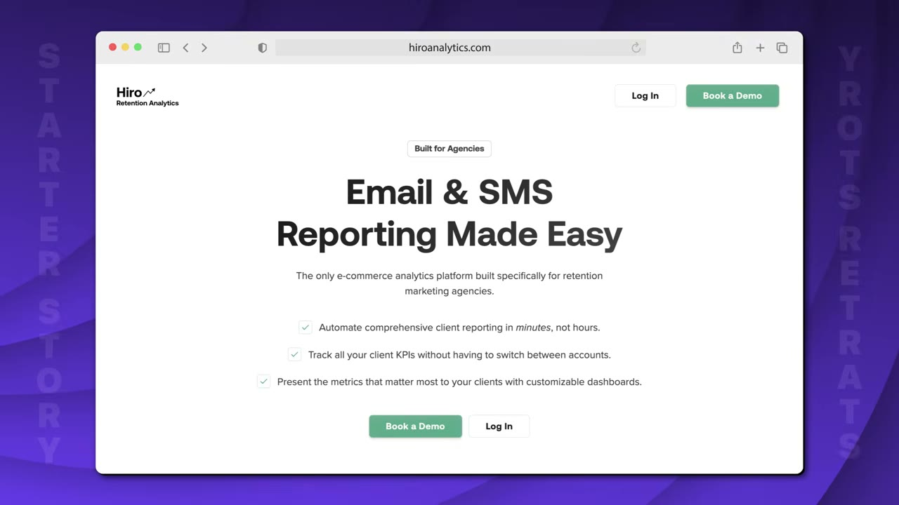
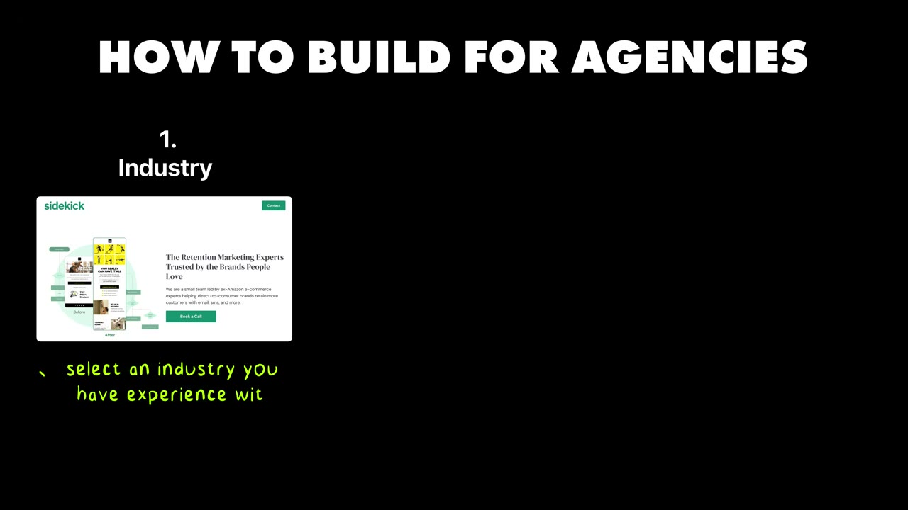

# Hero Analytics — $1M ARR nhờ bán cho AGENCY thay vì cho brand

> **Tóm tắt 30 giây:** Zac và Brendan chạy một agency email marketing suốt **6 năm**, có ~30 khách. Brendan quá ngán các điểm ma sát mà **mọi agency đều gặp** nên tự build công cụ. Ra mắt **Hero Analytics** tháng 10/2024 — nền tảng phân tích và báo cáo tự động, nhưng bán cho **agency**, không bán cho **brand**. **19 tháng: từ 0 lên hơn $1M ARR**, hiện **$96.200 MRR** và đang thêm **~$10K MRR mỗi tháng**. Churn thấp nhất mà host từng thấy trên kênh.



---

## 1. Con số

| Chỉ số | Giá trị |
|---|---|
| MRR | **$96.200** |
| ARR | **hơn $1.000.000** |
| Thời gian | **19 tháng** từ 0 |
| Tốc độ tăng | **+$10.000 MRR mỗi tháng** |
| Churn | **Cực thấp** — Pat: *"tỉ lệ churn tốt nhất tôi từng thấy từ bất kỳ ai lên kênh này"* |
| Nhân sự | **2** |
| Trial | 30 ngày miễn phí |

**Cách định giá — theo quy mô agency:**

| Agency có | Trả |
|---|---|
| 10 client | ~**$500**/tháng |
| 20 client | ~**$600**/tháng |
| 200 client | **vài nghìn** đô/tháng (thoả thuận riêng) |

Cộng thêm **giá theo ghế**: agency có 10 chiến lược gia trả ~$10/ghế; họ lại cấp ghế cho 20 khách của mình → thêm ~$200/tháng.

---

## 2. Insight cốt lõi: TẦNG AGENCY ⭐⭐⭐

Đây là mô hình đáng giá nhất trong toàn bộ knowledge base về mặt **đòn bẩy phân phối**.

**Vấn đề với cách bán thông thường:**
> Có rất nhiều công cụ phân tích trong mảng Shopify/ecommerce, nhưng **tất cả đều bán cho từng brand riêng lẻ**. Muốn có 3 subscription thì phải đi bán cho brand A, brand B, brand C.

**Cách của Zac:**
> **Mỗi agency có 10, 20, 30 brand làm khách. Bán cho MỘT agency là đưa được 30 brand lên nền tảng.**

```
Bán cho brand:    1 lần bán  =  1 khách hàng
Bán cho agency:   1 lần bán  =  30 brand + 10 nhân viên + 20 ghế cho khách của họ
```

### Ba lý do khiến mô hình này chạy tốt hơn hẳn

**1. Agency CỰC KỲ dễ tìm — đây là chỗ hay nhất** ⭐

> Vào **trang agency partner directory của Shopify**, của **Klaviyo** — họ **xếp hạng sẵn danh sách agency theo quy mô và độ ảnh hưởng**.

Nói cách khác: **danh sách khách hàng tiềm năng đã được nền tảng lớn tổng hợp, xếp hạng và công khai miễn phí.** Không cần cold outreach mò mẫm.

> **Xác nhận lẫn nhau với [Savvy Nomad](../2026-05-21_i-make-1-7m-year-in-the-most-boring-niche-imaginable/case.md):** Bo chọn ngách chán vì *"ít founder giỏi chịu động vào"*; Zac chọn tầng agency vì *"gần như không ai làm"*. **Điều kiện phân định giữa hai case: Bo bán cho người dùng cuối và phải tự tìm họ; Zac bán cho một tầng trung gian mà nền tảng lớn đã liệt kê và xếp hạng sẵn.** Nếu ngách của anh có tầng trung gian như vậy, mô hình Zac tiết kiệm cho anh toàn bộ khâu tìm khách.

**2. Mọi agency đều dùng cùng nền tảng → cùng một vấn đề**

> Vì các agency đều xoay quanh cùng những nền tảng, **có thể yên tâm giả định họ có cùng vấn đề**. Kết quả: **99% tính năng phát hành ra đều liên quan tới mọi người dùng, mọi lần.**

> **Đây là điều rất khó đạt được ở B2C.** Không phải tìm cách chiều nhiều nhóm khác nhau — mọi khách hàng đều muốn cùng một thứ.

**3. Vấn đề của agency luôn giống nhau, và rất đau**

> **Mọi chủ agency đều đang cố nhận thêm khách mà không phải thuê thêm người.** Và điều tác động mạnh thứ hai: **anh tiết kiệm được cho họ bao nhiêu thời gian.**

Chỉ cần đánh trúng hai điểm này là chủ agency sẽ **coi anh là nghiêm túc**.



---

## 3. Sản phẩm thực sự bán cái gì

Bề ngoài: nền tảng phân tích và báo cáo cho agency email/SMS marketing (nhóm chạy Klaviyo thay khách hàng).

**Nhưng Pat chỉ ra thứ thật sự được bán — và đây là điểm dễ hiểu sai nhất:**

> Trực quan hoá dữ liệu chỉ là thứ agency **giao cho khách của họ**. Lý do business này chạy tốt là vì **việc trực quan hoá dữ liệu rồi gửi cho khách là một cực hình. Và phải làm điều đó cho 20 khách khác nhau.** Đó là một đống việc tay.
>
> **"Món ăn không phải là data visualization — mà là THỜI GIAN TIẾT KIỆM ĐƯỢC."**

Tính năng đặc thù cho agency: xem **toàn bộ khách hàng ở một chỗ**, xem **team đang chạy so với mục tiêu thế nào**.

---

## 4. Ý tưởng đến từ đâu

Cùng mẫu hình lặp lại của kênh: **vấn đề gặp phải trong lúc làm việc khác.**

Họ chạy agency email marketing **6 năm**, có ~30 khách — **chính là ICP của sản phẩm sau này**. Brendan quá ngán các điểm ma sát mà mọi agency đều gặp nên **tự build**. Khi Hero có đà, họ rời agency để tập trung toàn thời gian.

**Và lời khuyên về con đường sự nghiệp — đáng đọc kỹ:**

> **"Con đường tìm ra business thật sự hiệu quả không bao giờ là đường thẳng. Hero đạt $1M ARR trong một năm rưỡi, nhưng thực ra chúng tôi mất khoảng 10 NĂM để xây Hero."**

Chuỗi kinh nghiệm của họ:
```
startup data visualization  →  Amazon mua lại  →  làm ở Amazon  →  nghỉ
  →  business newsletter THẤT BẠI  →  nhưng học được email marketing
  →  mở agency email marketing  →  chạy 5-6 năm
  →  MỚI build Hero
```

> **"Đừng coi nhẹ bất kỳ trải nghiệm nào. Anh không bao giờ biết cái nào sẽ cực kỳ liên quan tới business rốt cuộc cất cánh một thập kỷ sau."**

> ⚠️ **Đối lập trực tiếp với [Benji (Snag)](../2026-05-31_i-built-a-30k-month-app-heres-my-exact-process/case.md)** — 45 app trong một năm, mỗi app 4-5 tiếng, bắn nhiều để trúng. Zac thì một đường vòng 10 năm rồi mới trúng một phát. **Điều kiện phân định: nếu khách của anh tự tìm tới qua nội dung và quảng cáo (B2C), bắn nhiều là hợp lý; nếu khách của anh là chủ agency phải trả $500-2.000/tháng, họ mua vì anh NÓI ĐÚNG NGÔN NGỮ của họ — và thứ đó chỉ có được bằng thời gian sống trong ngành.**

---

## 5. Cách sao chép mô hình này ⭐⭐

Zac đưa quy trình rất cụ thể:

| Bước | Việc làm |
|---|---|
| **1** | Nhìn lại **ngành anh đang làm** và hỏi: **"Ở đây có TẦNG AGENCY nào không?"** |
| **2** | Xác định các **nền tảng chính** trong ngành đó |
| **3** | Vào website nền tảng đó tìm trang **"agency directory"** hoặc **"partner directory"** — đây là **danh sách khách hàng tiềm năng có sẵn** |
| **4** | Nhắm vào hai nỗi đau chung: **nhận thêm khách mà không thuê thêm người** + **tiết kiệm thời gian** |

**Ví dụ anh tự đưa ra:** nhà hàng có agency quản lý quảng cáo DoorDash và Uber Eats hộ, và **phải báo cáo cho khách về hiệu quả**.

**Pat bổ sung — và đây là bài tập làm được ngay:**

> **Vào ChatGPT hoặc Claude ngay bây giờ: "Tôi vừa biết về mô hình kinh doanh này. Cho tôi biết tôi có thể áp dụng nó ở những tầng agency nào khác?" Nó sẽ đưa ra khoảng 20 ý tưởng.**

> Pat gọi đây là **"mỏ vàng nằm ngay trước mắt"** — và nói thẳng anh không nói câu đó bừa.

**Vì sao mô hình này ẩn:** mọi công cụ tỉ đô đều có hệ sinh thái quanh nó, và **chúng công khai tầng agency ngay trên website của mình** — vì khách hàng cần điều đó.

---

## 6. Rủi ro — và cách trả lời rất sắc

Pat hỏi thẳng: không sợ **Klaviyo tự làm** tính năng này, hoặc **agency tự build**?

**Câu trả lời hai vế:**

**Vế 1 — quy mô bảo vệ họ:**
> **Một business unit $1M ARR là tuyệt vời với hai người. Nhưng với một công ty đại chúng, $1M ARR không xê dịch được kim đồng hồ.** Tầm ngắm của họ ở chỗ khác.

**Vế 2 — tính đa nền tảng là hào bảo vệ thật:**
> Họ **không chỉ nối vào Klaviyo**. Một agency có 30 khách thì có thể 20 khách dùng Klaviyo, 10 khách còn lại dùng **Postscript, Attentive, Omnisend**. Kể cả Klaviyo có làm bản riêng, **gần như chắc chắn họ sẽ không hiển thị dữ liệu từ các nền tảng khác** mà Klaviyo không dính dáng.

> **Bài học chống rủi ro nền tảng: đừng làm wrapper cho MỘT nền tảng. Hãy làm lớp TỔNG HỢP nhiều nền tảng.** Kẻ độc quyền sẽ không bao giờ hiển thị dữ liệu của đối thủ — đó là chỗ anh vĩnh viễn an toàn.
>
> **So với [Shipper](../2026-05-28_i-built-a-micro-version-of-a-1b-saas-now-i-make-50k/case.md), đây là hai câu trả lời khác nhau cho cùng một câu hỏi "gã khổng lồ copy thì sao?".** Shipper trả lời bằng **tính năng** (làm được app di động, extension, bot) — thứ Lovable có thể ship bất cứ lúc nào. Zac trả lời bằng **vị trí** (đứng giữa Klaviyo, Postscript, Attentive, Omnisend) — thứ không đối thủ nào trong số đó chịu làm. **Điều kiện phân định: khác biệt của anh nằm ở danh sách tính năng hay ở chỗ anh đứng? Chỉ cái thứ hai mới là hào.**

---

## 7. Tech stack

| Giai đoạn | Công cụ |
|---|---|
| **Ban đầu** | **AWS** + **Snowflake** (hóa đơn ban đầu rất cao vì chưa biết dùng) + **Retool** để dựng app nội bộ nối vào database tự thiết kế |
| **6-8 tháng gần đây** | **Chuyển hoàn toàn sang Claude Code** |

Họ có nền **ETL** từ trước — nhưng **không biết gì về AWS trong bối cảnh ứng dụng**, nên hoá đơn ban đầu bị đội.

---

## 8. Cảnh báo thiên kiến nguồn

- **Pat khẳng định một điều bị chính Zac bác bỏ trong cùng video.** Ở phút 04:16 Pat nói: *"các anh xây được cái này mà KHÔNG CÓ kinh nghiệm kỹ thuật sâu."* Nhưng Zac vừa kể ở phút 09:36: họ **làm ở một startup data visualization, startup đó được Amazon mua lại, họ làm tiếp ở Amazon**, và ở 04:24 anh nói họ có *"nền tảng ETL cũ khá đặc thù"*. Đây là **hai chuyên gia dữ liệu** xây một sản phẩm dữ liệu — không phải người không kỹ thuật.
- **Bối cảnh bị làm mờ bởi chính tiêu đề.** Tiêu đề bán câu chuyện *"$1M SaaS trong một ngách ẩn"*, nhưng ngách đó **không hề ẩn với họ**: họ đã **chạy agency email marketing 6 năm với ~30 khách**, và chính 30 khách đó là ICP của sản phẩm. Zac nói thẳng *"thực ra chúng tôi mất khoảng 10 NĂM để xây Hero"* — nhưng câu đó nằm ở phút thứ 9, sau khi tiêu đề đã bán xong câu chuyện "19 tháng".
- **Mốc thời gian bị co lại khi kể.** Sự thật là **19 tháng**; Pat gọi nó là *"just over a year"* (hơn một năm một chút) **hai lần** (00:07 và 03:01). Nghe thì nhanh hơn thực tế khoảng 60%.
- **Đoạn tài trợ HubSpot ở 03:34–04:16** — *"30+ Business Ideas in Unsexy Niches"* qua link `clickhubspot.com`, nhắc lại ở 12:58. **Không liên quan tới Hero.** Đáng chú ý: **đây đúng là lead magnet đã dùng trong video [Savvy Nomad](../2026-05-21_i-make-1-7m-year-in-the-most-boring-niche-imaginable/case.md)** ba tuần trước đó — cùng một tài liệu được gắn vào hai câu chuyện khác nhau, tức nội dung video được chọn một phần theo tài liệu mà kênh đang cần đẩy.
- **Có dashboard Stripe** (4 tuần gần nhất, $96,2K MRR) — điểm cộng. Nhưng **churn thì không có con số nào**: Zac chỉ nói *"cực thấp"*, Pat nói *"tỉ lệ churn tốt nhất tôi từng thấy"*, và **không ai đọc ra một phần trăm nào**. Với một case mà luận điểm trung tâm là "churn thấp vì agency nhúng vào quy trình", đây là con số quan trọng nhất và nó bị bỏ trống.
- **Số lượng khách hàng — chỉ số cốt lõi của mô hình — không hề được nêu.** Cả case dựng trên lập luận *"một lần bán = 30 brand"*, nhưng video **không nói họ có bao nhiêu agency đang trả tiền**. Không có con số đó thì không kiểm chứng được lập luận đòn bẩy.
- **Thiếu mặt chi phí.** Zac nói hoá đơn AWS và Snowflake ban đầu *"cao khủng khiếp"* nhưng **không nêu con số nào**. Với sản phẩm dữ liệu chạy trên Snowflake, chi phí hạ tầng là biến số quyết định biên lợi nhuận. Cũng không có CAC, không có chu kỳ bán hàng, không có tỉ lệ chuyển đổi sau trial 30 ngày.
- **Tên sản phẩm có thể bị ghi sai.** Bản ghi tự động đọc là *"Hero"*, nhưng link trong mô tả video là **`hiroanalytics.com`** — tên thật nhiều khả năng là **Hiro Analytics**. Nếu anh đi tra cứu, hãy tìm bằng địa chỉ web.

## 9. Áp dụng cho tôi (indie hacker VN)

**Đây là mô hình tôi đánh giá cao nhất cho anh về mặt đòn bẩy — và nó gần như chưa có ai làm ở Việt Nam.**

**Vì sao rất hợp:**
- ✅ **Danh sách khách hàng có sẵn, công khai, xếp hạng sẵn** — không cần đoán ai là khách
- ✅ **Một lần bán = 30 người dùng** → chi phí bán hàng trên mỗi user cực thấp
- ✅ **Mọi khách cùng một vấn đề** → không phải chiều nhiều nhóm
- ✅ **Churn thấp** vì agency đã nhúng công cụ vào quy trình phục vụ khách của họ
- ✅ **B2B, thu USD** → né hoàn toàn vấn đề ARPU thấp
- ✅ **Đội 2 người** làm được

**Bài tập làm hôm nay (30 phút):**
1. Liệt kê **ngành anh hiểu**
2. Với mỗi ngành, hỏi: **ai đang làm dịch vụ này THUÊ cho nhiều khách cùng lúc?** (đó là tầng agency)
3. Nền tảng chính của ngành đó là gì?
4. Tìm **"partner directory"** hoặc **"agency directory"** trên website nền tảng đó
5. Hỏi Claude: *"tầng agency nào khác áp dụng được mô hình này?"*

**Tầng agency đáng soi — quốc tế (thu USD):**
- Agency quản Amazon FBA cho nhiều seller
- Agency quản Google/Meta Ads cho nhiều SMB
- Agency SEO quản nhiều site
- Agency quản TikTok Shop cho nhiều brand
- Agency quản app store (ASO) cho nhiều app

**Tầng agency ở Việt Nam:**
- Agency chạy ads cho nhiều shop online
- Agency quản fanpage/TikTok cho nhiều nhãn hàng
- Đơn vị làm kế toán thuê cho nhiều doanh nghiệp nhỏ
- Đơn vị quản vận hành sàn (Shopee/Lazada/TikTok Shop) cho nhiều shop
- Agency booking KOC cho nhiều brand

> Trong mọi trường hợp, nỗi đau y hệt Zac mô tả: **họ phải gom dữ liệu và làm báo cáo cho từng khách, bằng tay, mỗi tuần.**

**Rào cản thật:**
- ⚠️ **Cần chuyên môn ngành thật.** Zac chạy agency 6 năm nên biết nền tảng nào, ai là ai, cái gì quan trọng. Không có nền này thì rất khó bán.
- ⚠️ **Bán B2B cần nói chuyện trực tiếp**, không bán qua web được. Ở VN càng cần gặp mặt.
- ⚠️ **Tích hợp nhiều nền tảng là việc kỹ thuật nặng** — nhưng cũng chính là hào bảo vệ
- ⚠️ **Thị trường agency ở VN nhỏ hơn và trả ít hơn.** Nếu làm cho VN, giá phải khác hẳn; nếu nhắm quốc tế, cần tiếng Anh và hiểu nền tảng Mỹ.
- ⚠️ Rủi ro nền tảng có thật — giảm bằng cách **tổng hợp nhiều nền tảng**, không phụ thuộc một cái

**Nhận định của Pat đáng nhớ, về việc chọn thị trường:**
> Nếu thật sự muốn kiếm tiền và tăng trưởng nhanh, **hãy tập trung vào các ngách "kém sang"**, đặc biệt nếu làm B2B. Anh cũng dẫn Gusto và QuickBooks: anh không tự lên web mua — **kế toán của anh giới thiệu và bán cho anh**, và anh **không có lựa chọn nào khác ngoài dùng nó.**

**Khi KHÔNG nên dùng mô hình này:**

- **Khi ngành anh nhắm không có một nền tảng lớn công khai danh sách đối tác.** Toàn bộ lợi thế của Zac là *"danh sách khách hàng đã được Shopify và Klaviyo xếp hạng sẵn"*. Nếu không có directory đó, anh mất chính thứ khiến mô hình rẻ, và quay về cold outreach thủ công — lúc ấy các mô hình khác đều nhanh hơn. **Hãy kiểm tra directory TRƯỚC, chọn ngành SAU.**
- **Khi sản phẩm của anh chỉ nối được vào MỘT nền tảng.** Câu trả lời chống rủi ro duy nhất của Zac là *"chúng tôi không chỉ nối vào Klaviyo"* — vì Klaviyo sẽ không bao giờ hiển thị dữ liệu của Postscript hay Attentive. Wrapper một nền tảng thì sớm muộn cũng bị chính nền tảng đó nuốt, và anh không có câu trả lời nào cho câu hỏi đó.
- **Khi anh chưa từng làm việc ở chính tầng đó.** Zac có **6 năm chạy agency và 30 khách sẵn** làm nhóm khách đầu tiên. Bán một phần mềm $500-2.000/tháng cho chủ agency đòi hỏi anh biết họ đau ở đâu trước khi họ nói ra. Nếu anh không có nền đó, hãy chọn mô hình mà sản phẩm tự bán được — như bộ lọc *"tiết kiệm X, trả Y, X > Y"* của [Savvy Nomad](../2026-05-21_i-make-1-7m-year-in-the-most-boring-niche-imaginable/case.md).

---

## Nguồn

- Video: [I Built A $1M SaaS In A Hidden Niche](https://www.youtube.com/watch?v=NPpky92ZfjA) — Starter Story, 10/06/2026, 13:21, 50K views
- Sản phẩm: Hero Analytics
- [`transcript.md`](transcript.md) · [`screenshots/`](screenshots/)
