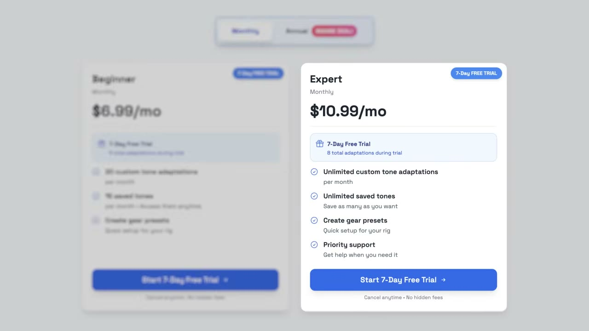

# The First App I Ever Built Makes $25K/Month

✅ **Đã phân tích sâu** → [`case.md`](case.md)

| | |
|---|---|
| **Video** | <https://www.youtube.com/watch?v=Q4k8JNYKJT0> |
| **Đăng** | 14/06/2026 |
| **Thời lượng** | 18:00 |
| **Lượt xem** | 147,170 |
| **Lượt thích** | 3,847 |
| **Video ID** | `Q4k8JNYKJT0` |

## Trong thư mục này

| File | Nội dung |
|---|---|
| [`case.md`](case.md) | **Phân tích đầy đủ** — ý tưởng, validate, GTM, áp dụng ở VN |
| [`meta.json`](meta.json) | Metadata gốc (chapters, heatmap, mô tả) |
| [`screenshots/`](screenshots/) | 10 ảnh 720p |

## Mô tả gốc

Kyan is a college student who built his first app and turned it into a $25K/month business. This is the story about how he found a tiny problem and turned it into a profitable app in just 5 months. 
0:00 - Zero to $25K in 5 months
1:04 - What's your story?
1:41 - App breakdown
3:01 - Kyan's background
3:40 - Finding and validating the idea
4:20 - The Attention Playbook
5:03 - Solve your own problem
5:22 - Build process and tech stack
6:51 - Growth and marketing 
7:39 - Being "cringe"
8:20 - Find something you already know
9:30 - Find a tiny problem
10:11 - Ship V1 FAST
10:32 - Post 3x per day

## Số liệu bắt được từ transcript

> Các đoạn founder nhắc tới con số, kèm timestamp để tua thẳng tới đó trong video.

_(không bắt được con số nào)_

## Chương

- `00:00` Zero to $25K in 5 months
- `01:04` What's your story?
- `01:41` App breakdown
- `03:01` Kyan's background
- `03:40` Finding and validating the idea
- `04:20` The Attention Playbook
- `05:03` Solve your own problem
- `05:22` Build process and tech stack
- `06:51` Growth and marketing
- `07:39` Being "cringe"
- `08:20` Find something you already know
- `09:30` Find a tiny problem
- `10:11` Ship V1 FAST
- `10:32` Post 3x per day
- `11:09` Scale winning content
- `12:15` ToneAdapt demo
- `14:12` Advice to younger self
- `15:05` Pat and Gus reflections: a cool little idea

## Ảnh

1. `01_00m15s_ch-zero-to-25k-in-5-months.jpg` — 
2. `02_01m08s_usd-25-000.jpg` — 
3. `03_02m11s_usd-10.jpg` — 
4. `04_02m57s_usd-25-000.jpg` — 
5. `05_03m52s_ch-finding-and-validating-the-idea.jpg` — 
6. `06_04m30s_usd-1-m.jpg` — 
7. `07_05m15s_ch-solve-your-own-problem.jpg` — 
8. `08_06m11s_replay.jpg` — 
9. `09_07m03s_ch-growth-and-marketing.jpg` — 
10. `10_07m51s_ch-being-cringe.jpg` — 

---

← [Quay lại index](../../index.md) · [Toàn bộ video](../README.md)
