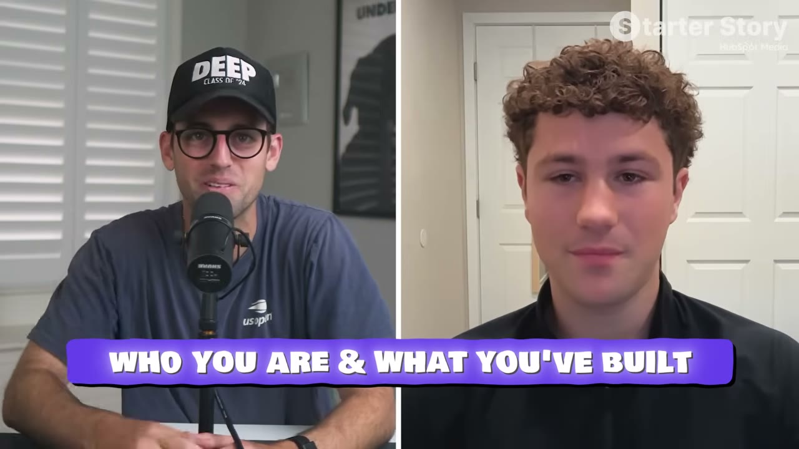
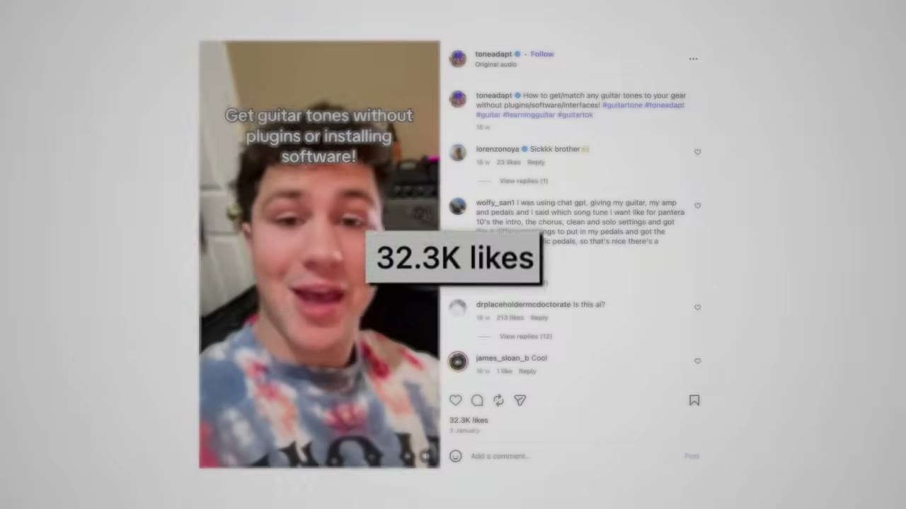

# Tone Adapt — $25K/tháng từ một vấn đề "bé xíu" của dân chơi guitar

> **Tóm tắt 30 giây:** Kian, 21 tuổi, sinh viên CS ở San Diego State. Anh học guitar được năm rưỡi và mê mẩn. Xin thực tập không được, anh tìm một project để cho vào CV. Anh nhận ra mình đang dùng ChatGPT để hỏi cách chỉnh âm thanh guitar nhưng **kết quả không chính xác** — và trên Reddit, Instagram nhiều người chơi guitar cũng đúng vấn đề đó, **không có giải pháp nào**. Anh build **Tone Adapt** trong **một tuần**, **không tự viết một dòng code nào**. Dưới **5 tháng**: **100.000+ người dùng, $25.000/tháng**.

---

## 1. Con số

| Chỉ số | Giá trị |
|---|---|
| Doanh thu 4 tuần gần nhất | **hơn $25.000** (web $11.500 + app $14.000) |
| Người dùng | **100.000+** |
| Subscriber mới trong 3 tháng | **1.400** |
| Subscriber hoạt động trên app | 397 (app mới ra mắt 1 tháng) |
| Giá | **$10/tuần** hoặc **~$60/năm** |
| Thời gian build V1 | **1 tuần** (anh nói giờ làm lại chỉ mất **vài giờ**) |
| Tuổi | 21, vẫn đi học |

**Sản phẩm:** nhập cây guitar + amp + pedal bạn đang có (database **1.500 guitar, 2.000 amp**), chọn bài hát muốn nghe giống → **dưới 30 giây** app trả về: thiết bị gốc nghệ sĩ dùng khi thu âm, ước lượng thông số amp của họ, chuỗi hiệu ứng — **rồi quy đổi sang đúng thiết bị bạn đang có.**

> **Chỗ ăn tiền nằm ở chữ "quy đổi".** Không phải "đây là thiết bị của nghệ sĩ" (Google cũng làm được) — mà **"đây là cách chỉnh CÂY ĐÀN CỦA BẠN để ra âm đó"**. Cá nhân hoá chính là sản phẩm.

---

## 2. Ý tưởng: vấn đề "bé xíu" ⭐⭐

**Luận điểm trung tâm, và là câu đáng nhớ nhất của case:**

> **"Nếu bạn có một vấn đề bé xíu, thì ngoài kia có ít nhất hàng nghìn, nếu không phải hàng chục nghìn người đang có đúng vấn đề đó."**

**Cách anh tìm ra:**
1. Anh **chơi guitar gần như mỗi ngày suốt hơn một năm** trước khi nghĩ tới việc build
2. Anh liệt kê **những điểm đau anh gặp phải khi chơi**
3. Anh nhận ra mình dùng ChatGPT để hỏi tone nhưng **không chính xác**
4. Anh **nói chuyện với người chơi guitar khác trên Reddit, Instagram — chủ yếu trong phần bình luận**
5. Nhiều người **có đúng vấn đề đó**, và **không có giải pháp thật nào**

> **Bước 4 là bước validate, và nó miễn phí.** Đọc và tham gia bình luận trong cộng đồng ngách — cùng cơ chế với [Go Tall](../2026-07-19_this-stupidly-simple-app-makes-100k-month/case.md) (bình luận TikTok), [Stella](../2026-07-12_she-built-this-340k-month-app-in-60-days/case.md) (bình luận là bản thiết kế) và chữ **C** trong [khung VSC](../2026-06-21_i-built-a-10k-month-app-with-this-one-system/case.md).

### Công thức tìm ý tưởng của anh

> **"Chọn một sở thích hoặc ngách anh đã biết. Chọn thứ anh làm mỗi ngày hoặc mỗi tuần."**

**Vì sao điều này quan trọng:**

> **"Anh hiểu và trực tiếp gặp đúng những điểm đau anh đang cố giải — mà không cần làm nghiên cứu thị trường gì cả. Về mặt kỹ thuật, anh CHÍNH LÀ khách hàng của anh, và anh hiểu ngách của mình hơn bất kỳ ai."**

**Cách soi một sở thích để tìm ý tưởng:**

> Trong bất kỳ sở thích nào cũng có **một điểm đau bé xíu** mà chưa có giải pháp, hoặc quy trình quá chậm, hoặc kết quả không chính xác, hoặc bất tiện. **Chỗ đó là cơ hội kinh doanh.**

Pat nhận xét: rất nhiều người **đánh giá thấp** những sở thích nhỏ của chính mình và nghĩ *"tôi chẳng có đam mê gì"*.

---

## 3. Playbook ra mắt — cụ thể và làm được ngay ⭐⭐

Đây là bộ hướng dẫn hành động rõ ràng nhất trên kênh.

### Bước 1 — Ship V1 trên WEB, ngay hôm nay

> **"Ship V1 trên web ngay bây giờ. Anh có thể ship một web app hôm nay và có người trả tiền cho anh ngay tối nay. Đừng ngồi hàng giờ chọn logo, đừng đánh bóng gì cả — cứ build cái gì đó, đưa lên internet, và thu tiền."**

**Vì sao web trước, app sau:** có doanh thu **từ ngày đầu tiên** và có phản hồi để cải tiến, **rồi mới** làm bản mobile.

> **Đây là lời khuyên chiến thuật quan trọng.** Web không phải chờ Apple duyệt — thứ từng là đường găng ở [CalBuddy](../2026-08-09_i-copied-a-huge-app-now-i-make-80k-month/case.md) (2 tháng chờ duyệt). Kian ship web trước, thu tiền, rồi mới làm app. **App mobile sau đó lại kiếm nhiều hơn cả web** ($14K so với $11.500).

### Bước 2 — Đăng 3 lần MỖI NGÀY, tối thiểu một tháng

> **"Cam kết đăng ba lần mỗi ngày trong ít nhất một tháng và tôi đảm bảo anh sẽ kiếm được tiền và có người dùng."**

Anh đăng lại trên **mọi nền tảng**: Instagram, TikTok, YouTube, Facebook.

**Và lời khuyên chống-hoàn-hảo:**

> **"Thật ra đừng nghĩ nhiều về việc đăng cái gì. Nội dung nào cũng hơn là không có nội dung nào. Mỗi lần anh đăng là có người nhìn thấy."**

**Cho thấy sản phẩm đang giải quyết vấn đề trong thời gian thực** — anh nhấn mạnh điểm này.

> **Đây là chỗ hầu hết người biết build thất bại:** làm ra sản phẩm đẹp, giải đúng vấn đề, **rồi không bao giờ đưa nó ra trước mắt ai.**

### Bước 3 — Đặt mặt mình vào thương hiệu ngay từ đầu

Anh thừa nhận video đầu tiên **cực kỳ ngượng**. Bạn bè anh xem và trêu chọc.

> **"Nhưng khi qua được video đầu tiên và nó đã nằm trên internet cho tất cả mọi người xem, anh nhận ra chuyện đó chẳng quan trọng gì. Từ video thứ hai trở đi, không còn ngượng nữa."**

Mục đích: người dùng cảm thấy **họ đang đồng hành cùng anh** trong hành trình cải tiến sản phẩm.

> **Cùng bài học "cringe mountain" của [Go Tall](../2026-07-19_this-stupidly-simple-app-makes-100k-month/case.md).** Rào cản không phải kỹ thuật — nó là tâm lý, và nó chỉ tồn tại đúng một lần.

### Bước 4 — Tìm được format thắng thì đổ xăng vào ⭐

> **"Nội dung đầu tiên chuyển đổi được chính là TEMPLATE cho mọi thứ anh làm sau đó. Làm lại nó 50 lần với biến thể nhỏ. Thuê UGC creator sao chép đúng format đó 60 lần một tháng. Đổ tiền Meta Ads và TikTok Ads vào. Khi đã tìm ra format chuyển đổi, cưỡi nó cho tới khi nó chết."**

**Công thức:** đăng không ngừng → có một cái thắng → **đổ xăng vào cái thắng đó** cho tới khi hết tác dụng → lặp lại.

> **Đây chính là mẫu hình lặp lại nhiều nhất trong toàn bộ knowledge base:** [Go Tall](../2026-07-19_this-stupidly-simple-app-makes-100k-month/case.md) (nhân bản format qua UGC rồi chạy ads), [Chart Detector AI](../2026-07-23_i-make-50k-per-month-working-5-hours-a-week/case.md) (scale ad thắng +20%/3 ngày), [Stella](../2026-07-12_she-built-this-340k-month-app-in-60-days/case.md) (tái tạo nội dung viral đến vô hạn), [Flame](../2026-06-21_i-built-a-10k-month-app-with-this-one-system/case.md) (lặp lại hook đang chạy). **Bốn founder độc lập, cùng một kết luận.**

---

## 4. Tech stack — hai bộ riêng biệt

**Web app** (anh gọi là "bộ để ship tối nay và có người trả tiền"):

| Công cụ | Vai trò |
|---|---|
| **Supabase** | Database |
| **Vercel** | Hosting + analytics |
| **Mailgun** | Email |
| **Stripe** | Thanh toán |
| **OpenAI API + Tavily** (web search) | Lõi AI |
| **Claude Code** | Viết toàn bộ code |

**Mobile app:**

| Công cụ | Vai trò |
|---|---|
| **Swift** (native) | App |
| **Vercel** | Backend API routes |
| **Supabase** | Database |
| **RevenueCat** | Theo dõi thanh toán, subscription |
| **Superwall** | Paywall + A/B test |

> **"Không một dòng code nào do tôi tự viết."** — sinh viên CS, nhưng toàn bộ là vibe coding.

---

## 5. Lời khuyên cuối

> **"Hãy bắt đầu đăng lên mạng xã hội ngay hôm nay. Không cần cho một sản phẩm cụ thể nào, không cần bán gì cả. Cứ bắt đầu đăng. Nó sẽ mở ra rất nhiều cánh cửa. Tôi nghĩ đó là kỹ năng giá trị nhất mà một người có thể có trong thế giới hôm nay."**

Pat xác nhận bằng dữ liệu từ chính kênh: **8-9 trên 10 founder** anh hỏi "làm sao anh tăng trưởng?" đều trả lời **TikTok, Instagram, mạng xã hội**.

**Và nhận xét về tương lai — quan trọng:**

> AI đang khiến ai cũng build được mọi thứ, và sẽ có **một biển app**. Vậy vì sao app của Kian thắng? **Vì nội dung anh ấy tạo ra** — 1-3 video TikTok/Instagram mỗi ngày. Trên App Store, tìm từ khoá "guitar tone", app của anh **đứng thứ hai sau kết quả quảng cáo**.

---

## 6. Cảnh báo thiên kiến nguồn

- **Doanh thu web đang GIẢM, và con số gộp che mất điều đó.** Kian nói *"3 tháng qua chúng tôi làm được $45.000 trên website"* và *"4 tuần gần nhất trên Stripe khoảng $11.500"*. Nghĩa là hai tháng trước đó trung bình **~$16.750/tháng**, còn tháng gần nhất chỉ **$11.500** — **giảm khoảng 30%**. Con số "$25K/tháng" đứng vững được là nhờ app mobile mới ra mắt bù vào. Không ai trong video chỉ ra điều này.
- **Mâu thuẫn về công cụ ngay trong cùng một video.** Ở phút 00:16 anh nói *"tôi dùng CURSOR để build toàn bộ dự án"*; ở phút 05:56 anh nói *"tôi dùng CLAUDE CODE để viết toàn bộ code"*. Case này ghi Claude Code, nhưng hãy biết là hai câu không khớp.
- **Con số app mobile cũng lệch:** Kian nói $14.000 trong 4 tuần; Pat nhắc lại thành *"hơn 15.000 trong tháng vừa rồi"*.
- **Bối cảnh bị làm mờ, và nó là bối cảnh quyết định.** Tiêu đề bán *"app đầu tiên tôi từng build"* và câu mở đầu là *"một sinh viên chưa từng build gì trong đời"*. Nhưng: anh là **sinh viên khoa học máy tính**, và **mùa thu trước đó anh đã làm UGC thuê cho các brand** — nguyên văn *"nó mở mắt cho tôi về sức mạnh mạng xã hội và DẠY TÔI CÁCH LÀM NỘI DUNG VIRAL"*. Chính Pat cũng thừa nhận ở phút 17:15: *"anh ấy vốn có nền tảng UGC"*. **Video đầu tiên viral ngay trong đêm không phải may mắn — đó là kỹ năng đã được trả tiền để học.**
- **Đoạn tài trợ HubSpot ở 04:20–05:03** — *"$1M Attention Guide"* qua link `clickhubspot.com`, nhắc lại ở 17:15. Chủ đề có gần với câu chuyện (nội dung, sự chú ý) nhưng đây vẫn là lead magnet của kênh, không phải công cụ Kian dùng.
- **Có dashboard Stripe và RevenueCat** — điểm cộng, và Pat nói rõ đó là lý do anh muốn làm số này. Nhưng **không có con số churn nào**, và với giá **$10/TUẦN** (tức $520/năm) thì churn là biến số sống còn. Cũng không có: tỉ lệ hoàn tiền, chi phí gọi OpenAI API + Tavily cho mỗi lượt tra cứu, chi phí ads, và phần Apple cắt.
- **Độ chính xác của sản phẩm không được kiểm chứng ở đâu cả.** App *"ước lượng thông số amp mà nghệ sĩ gốc đã dùng"* — dữ liệu đến từ web search tự động, và không ai hỏi nó đúng bao nhiêu phần trăm. Với một sản phẩm bán bằng lời hứa chính xác, đây là câu hỏi trung tâm bị bỏ qua.
- **Tên gọi loạn trong bản ghi:** Tone Up / Tone Adapt / Tone That Up / Tone Detect; tên founder ghi là Kyan trong mô tả nhưng Kian trong lời nói. Khi tra cứu, dùng `toneadapt.com`.
- **Pat lặp lại câu tự khoác vai trò trung lập** ở phút 14:56: *"cảm ơn Kian đã lên chia sẻ mọi thứ, dù anh không nhất thiết phải làm vậy"* — trong khi Kian nhận **147.000 lượt xem quảng bá miễn phí** cùng link web và X trong phần mô tả.

## 7. Áp dụng cho tôi (indie hacker VN)

**Đây là case có tỉ lệ giá-trị-trên-độ-khó tốt nhất trong toàn bộ knowledge base.** Vốn gần bằng 0, build một tuần, playbook rõ ràng.

**Kế hoạch làm ngay:**

| Bước | Việc |
|---|---|
| **1** | Liệt kê **sở thích anh làm mỗi ngày/mỗi tuần** ít nhất 6 tháng qua |
| **2** | Với mỗi cái, viết ra **những điểm đau bé xíu**: chỗ nào chậm, chỗ nào không chính xác, chỗ nào bất tiện |
| **3** | Vào **bình luận** trên Reddit/TikTok/Facebook group của ngách đó — có ai than đúng điều đó không? |
| **4** | Build **web app** trong 1 tuần bằng Claude Code. **Không chọn logo. Không đánh bóng.** |
| **5** | Gắn Stripe, thu tiền **từ ngày đầu** |
| **6** | **Đăng 3 lần/ngày trong 30 ngày.** Đặt mặt mình vào. Chấp nhận ngượng đúng một lần. |
| **7** | Tìm được nội dung chuyển đổi → **làm lại 50 lần** → thuê UGC → đổ ads |
| **8** | Web đã chạy → mới làm mobile app |

**Vì sao rất hợp với VN:**
- ✅ **Chi phí gần bằng 0** — không cần vốn ads
- ✅ **Web-first** né hoàn toàn rào cản Apple Developer và chờ duyệt
- ✅ **Ngách sở thích mang tính toàn cầu** — người chơi guitar ở đâu cũng có cùng vấn đề → bán được bằng USD
- ✅ **Một người làm được**
- ✅ Anh **đã là khách hàng của chính mình** → không cần nghiên cứu thị trường

**Ngách sở thích đáng soi:** guitar/piano/nhạc cụ, nhiếp ảnh, cà phê pha thủ công, cây cảnh, cá cảnh, xe máy độ, câu cá, nấu ăn, cờ vua, chạy bộ, leo núi, làm bánh. **Điều kiện: anh phải thật sự chơi nó.**

**Rào cản thật:**
- ⚠️ **Phải đăng 3 lần/ngày** — đây là công việc thật, không phải tự động
- ⚠️ **Phải chịu được ngượng** khi đưa mặt mình lên
- ⚠️ **Ngách sở thích có trần** — $25K/tháng có thể gần trần của ngách guitar tone
- ⚠️ Anh có **nền tảng làm UGC cho brand trước đó** — đã biết cách làm nội dung viral. Người chưa có kỹ năng này sẽ mất thêm thời gian.
- ⚠️ **Nội dung phải bằng tiếng Anh** nếu nhắm khách quốc tế

**Khi KHÔNG nên dùng mô hình này:**

- **Khi anh không sẵn sàng đưa mặt mình lên và đăng 3 lần/ngày trong ít nhất 30 ngày.** Đây không phải một kênh trong nhiều kênh — nó là **kênh DUY NHẤT** của Kian. Không SEO, không ads trả phí, không Product Hunt, không cộng đồng. Nếu anh bỏ đăng, doanh thu dừng. Ai không làm được việc này nên đi đường có tài sản tích luỹ như SEO ý định mua của [Shipper](../2026-05-28_i-built-a-micro-version-of-a-1b-saas-now-i-make-50k/case.md) hoặc directory đối tác của [Hero Analytics](../2026-06-10_i-built-a-1m-saas-in-a-hidden-niche/case.md).
- **Khi sở thích của anh không quy ra được một câu trả lời CÁ NHÂN HOÁ cho từng người.** Tone Adapt bán đúng một thứ: *"cây đàn CỦA BẠN phải chỉnh thế nào"*. Nếu output của anh giống hệt nhau với mọi người dùng, thì ChatGPT hay một bài blog đã làm xong việc đó — và không ai trả $10/tuần. **Bộ lọc: sản phẩm của tôi có tính ra được một con số riêng cho từng người không?**
- **Khi anh cần doanh thu ổn định trong nhiều năm.** Giá $10/tuần cho một công cụ tra cứu là mô hình **thu nhanh, churn cao**: người ta tra vài bài hát rồi huỷ. Doanh thu web của chính anh đã giảm ~30% trong tháng gần nhất. Nếu anh cần thứ giữ được khách nhiều năm, hãy nhìn mô hình nhúng vào quy trình làm việc như [Hero Analytics](../2026-06-10_i-built-a-1m-saas-in-a-hidden-niche/case.md), nơi khách không gỡ ra được vì đã dùng nó để phục vụ khách của họ.

---

## Nguồn

- Video: [The First App I Ever Built Makes $25K/Month](https://www.youtube.com/watch?v=Q4k8JNYKJT0) — Starter Story, 14/06/2026, 18:00, 147K views
- Sản phẩm: Tone Adapt (web + iOS)
- Transcript: [`_raw/transcripts/Q4k8JNYKJT0.md`](transcript.md) · Ảnh: [`screenshots/Q4k8JNYKJT0/`](screenshots/)
