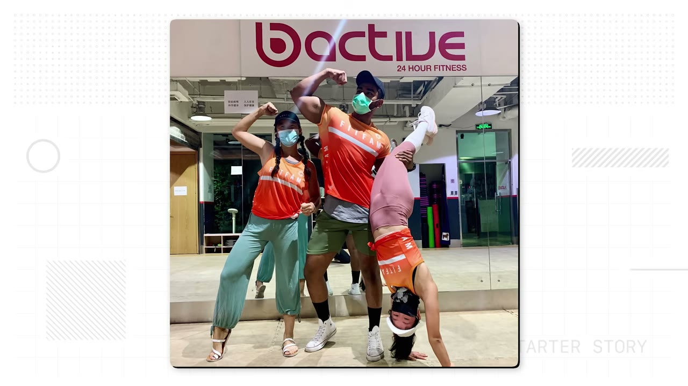
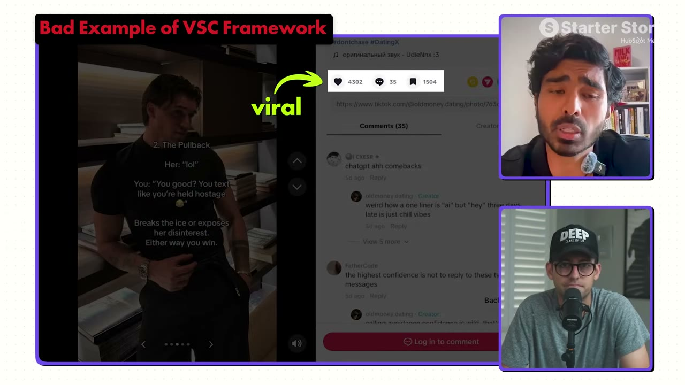

# I Built a $10K/Month App With This One System

✅ **Đã phân tích sâu** → [`case.md`](case.md)

| | |
|---|---|
| **Video** | <https://www.youtube.com/watch?v=-VlJIgj6gM4> |
| **Đăng** | 21/06/2026 |
| **Thời lượng** | 15:19 |
| **Lượt xem** | 38,714 |
| **Lượt thích** | 1,139 |
| **Video ID** | `-VlJIgj6gM4` |

## Trong thư mục này

| File | Nội dung |
|---|---|
| [`case.md`](case.md) | **Phân tích đầy đủ** — ý tưởng, validate, GTM, áp dụng ở VN |
| [`meta.json`](meta.json) | Metadata gốc (chapters, heatmap, mô tả) |
| [`screenshots/`](screenshots/) | 10 ảnh 720p |

## Mô tả gốc

An built an app that has thousands of users and hit 6-figures ARR. But after almost running out of cash for this app, he spent 2 months developing a framework that completely transformed his business. In this video, we break down his entire system and how any builder can this for their own app.
0:00 - Validate before building anything
1:07 - What’s your story?
1:47 - App breakdown and “ugly” spreadsheet
2:43 - Founder background
3:43 - Finding the app idea
4:12 - More ways to grow apps
4:59 The VSC Framework
7:26 - Content examples
8:47 - The “ugly” content tracking spreadsheet
10:37 - App dem

## Số liệu bắt được từ transcript

> Các đoạn founder nhắc tới con số, kèm timestamp để tua thẳng tới đó trong video.

_(không bắt được con số nào)_

## Chương

- `00:00` Validate before building anything
- `01:07` What’s your story?
- `01:47` App breakdown and “ugly” spreadsheet
- `02:43` Founder background
- `03:43` Finding the app idea
- `04:12` More ways to grow apps
- `04:59` The VSC Framework
- `07:26` Content examples
- `08:47` The “ugly” content tracking spreadsheet
- `10:37` App demo
- `11:50` Tech stack and tools
- `12:36` Advice to founders
- `13:12` Pat and Gus reflections: create a system

## Ảnh

1. `01_00m38s_usd-10-000.jpg` — 
2. `02_01m42s_metric.jpg` — 
3. `03_02m55s_ch-founder-background.jpg` — 
4. `04_03m55s_ch-finding-the-app-idea.jpg` — 
5. `05_05m11s_ch-the-vsc-framework.jpg` — 
6. `06_06m36s_usd-1.jpg` — 
7. `07_07m38s_ch-content-examples.jpg` — 
8. `08_08m59s_ch-the-ugly-content-tracking-spreadsheet.jpg` — 
9. `09_10m44s_usd-10-000.jpg` — 
10. `10_11m46s_usd-10-000.jpg` — 

---

← [Quay lại index](../../index.md) · [Toàn bộ video](../README.md)
