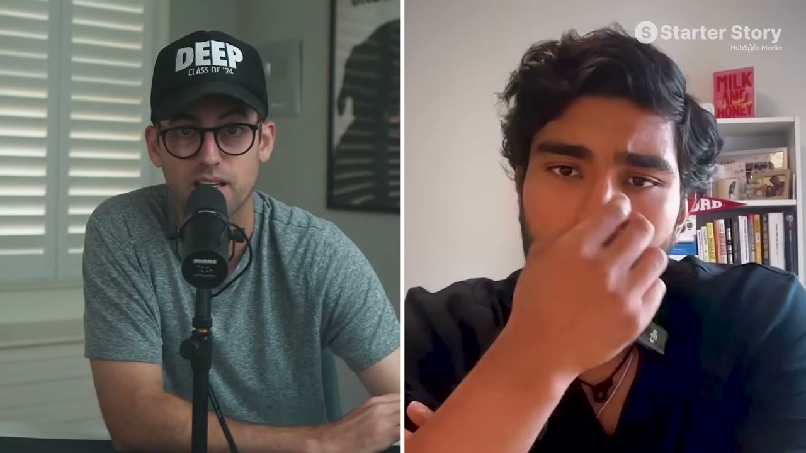
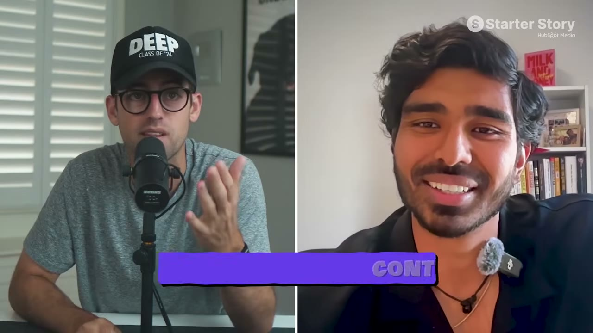

# Flame & khung VSC — cách biết trước ý tưởng có tăng trưởng được không

> **Tóm tắt 30 giây:** On Neill từng mở chuỗi phòng gym ở Trung Quốc (**$50M ARR, 7 cơ sở**), rồi đưa một scale-up Đức từ Series B $40M lên Series C $200M. Bài học anh rút ra: **phân phối chính là hào bảo vệ**. Anh chuyển sang New York và làm **Flame** — app cho các cặp đôi, mỗi ngày một câu hỏi, phải trả lời xong mới thấy câu trả lời của người kia. Sau khi suýt cạn tiền, anh dành 2 tháng xây một khung làm việc rồi đưa app từ **$3K lên $10K MRR trong chưa tới 8 tháng**, **250.000 lượt tải, 50 triệu view organic**. Giá trị của case này không nằm ở doanh thu — mà ở **khung VSC**.

---

## 1. Khung VSC — cách validate ý tưởng TRƯỚC KHI build ⭐⭐⭐

Đây là **công cụ validate tốt nhất trong toàn bộ knowledge base**. Cách làm: lên TikTok và tìm ba thứ.

### V — Viral (Nội dung này đã từng viral chưa?)

**Định nghĩa cụ thể, có ngưỡng đo được:**

> **Đã có nhiều nội dung tương tự vượt 100.000 view, đến từ các tài khoản DƯỚI 5.000 follower hay chưa?**

**Vì sao phải dưới 5.000 follower** — đây là chỗ tinh tế nhất:

> **Khi tài khoản dưới 5.000 follower, nội dung viral KHÔNG phải nhờ độ phủ của tài khoản đó — mà nhờ chính bản thân nội dung.**

> **Đây là điều chỉnh sắc sảo.** Một video 5 triệu view từ tài khoản 2 triệu follower **không chứng minh được gì** — nó chứng minh người đó nổi tiếng. Một video 100K view từ tài khoản 800 follower chứng minh **format tự nó chạy** — và anh cũng chạy được.

### S — Scalable (Có sản xuất nổi số lượng lớn không?)

> **"Phải cày. Phải ra khối lượng lớn. Đây là trò chơi số lượng."**

Có lúc họ **đăng 150 nội dung mỗi ngày chỉ để test một cái hook duy nhất.**

**Câu hỏi tự kiểm:** *bạn có làm được 100 cái như thế này mà không kiệt sức không?*

**Hai cách để scale:**
1. **Nội dung AI sinh** — anh nói chất lượng hiện đã rất gần video thật
2. **Thuê UGC từ Đông Âu và Nga** — **$1 cho một video 60 giây**, qua các sàn kiểu "Fiverr của Nga"

> ⚠️ **Con số $1/video là dữ liệu quan trọng.** Nó cho thấy cuộc chơi nội dung đã trở thành cuộc chơi vận hành và chênh lệch chi phí, không phải cuộc chơi sáng tạo.

### C — Convertible (Nó có ra đơn không?) — quan trọng nhất

> **"Anh có thể viral bằng cách lấy một format đang chạy rồi làm lại. Nhưng nếu nó không chuyển đổi cho sản phẩm của anh thì nó vô giá trị."**

**Cách kiểm tra — miễn phí, làm được ngay hôm nay:**

Vào video đang viral trong ngách đó và **đọc bình luận**:

| Bình luận | Ý nghĩa |
|---|---|
| *"App gì vậy?"* · *"Mua ở đâu?"* · *"Tên sản phẩm là gì?"* | ✅ **Có ý định mua** — sẽ chuyển đổi |
| *"lol"* · *"tôi không đồng ý"* · bình luận vu vơ | ❌ **Chỉ giải trí** — không ra đơn |

**Ví dụ thật anh đưa ra để đối chiếu:**

| Video | V | S | C | Kết quả |
|---|:-:|:-:|:-:|---|
| Slideshow tạo bằng Nano Banana + chữ đè | ✅ | ✅ | ❌ (bình luận không hỏi sản phẩm) | 120.000 view → chỉ **8-9 lượt dùng thử** |
| Slideshow: phụ nữ trong mối quan hệ xa, *"làm sao để không làm hỏng nó?"* → slide sau cắm sản phẩm | ✅ | ✅ | ✅ | **~1% chuyển đổi** — rất cao với organic |

> **Con số 120.000 view chỉ ra 8 trial là bài học đắt nhất của case này.** View không phải tiền. **C là chữ quyết định.**

Anh nói thẳng: **khung này đã cứu công ty anh khỏi chết.**

---

## 2. Comment seeding — chiến thuật gây tranh cãi ⭐

Chi tiết đáng chú ý về cách họ đẩy chuyển đổi:

> **Mỗi bình luận anh thấy dưới video đó đều được đăng từ chính tài khoản đó hoặc từ một tài khoản khác của họ.** Khi organic không kéo đủ traffic, họ **dùng các tài khoản khác vào thả bình luận** lên trên những bình luận đang có sẵn.

Kết quả: **~1% chuyển đổi**.

> ⚠️ **Nhận định thẳng:** đây là kỹ thuật thao túng tương tác. Nó hiệu quả và nhiều người làm, nhưng cần biết rõ đây là vùng xám: vi phạm điều khoản nền tảng, rủi ro khoá tài khoản, và về mặt đạo đức thì đang giả lập nhu cầu. **Tôi ghi lại vì nó có thật và anh cần biết đối thủ đang làm gì — không phải để khuyến nghị.**
>
> Phiên bản sạch của cùng ý tưởng: **trả lời thật** các câu hỏi trong bình luận và ghim câu trả lời lên đầu (cách [Erly](../2026-07-05_this-insanely-simple-app-makes-50k-month/case.md) làm).

---

## 3. Hạ tầng vận hành nội dung ⭐

Đây là phần ít ai cho xem — quy mô thật của "TikTok organic":

**Hạ tầng vật lý:** **5 điện thoại, mỗi máy 2-5 tài khoản TikTok → 15-20 tài khoản** chạy song song.

**Bảng theo dõi (anh gọi là "ugly tracker", khá nổi trên X):**

| Cột | Nội dung |
|---|---|
| Tài khoản | mọi tài khoản TikTok họ có |
| Máy | tài khoản đang chạy trên điện thoại nào |
| **Trạng thái** | **warm-up giai đoạn 1, 2, tạm dừng, khoẻ, không khoẻ, đã dừng, bị chặn** |
| Kênh | chỉ TikTok, hay TikTok + Instagram, hay thêm nền tảng khác |
| Loại nội dung | video phản ứng, slideshow, dạng khác |
| Số liệu hằng ngày | view, like — **team ghi mỗi ngày** |
| Ghi chú | cái gì chạy, cái gì không |

**Một bảng riêng theo dõi các HOOK** và hiệu quả từng cái. Cái nào chạy → hôm sau lặp lại với thay đổi nhỏ về câu chữ hoặc vị trí đặt chữ.

**Ví dụ về mức độ chi tiết của việc tối ưu:**

> Họ có một phụ nữ quay phản ứng trước camera. Họ phát hiện: **đặt chữ ngay ở đường cổ áo — không phải trên mặt** — thì video chạy tốt nhất. Thứ chỉ tìm ra được bằng cách đăng mỗi ngày.

> **"Warm-up giai đoạn 1, 2" là chi tiết quan trọng:** tài khoản TikTok mới phải được "nuôi" (dùng như người dùng thật) trước khi đăng nội dung thương mại, nếu không sẽ bị bóp. Đây là kiến thức vận hành hiếm khi được nói ra.

---

## 4. Sản phẩm & ý tưởng

**Khoảng trống anh nhìn thấy:** có rất nhiều app giúp **tìm** người yêu, **gần như không có app nào giúp mối quan hệ tốt lên sau đó**.

**Định vị rất sắc:**
> Xây cho **80% cặp đôi nói rằng mối quan hệ của họ cần cải thiện, nhưng sẽ không trả $200 cho một buổi trị liệu.**

> **Đây là mẫu định vị đáng học: lấy một dịch vụ đắt tiền hiện có (trị liệu tâm lý) và phục vụ nhóm người cần nó nhưng không đủ khả năng chi trả.** Cùng công thức với [Live Tourney](../2026-07-15_i-quit-my-job-at-meta-to-build-a-30k-month-saas/case.md) và [Profit AI](../2026-06-24_i-turned-this-spreadsheet-into-a-30k-month-micro-saa/case.md).

**Cơ chế cốt lõi:** mỗi ngày một câu hỏi, **không thấy câu trả lời của bạn đời cho tới khi mình trả lời xong**. Đầu tư 2 phút mỗi ngày. Có AI coach được huấn luyện trên chính câu trả lời của bạn, danh sách việc muốn làm cùng nhau, và dòng thời gian kỷ niệm riêng tư.

Anh xây app cùng bạn gái người Pháp, **vừa dùng app để xây mối quan hệ, vừa dùng mối quan hệ để xây app** — và họ đã cưới.

---

## 5. Lời khuyên cuối — hệ thống, không phải cảm hứng

> **"Người ta đuổi theo việc phải làm ĐÚNG loại nội dung. Không. Anh cần làm ĐỦ NHIỀU nội dung. Làm nhiều hơn, đẩy nhiều hơn, hiểu cái gì chạy cái gì không, rồi dồn vào cái đang chạy."**

Producer chốt lại rất thật:

> Người ta dễ thấy choáng ngợp trước khối lượng này. **Nhưng đây chính là cuộc chơi.** Mọi khách mời thành công trên kênh đều đang ở trên TikTok, Instagram, đăng bài, theo dõi số liệu.

Và Pat nói thẳng:

> **"Khách mời gần nhất nào nói 'tôi không phải làm marketing' hay 'nó tự bán'? Không có đâu."**

---

## 6. Tech stack

| Công cụ | Vai trò |
|---|---|
| **Claude Code + Claude Design** | Build app |
| **RevenueCat** | Quản lý monetization |
| **Mixpanel** | Analytics (đang dùng gói free) |
| **TikTok native analytics** | Anh nói **không công cụ nào sánh được** — xem retention, xem người ta bỏ ở giây nào |
| **15-20 tài khoản TikTok trên 5 điện thoại** | Hạ tầng phân phối |

---

## 7. Cảnh báo thiên kiến nguồn

- **Đây là case DUY NHẤT trong nhóm này mà founder TỪ CHỐI cho xem doanh thu — và lý do rất đáng chú ý.** Pat hỏi thẳng: *"bật ảnh chụp doanh thu lên cho tôi để chứng minh cái này là thật"*. On trả lời (02:09): **"chúng tôi đang ở giữa một quá trình BÁN CÔNG TY, tôi không thể bật số lên lúc này."** Nghĩa là: **(a) không có một bằng chứng doanh thu nào trong toàn video**, và **(b) người kể đang trong quá trình bán chính sản phẩm đó — tức có động cơ tài chính trực tiếp để con số nghe đẹp.** Đây là mức xung đột lợi ích cao nhất trong nhóm case này.
- **Con số $10K MRR là chuyện của NĂM NGOÁI.** Nguyên văn: *"đây là năm ngoái, khi chúng tôi đưa app từ khoảng 3.000 lên 10.000"*. **Doanh thu hiện tại không được nêu ở bất kỳ đâu.**
- **Thứ duy nhất được chiếu là bảng theo dõi nội dung** — và con số ở đó cũng lệch với lời dẫn: intro nói **50 triệu view**, bảng nói **"khoảng 58 triệu trong năm qua"**.
- **Ba phễu bán hàng chồng lên nhau trong một video 15 phút:** (1) đoạn tài trợ **HubSpot** *"Organic Short Form Playbook"* ở 04:12–04:59 qua `clickhubspot.com`; (2) **bảng theo dõi của On được phát trên chính domain Starter Story** kèm `utm_campaign=an-nayal-tracker` — tức kênh dùng tài sản của khách mời làm lead magnet thu email; (3) **"VSC Framework Deep Dive"** qua `onelink.to/starterstory`. Ở phút 14:33 Gus tự gọi đoạn cuối là **"shameless plug"** và dành gần 90 giây cuối video để bán playbook.
- **Hai kỹ thuật cốt lõi của case đều vi phạm điều khoản nền tảng, và được kể thẳng trên camera:** **comment seeding** (*"mỗi bình luận anh thấy đều do chính tài khoản đó hoặc một tài khoản khác của chúng tôi đăng"*) và **hạ tầng 15-20 tài khoản có "warm-up giai đoạn 1, 2"**. Tỉ lệ chuyển đổi 1% — con số marketing chính của case — được gán trực tiếp cho comment seeding. **Không ai trong video đặt câu hỏi về rủi ro khoá tài khoản hay về tính trung thực của việc giả lập nhu cầu.**
- **Bối cảnh bị làm mờ, và nó làm đảo chiều ý nghĩa của case:** On **đã mở một chuỗi phòng gym ở Trung Quốc lên $50 TRIỆU ARR với 7 cơ sở**, rồi đưa một scale-up Đức từ Series B $40M lên Series C $200M. Đây là một nhà vận hành có vốn, có mạng lưới và **có team** (anh nói *"team của tôi vào ghi số mỗi ngày"*). **$10K MRR là kết quả NHỎ so với nền tảng đó** — nhưng video được đóng gói như một playbook cho người mới.
- **Thiếu toàn bộ mặt chi phí, và ở case này nó đặc biệt nghiêm trọng.** Không có: lương team ghi số liệu hằng ngày, chi phí UGC, 5 điện thoại và SIM, churn, CAC. **Với $10K MRR, một bộ máy nội dung cỡ này hoàn toàn có thể đang lỗ** — và không có cách nào biết từ video.
- **Tên riêng bị bản ghi tự động làm loạn:** "On Neill", "An", có chỗ đọc thành "Ankit". Tên thật là **An Nayal** (`annayal.com`, X: `@consumerxai`).
- **Sản phẩm thu thập dữ liệu rất riêng tư** (câu trả lời về đời sống tình cảm, dùng để huấn luyện AI coach) — không một câu nào trong video nói về cách dữ liệu đó được lưu trữ hay bảo vệ.

## 8. Áp dụng cho tôi (indie hacker VN)

**Giá trị lớn nhất: khung VSC. Dùng nó trước mọi ý tưởng, miễn phí, mất 30 phút.**

**Quy trình VSC cho ý tưởng tiếp theo của anh:**

| Bước | Việc làm |
|---|---|
| **V** | Lên TikTok, tìm nội dung về vấn đề đó. **Có video >100K view từ tài khoản <5.000 follower không?** Không có → dừng lại. |
| **S** | Tôi có làm được 100 video dạng này không? Bằng AI? Bằng UGC thuê ngoài? Không → dừng lại. |
| **C** | **Đọc bình luận dưới các video đó.** Người ta có hỏi mua sản phẩm không? Không → viral cũng vô nghĩa. |

**Sao chép được ngay:**
- ✅ **Khung VSC** — quan trọng nhất
- ✅ **Bảng theo dõi nội dung** có cột trạng thái tài khoản và ghi chú hằng ngày
- ✅ **Bảng theo dõi hook** riêng biệt
- ✅ Tìm được nội dung chuyển đổi tốt → **lặp lại nó với biến thể nhỏ**
- ✅ Định vị "phiên bản rẻ của dịch vụ đắt tiền"

**Lợi thế cho VN:**
- ✅ Chi phí UGC ở Việt Nam rất cạnh tranh — $1-3/video hoàn toàn khả thi
- ✅ TikTok Việt Nam vẫn đang mạnh về organic reach
- ✅ Có thể chạy nhiều tài khoản với chi phí nhân sự thấp

**Rào cản thật:**
- ⚠️ **Đây là cuộc chơi vận hành, không phải cuộc chơi sản phẩm.** Cần người quản lý nội dung mỗi ngày. Solo founder rất khó duy trì.
- ⚠️ **Chi phí hạ tầng:** 5 điện thoại + SIM + tài khoản. Không lớn nhưng có thật.
- ⚠️ **Rủi ro nền tảng cao:** nhiều tài khoản, comment seeding, warm-up — đều dễ bị khoá. Toàn bộ business phụ thuộc một nền tảng.
- ⚠️ **Comment seeding là vùng xám.** Cân nhắc kỹ.
- ⚠️ $10K MRR sau 8 tháng cày với cường độ này — **tỉ suất công/kết quả không cao** so với [AngelMatch](../2026-08-23_i-make-32k-month-from-3-simple-boring-websites/case.md) hay [Live Tourney](../2026-07-15_i-quit-my-job-at-meta-to-build-a-30k-month-saas/case.md).

**Khi KHÔNG nên dùng mô hình này:**

- **Khi ngách của anh không có sẵn nội dung viral từ tài khoản nhỏ để đối chiếu.** Chữ **V** đòi hỏi anh tìm được nhiều video >100K view từ tài khoản <5.000 follower nói về đúng điểm đau đó. Với B2B, công cụ chuyên môn hẹp, hay khách hàng là doanh nghiệp, **TikTok không có mẫu để đối chiếu** — khung VSC trả về "không đủ dữ liệu", và anh phải đi đường khác: directory đối tác của [Hero Analytics](../2026-06-10_i-built-a-1m-saas-in-a-hidden-niche/case.md) hoặc SEO ý định mua.
- **Khi anh không chấp nhận vận hành ngoài điều khoản nền tảng.** 15-20 tài khoản trên 5 điện thoại, quy trình warm-up, và comment seeding — cả ba đều nằm ngoài quy định của TikTok. Nếu anh cần một business bán lại được, chịu được thẩm định pháp lý, hoặc chỉ đơn giản là không muốn mất trắng khi bị quét tài khoản, **phần vận hành của case này không dùng được — chỉ phần khung VSC là dùng được.**
- **Khi chi phí nhân sự của anh không đủ rẻ để nuôi bộ máy này ở mức $10K MRR.** Case cần một team ghi số liệu mỗi ngày, một dòng UGC liên tục, và hạ tầng thiết bị. $10K MRR là **doanh thu**, không phải lợi nhuận, và video không cho biết còn lại bao nhiêu. Nếu anh không có nguồn nhân lực rất rẻ, hãy chọn mô hình một người vận hành được như [Savvy Nomad](../2026-05-21_i-make-1-7m-year-in-the-most-boring-niche-imaginable/case.md) hoặc [Tone Adapt](../2026-06-14_the-first-app-i-ever-built-makes-25k-month/case.md).

**Khuyến nghị:** **lấy khung VSC, cân nhắc kỹ phần vận hành.** VSC là công cụ tư duy miễn phí và có giá trị vĩnh viễn. Bộ máy 20 tài khoản thì chỉ nên làm khi đã có người và có ngân sách.

---

## Nguồn

- Video: [I Built a $10K/Month App With This One System](https://www.youtube.com/watch?v=-VlJIgj6gM4) — Starter Story, 21/06/2026, 15:19, 38K views
- Sản phẩm: Flame (app cho cặp đôi)
- Transcript: [`_raw/transcripts/-VlJIgj6gM4.md`](transcript.md) · Ảnh: [`screenshots/-VlJIgj6gM4/`](screenshots/)
