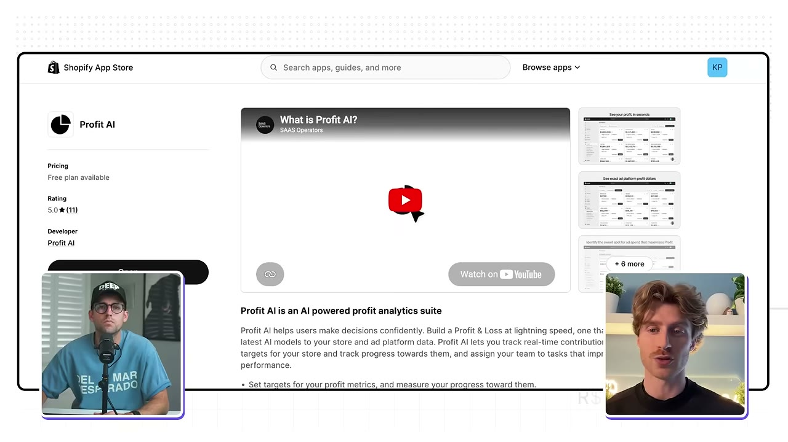
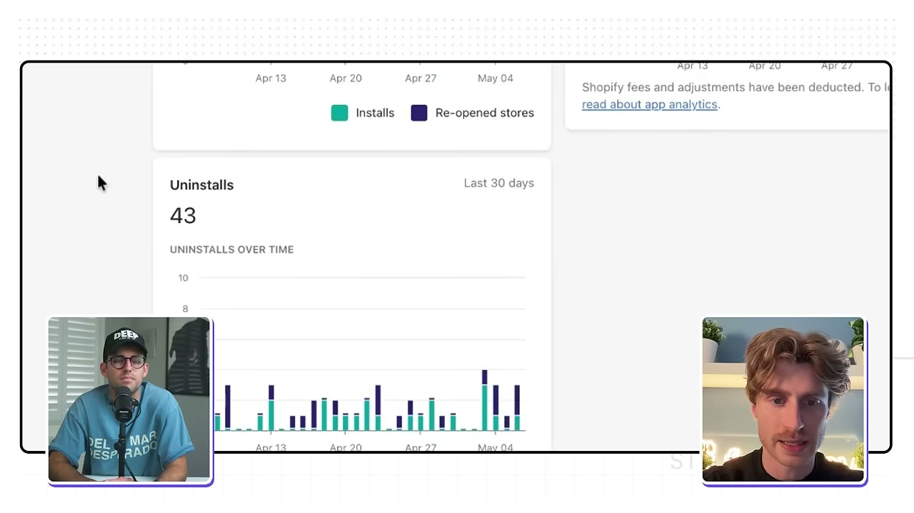
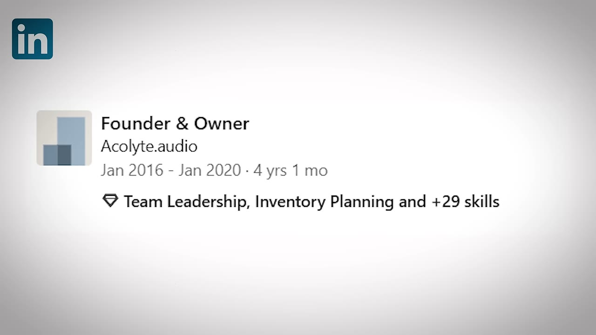
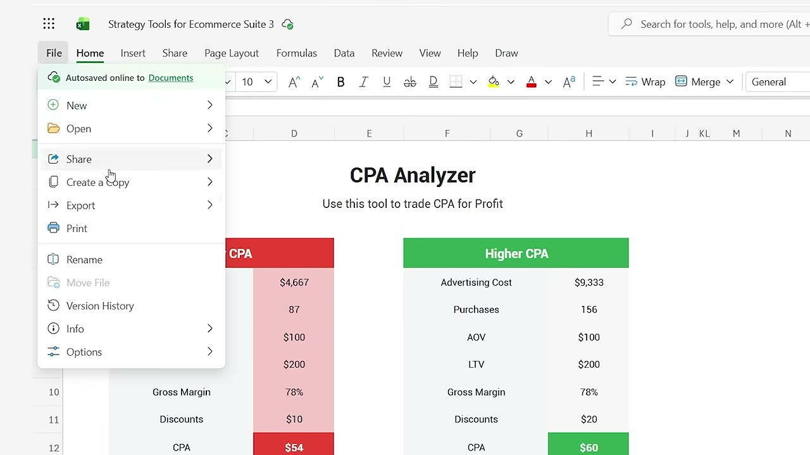
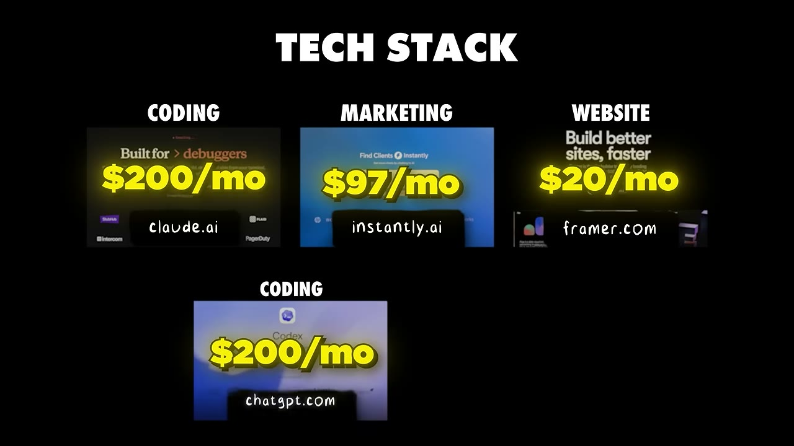

# I Turned This Spreadsheet Into a $30K/Month Micro-SaaS

✅ **Đã phân tích sâu** → [`case.md`](case.md)

| | |
|---|---|
| **Video** | <https://www.youtube.com/watch?v=d8PdJJcEtE0> |
| **Đăng** | 24/06/2026 |
| **Thời lượng** | 12:24 |
| **Lượt xem** | 43,685 |
| **Lượt thích** | 967 |
| **Video ID** | `d8PdJJcEtE0` |

## Trong thư mục này

| File | Nội dung |
|---|---|
| [`case.md`](case.md) | **Phân tích đầy đủ** — ý tưởng, validate, GTM, áp dụng ở VN |
| [`meta.json`](meta.json) | Metadata gốc (chapters, heatmap, mô tả) |
| [`screenshots/`](screenshots/) | 10 ảnh 720p |

## Mô tả gốc

Jack consulted for agencies and e-comm brands for years... and kept seeing the same problem: everyone was buried in messy spreadsheets trying to make sense of their data. So he built an app with Claude to solve it. This is the story of how he turned what was already in his head into a real SaaS.
0:00 - Spreadsheet to App
0:50 - What's your story?
1:35 - Business breakdown
3:29 - Background
4:38 - Find micro-saas ideas
5:21 - The spreadsheet
6:25 - Turning the spreadsheet into an app
7:09 - Tech stack
7:42 - Ecommerce Tools/Software
8:21 - Business ideas
9:29 - Advice 
10:28 - Pat and Gus refle

## Số liệu bắt được từ transcript

> Các đoạn founder nhắc tới con số, kèm timestamp để tua thẳng tới đó trong video.

_(không bắt được con số nào)_

## Chương

- `00:00` Spreadsheet to App
- `00:50` What's your story?
- `01:35` Business breakdown
- `03:29` Background
- `04:38` Find micro-saas ideas
- `05:21` The spreadsheet
- `06:25` Turning the spreadsheet into an app
- `07:09` Tech stack
- `07:42` Ecommerce Tools/Software
- `08:21` Business ideas
- `09:29` Advice
- `10:28` Pat and Gus reflections: business ideas in spreadsheets

## Ảnh

1. `01_00m15s_ch-spreadsheet-to-app.jpg` — 
2. `02_00m51s_usd-147-000.jpg` — 
3. `03_01m47s_ch-business-breakdown.jpg` — 
4. `04_02m54s_usd-147-000.jpg` — 
5. `05_03m41s_ch-background.jpg` — 
6. `06_04m50s_ch-find-micro-saas-ideas.jpg` — 
7. `07_05m33s_ch-the-spreadsheet.jpg` — 
8. `08_06m37s_ch-turning-the-spreadsheet-into-an-app.jpg` — 
9. `09_07m31s_usd-200.jpg` — 
10. `10_08m33s_ch-business-ideas.jpg` — 

---

← [Quay lại index](../../index.md) · [Toàn bộ video](../README.md)
