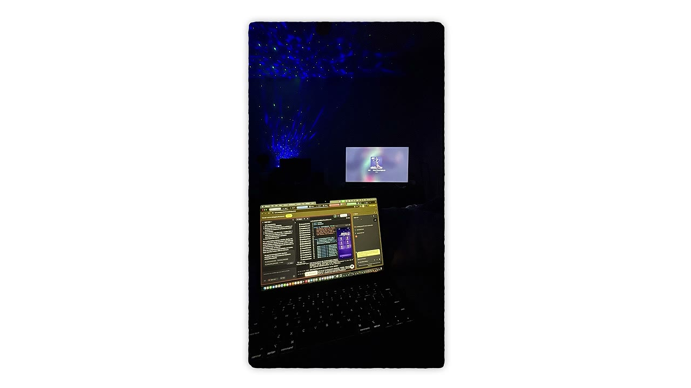
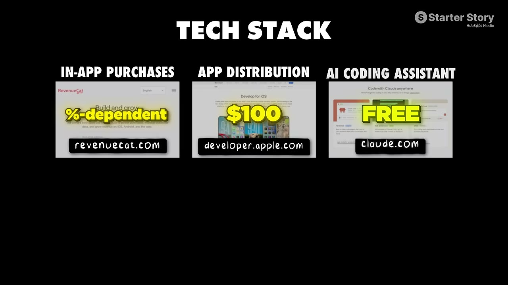
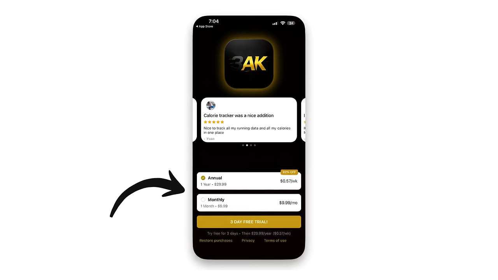
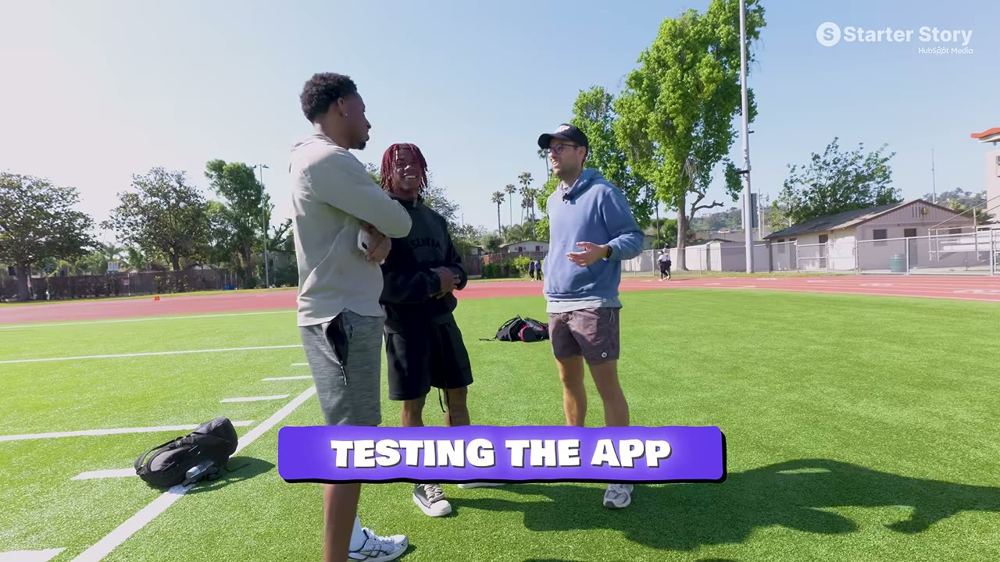
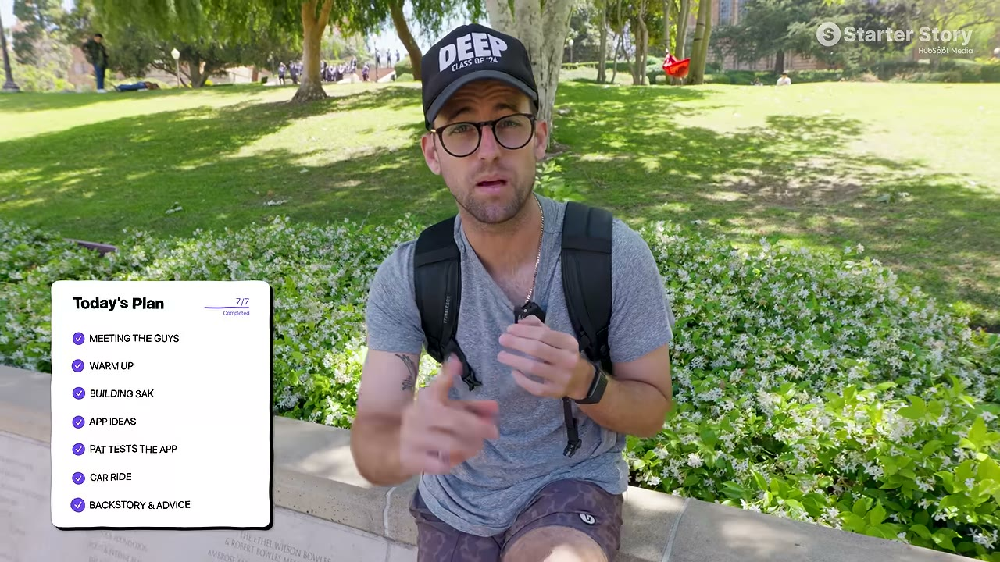

# How We Built This $20K/Month AI App

✅ **Đã phân tích sâu** → [`case.md`](case.md)

| | |
|---|---|
| **Video** | <https://www.youtube.com/watch?v=DiRxTfnHTaY> |
| **Đăng** | 28/06/2026 |
| **Thời lượng** | 13:11 |
| **Lượt xem** | 42,547 |
| **Lượt thích** | 1,482 |
| **Video ID** | `DiRxTfnHTaY` |

## Trong thư mục này

| File | Nội dung |
|---|---|
| [`case.md`](case.md) | **Phân tích đầy đủ** — ý tưởng, validate, GTM, áp dụng ở VN |
| [`meta.json`](meta.json) | Metadata gốc (chapters, heatmap, mô tả) |
| [`screenshots/`](screenshots/) | 10 ảnh 720p |

## Mô tả gốc

We traveled to Los Angeles, CA to meet the guys behind a $20K/month track app, hear their story, and learn about how they built this... while still in college (without knowing how to code!) 
0:00 - The track app
0:34 - Meeting the guys
1:10 - What’s the app?
1:31 - Founders background
2:10 - Warm up and stretch!
2:41 - Building the app (tools and tech)
3:33 - Build your own iOS app
4:51 - Coming up with app ideas
5:31 - App demo
6:15 - Pat tests the track app!
8:01 - Building niche apps
8:44 - Dropping out and balancing everything
9:47 - The story behind the founders
10:50 - Day in the life, m

## Số liệu bắt được từ transcript

> Các đoạn founder nhắc tới con số, kèm timestamp để tua thẳng tới đó trong video.

_(không bắt được con số nào)_

## Chương

- `00:00` The track app
- `00:34` Meeting the guys
- `01:10` What’s the app?
- `01:31` Founders background
- `02:10` Warm up and stretch!
- `02:41` Building the app (tools and tech)
- `03:33` Build your own iOS app
- `04:51` Coming up with app ideas
- `05:31` App demo
- `06:15` Pat tests the track app!
- `08:01` Building niche apps
- `08:44` Dropping out and balancing everything
- `09:47` The story behind the founders
- `10:50` Day in the life, making money in college
- `11:32` Final advice
- `12:27` Pat’s closing reflections

## Ảnh

1. `01_00m15s_ch-the-track-app.jpg` — 
2. `02_01m55s_usd-3-000.jpg` — 
3. `03_02m41s_usd-70-000.jpg` — 
4. `04_03m27s_usd-500.jpg` — 
5. `05_05m03s_ch-coming-up-with-app-ideas.jpg` — 
6. `06_05m49s_usd-10-m.jpg` — 
7. `07_06m27s_ch-pat-tests-the-track-app.jpg` — 
8. `08_08m13s_ch-building-niche-apps.jpg` — 
9. `09_08m56s_ch-dropping-out-and-balancing-everything.jpg` — 
10. `10_12m28s_usd-70-000.jpg` — 

---

← [Quay lại index](../../index.md) · [Toàn bộ video](../README.md)
