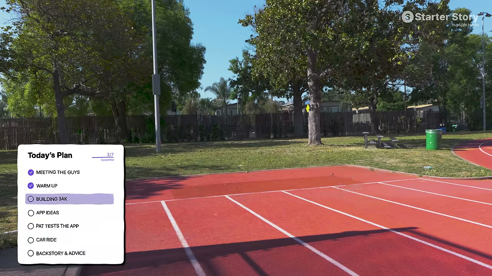
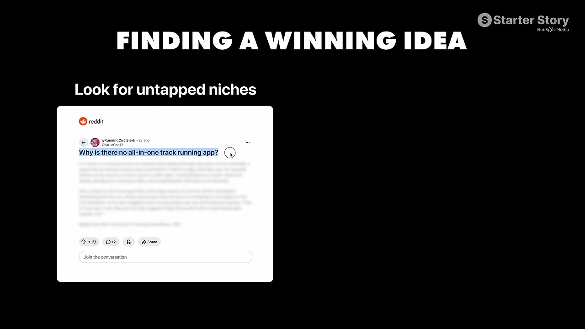
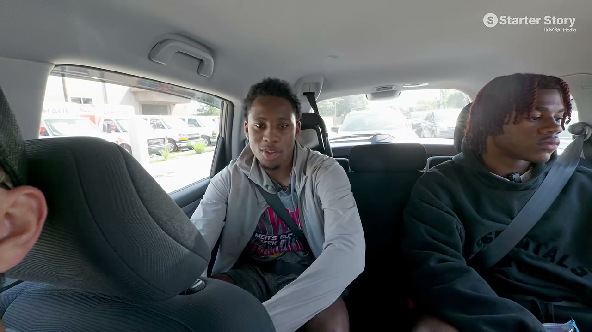

# 3AK — $70K trong 6 tháng, hai sinh viên không biết code

> **Tóm tắt 30 giây:** Christian (20) và Braylon (19) là hai vận động viên điền kinh đại học, bạn thân từ cấp ba. Họ từng chơi trading và **mất $3.000**. Rồi họ nhận ra: **rất nhiều người chạy điền kinh, nhưng không có app nào dành riêng cho điền kinh.** Quan trọng hơn — họ **đã có sẵn hàng trăm nghìn follower** trong đúng ngách đó. Build app trong **2 tuần** bằng AI, **không biết code**. Tháng đầu **$10.000**. Sáu tháng: **$70.000, 40.000 người dùng, 4.7 sao**. Chi phí khởi đầu: **dưới $500**.

---

## 1. Con số

| Chỉ số | Giá trị |
|---|---|
| Tổng doanh thu 6 tháng | **~$70.000** |
| Doanh thu tháng đầu | **$10.000** |
| Người dùng | **40.000** |
| Đánh giá App Store | **4,7** |
| Giá | **$10/tháng** hoặc **$30/năm** |
| Thời gian build | **2 tuần** |
| **Chi phí khởi đầu** | **dưới $500** |
| Tuổi | 19 và 20 |

> **$500 để có một app đang chạy trên App Store.** Đây là chi phí khởi đầu thấp nhất trong toàn bộ knowledge base. Rào cản kỹ thuật gần như đã biến mất.

---

## 2. Chiến lược cốt lõi: ĐI TỚI NƠI MÌNH ĐÃ CÓ ẢNH HƯỞNG ⭐⭐

Đây là bài học trung tâm, và họ nói rất gọn:

> **"Chúng tôi tìm một ngách ít người làm. Rất nhiều người chạy điền kinh nhưng không có app nào riêng cho điền kinh. Nên chúng tôi nói: hãy đặt app của mình vào đúng nơi mình ĐÃ CÓ ẢNH HƯỞNG."**

Họ đã dựng được **hàng trăm nghìn follower riêng trong ngách điền kinh** bằng video — **không tốn tiền marketing**.

### Gieo mầm trước khi ra mắt — chi tiết khôn ngoan nhất ⭐

> **Họ đã lồng "3AK" vào video một cách ngấm ngầm TỪ TRƯỚC KHI app ra đời.**

Họ có sẵn cửa hàng Shopify (bán hàng), nên nhắc **"3AK method"** trên website, để tên trong bio. Đến khi app ra mắt, **cái tên đã quen thuộc** với khán giả — và nó bùng nổ ngay.

> **Đây là kỹ thuật đáng học nhất của case:** xây nhận biết thương hiệu **trước khi có sản phẩm**. Đến ngày ra mắt, khán giả không gặp một cái tên lạ — họ gặp một cái tên đã thấy hàng chục lần.
>
> **Áp dụng ngay:** chọn tên sản phẩm **hôm nay**, bắt đầu nhắc tới nó trong nội dung **ngay bây giờ**, kể cả khi còn 6 tháng nữa mới ra mắt.

**Liên hệ:** cùng nguyên lý với [Stella](../2026-07-12_she-built-this-340k-month-app-in-60-days/case.md) (phân phối trước, sản phẩm sau) và [Cat on Chair](../2026-07-26_this-simple-app-makes-18k-month/case.md) (bắt đầu ở nơi đã có khán giả).

---

## 3. Sản phẩm

App tất-cả-trong-một cho dân chạy điền kinh:
- Ghi nhận buổi tập và tiến bộ
- **Phân tích video → chấm điểm tư thế chạy** (AI)
- Phân tích bữa ăn để đảm bảo dinh dưỡng đúng
- Cộng đồng

**Trong video, Pat tự chạy thử và được chấm 56/100** — app chỉ ra cụ thể: cơ chế sinh học của dáng chạy kém, sải chân kém, tư thế tạm được, vung tay kém. Họ khuyên anh **đứng thẳng và nâng cao gối**. Chạy lại: **68 điểm**.

> **Vì sao màn demo này quan trọng:** nó chứng minh sản phẩm **thật sự hoạt động** và **cải thiện được ngay lập tức**. Đây chính là loại tính năng dễ dựng thành nội dung viral — người xem thấy điểm số thay đổi.

---

## 4. Định giá — hiểu đúng túi tiền khách hàng ⭐

Họ giải thích rất rõ:

> **"Chúng tôi test rất nhiều gói năm, vì biết chênh lệch giữa gói năm và gói tháng không lớn lắm. Nhưng phải nhớ khách hàng của chúng tôi là mấy đứa trẻ. Chúng nó sẽ không bỏ $60-70 cho một chương trình tập luyện. Chúng nó chỉ tiêu 10, 15, 20 đô lẻ tẻ."**

Họ dẫn chứng: đám trẻ đó **mua V-Bucks, Robux**.

> **Bài học định giá: giá phải khớp với hành vi chi tiêu THẬT của khách, không khớp với giá trị anh nghĩ mình mang lại.** Cách nhanh nhất để biết: **họ đang tiêu tiền vào đâu ở mức giá nào?**
>
> Đây là bài học đặc biệt hữu ích cho thị trường Việt Nam, nơi ARPU thấp.

---

## 5. Cách build — không biết code

**Công cụ:** một AI IDE (họ mô tả là "nói chuyện với nó như ChatGPT"), **Claude và Claude Code để kiểm chứng và gỡ rối**, RevenueCat, Supabase, Apple Developer.

> **"Ngày xưa anh phải quét 300 dòng code, tìm đúng chỗ, sửa. Giờ không cần nữa. Nó làm hộ anh."**

**Quy trình của họ:** mô tả bằng lời điều mình muốn → AI viết → **khi bí thì đưa sang Claude để kiểm chứng và sửa.**

> Đây là mẫu hình đáng chú ý: **dùng một AI để viết, một AI khác để kiểm tra.** Cách làm thực dụng cho người không biết code.

**Chi phí:** *"Tôi chắc chắn anh build được một app và đưa lên App Store với chưa tới $500."*

---

## 6. Thực tế phía sau — phần trung thực nhất

**Nhịp sống:**
- Christian: dậy 9h → làm việc tới giờ tập → tập → về nhà → **làm tới 3h sáng** → lặp lại
- Braylon: dậy 8h → lớp học → ăn → tập → **thẳng tới văn phòng, làm cả đêm**; gọi điện công việc **giữa các tiết học**
- Khi ra mắt app bóng bầu dục, họ **không ngủ 4 ngày liền**

**Christian đã bỏ học.** Anh nói thẳng: *cách tôi đang cày trên các app này chính là thứ tôi muốn làm... tôi sẽ không ở lại trường 20 năm chỉ để kiếm bằng số tiền tôi đang kiếm bây giờ.*

**Lời khuyên về việc làm một mình:**

> **"Đó là lý do anh không thể làm một mình. Nếu anh vừa đi học vừa là solo founder, thôi bỏ đi. Xin lỗi, vì nó quá khó."**

Cách họ chia việc: một người còn đi học, một người đã nghỉ → **chia ca cho nhau**. Ai mệt thì người kia làm.

**Hoàn cảnh cá nhân:** Christian mất cha năm 15 tuổi, mẹ nuôi một mình, năm ngoái anh **hoàn toàn túng quẫn**. Braylon lớn lên nay đây mai đó, không có cha bên cạnh, **mất mẹ năm 12 tuổi**.

> **"Tiền thì hay đấy, nhưng tiền không bao giờ nên là động lực. Động lực phải là cuộc sống anh muốn sống."**

---

## 7. Lời khuyên tìm ý tưởng

**Christian:**
> **"Hãy lấy thứ anh đã làm hằng ngày và biến nó thành thứ kiếm ra tiền.** Thích chơi game cả ngày → kiếm tiền từ game. Thích nấu ăn cho người khác → kiếm tiền từ nấu ăn. **Làm thứ anh vốn đam mê, vì anh sẽ trụ ở ngách đó lâu hơn nhiều so với người làm chỉ vì tiền.**"

**Braylon:**
> **"Cách tốt nhất là: hôm nay anh gặp một vấn đề, hãy nghĩ về tương lai. Nghĩ xem 'chắc mình sẽ còn gặp vấn đề này nữa — vậy giải nó ngay bây giờ để sau này mình đỡ khổ.'"**

**Pat mở rộng thành nguồn ý tưởng:** app phân tích tư thế theo môn thể thao — anh nêu tennis và pickleball. **Cơ chế giống hệt, môn khác nhau, mỗi môn là một ngách nội dung riêng.**

---

## 8. Cảnh báo thiên kiến nguồn

- **Đây là case ÍT bằng chứng nhất trong nhóm: không có một dashboard doanh thu nào.** Pat mở đầu bằng đúng câu *"tôi còn háo hức hơn khi được xem thứ này thực sự kiếm được bao nhiêu tiền"* — rồi **không bao giờ yêu cầu họ bật RevenueCat hay App Store Connect**. Cả video là một buổi đi chơi ở sân điền kinh. **Mọi con số — $70.000, $20K/tháng, 40.000 người dùng, 4,7 sao — đều chỉ là lời nói.**
- **Con số trên tiêu đề đến từ một tin nhắn DM.** Nguyên văn câu mở: *"hai cậu sinh viên này NHẮN TIN cho tôi nói rằng họ đang kiếm $20.000/tháng"*. Đó là nguồn duy nhất của con số $20K/tháng.
- **Và nó không khớp với con số họ tự nói.** Họ khai **$70.000 kể từ 16/12**. Tính tới lúc quay (khoảng tháng 5-6) là **5-6 tháng**, tức trung bình **khoảng $11-14K/tháng** — không phải $20K.
- **$70.000 có thể không phải chỉ của 3AK.** Ở phút 09:22 họ nhắc *"khi chúng tôi ra mắt app BÓNG BẦU DỤC, chúng tôi không ngủ 4 ngày"* — tức họ có **ít nhất hai app**. Video không bao giờ tách con số ra.
- **Đoạn tài trợ ở 03:33–04:26 được Pat cắt vào từ phòng dựng** (*"Pat từ tương lai đây"*) — nội dung là **iOS Bootcamp miễn phí của chính Starter Story**, phát qua link `clickhubspot.com`. Vừa là quảng cáo của nhà tài trợ vừa là phễu bán hàng của kênh.
- **Bối cảnh bị làm mờ, và nó là toàn bộ lý do case này thành công:** họ **đã có hàng trăm nghìn follower** trong ngách điền kinh, **đã có một cửa hàng Shopify** bán "3AK method", và **đã gieo tên thương hiệu vào nội dung nhiều tháng trước khi app ra đời**. Tiêu đề bán câu chuyện *"hai sinh viên không biết code build app trong 2 tuần"*; sự thật là **một thương hiệu có sẵn khán giả ra thêm một sản phẩm**. Họ cũng từng có **$3.000 để mất vào trading** — không phải xuất phát từ số không tuyệt đối.
- **Màn demo được trình bày như bằng chứng, nhưng nó không kiểm chứng được.** Pat chạy lần đầu được **56 điểm**, nghe một lời khuyên, chạy lại được **68 điểm**. Không ai hỏi điểm số đó được tính thế nào, có hiệu chuẩn không, hay liệu một mô hình AI có xu hướng cho lần thử thứ hai điểm cao hơn hay không. **Một con số tăng lên trên màn hình không phải là bằng chứng về độ chính xác** — nhưng nó là loại nội dung viral hoàn hảo, và đó chính là lý do tính năng này tồn tại.
- **Khách hàng là trẻ vị thành niên, và không một câu nào nói về trách nhiệm.** Chính họ mô tả nhóm khách là *"mấy đứa trẻ... chúng nó mua V-Bucks, Robux"*. App đưa **giáo án tập luyện và lời khuyên dinh dưỡng** cho vận động viên tuổi học sinh. Không có gì trong video về đồng ý của phụ huynh, giới hạn trách nhiệm, hay rủi ro chấn thương.
- **Thiếu toàn bộ số liệu vận hành:** churn, tỉ lệ hoàn tiền, phần Apple cắt 15-30%, chi phí phân tích video bằng AI cho mỗi lượt chạy, và bao nhiêu trong $70.000 còn lại sau chi phí.

## 9. Áp dụng cho tôi (indie hacker VN)

**Vì sao case này rất đáng chú ý:**
- ✅ **$500 chi phí khởi đầu** — rào cản gần như bằng 0
- ✅ **2 tuần build**, không biết code
- ✅ **Không tốn tiền marketing** — dùng khán giả sẵn có
- ✅ **Ngách hẹp mà sâu** — không cạnh tranh với ai
- ✅ **Đội 2 người** chia ca, hợp với người còn đi làm/đi học

**Công thức sao chép:**
1. Liệt kê những cộng đồng anh **đã thuộc về** (môn thể thao, sở thích, nghề nghiệp, hội nhóm)
2. Trong đó, cộng đồng nào **chưa có app riêng tử tế**?
3. **Bắt đầu làm nội dung ngay hôm nay** trong cộng đồng đó, nhắc tên sản phẩm tương lai
4. Build bằng AI trong 2-4 tuần
5. Định giá theo **hành vi chi tiêu thật** của nhóm đó

**Ngách VN đáng soi:** cầu lông, pickleball (đang bùng nổ ở VN), chạy bộ phong trào, bóng đá sân 7, gym/thể hình, cờ vua, đá cầu, luyện thi. **Điều kiện tiên quyết vẫn là: anh phải đã ở trong cộng đồng đó.**

**Rào cản thật:**
- ⚠️ **Nếu chưa có khán giả, case này không sao chép được.** Sức mạnh của họ là hàng trăm nghìn follower có sẵn — mất nhiều năm để xây.
- ⚠️ **Nhịp làm việc không bền vững** — 4 ngày không ngủ, làm tới 3h sáng. Đây không phải mô hình dài hạn lành mạnh.
- ⚠️ **Ngách hẹp = trần thấp.** $20K/tháng có thể là gần trần của ngách điền kinh.
- ⚠️ **Chưa chứng minh được độ bền** — mới 6 tháng, chưa biết retention thế nào.
- ⚠️ Giá $10/tháng vẫn cao với học sinh Việt Nam → cần định giá lại mạnh

**Khi KHÔNG nên dùng mô hình này:**

- **Khi anh chưa có khán giả trong chính cộng đồng đó.** Câu chốt của họ là *"đặt app của mình vào đúng nơi mình ĐÃ CÓ ảnh hưởng"* — bỏ vế "đã có" đi thì không còn case nào cả. Nếu anh xuất phát từ 0 follower, có hai đường thay thế đã được chứng minh: **tự xây khán giả** bằng cách đăng 3 lần/ngày như [Tone Adapt](../2026-06-14_the-first-app-i-ever-built-makes-25k-month/case.md), hoặc **mượn khán giả có sẵn** bằng cách trả tiền influencer trong ngách như [Pep AI](../2026-05-24_i-built-a-30k-month-in-35-days/case.md). Cả hai đều mất thời gian hoặc tiền — không có đường tắt.
- **Khi anh là solo founder và còn đang đi học hoặc đi làm toàn thời gian.** Chính họ nói thẳng: *"đó là lý do anh KHÔNG THỂ làm một mình. Nếu anh vừa đi học vừa là solo founder, thôi bỏ đi."* Mô hình của họ dựa trên **hai người chia ca** — một người đang học, một người đã nghỉ. Nếu anh không có người chia ca, hãy chọn mô hình ít đòi hỏi vận hành liên tục hơn.
- **Khi khách hàng của anh là trẻ vị thành niên và anh không có cách xử lý phần đồng ý của phụ huynh cùng trách nhiệm pháp lý.** App này đưa giáo án tập luyện và lời khuyên dinh dưỡng cho học sinh. Ở Việt Nam, sản phẩm sức khoẻ nhắm trẻ em vừa có rủi ro pháp lý vừa có rủi ro thật cho người dùng — và nhóm này cũng là nhóm có khả năng chi trả thấp nhất.

**Nếu chưa có khán giả:** hãy bắt đầu **xây trước**, theo đúng nguyên tắc của [Stella](../2026-07-12_she-built-this-340k-month-app-in-60-days/case.md) và [Gaurabh](../2026-08-22_he-built-100-apps-and-made-0-can-he-fix-it-in-30-day/case.md) — chọn một cộng đồng anh thuộc về, làm nội dung 3-6 tháng, rồi mới build.

---

## Nguồn

- Video: [How We Built This $20K/Month AI App](https://www.youtube.com/watch?v=DiRxTfnHTaY) — Starter Story, 28/06/2026, 13:11, 42K views
- Transcript: [`_raw/transcripts/DiRxTfnHTaY.md`](transcript.md) · Ảnh: [`screenshots/DiRxTfnHTaY/`](screenshots/)
