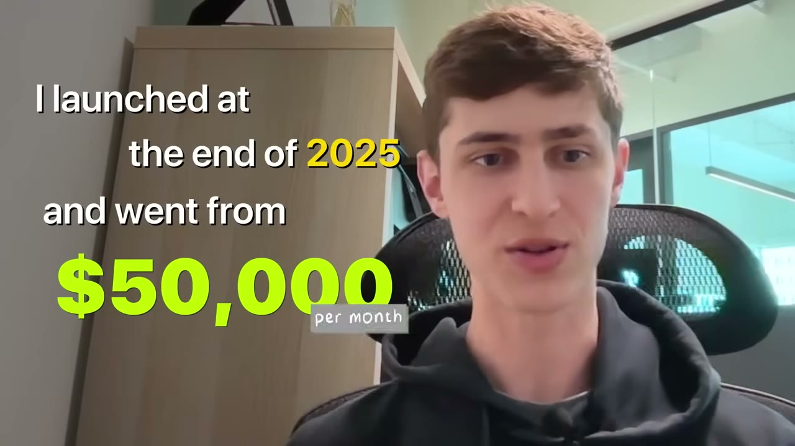
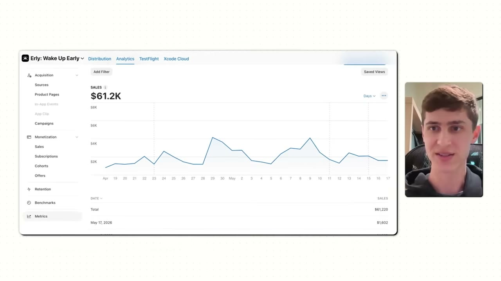
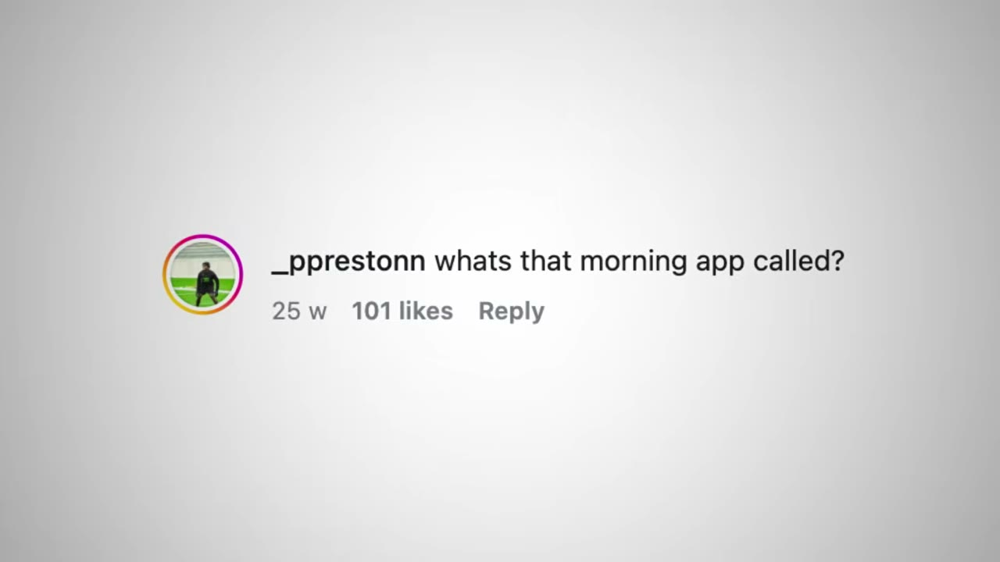
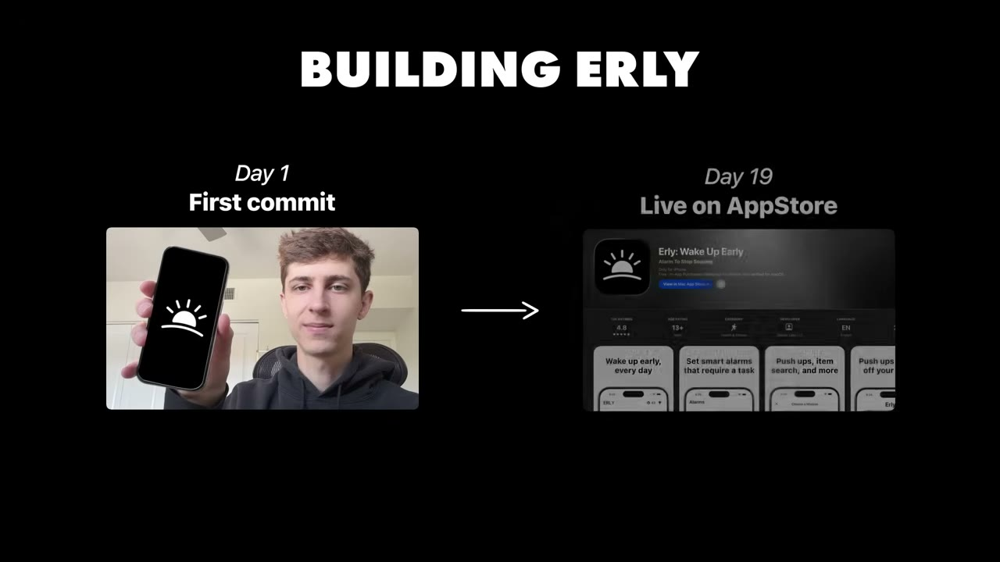
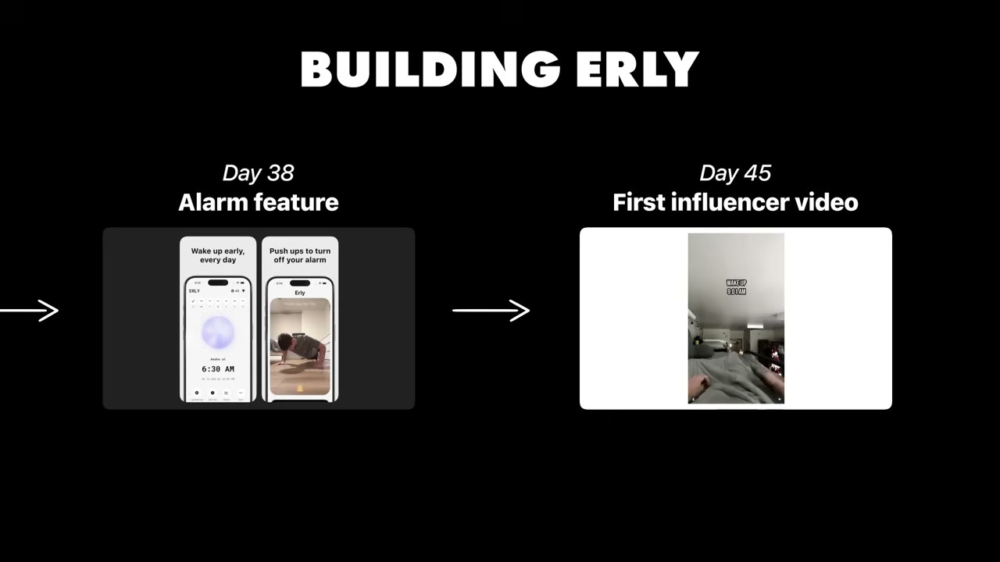
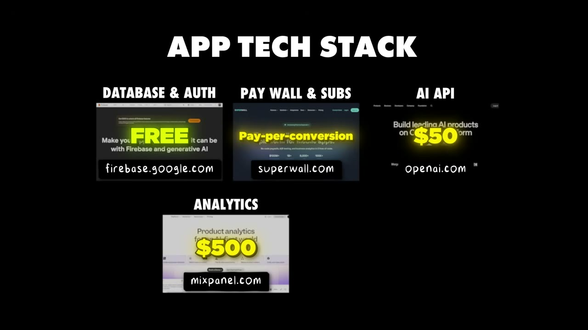

# This Insanely Simple App Makes $50K/Month

✅ **Đã phân tích sâu** → [`case.md`](case.md)

| | |
|---|---|
| **Video** | <https://www.youtube.com/watch?v=uvIcGuN2iO8> |
| **Đăng** | 05/07/2026 |
| **Thời lượng** | 19:16 |
| **Lượt xem** | 309,900 |
| **Lượt thích** | 7,674 |
| **Video ID** | `uvIcGuN2iO8` |

## Trong thư mục này

| File | Nội dung |
|---|---|
| [`case.md`](case.md) | **Phân tích đầy đủ** — ý tưởng, validate, GTM, áp dụng ở VN |
| [`meta.json`](meta.json) | Metadata gốc (chapters, heatmap, mô tả) |
| [`screenshots/`](screenshots/) | 10 ảnh 720p |

## Mô tả gốc

Jake Glacer built one of the simplest apps I've ever seen. You almost can't believe it makes any money. But Jake found a viral idea, started marketing from the very beginning, and grew to over $50K/month in just 4 months. In this video, we break down how something this simple actually works and why a niche app like this is so easy to market.
0:00 - Simples app idea ever?
0:59 - What’s your story?
1:24 - What’s the app?
2:22 - Founder background
3:00 - More simple iOS app ideas
4:03 - Finding the idea
5:59 - Build the app
7:27 - How to find successful ideas
8:59 - Growth and marketing
9:59 - Ma

## Số liệu bắt được từ transcript

> Các đoạn founder nhắc tới con số, kèm timestamp để tua thẳng tới đó trong video.

_(không bắt được con số nào)_

## Chương

- `00:00` Simples app idea ever?
- `00:59` What’s your story?
- `01:24` What’s the app?
- `02:22` Founder background
- `03:00` More simple iOS app ideas
- `04:03` Finding the idea
- `05:59` Build the app
- `07:27` How to find successful ideas
- `08:59` Growth and marketing
- `09:59` Marketing example
- `11:05` Deal structure
- `11:52` Tracking marketing results
- `13:01` Tech stack
- `13:59` App demo
- `14:50` Final advice: focus on marketing
- `15:51` Pat and Gus reflections: a crazy simple idea

## Ảnh

1. `01_00m15s_ch-simples-app-idea-ever.jpg` — 
2. `02_01m07s_usd-50-000.jpg` — 
3. `03_01m52s_usd-50-000.jpg` — 
4. `04_02m34s_ch-founder-background.jpg` — 
5. `05_03m12s_ch-more-simple-ios-app-ideas.jpg` — 
6. `06_04m15s_ch-finding-the-idea.jpg` — 
7. `07_06m11s_ch-build-the-app.jpg` — 
8. `08_06m49s_usd-1-000.jpg` — 
9. `09_09m09s_usd-50-000.jpg` — 
10. `10_13m22s_replay.jpg` — 

---

← [Quay lại index](../../index.md) · [Toàn bộ video](../README.md)
