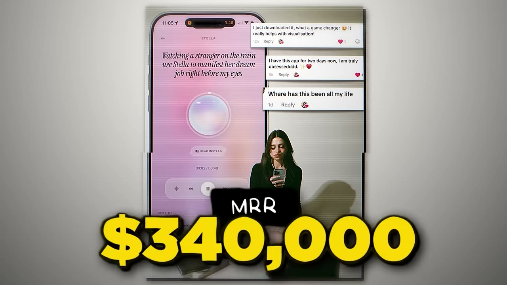
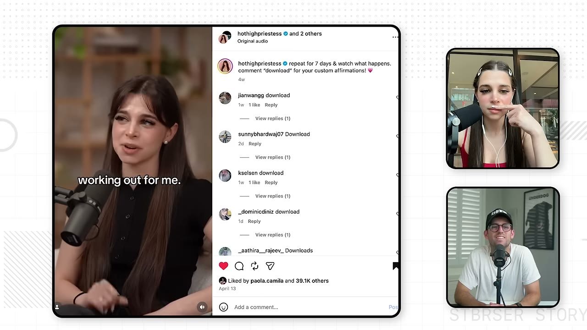
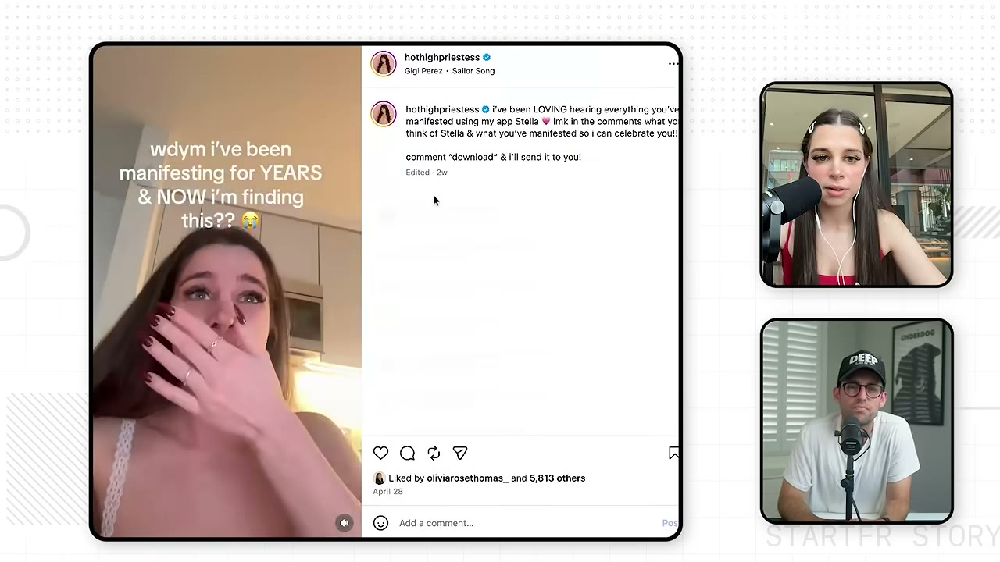

# She Built This $340K/Month App in 60 Days

✅ **Đã phân tích sâu** → [`case.md`](case.md)

| | |
|---|---|
| **Video** | <https://www.youtube.com/watch?v=Eg93po_DAYo> |
| **Đăng** | 12/07/2026 |
| **Thời lượng** | 16:48 |
| **Lượt xem** | 65,889 |
| **Lượt thích** | 1,972 |
| **Video ID** | `Eg93po_DAYo` |

## Trong thư mục này

| File | Nội dung |
|---|---|
| [`case.md`](case.md) | **Phân tích đầy đủ** — ý tưởng, validate, GTM, áp dụng ở VN |
| [`meta.json`](meta.json) | Metadata gốc (chapters, heatmap, mô tả) |
| [`screenshots/`](screenshots/) | 10 ảnh 720p |

## Mô tả gốc

Sarah turned a simple idea into an app called Stella. In JUST 2 months she hit $340K/Month. But... there’s a bigger story here: building apps is getting easier and easier. So who is going to win? Well, in this video, we break down how Sarah built a $300K/month app, and why she thinks she's the first of a much bigger wave.
0:00 - She built this app
0:55 - Meet Sarah
1:26 - App breakdown
2:36 - "But you have a following?"
3:27 - Sarah's background
4:34 - The year of iOS
5:15 - Finding the app idea
6:23 - Tech stack
7:08 - The next wave of builders
8:58 - Distribution and virality
10:16 - Marketi

## Số liệu bắt được từ transcript

> Các đoạn founder nhắc tới con số, kèm timestamp để tua thẳng tới đó trong video.

_(không bắt được con số nào)_

## Chương

- `00:00` She built this app
- `00:55` Meet Sarah
- `01:26` App breakdown
- `02:36` But you have a following?
- `03:27` Sarah's background
- `04:34` The year of iOS
- `05:15` Finding the app idea
- `06:23` Tech stack
- `07:08` The next wave of builders
- `08:58` Distribution and virality
- `10:16` Marketing examples
- `12:41` Advice to younger self
- `14:32` Pat and Gus: the next wave of builders

## Ảnh

1. `01_00m15s_ch-she-built-this-app.jpg` — 
2. `02_01m23s_usd-300-000-m.jpg` — 
3. `03_02m48s_ch-but-you-have-a-following.jpg` — 
4. `04_03m29s_usd-300-000.jpg` — 
5. `05_04m46s_ch-the-year-of-ios.jpg` — 
6. `06_05m27s_ch-finding-the-app-idea.jpg` — 
7. `07_06m35s_ch-tech-stack.jpg` — 
8. `08_07m51s_metric.jpg` — 
9. `09_10m49s_replay.jpg` — 
10. `10_12m09s_replay.jpg` — 

---

← [Quay lại index](../../index.md) · [Toàn bộ video](../README.md)
