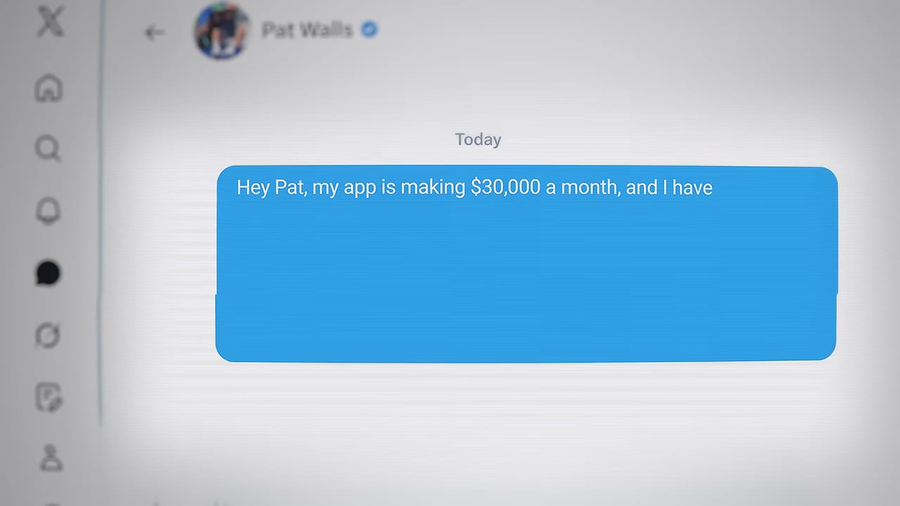
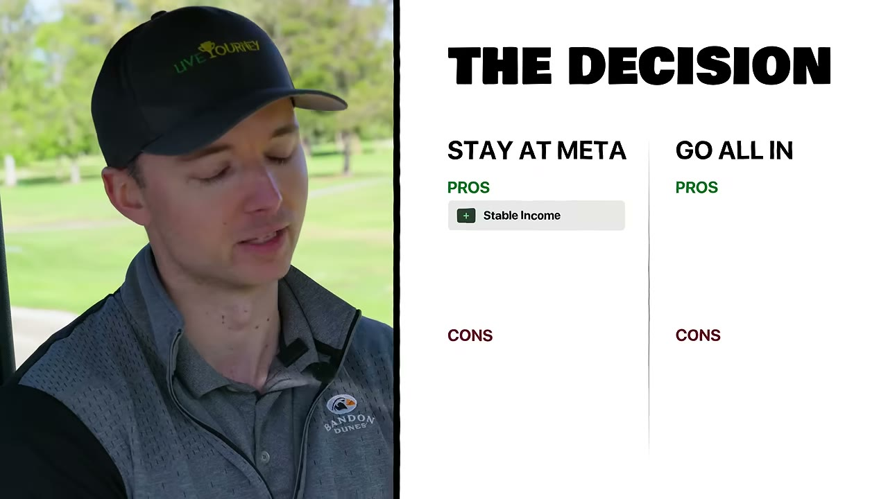
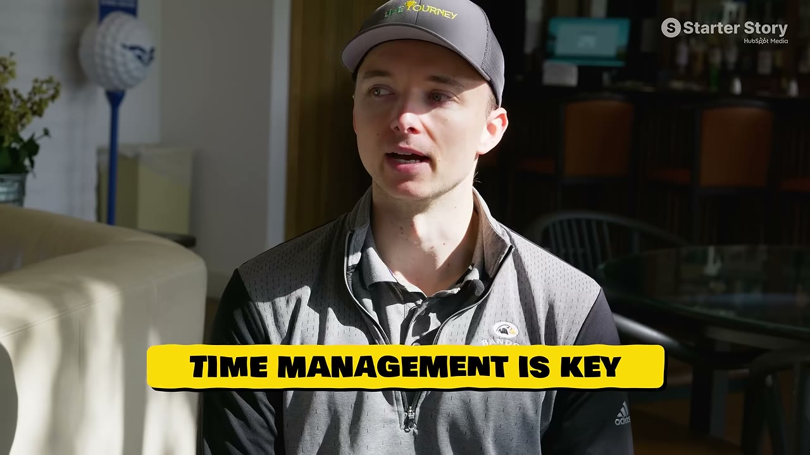

# I Quit My Job at Meta to Build a $30K/Month SaaS

✅ **Đã phân tích sâu** → [`case.md`](case.md)

| | |
|---|---|
| **Video** | <https://www.youtube.com/watch?v=2_lpZ503ZGg> |
| **Đăng** | 15/07/2026 |
| **Thời lượng** | 15:00 |
| **Lượt xem** | 33,917 |
| **Lượt thích** | 844 |
| **Video ID** | `2_lpZ503ZGg` |

## Trong thư mục này

| File | Nội dung |
|---|---|
| [`case.md`](case.md) | **Phân tích đầy đủ** — ý tưởng, validate, GTM, áp dụng ở VN |
| [`meta.json`](meta.json) | Metadata gốc (chapters, heatmap, mô tả) |
| [`screenshots/`](screenshots/) | 10 ảnh 720p |

## Mô tả gốc

I traveled to Los Angeles to meet a guy who built a $30K/month golf app while he had a full-time job at a big tech company. 
But now he's facing a big decision: should he stay at his full-time job and keep building on the side? Or is it finally time to go all-in on his business? 
In this video, you will learn the incredible story behind how he built this successful business and by the end... you'll find out whether he stayed or quit!
0:00 - Stay or quit? 
0:43 - Arrival!
1:02 - Meet Matt
1:25 - Business breakdown
1:43 - Career life
2:13 - Improve Pat’s swing!
2:47 - Idea and build
3:32 - How t

## Số liệu bắt được từ transcript

> Các đoạn founder nhắc tới con số, kèm timestamp để tua thẳng tới đó trong video.

_(không bắt được con số nào)_

## Chương

- `00:00` Stay or quit?
- `00:43` Arrival!
- `01:02` Meet Matt
- `01:25` Business breakdown
- `01:43` Career life
- `02:13` Improve Pat’s swing!
- `02:47` Idea and build
- `03:32` How the app works
- `04:12` Is this a dumb decision?
- `04:40` Go build something!
- `05:44` What’s the plan?
- `06:55` The inflection point
- `07:40` Back against the wall
- `08:28` How to build with a full-time job
- `09:42` What it feels to build a successful app
- `10:30` Takeaways and reflections
- `11:31` The final decision!
- `12:08` Leaving the job
- `12:43` A family decision
- `13:18` What’s next?
- `14:42` Wrap up

## Ảnh

1. `01_00m15s_ch-stay-or-quit.jpg` — 
2. `02_01m07s_usd-40-000.jpg` — 
3. `03_01m55s_ch-career-life.jpg` — 
4. `04_02m40s_usd-30-000.jpg` — 
5. `05_03m44s_ch-how-the-app-works.jpg` — 
6. `06_04m24s_ch-is-this-a-dumb-decision.jpg` — 
7. `07_05m12s_usd-30-000.jpg` — 
8. `08_05m56s_ch-what-s-the-plan.jpg` — 
9. `09_07m46s_usd-12-000.jpg` — 
10. `10_08m48s_usd-30-000.jpg` — 

---

← [Quay lại index](../../index.md) · [Toàn bộ video](../README.md)
