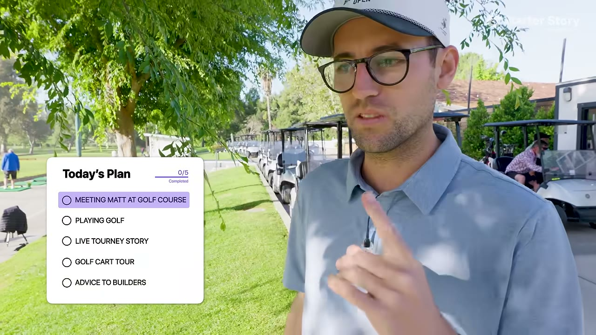
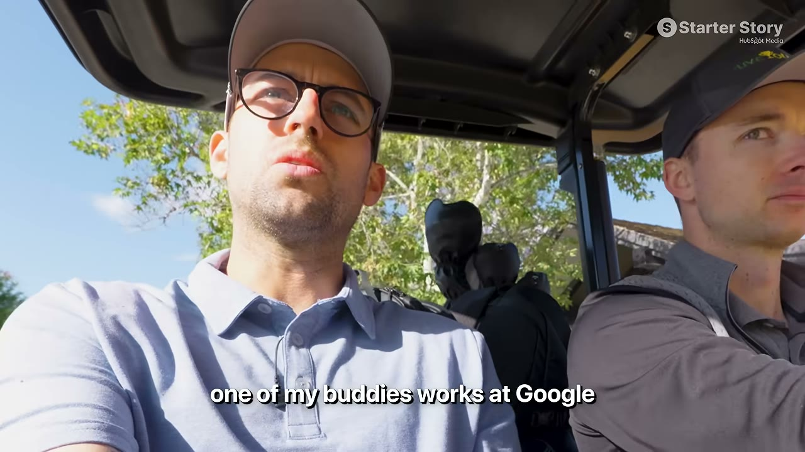

# Live Tourney — $30K/tháng làm ngoài giờ, và quyết định nghỉ việc ở Meta

> **Tóm tắt 30 giây:** Matt là senior software engineer ở **Meta, team AI**, có vợ và hai con nhỏ. Anh chơi giải ở sân golf địa phương, thấy họ chấm điểm bằng giấy. Hỏi tại sao không dùng phần mềm có sẵn (Golf Genius), pro của sân trả lời: **quá phức tạp và quá đắt**. Anh build **Live Tourney** trong 4 năm buổi tối và cuối tuần. Nay **150 sân golf**, **$350K ARR**, đà chạy **~$800K/năm**. Video này ghi lại đúng khoảnh khắc anh quyết định **nghỉ việc ở Meta** — và anh đã nghỉ.

---

## 1. Con số

| Chỉ số | Giá trị |
|---|---|
| Doanh thu | **~$30.000/tháng** |
| ARR | **$350.000** |
| Run rate theo đà đầu năm | **~$800.000/năm** |
| Khách hàng | **150 sân golf** |
| Nhân sự | **1** — làm ngoài giờ |
| Thời gian | **4 năm** |
| Tech stack | **Next.js + Firebase**. Hết. |

---

## 2. Ý tưởng — công thức "đối thủ quá đắt và quá phức tạp" ⭐

Anh chơi giải ở sân địa phương, thấy họ **không dùng phần mềm gì cả**. Anh biết có sản phẩm trên thị trường (Golf Genius) vì từng dùng. Anh hỏi pro của sân **tại sao không dùng**.

Câu trả lời:

> **"Quá phức tạp và quá đắt."**

Với anh, đó chính là **cơ hội**.

> **Đây là một trong những công thức tìm ý tưởng B2B đáng tin cậy nhất — và ít người dùng nhất:**
>
> Đừng tìm thị trường **chưa có phần mềm**. Hãy tìm thị trường **đã có phần mềm nhưng không ai chịu dùng nó**. Sự tồn tại của đối thủ **chứng minh nhu cầu**; việc họ bị từ chối **chỉ ra khoảng trống**.
>
> **Câu hỏi để hỏi bất kỳ doanh nghiệp nhỏ nào:** *"Có phần mềm cho việc này chứ? Sao anh không dùng?"* Câu trả lời "quá đắt" hoặc "quá rắc rối" chính là bản mô tả sản phẩm của anh.

**Anh build cho giải đấu đầu tiên ngay tại sân của mình** — không phải sản phẩm giả định, mà là công cụ dùng thật cho một sự kiện thật.

**Sản phẩm cực đơn giản:** người chơi nhận thẻ điểm giấy → quét QR → vào bảng xếp hạng → nhập điểm → **bảng xếp hạng cập nhật thời gian thực** cho cả giải theo dõi.

---

## 3. Xây dựng khi vẫn đi làm toàn thời gian ⭐

**Lời khuyên của anh — quản lý thời gian là tất cả:**

> **Đặt ra một khung giờ cố định trong ngày.** Với anh là **6h - 9h sáng**. Dậy sớm và làm cho xong.

Anh mô tả giai đoạn đầu như một nỗi ám ảnh: thứ đầu tiên anh muốn làm khi thức dậy, thứ cuối cùng trước khi đi ngủ, là ngồi build — **liên tục tìm cách làm nó tốt hơn mỗi ngày**.

**Vì sao chọn buổi sáng:** làm trước khi công việc chính bắt đầu thì không ai giành mất, và không phụ thuộc vào việc tối đó anh còn năng lượng hay không.

---

## 4. Quyết định nghỉ việc — khung suy nghĩ ⭐

Đây là phần khác biệt của case này: nó ghi lại **quá trình ra quyết định**, không phải kết quả.

**Bên ở lại:**
- Lương và phúc lợi ổn định
- Anh làm ở **team AI của Meta** — Pat nhắc một người bạn ở Google kiếm hàng chục triệu đô nhờ làm mảng AI
- Có vợ và **hai con nhỏ** — quyết định không của riêng anh

**Bên ra đi:**
- **Việc làm không còn là bảo đảm:** 6 năm ở Meta, anh chứng kiến **hơn 6 đợt sa thải**. Anh chưa bị ảnh hưởng, nhưng cảm giác an toàn đã mất.
- **Làm cả hai không còn bền vững** — với hai con nhỏ
- **Cho con thấy một điều:** anh muốn chứng minh với các con rằng *có thể làm điều mình muốn, không phải chờ ai cho phép*
- **Năng lượng buổi sáng của anh thuộc về Live Tourney**, không thuộc về Meta

**Nỗi sợ anh nói thẳng:** ngày hôm sau tỉnh dậy không còn "công việc thật" và "thu nhập thật" thì sẽ ra sao. Nếu mất hết khách hàng thì **không còn gì**.

**Quan điểm của Pat — "back against the wall":** anh kể khi mình nghỉ việc, anh **còn $12.000 trong tài khoản**, và chính sự bí bách đó thúc anh làm tới. Nhưng anh cũng chỉ ra vế ngược:

> **"Rất nhiều người bỏ việc đi khởi nghiệp mà còn không biết ưu tiên thời gian ra sao. Anh thì đã biết. Anh đã chứng minh mình tạo được doanh thu và có khách. Anh làm xong phần khó rồi."**

**Kết quả:** ba tuần sau, Matt **nghỉ việc**. Đợt sa thải diễn ra tuần trước đó và anh **không** bị cho nghỉ — anh nói điều đó khiến quyết định **khó hơn**. Vợ anh là người thúc đẩy.

> **Đúc kết của Pat, đáng ghi nhớ:**
> **"Khởi nghiệp rốt cuộc là chuyện anh sẵn sàng chịu bao nhiêu rủi ro. Vì lúc bỏ việc thường là lúc anh chưa chắc business có ổn không. Điều này quan trọng hơn nhiều so với việc ý tưởng của anh là gì. Nó là chuyện anh có tin vào chính mình hay không."**

Pat cũng nêu mốc tham chiếu hữu ích: kênh từng phỏng vấn người **giữ việc cho tới khi kiếm $80.000/tháng**. Không có mốc đúng.

---

## 5. Lời khuyên tìm ý tưởng

> **Tìm thứ anh thật sự quan tâm, tìm chỗ anh có thể làm nó tốt hơn, rồi làm.**

Anh nói rõ vì sao điều này quan trọng: anh làm được việc này mà **không có cảm giác đang đi làm**.

Pat mở rộng thành cảnh báo rất thực tế:

> **"Rất nhiều người cố build cái gì đó cho nha sĩ, nhưng họ không phải nha sĩ, không biết gì về nha sĩ. Rồi 3 tháng sau việc trở nên khó khăn và họ bỏ cuộc."**

Anh gợi ý: thích pickleball thì làm phần mềm giải đấu pickleball.

> **Liên hệ với [Gaurabh](../2026-08-22_he-built-100-apps-and-made-0-can-he-fix-it-in-30-day/case.md):** cùng một bài học từ hai hướng. Gaurabh **thất bại** vì phục vụ nhóm anh không thuộc về; Matt **thành công** vì phục vụ đúng nhóm của mình. **Đây là mẫu hình mạnh nhất trong toàn bộ knowledge base.**

---

## 6. Cảnh báo thiên kiến nguồn

**Không có ảnh chụp dashboard doanh thu.** Pat **không hỏi** Stripe lần nào trong cả video — khác với thông lệ của kênh. Matt chỉ demo **bảng xếp hạng của app**, không mở bất kỳ màn hình doanh thu nào. **Mọi con số là lời tự khai.**

**Bốn con số không khớp nhau:**

| Nguồn | Con số | Quy ra tháng |
|---|---|---|
| Tiêu đề + mô tả video | $30K/tháng | $30.000 |
| Pat nói ở 01:02 | "making 30, $40,000 a month" | $30-40.000 |
| Matt nói: ARR $350K | | **~$29.000** |
| Matt nói: run rate $800K/năm | | **~$66.000** |

Con số "$800K run rate" **gấp hơn hai lần** con số dùng làm tiêu đề, và Matt tự nói nó dựa trên *"how we've been doing the start of the year"* — tức **ngoại suy từ vài tháng tốt nhất**. Với ngành golf, đầu năm là mùa cao điểm ở nhiều bang Mỹ, nên cách ngoại suy này thổi phồng có hệ thống. Case này nên đọc theo mốc **$350K ARR** (con số duy nhất có tính lịch sử), không phải $800K.

**Quảng cáo chèn giữa (04:40 → 05:38).** Gần một phút ad, và Pat nói thẳng: *"we worked with **HubSpot** to put together a free database of over 100 proven micro SaaS ideas"* — link `clickhubspot.com/58ys`. **HubSpot không liên quan gì tới SaaS chấm điểm golf.** Hai chi tiết đáng để ý:
- Mô tả video ghi **"190+ Micro-SaaS Ideas"**, Pat trong video nói **"over 100"**. Ngay cả con số của sản phẩm tài trợ cũng không nhất quán.
- Ad được chèn **đúng vào khoảnh khắc căng nhất** — ngay sau khi Matt nói "nếu thuần tài chính thì ở lại có vẻ đúng" và ngay trước phần anh trình bày kế hoạch. Đây là kỹ thuật cliffhanger giữ chân, không phải điểm ngắt tự nhiên.

**Bối cảnh bị làm mờ — đáng kể:** khung "back against the wall" mà Pat dựng lên **không phải hoàn cảnh của Matt**. Pat kể chuyện anh nghỉ việc với **$12.000 trong tài khoản** rồi áp cảm hứng đó lên Matt, nhưng Matt là:
- **Senior software engineer ở Meta, team AI, 6 năm** — mức thu nhập cao nhất nhì ngành phần mềm Mỹ
- Có **lương + cổ phiếu 6 năm** làm đệm tài chính (video **không hề hỏi** anh có bao nhiêu tiết kiệm)
- Nghỉ việc khi business **đã có $350K ARR** và 150 khách trả tiền

Nói cách khác: đây là case **rủi ro thấp nhất có thể**, được kể bằng ngôn ngữ của một quyết định liều lĩnh. Chính Pat thừa nhận điều này ở 13:44 — *"you're not feeling like you're super back against the wall"* — nhưng câu đó nằm ở cuối, sau khi khung cảm xúc đã được dựng xong.

**Lỗ hổng lớn nhất: không ai hỏi anh kiếm 150 khách bằng cách nào.** Case xây trên luận điểm "không cần marketing" — Matt nói anh **chưa từng nói về sản phẩm trên LinkedIn hay mạng xã hội nào**. Nhưng vậy thì 150 sân golf tìm ra anh kiểu gì? Truyền miệng? Cold email? Đi gõ cửa? Hiệp hội golf? **Câu hỏi này không được đặt ra một lần nào trong 15 phút.** Đây là thông tin có giá trị nhất của case và nó **hoàn toàn vắng mặt** — 4 năm lịch sử phân phối bị nén thành một chữ "không marketing".

**Thiếu số liệu quan trọng:** không có **giá bán** (chỉ suy ra được ~$195/khách/tháng từ phép chia), không có **churn** (rất quan trọng với SaaS bán theo mùa giải), không có **chi phí** (Firebase ở quy mô 150 sân), không có **biên lợi nhuận**, không có **CAC**, không có **tỷ lệ gia hạn theo mùa**. Cũng không rõ 150 sân là **khách đang trả tiền** hay là *"đã bắt đầu dùng sản phẩm"* — đúng nguyên văn Matt nói: *"150 golf courses that have started using our product"*, một cách diễn đạt có thể bao gồm cả tài khoản dùng thử.

---

## 7. Áp dụng cho tôi (indie hacker VN)

**Vì sao mô hình này đáng chú ý:**
- ✅ **Không cần bỏ việc để bắt đầu** — 4 năm ngoài giờ
- ✅ **Không cần marketing** — anh chưa từng nói về sản phẩm trên mạng xã hội mà vẫn có 150 khách
- ✅ **Tech stack tối giản** (Next.js + Firebase)
- ✅ **B2B, giá trị cao** — sân golf trả tiền không chớp mắt
- ✅ **Không phụ thuộc trend**

**Công thức tìm ý tưởng — dùng ngay tuần này:**
1. Liệt kê **ngành anh thật sự hiểu** (nghề cũ, sở thích, nơi gia đình làm việc)
2. Với mỗi ngành, hỏi người trong nghề: **"Có phần mềm cho việc này không? Sao anh không dùng?"**
3. Nghe câu **"quá đắt"** hoặc **"quá phức tạp"** → đó là cơ hội
4. Build phiên bản đơn giản cho **một** khách thật, dùng cho **một** sự kiện thật

**Ngách VN đáng soi theo đúng công thức này:** giải đấu thể thao phong trào (pickleball, cầu lông, bóng đá sân 7), quản lý phòng gym/yoga nhỏ, sân tennis, trung tâm dạy thêm, phòng khám nhỏ, quán cà phê chuỗi nhỏ. **Điểm chung: đều có phần mềm quốc tế đắt và phức tạp mà chủ Việt Nam không dùng.**

**Rào cản thật:**
- ⚠️ **4 năm.** Đây là case chậm nhất trong knowledge base. Không có cú nổ nào cả.
- ⚠️ **Vertical SaaS có trần thấp** — 150 sân golf là thị trường hữu hạn. Đổi lại là ổn định và churn thấp.
- ⚠️ Bán B2B cho doanh nghiệp truyền thống ở VN cần **gặp mặt trực tiếp**, không bán qua web được
- ⚠️ ARPU: $350K ARR / 150 khách = **~$195/khách/tháng**. Sân golf VN khó trả mức này → chọn ngách có biên tốt hơn hoặc nhắm khách quốc tế

---

## Nguồn

- Video: [I Quit My Job at Meta to Build a $30K/Month SaaS](https://www.youtube.com/watch?v=2_lpZ503ZGg) — Starter Story, 15/07/2026, 15:00, 33K views
- Transcript: [`_raw/transcripts/2_lpZ503ZGg.md`](transcript.md) · Ảnh: [`screenshots/2_lpZ503ZGg/`](screenshots/)
