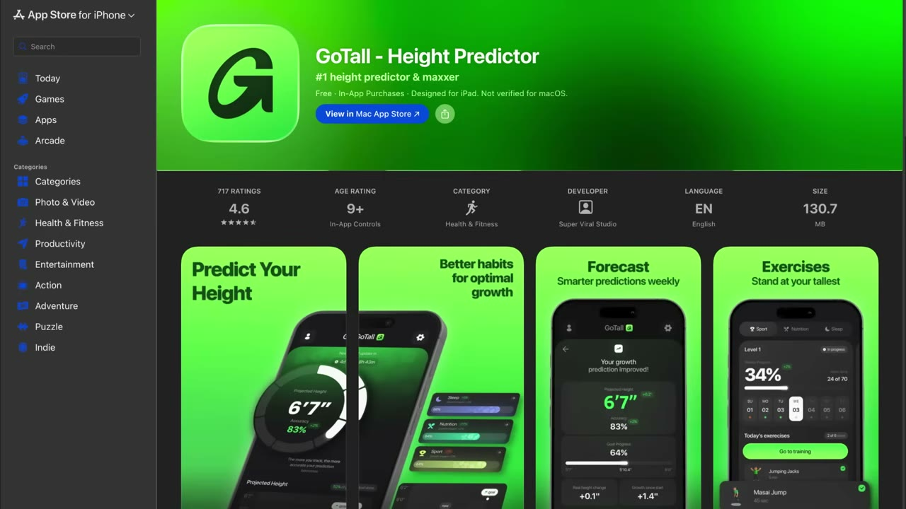
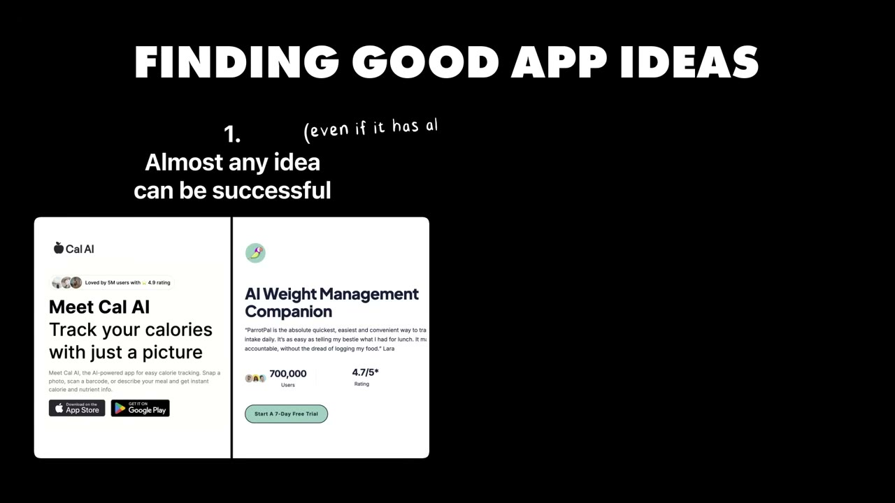

# This Stupidly Simple App Makes $100K/Month

✅ **Đã phân tích sâu** → [`case.md`](case.md)

| | |
|---|---|
| **Video** | <https://www.youtube.com/watch?v=EQfZCe3MkTU> |
| **Đăng** | 19/07/2026 |
| **Thời lượng** | 17:35 |
| **Lượt xem** | 112,528 |
| **Lượt thích** | 2,859 |
| **Video ID** | `EQfZCe3MkTU` |

## Trong thư mục này

| File | Nội dung |
|---|---|
| [`case.md`](case.md) | **Phân tích đầy đủ** — ý tưởng, validate, GTM, áp dụng ở VN |
| [`meta.json`](meta.json) | Metadata gốc (chapters, heatmap, mô tả) |
| [`screenshots/`](screenshots/) | 10 ảnh 720p |

## Mô tả gốc

Michael built one of the most unbelievable app ideas I've ever seen. And today he makes over $100K per month. But the real story is the IDEA. What's the secret? How does it make money? 
So in this video, we break down how Michael found this unbelievable app idea and the framework any builder can use to find their own crazy app ideas too. 
0:00 -  I can't believe this exists...
0:58 - What's your story?
1:31 - App breakdown
2:41 - Michael's background
3:32 - Health and Self-Improvement Apps
4:36 - Finding the unbelievable idea
6:27 - Advice for finding ideas
8:40 - Growth and marketing 
10:20 -

## Số liệu bắt được từ transcript

> Các đoạn founder nhắc tới con số, kèm timestamp để tua thẳng tới đó trong video.

_(không bắt được con số nào)_

## Chương

- `00:00` I can't believe this exists...
- `00:58` What's your story?
- `01:31` App breakdown
- `02:41` Michael's background
- `03:32` Health and Self-Improvement Apps
- `04:36` Finding the unbelievable idea
- `06:27` Advice for finding ideas
- `08:40` Growth and marketing
- `10:20` Tech stack
- `10:52` Go Tall demo
- `12:59` Advice: let go of your ego
- `14:35` Pat and Gus reflections: what an unbelievable idea!
- `17:01` Build YOUR app idea

## Ảnh

1. `01_00m36s_usd-100-000.jpg` — 
2. `02_01m43s_ch-app-breakdown.jpg` — 
3. `03_02m28s_usd-100-000.jpg` — 
4. `04_03m44s_ch-health-and-self-improvement-apps.jpg` — 
5. `05_04m59s_replay.jpg` — 
6. `06_06m39s_ch-advice-for-finding-ideas.jpg` — 
7. `07_08m34s_usd-100-000.jpg` — 
8. `08_10m37s_replay.jpg` — 
9. `09_13m11s_ch-advice-let-go-of-your-ego.jpg` — 
10. `10_14m47s_ch-pat-and-gus-reflections-what-an-unbelievab.jpg` — 

---

← [Quay lại index](../../index.md) · [Toàn bộ video](../README.md)
