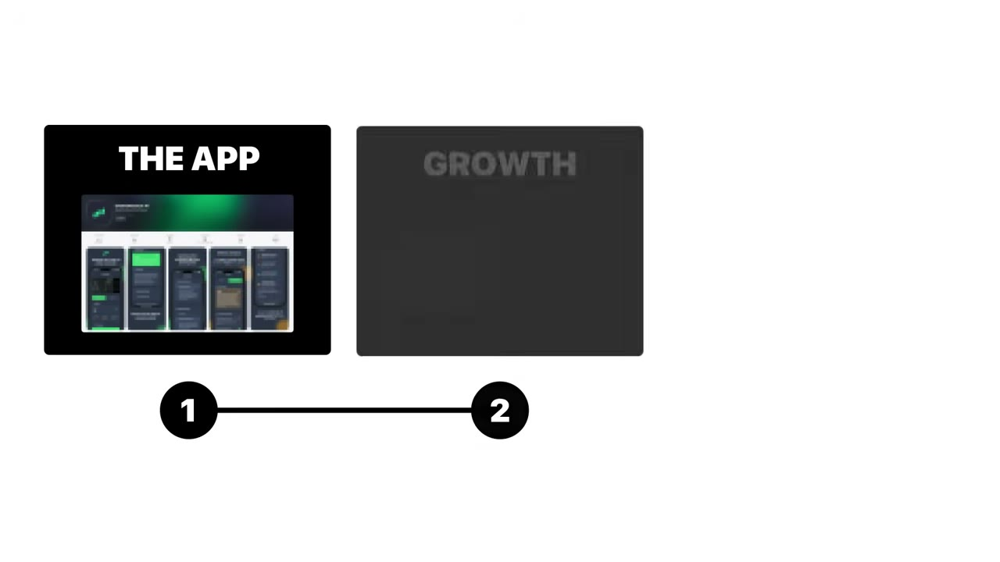
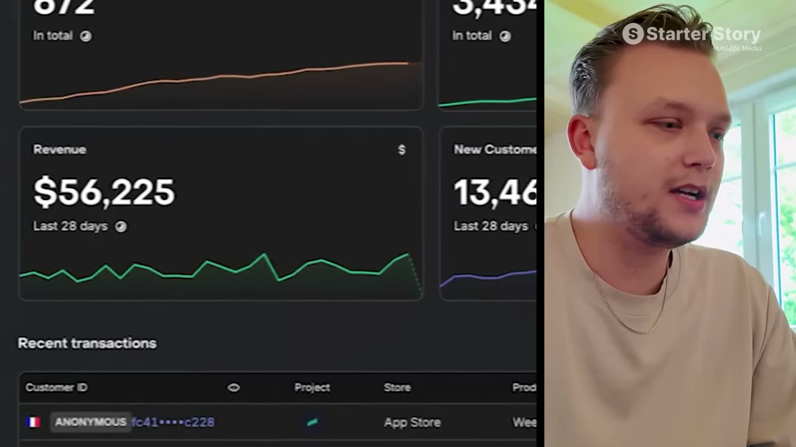
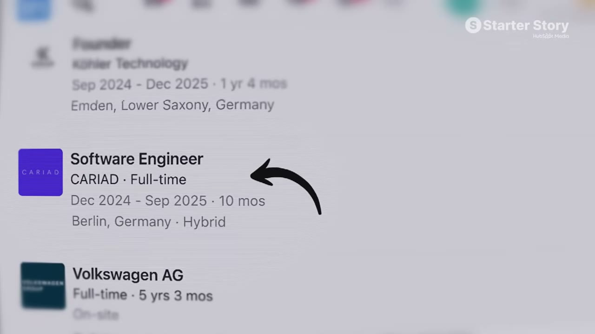
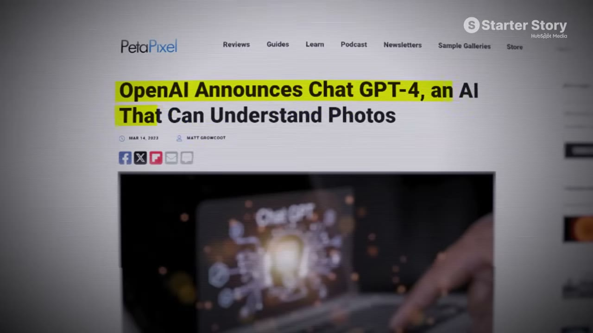
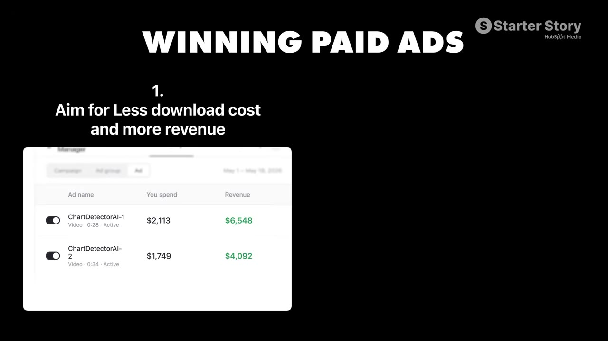
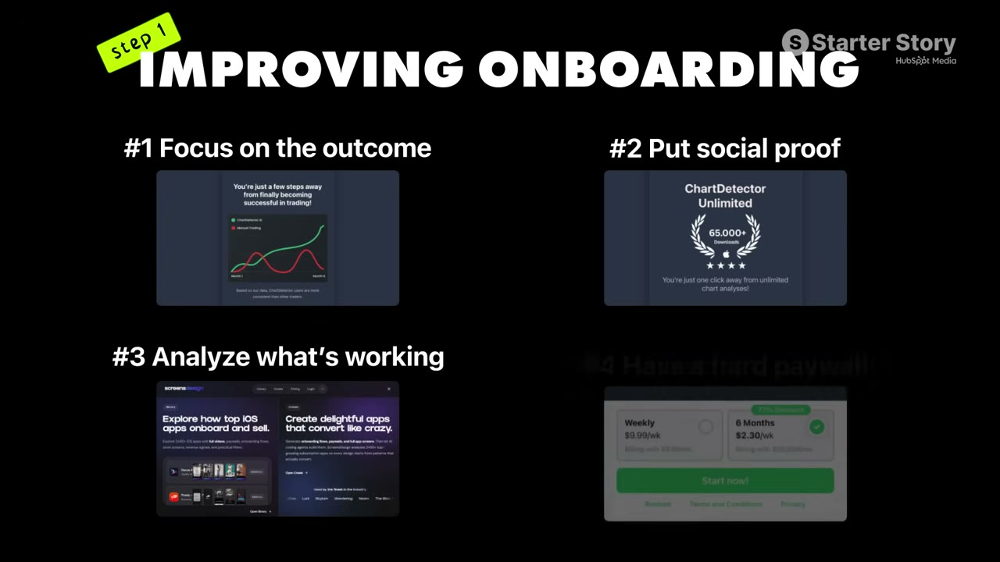
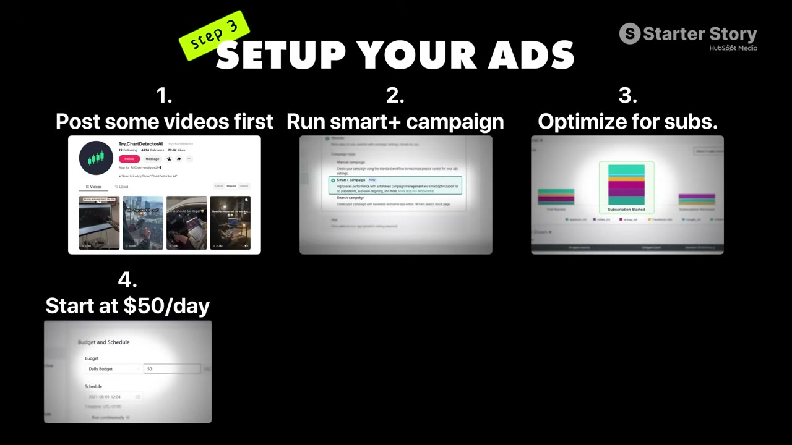
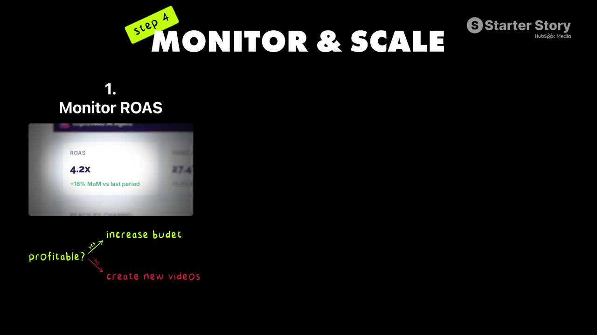

# I Make $50K Per Month Working 5 Hours A Week

✅ **Đã phân tích sâu** → [`case.md`](case.md)

| | |
|---|---|
| **Video** | <https://www.youtube.com/watch?v=DPb-M0Vt4uI> |
| **Đăng** | 23/07/2026 |
| **Thời lượng** | 13:49 |
| **Lượt xem** | 66,491 |
| **Lượt thích** | 1,787 |
| **Video ID** | `DPb-M0Vt4uI` |

## Trong thư mục này

| File | Nội dung |
|---|---|
| [`case.md`](case.md) | **Phân tích đầy đủ** — ý tưởng, validate, GTM, áp dụng ở VN |
| [`meta.json`](meta.json) | Metadata gốc (chapters, heatmap, mô tả) |
| [`screenshots/`](screenshots/) | 10 ảnh 720p |

## Mô tả gốc

Timo built an AI app that today makes over $50K/month. His entire growth has come from one system that allows him to only work 20 hours per month on the app. In this video, we break down what it takes to scale an app from zero to $50K and how much it costs to run the whole thing. 
0:00 - I only work 20 hours per month
0:52 - What's your story?
1:30 - App breakdown and data
2:49 - Timo's background
3:25 - Finding the app idea
4:09 - Distribution strategy
4:48 - More app growth strategies
5:27 - TikTok ad examples
5:50 - Are you profitable?
6:37 - Step 1: Improve onboarding
7:32 - Step 2: Set up

## Số liệu bắt được từ transcript

> Các đoạn founder nhắc tới con số, kèm timestamp để tua thẳng tới đó trong video.

_(không bắt được con số nào)_

## Chương

- `00:00` I only work 20 hours per month
- `00:52` What's your story?
- `01:30` App breakdown and data
- `02:49` Timo's background
- `03:25` Finding the app idea
- `04:09` Distribution strategy
- `04:48` More app growth strategies
- `05:27` TikTok ad examples
- `05:50` Are you profitable?
- `06:37` Step 1: Improve onboarding
- `07:32` Step 2: Set up tracking
- `08:05` Step 3: Create ads
- `10:03` Step 4: Monitor profitability
- `10:56` Tech stack
- `11:44` Final advice
- `12:30` Pat and Gus reflections: is this approach simpler

## Ảnh

1. `01_00m38s_usd-50-000.jpg` — 
2. `02_01m56s_usd-56-000.jpg` — 
3. `03_03m01s_ch-timo-s-background.jpg` — 
4. `04_03m37s_ch-finding-the-app-idea.jpg` — 
5. `05_04m28s_usd-1-50.jpg` — 
6. `06_05m43s_replay.jpg` — 
7. `07_07m23s_replay.jpg` — 
8. `08_08m17s_ch-step-3-create-ads.jpg` — 
9. `09_09m15s_usd-50.jpg` — 
10. `10_10m15s_ch-step-4-monitor-profitability.jpg` — 

---

← [Quay lại index](../../index.md) · [Toàn bộ video](../README.md)
