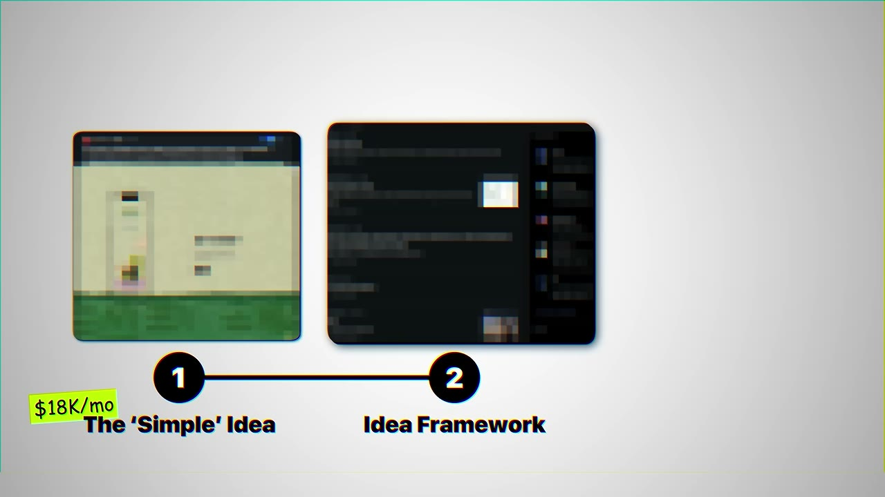
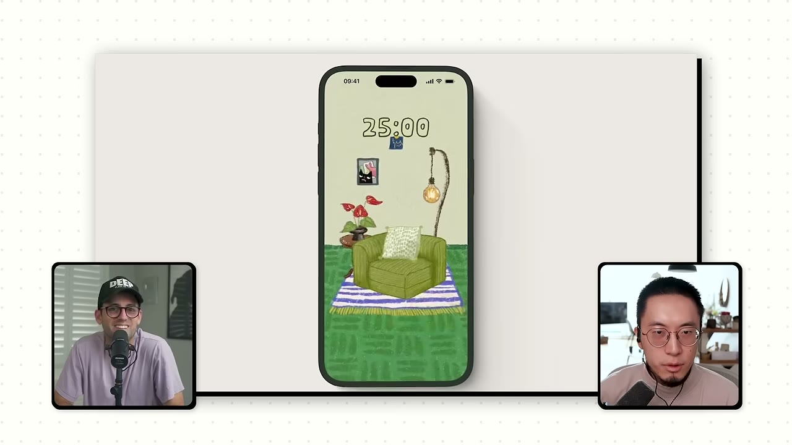
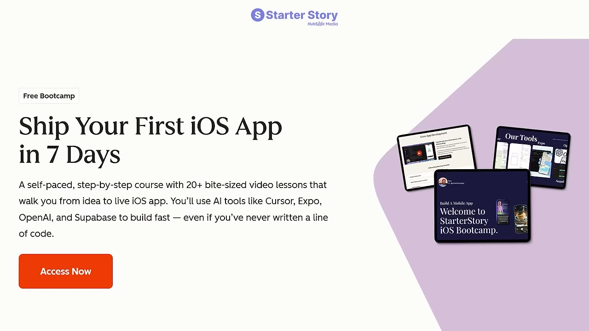
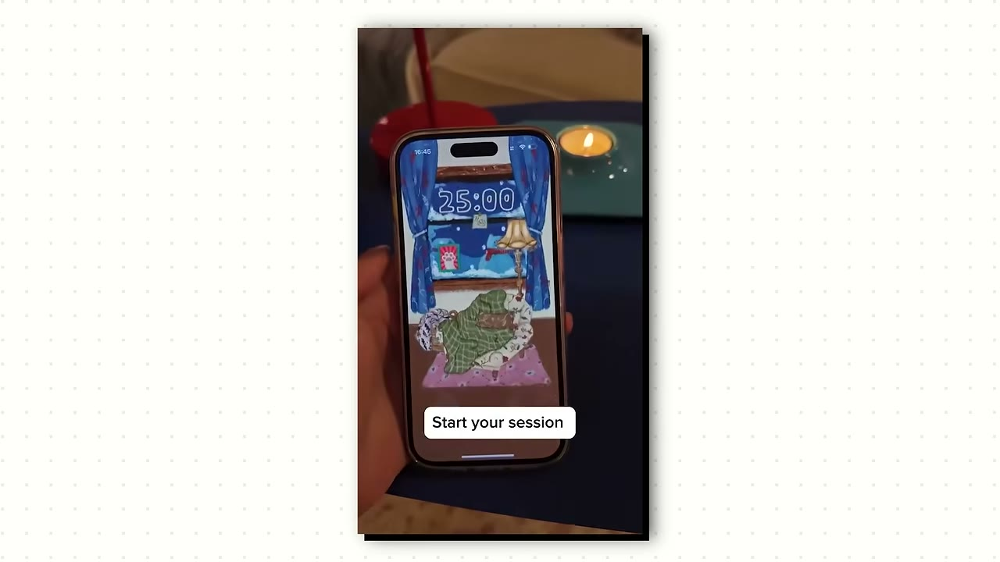
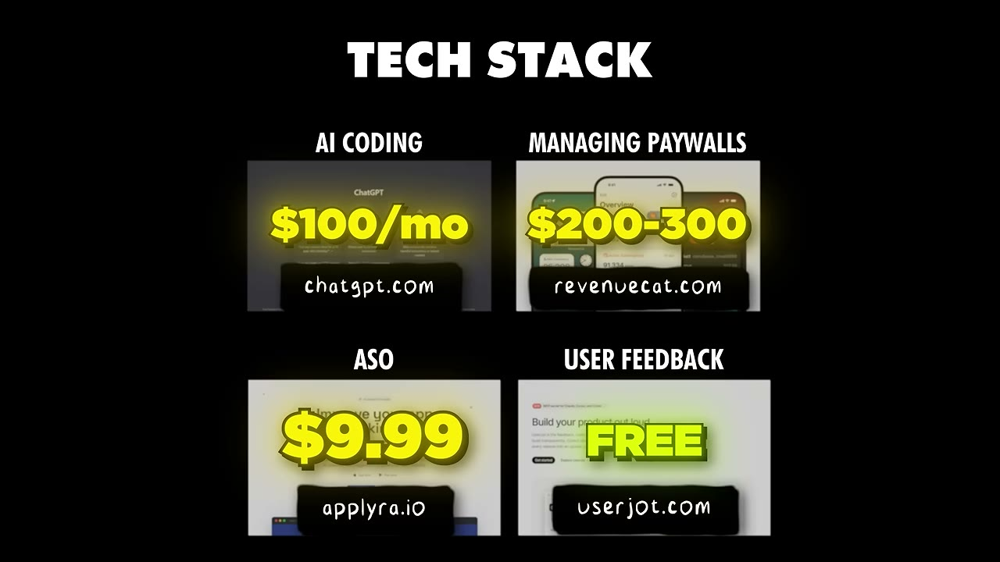

# This Simple App Makes $18K/Month

✅ **Đã phân tích sâu** → [`case.md`](case.md)

| | |
|---|---|
| **Video** | <https://www.youtube.com/watch?v=V_4kiR3R4QU> |
| **Đăng** | 26/07/2026 |
| **Thời lượng** | 15:36 |
| **Lượt xem** | 157,867 |
| **Lượt thích** | 4,564 |
| **Video ID** | `V_4kiR3R4QU` |

## Trong thư mục này

| File | Nội dung |
|---|---|
| [`case.md`](case.md) | **Phân tích đầy đủ** — ý tưởng, validate, GTM, áp dụng ở VN |
| [`meta.json`](meta.json) | Metadata gốc (chapters, heatmap, mô tả) |
| [`screenshots/`](screenshots/) | 10 ảnh 720p |

## Mô tả gốc

Ryan is a former product designer who quit his job to finally build his own app. With the help of AI coding tools, the first app he ever built hit $18K/month. 
But here's the crazy part... this type of app has been built hundreds of times. Why was his successful? 
In this video, we will dive into the simple app he built, how he got his first users, and his advice on how to pick winning app ideas. 
Chapters
0:00 - I love niche apps
0:50 - What’s your story?
1:19 - App breakdown and data
2:46 - Ryan’s background
3:20 - Simple apps win
3:54 - Design and AI
4:10 - Build timeline
5:35 - Target cust

## Số liệu bắt được từ transcript

> Các đoạn founder nhắc tới con số, kèm timestamp để tua thẳng tới đó trong video.

_(không bắt được con số nào)_

## Chương

- `00:00` I love niche apps
- `00:50` What’s your story?
- `01:19` App breakdown and data
- `02:46` Ryan’s background
- `03:20` Simple apps win
- `03:54` Design and AI
- `04:10` Build timeline
- `05:35` Target customers
- `06:16` Tech stack
- `06:48` Finding the app idea
- `08:15` Why does this app work?
- `09:47` Building a hand-crafted app
- `10:19` How to build cool, unique apps
- `11:11` Cat on Chair Demo
- `12:33` Final advice
- `13:20` Pat and Gus reflections: building unique apps

## Ảnh

1. `01_00m36s_usd-18-000.jpg` — 
2. `02_01m28s_replay.jpg` — 
3. `03_02m11s_usd-29-99.jpg` — 
4. `04_02m56s_usd-20-000.jpg` — 
5. `05_03m32s_ch-simple-apps-win.jpg` — 
6. `06_04m22s_ch-build-timeline.jpg` — 
7. `07_05m47s_ch-target-customers.jpg` — 
8. `08_06m46s_replay.jpg` — 
9. `09_08m07s_usd-20-000.jpg` — 
10. `10_09m59s_ch-building-a-hand-crafted-app.jpg` — 

---

← [Quay lại index](../../index.md) · [Toàn bộ video](../README.md)
