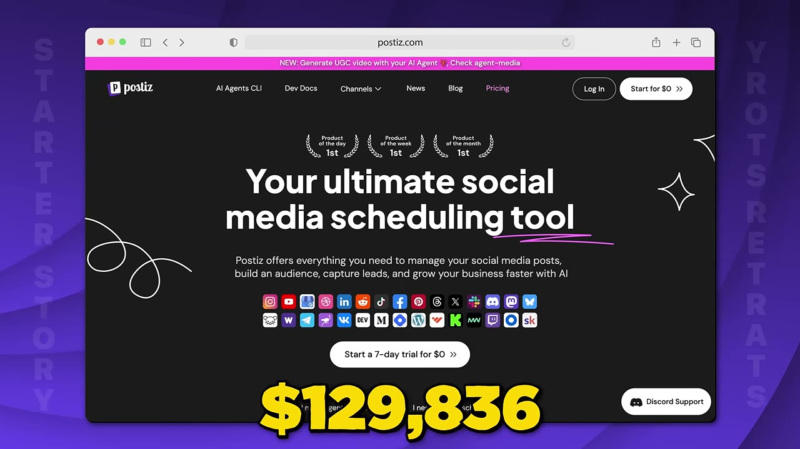
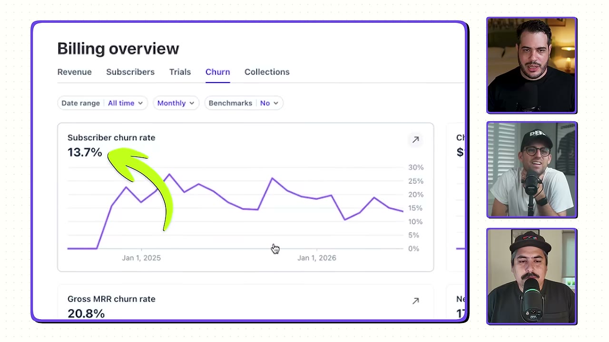

# How Postiz Went From $17K to $143K/Month in 4 Months

✅ **Đã phân tích sâu** → [`case.md`](case.md)

| | |
|---|---|
| **Video** | <https://www.youtube.com/watch?v=n7Obxh9-Rc8> |
| **Đăng** | 30/07/2026 |
| **Thời lượng** | 16:11 |
| **Lượt xem** | 39,496 |
| **Lượt thích** | 1,087 |
| **Video ID** | `n7Obxh9-Rc8` |

## Trong thư mục này

| File | Nội dung |
|---|---|
| [`case.md`](case.md) | **Phân tích đầy đủ** — ý tưởng, validate, GTM, áp dụng ở VN |
| [`meta.json`](meta.json) | Metadata gốc (chapters, heatmap, mô tả) |
| [`screenshots/`](screenshots/) | 10 ảnh 720p |

## Mô tả gốc

A few months ago, Nevo came onto the channel and told us about how he was making $17K per month with Postiz. But now... just four months later... he’s grown it to $143K+ per month!! 
In this video, Nevo will break down how Postiz exploded, plus the biggest lessons he learned about scaling a bootstrapped SaaS along the way.
Chapters
0:00 - Wanna hear a crazy story?
1:16 - Welcome back!
1:42 - What's the app?
2:20 - Business breakdown
3:06 - Agentic SaaS
4:18 - More SaaS Ideas
5:11 - Marketing and Growth strategies
6:53 - Nevo's advice for builders
8:32 - AI Agents reducing churn
8:54 - Running 

## Số liệu bắt được từ transcript

> Các đoạn founder nhắc tới con số, kèm timestamp để tua thẳng tới đó trong video.

_(không bắt được con số nào)_

## Chương

- `00:00` Wanna hear a crazy story?
- `01:16` Welcome back!
- `01:42` What's the app?
- `02:20` Business breakdown
- `03:06` Agentic SaaS
- `04:18` More SaaS Ideas
- `05:11` Marketing and Growth strategies
- `06:53` Nevo's advice for builders
- `08:32` AI Agents reducing churn
- `08:54` Running the business
- `09:47` Make your app reliable
- `10:42` The future of AI agents
- `11:45` Pat and Gus: 10X Growth and AI Agents

## Ảnh

1. `01_00m15s_ch-wanna-hear-a-crazy-story.jpg` — 
2. `02_00m51s_usd-140-000.jpg` — 
3. `03_01m28s_ch-welcome-back.jpg` — 
4. `04_02m55s_metric.jpg` — 
5. `05_04m30s_ch-more-saas-ideas.jpg` — 
6. `06_05m23s_ch-marketing-and-growth-strategies.jpg` — 
7. `07_07m05s_ch-nevo-s-advice-for-builders.jpg` — 
8. `08_09m17s_usd-60.jpg` — 
9. `09_09m59s_ch-make-your-app-reliable.jpg` — 
10. `10_10m54s_ch-the-future-of-ai-agents.jpg` — 

---

← [Quay lại index](../../index.md) · [Toàn bộ video](../README.md)
