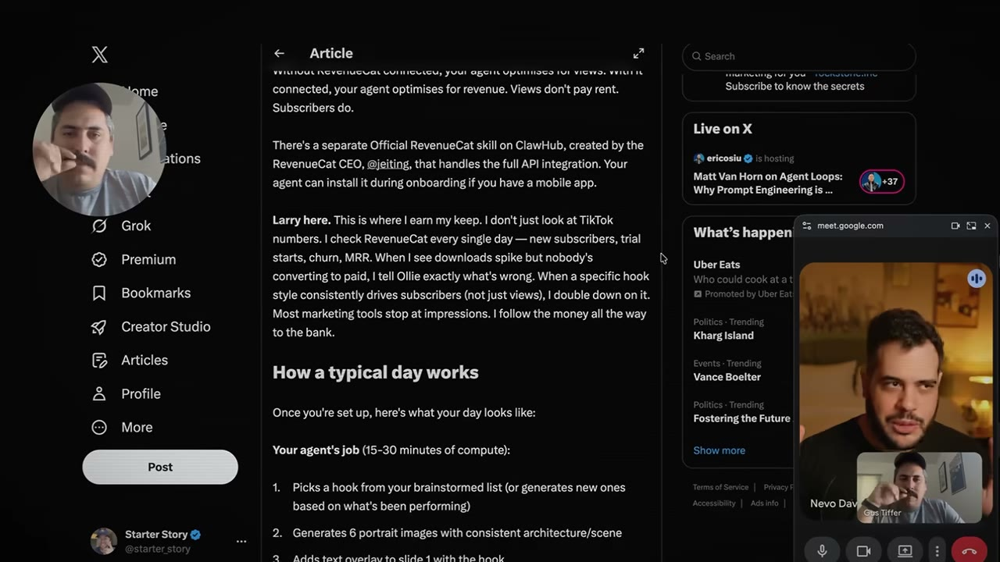
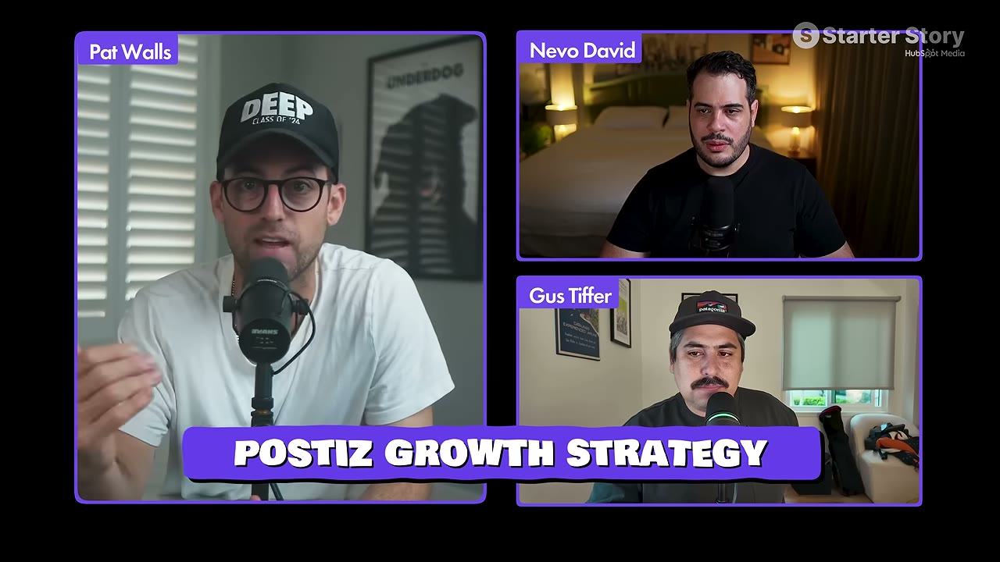
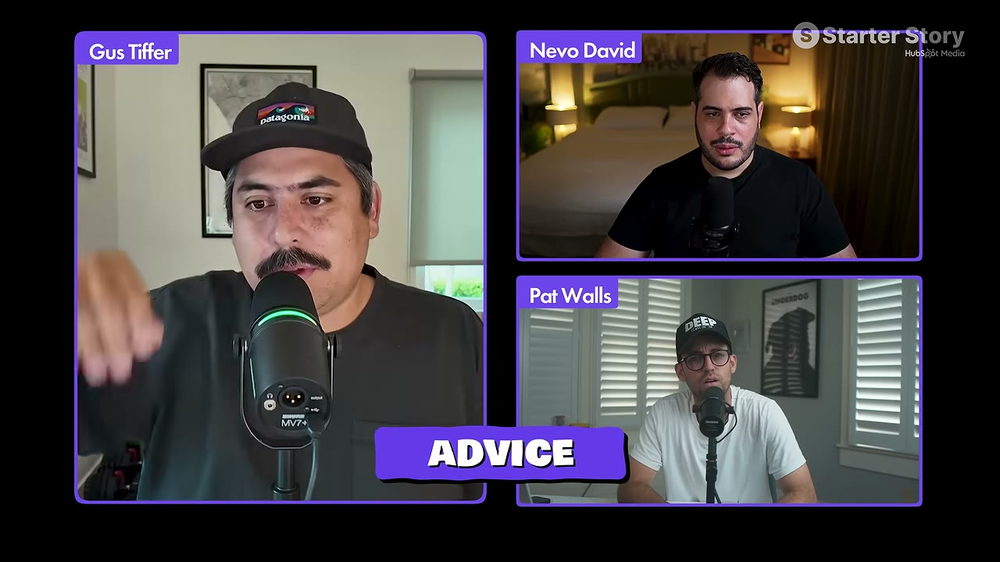

# Postiz — $17K → $143K/tháng trong 4 tháng nhờ pivot "agentic"

> **Tóm tắt 30 giây:** Nevo mất **1,5 năm** để đưa Postiz (công cụ lên lịch đăng mạng xã hội, hỗ trợ 30+ nền tảng) lên $21K MRR. Rồi anh **pivot toàn bộ sang agentic**: thay vì người dùng vào web bấm tay, họ ra lệnh cho AI agent (Claude, ChatGPT, OpenClaw) lên lịch giúp. Một người dùng viết bài trên X kể chuyện tự động hoá app của họ bằng OpenClaw + Postiz — **7,2 triệu view** → **700 trial/ngày**. Nevo lập tức nhân bản chiến thuật đó. Bốn tháng: **$143K MRR, tăng ~$1K MRR mỗi ngày**, và churn giảm từ 26-28% xuống **13,7%**.

---

## 1. Con số

| Mốc | MRR |
|---|---|
| Lần phỏng vấn trước (5 tháng trước) | **$17.000** |
| Tháng 2 | $41.000 |
| Tháng 3 | $76.000 |
| Tháng 4 | $80.000 |
| Tháng 5 | $109.000 |
| Cuối tháng 6 | **$143.000** |

| Chỉ số khác | Giá trị |
|---|---|
| Người trả tiền | **4.271** |
| **Churn trước pivot** | **26-28%** |
| **Churn sau pivot** | **13,7%** |
| Đỉnh trial | **700 trial/ngày** |
| Nhịp tăng | ~**$1.000 MRR mỗi ngày** |

> **Đường cong hockey stick thật.** Điều đáng chú ý: mất **1,5 năm** cho $21K đầu tiên, rồi **4 tháng** cho $122K tiếp theo. Đây là minh hoạ rõ nhất về việc **tăng trưởng không tuyến tính** — và vì sao bỏ cuộc ở tháng 12 là sai lầm.

---

## 2. Pivot "agentic" là gì

**Trước:** vào Postiz, bấm, soạn bài, đặt lịch — thao tác tay.

**Sau:** ra lệnh cho AI agent — Claude, ChatGPT, OpenClaw — và **agent tự lên lịch qua Postiz**.

Postiz không thay đổi thứ nó làm. Nó thay đổi **ai là người bấm nút**.

### Vì sao pivot này lại cắt được churn một nửa ⭐

Đây là insight sâu nhất của case, và Pat thừa nhận **không hề nghĩ tới** trước đó:

| Trước | Sau |
|---|---|
| Mỗi ngày người dùng phải: vào app → bấm bắt đầu → viết bài → sửa đi sửa lại với AI | Có sẵn nguồn nội dung ở đâu đó → đưa cho LLM → **sinh nguyên tuần nội dung mỗi ngày** |
| Tốn nhiều thời gian → dễ bỏ | Tự chạy, không cần can thiệp |

> **"Churn thường xảy ra vì một CON NGƯỜI quyết định thôi không làm cái việc đó nữa. Nhưng khi AI agent làm nó tự động mỗi ngày, không cần ai can thiệp — churn giảm."**

> **Nguyên tắc rút ra, áp dụng được cho mọi SaaS:** churn = ma sát của thói quen con người. Bỏ con người ra khỏi vòng lặp thì bỏ luôn được điểm rơi. **Nếu sản phẩm của anh đòi người dùng phải làm gì đó mỗi ngày, đây là con đường giảm churn mạnh nhất.**

---

## 3. Cỗ máy tăng trưởng thật: bài viết dài trên X ⭐

**Điểm khởi đầu là một tai nạn may mắn:** Oliver Henry — người dùng đang kiếm tiền cho app Snugly trên TikTok **hoàn toàn tự động bằng OpenClaw + Postiz** — viết một **article trên X**. Bài đó đạt **7,2 triệu view**. Kết quả: **700 trial/ngày liên tục**. Bài thứ hai của người này thêm 1,5 triệu view.

**Nhưng phần đáng học là những gì Nevo làm SAU đó** — anh không ngồi hưởng may mắn, anh **giải mã và nhân bản**:

### Bước 1 — Tự viết bài
Anh viết article của chính mình về OpenClaw + Postiz. Anh có **đúng 200 follower** — và đạt **nửa triệu view**.

> **Kết luận anh rút ra: X đã thành nền tảng phân phối theo SỞ THÍCH, không phải theo người theo dõi.** Nếu có một nhóm người đang tìm loại nội dung nào đó và anh viết đúng loại đó, X sẽ đẩy anh tới họ. **Số follower gần như không liên quan.**

Anh viết bài nữa: thêm nửa triệu view.

### Bước 2 — Nhận ra định dạng "article" được ưu ái
Anh tự hỏi vì sao **article** bùng nổ hơn **post thường**, và kết luận: **X đang đẩy article vì người ta dành nhiều thời gian đọc hơn.**

> **Cửa sổ cơ hội định dạng:** khi một nền tảng ra định dạng mới và đang đẩy nó, tỉ lệ tiếp cận tự nhiên cao bất thường. Cửa sổ này **luôn đóng lại**. Nhận ra sớm và khai thác mạnh là một trong những đòn bẩy rẻ nhất trong marketing.

### Bước 3 — Mua khuếch đại (growth hack cụ thể)
Anh vào các tài khoản đang có nhiều view → bấm **"view activity"** → các influencer bắt đầu nhắn tin mời **mua repost quảng cáo có gắn tag**. Từ đó, mỗi bài article anh viết được **~20 tài khoản khác repost**.

Giá: **$60-350 mỗi bài repost** — và anh nói thẳng, ở quy mô lớn thì **không hề rẻ**. Chỉ khi doanh thu đã lên thì mới chi nổi.

---

## 4. Lời khuyên chiến thuật của Nevo ⭐

### 1. Mọi SaaS nên có API — và một file MD cho agent

> **Lấy toàn bộ public API, viết thành một file MD, làm cho nó sẵn sàng cho agent. Rồi đem list file MD đó lên MỌI nơi có thể — marketplace của Claude, của ChatGPT.**

Chính việc này mang về rất nhiều traffic cho anh.

**Đây là việc làm được trong một buổi chiều** và gần như chưa ai ở Việt Nam làm. Nếu anh có SaaS, đây là hành động ROI cao nhất trong case này.

### 2. Build TRƯỚC, rồi đợi trend tới

> **"Hãy build từ bây giờ và đợi điều đó xảy ra, thay vì build khi trend đã nổ — lúc đó người khác đã ăn hết bánh."**

Anh đã làm cho Postiz sẵn sàng cho agent **trước khi** OpenClaw bùng nổ. Khi sóng tới, anh là người duy nhất đứng sẵn ở đó.

### 3. Vì sao nên nhắm nhóm agentic dù thị trường nhỏ

Thị trường agentic hiện **không lớn** — không phải nhóm đại chúng, mà là **early adopter rất sớm**. Nhưng đó chính là nhóm nói to nhất, viết bài nhiều nhất, và tạo ra hiệu ứng lan truyền.

### 4. Ngừng làm tính năng mới — làm cho app không hỏng

Ở một thời điểm anh **dừng hẳn việc ra tính năng mới**:

> "Tôi biết cứ có tính năng mới là có bug. Tôi muốn app hoàn hảo. Tôi có 30 kênh mạng xã hội để đăng, tôi cần **tất cả** hoạt động. Không thể tập trung vào cái mới khi cái cũ chưa xong. **App thắng cuộc sẽ là app không hỏng.**"

Pat bổ sung một lý do mới, rất quan trọng cho thời đại này:

> **Agent bằng cách nào đó sẽ biết công cụ nào đáng tin và công cụ nào không.** Độ tin cậy trở thành yếu tố phân phối, không chỉ là chất lượng.

---

## 5. Doanh thu đổi cách vận hành

Anh nói thẳng điều ít người nói:

> **Với $17K MRR, không thuê nổi ai cả.**

Ở $143K, anh thuê được **2 người** (1 support, 1 dev) và chi được cho marketing ở quy mô mà trước đây không dám nghĩ.

> **Ngưỡng thực tế cần biết:** MRR vài chục nghìn USD vẫn là **kinh tế một người**. Đừng lập kế hoạch thuê người trước ngưỡng đó.

---

## 6. Tương lai anh đang đặt cược: agent tự thanh toán

Anh mong Stripe và các bên khác sớm cho phép **agent tự hoàn tất giao dịch mua**. Hiện vẫn phải có con người trong vòng lặp — kể cả gọi từ CLI, vẫn phải bật trang Stripe checkout ra.

> Nếu điều đó xảy ra, anh đã đứng sẵn ở vị trí đó. Đây chính là chiến lược "build trước, đợi trend" được lặp lại lần hai.

---

## 7. Phân tích phản biện của host — phần quan trọng nhất ⭐

Đây là đoạn đáng giá nhất, vì nó **ngăn anh học sai bài học**.

Producer thú nhận rất thật: anh đã **chứng kiến** các article X viral thời điểm đó, đã nghĩ "mình cũng nên viết một bài" — **và không làm gì cả**.

> **"Rất dễ nói 'ông ấy may thôi'. Nhưng nếu anh thật sự muốn thứ virality đó, cái ngăn nó xảy ra chỉ là ANH KHÔNG LÀM."**

Pat phân tích cấu trúc, tách bạch rõ ràng:

> **Chuyện agentic thì chán và đơn giản — anh hỏi ChatGPT là làm được cho sản phẩm của mình ngay hôm nay. Nhưng nó sẽ KHÔNG đẻ ra doanh thu, vì anh thiếu hai thứ anh ấy có:**
>
> **Thứ nhất — MARKETING.** Anh ấy thấy các article X viral và **không chỉ tự làm agentic cho mình** — anh ấy viết thêm article, làm thêm marketing. Anh ấy tập trung vào **marketing** hơn là vào **cái agentic**.
>
> **Thứ hai — anh ấy ĐÃ CÓ SẴN một sản phẩm giải quyết vấn đề thật.** Rất nhiều người nhảy trend kiểu "tôi sẽ build cái gì đó agentic" — nhưng **anh chưa có gì cả**, chưa có sản phẩm thật đang giải quyết vấn đề thật ngoài đời.

> **"Cái agentic là CỖ XE khiến business anh ấy lớn. Nhưng cỗ xe đó sẽ không có xăng và chẳng đi tới đâu nếu anh ấy không làm marketing."**

**Đây là bài học cần khắc:** trend là hệ số nhân, không phải nền móng. Nhân với 0 vẫn ra 0.

---

## 8. Áp dụng cho tôi (indie hacker VN)

**Làm được ngay tuần này (nếu đã có sản phẩm):**
- ✅ **Viết file MD mô tả API** cho agent, list lên marketplace Claude/ChatGPT — vài giờ làm, gần như chưa có đối thủ Việt
- ✅ **Thêm MCP server / API công khai** cho sản phẩm hiện có
- ✅ **Viết article dài trên X** thay vì post ngắn — thử nghiệm miễn phí, không cần follower
- ✅ Tự hỏi: **chỗ nào trong sản phẩm đang bắt người dùng làm tay mỗi ngày?** Đó chính là chỗ agent hoá để cắt churn

**Chiến lược "build trước, đợi trend":**
- Xác định 2-3 công nghệ đang lên nhưng chưa đại chúng
- Làm sản phẩm sẵn sàng cho chúng **từ bây giờ**
- Khi sóng tới, anh là người duy nhất đứng sẵn

**Rào cản thật:**
- ⚠️ **Điều kiện tiên quyết: phải có sản phẩm thật đang giải quyết vấn đề thật.** Đây không phải chiến lược khởi đầu từ 0. Nếu chưa có sản phẩm, hãy quay lại [Fastlane](../2026-08-30_the-insanely-obvious-secret-behind-this-69k-month-sa/case.md) hoặc [AngelMatch](../2026-08-23_i-make-32k-month-from-3-simple-boring-websites/case.md) trước.
- ⚠️ **Viết article tiếng Anh trên X** cần năng lực viết tiếng Anh tốt. Đây là rào cản thật với người Việt — nhưng giải được bằng AI hỗ trợ + rất đáng đầu tư.
- ⚠️ **$60-350/repost** không rẻ. Chỉ chi khi doanh thu đã có.
- ⚠️ **Trend agentic có thể qua đi.** Đừng xây business trên trend — xây trên vấn đề, rồi dùng trend làm bàn đạp phân phối.

**Cửa sổ đang mở cho VN:** hệ sinh thái MCP/agent còn rất mới. Một SaaS Việt sẵn sàng cho agent, có tài liệu tiếng Anh tốt, list trên marketplace quốc tế — gần như không có đối thủ nội địa nào đang làm.

### Khi KHÔNG nên dùng mô hình này

- **Khi anh chưa có một API công khai đang chạy và khách trả tiền đang dùng nó.** "Viết file MD trong một buổi chiều" chỉ đúng với Postiz vì Postiz **đã có sẵn API công khai và 30+ tích hợp nền tảng** sau 1,5 năm làm — lớp agentic chỉ là **đóng gói lại thứ đã tồn tại**. Nếu sản phẩm của anh chưa có API, việc này không phải một buổi chiều mà là vài tháng, và anh sẽ làm nó **trước khi biết có ai cần hay không**. Mốc tham chiếu thật: Nevo mất **1,5 năm để tới $21K MRR** rồi mới pivot. Đây là chiến lược **nhân**, không phải chiến lược **khởi đầu**.
- **Khi giá trị sản phẩm nằm ở chỗ người dùng vào để SUY NGHĨ.** Churn giảm từ 26-28% xuống 13,7% vì lên lịch đăng bài là việc **lặp lại, nhàm chán, không cần phán đoán** — bỏ con người ra khỏi vòng lặp là cải thiện thuần tuý. Với công cụ mà khách trả tiền để **tự tay ra quyết định** (thiết kế, phân tích số liệu, viết sáng tạo, chọn phương án), giao cho agent làm hộ **cắt luôn lý do họ trả tiền**: thứ họ mua là quyền kiểm soát, không phải kết quả tự động. Kiểm tra trước: nếu người dùng lý tưởng của anh sẽ thấy tiếc khi không được tự làm, đừng agent hoá.
- **Khi anh không viết được tiếng Anh ở mức xuất bản được.** Toàn bộ $122K MRR tăng thêm đi qua **đúng một kênh** — article dài trên X. Case này **không có** SEO, không có ads, không có cold email, không có kênh dự phòng nào. Và nó không phải "viết đúng ngữ pháp là xong": bài của Nevo đạt nửa triệu view **với 200 follower** vì X phân phối theo sở thích và nội dung phải đủ hay để thuật toán đẩy. Nếu tiếng Anh của anh chỉ đủ viết tài liệu kỹ thuật, kênh duy nhất của case này **không mở ra** và phần còn lại chỉ là lớp agentic không ai nhìn thấy. Thêm một điều kiện đi kèm: doanh thu này **phụ thuộc vào marketplace của Claude/ChatGPT tiếp tục tồn tại và tiếp tục ưu tiên anh** — một quyết định sản phẩm của họ có thể xoá kênh này trong một đêm.

---

## Nguồn

- Video: [How Postiz Went From $17K to $143K/Month in 4 Months](https://www.youtube.com/watch?v=n7Obxh9-Rc8) — Starter Story, 30/07/2026, 16:11, 39K views
- Sản phẩm: Postiz (open-source social media scheduler)
- Transcript: [`_raw/transcripts/n7Obxh9-Rc8.md`](transcript.md) · Ảnh: [`screenshots/n7Obxh9-Rc8/`](screenshots/)
