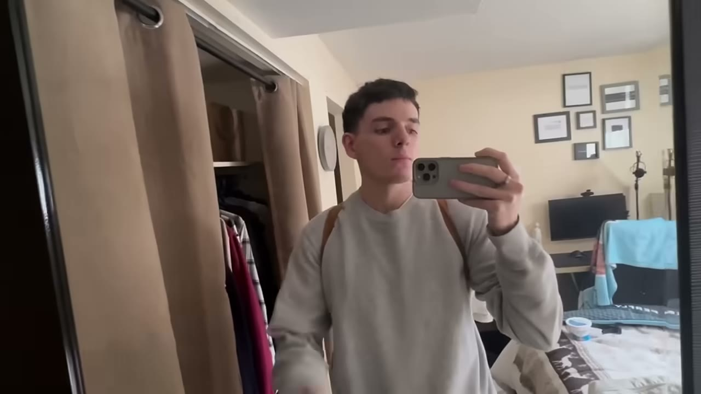
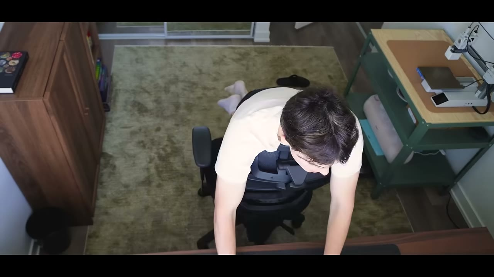

# Jack Friks — $40K/tháng, có tuần làm 4 tiếng, có tuần 40 tiếng

> ⚠️ **Video dạng "How I Work"** — không bóc tách sản phẩm, không show dashboard. Giá trị nằm ở **cách vận hành, cách chọn việc, và một đoạn rất thật về khủng hoảng tinh thần**.

> **Tóm tắt 30 giây:** Jack Friks kiếm **$40.000/tháng** một mình. Anh **không làm việc theo ngày mà theo đợt** — tuần ra mắt sản phẩm thì 10 tiếng/ngày, tuần bình thường thì 1-2 tiếng. Việc đầu tiên mỗi sáng luôn là **hỗ trợ khách hàng**, vì đó là thứ anh ghét nhất và cũng là thứ quan trọng nhất. Hai năm rưỡi trước, anh **suy sụp** khi app chững ở $3K/tháng — hai tháng sau nó chạm đỉnh $15K/tháng.



---

## 1. Nhịp làm việc

| Giờ | Việc |
|---|---|
| **7:00-8:00** | Dậy (không có giờ cố định, tuỳ hôm trước thế nào) |
| Ngay sau khi dậy | Đánh răng → **tập thể dục** → tắm → pha cà phê |
| **Việc đầu tiên trên bàn** | **Hỗ trợ khách hàng** |
| Sau đó | Đúng **MỘT** dự án trong ngày |
| **~17:00** | Đóng máy, nấu ăn, đi bộ, đạp xe, chơi thể thao, xem phim tới 21:00 |
| **~23:00** | Ngủ. **Luôn ngủ đủ 8 tiếng** |

### Vì sao hỗ trợ khách hàng luôn là việc đầu tiên ⭐

Hai lý do, và cả hai đều đáng học:

1. **Đó là thứ anh ghét nhất.** Và anh khó lờ đi một email khi đã nhìn thấy nó → làm cho xong sớm.
2. **Đó là thứ quan trọng nhất:**
> **"Nếu tôi trả lời khách hàng đang trả tiền, họ sẽ vui hơn nhiều. Tôi trả lời càng nhanh, sửa vấn đề càng nhanh — đó chính là cách tôi tăng trưởng được sản phẩm, làm nó tốt hơn, và rồi có thêm người dùng ở lại vì nó thật sự hữu ích."**

> **Đây là cách nói khác của bài học từ [Kleo](../2026-01-11_how-my-app-hit-60k-month-in-2-months/case.md): giữ chân khách nằm ở việc họ được hỗ trợ và hiểu sản phẩm, không nằm ở tính năng.**

**Về môi trường làm việc:** anh **không làm ở quán cà phê, không di chuyển**. Luôn cùng một chỗ, ghế tốt, bàn tốt, gọn gàng, không lộn xộn — để **không phải bận tâm về những thứ vặt vãnh trong môi trường**.

> Đối lập thú vị với [Rob Hallam](../2026-08-20_how-i-work-22k-month-solopreneur/case.md), người đi 13 nước. **Không có mô hình đúng — chỉ có mô hình phù hợp với từng người.**

---

## 2. Làm việc theo ĐỢT, không theo ngày ⭐

> **"Mỗi tuần tôi làm việc đều hoàn toàn khác nhau. Tôi làm theo SPRINT chứ không theo ngày. Có tuần tôi làm một hai tiếng mỗi ngày, có tuần tôi làm tám đến mười tiếng."**

**Tuần vừa ra mắt sản phẩm mới:** 10 tiếng/ngày, **quên cả ăn trưa** — vì anh đang thật sự vui và có cảm hứng. Có phản hồi liên tục, có vô số việc phải làm.

**Một hai tháng sau, khi mọi thứ ổn định:** quay về 1-2 tiếng/ngày.

**Và anh nói thẳng lý do thứ ba:** nếu trời đẹp, anh muốn ra ngoài chơi thể thao với vị hôn thê hoặc đi dạo. **Đó chính là lý do anh làm founder ngay từ đầu — để được chọn.**

### Quy tắc "một thứ mỗi ngày"

> **Ngoài phần hỗ trợ khách hàng, anh chỉ tập trung vào ĐÚNG MỘT dự án mỗi ngày.** Anh nói đã trao đổi với nhiều người khác và **tập trung vào hơn một thứ là rất khó** — đó là ranh giới anh vạch cho việc đa nhiệm.

**Cách chọn làm gì:** thứ anh thấy quan trọng nhất hôm đó, hoặc thứ anh **có cảm hứng** làm.
> **"Tôi là sếp của chính mình. Tôi được quyết định làm gì tiếp theo, vậy thì cũng nên làm cho nó vui. Không thì tôi đang làm cái gì vậy?"**



---

## 3. Đoạn thật nhất: lo âu và suy sụp ⭐

Đây là phần hiếm gặp trên kênh, và đáng đọc kỹ.

> Anh bị **đau đầu và lo âu suốt 2 năm** và **nó không dừng lại**. Anh không ngừng nghĩ *làm sao mình sống được? làm sao mình làm được chuyện này?*

> **Hai năm rưỡi trước, anh suy sụp một mùa hè. Anh khóc cùng vị hôn thê trên một buổi đi dạo và nghĩ mình sẽ không làm được.** Anh thật sự tin rằng mình **đã chạm trần ở $3.000/tháng** với app di động và không biết phải làm gì.

> **Hai tháng sau, mọi thứ đảo chiều hoàn toàn.** Anh tiếp tục làm và app chạm đỉnh **$15.000/tháng**. Từ đó nó cứ đi lên.

**Điều gì làm anh bình tâm lại:**
> Càng kiếm được nhiều tiền và càng thấy an toàn, anh càng **ít thấy cần phải chứng minh điều gì** — nên càng ít thấy cần phải làm việc nhiều. Bước ngoặt là khi **MRR vượt vài nghìn đô/tháng**: anh biết mình **sống được bằng nó**. Khi tiết kiệm tích luỹ thêm một năm nữa, mọi thứ mới thật sự dịu xuống.

> **Bài học quan trọng: cảm giác "tôi đã chạm trần" thường xuất hiện ngay trước bước nhảy.** Đây là dữ liệu thật để đối chiếu khi anh ở trong giai đoạn đó. Đối chiếu thêm với [Gaurabh](../2026-08-22_he-built-100-apps-and-made-0-can-he-fix-it-in-30-day/case.md) — phần lớn $6.500 rơi vào 30 ngày cuối, sau khi 30 ngày đầu chỉ có $99.

**Về ranh giới công việc — cũng rất thật:**
Anh nói mình dừng lúc 17:00, nhưng thừa nhận **không phải lúc nào cũng vậy**. Trong **hai năm đầu** của mối quan hệ, anh vừa nấu ăn vừa ôm máy tính, vừa xem phim vừa làm việc — **không phải thời gian chất lượng, và nó ngấm vào chất lượng mối quan hệ**. Anh mất **2 năm** mới đặt được một giờ dừng, và **tới giờ vẫn có lúc chật vật**.

---

## 4. Cách tìm ý tưởng — chuỗi sản phẩm nối nhau ⭐

Mọi ý tưởng của anh đều bắt đầu **cho chính mình**:

```
App di động đầu   ← anh muốn thấy nó tồn tại trên đời
                     hoá ra 100.000 người khác cũng muốn
        ↓  cần cách để tiếp tục tăng trưởng nó
Post Bridge       ← công cụ lên lịch mạng xã hội, làm để tự tăng trưởng app kia
                     → lớn gấp 10, gấp 100 lần app đầu
        ↓  bỏ app di động, dồn vào Post Bridge
App di động khác  ← làm để tự mình trở thành case study cho công cụ đó
```

> **"Mọi thứ đều xuất phát từ nhu cầu của chính tôi. Mỗi sản phẩm tôi làm là một thứ tôi muốn thấy tồn tại trên đời và tôi sẽ tự dùng."**

> **Mẫu hình đáng chú ý: công cụ anh làm để MARKETING cho sản phẩm chính lại lớn hơn sản phẩm chính 10-100 lần.** Giống hệt [AngelMatch](../2026-08-23_i-make-32k-month-from-3-simple-boring-websites/case.md) — business đầu thất bại nhưng công cụ tự chế để cứu nó lại thành công.

### Sai lầm anh thấy người khác hay mắc

> **Người ta cố làm thứ người khác đang làm.** Sản phẩm tương tự, ngách tương tự, vì người kia trúng lớn, người kia kiếm nhiều tiền — **nhưng nó không liên quan gì tới sự tò mò và mối quan tâm của chính họ.**
>
> **"Kể cả nếu đó là một ý tưởng tuyệt vời và có rất nhiều tiền trong đó, họ sẽ không thấy vui — và điều đó ngấm vào mọi thứ họ làm."**

Với anh, **thấy vui và đặt chính mình vào thứ mình chọn làm** là yếu tố quyết định anh có tiếp tục hay không — và **việc có tiếp tục hay không mới quyết định anh có người dùng và doanh thu hay không.**

### Cách anh đánh giá một ý tưởng — rất thực dụng ⭐

> **Anh không tự quyết định.** Anh dựng một landing page, đăng một TikTok, tung một thứ gì đó ra — và **người ta sẽ tự nói cho anh biết**, qua bình luận hoặc qua việc **vào trang rồi không bấm mua**.
>
> **Nếu 1.000 người vào mà không ai bấm mua, thì rõ ràng ý tưởng không tốt — hoặc ít nhất cách nó được trình bày là không tốt.**

**Và anh đổi câu hỏi — đây là phần hay nhất:**
> **Anh không tự hỏi "đây có phải ý tưởng hay không?". Anh hỏi: "làm sao trình bày cái này cho nó có giá trị? Nó có thật sự có giá trị không? Tôi có dùng nó không? Tôi có hình dung được ai đó dùng nó không? Nó có giúp người ta tiết kiệm thời gian, tiết kiệm tiền, hay đáp ứng một mong muốn cơ bản nào không?"**
>
> Nếu không → **ý tưởng có lẽ dở**.

> **Insight quan trọng: ý tưởng có thể rất tốt nhưng CÁCH TRÌNH BÀY dở thì vẫn không bán được.** Đây là lỗi phổ biến bị chẩn đoán nhầm thành "ý tưởng sai".

---

## 5. Lời khuyên cuối

> **"Hãy tìm con đường của riêng mình. Giữ sự tò mò và lạc quan về tương lai."**

Anh kể một thói quen nhỏ nhưng cụ thể: trong giai đoạn thử nhiều thứ không thành, anh **thu thập những hình ảnh truyền cảm hứng vào một thư mục trên máy tính** — mỗi lần thấy một hình khiến anh muốn tiếp tục, anh bỏ vào đó.

> **"Có rất nhiều cách để anh đạt được điều mình muốn. Và con đường tốt nhất cho anh thì hoàn toàn chưa biết — anh sẽ không biết cái gì hợp với mình cho tới khi anh thử và thí nghiệm."**

---

## 6. Cảnh báo thiên kiến nguồn

**Không có ảnh chụp doanh thu, và không ai hỏi.** Con số $40.000/tháng được nói **đúng một lần**, ở câu thứ hai của video (00:15), rồi không bao giờ được nhắc lại, bóc tách, hay chứng minh. Đây là video dạng "How I Work" — **không có host phỏng vấn, không có ai phản biện**, toàn bộ là founder tự kể trên nền b-roll. Ngay cả tiêu chuẩn "cho tôi xem Stripe" vốn có ở các case phỏng vấn của kênh cũng **không áp dụng ở định dạng này**.

**Một mâu thuẫn số học chưa được giải thích:** anh kể app di động đầu tiên đỉnh điểm **$15.000/tháng**, rồi nói công cụ lên lịch (Post Bridge) *"lớn gấp 10, gấp 100 lần"* app đó. Gấp 10 lần $15K là **$150K/tháng** — trong khi tổng doanh thu anh công bố chỉ là **$40K**. Hoặc "gấp 10-100 lần" là nói về người dùng/tiềm năng chứ không phải doanh thu, hoặc một trong hai con số sai. **Video không làm rõ**, và cũng không nói $40K là **doanh thu** hay **lợi nhuận** — với một công cụ tích hợp 30+ nền tảng mạng xã hội, chi phí hạ tầng và API không phải con số nhỏ.

**Không có ad chèn giữa — nhưng có phễu trong mô tả.** Khác hầu hết video Starter Story, transcript 10 phút này **không chứa đoạn quảng cáo nào**. Tuy nhiên mô tả video vẫn gắn *"Get our free $1M Solopreneur MVP guide"* qua link `clickhubspot.com/dg4j` — **link tracking HubSpot**, tức vẫn là phễu thu lead có đối tác thương mại, chỉ là không đọc thành lời. Ghi nhận điểm cộng cho định dạng này: nội dung không bị cắt ngang để bán hàng.

**Bối cảnh bị làm mờ — lớn nhất: cách anh có khách hàng hoàn toàn vắng mặt.** Trong 10 phút, anh mô tả kỹ lịch ngủ, lịch tập, chỗ ngồi, giờ ăn tối — nhưng **không một câu nào** về việc người dùng đến từ đâu. Thực tế Jack Friks xây dựng khán giả qua **build in public trên X suốt nhiều năm**, và đó chính là thứ khiến "làm 4 tiếng/tuần" khả thi. Nhịp làm việc nhàn nhã là **kết quả của một tài sản phân phối đã có**, nhưng video trình bày nó như **nguyên nhân của thành công**. Đây là kiểu đảo chiều nhân quả nguy hiểm nhất trong thể loại "How I Work".

**Câu chuyện $3K → $15K không có cơ chế.** Đoạn cảm động nhất của video — suy sụp ở $3K/tháng, hai tháng sau lên $15K — được kể **không kèm bất kỳ lời giải thích nào về điều gì đã thay đổi**. Anh chỉ nói *"I kept working on it"*. "Tiếp tục làm" không phải một cơ chế, và bài học rút ra ("cảm giác chạm trần xuất hiện ngay trước bước nhảy") được suy ra từ **một mẫu duy nhất, do chính người sống sót kể lại**. Vô số người cũng "tiếp tục làm" ở $3K và ở nguyên đó — nhưng họ không được mời lên kênh. Hãy đọc đoạn này như **an ủi**, không phải như **dự báo**.

**Thiếu gần như toàn bộ số liệu vận hành:** không có **giá bán**, không có **số người trả tiền**, không có **churn**, không có **chi phí**, không có **CAC**, không có **kênh phân phối**, không có **timeline** (frontmatter ghi `started: không nêu` — đúng như vậy). Đây là video về **lối sống**, không phải về **mô hình kinh doanh**, và nên được lưu trong knowledge base đúng theo tư cách đó.

> 📄 **Về chất lượng transcript:** đây là auto-caption YouTube và nhận dạng tên riêng khá tệ — ở 00:15 máy nghe tên anh thành "Jack Butcher" (một người hoàn toàn khác), Post Bridge thành "Post Ridge", Curiosity Quench thành "curiosity quenched". Đừng trích dẫn tên riêng từ transcript mà không đối chiếu.

---

## 7. Áp dụng cho tôi (indie hacker VN)

**Lấy được gì:**
- ✅ **Làm hỗ trợ khách hàng ĐẦU TIÊN mỗi ngày** — vừa xử lý việc khó chịu sớm, vừa là đòn bẩy giữ chân lớn nhất
- ✅ **Làm theo đợt, không theo ngày.** Tuần ra mắt thì dồn sức; tuần bình thường thì nhẹ. Đừng ép mình một nhịp cố định.
- ✅ **Một dự án mỗi ngày**, ngoài việc hỗ trợ khách
- ✅ **Đổi câu hỏi khi đánh giá ý tưởng:** không hỏi *"ý tưởng này hay không?"* mà hỏi *"làm sao trình bày để nó có giá trị? nó tiết kiệm thời gian/tiền cho ai?"*
- ✅ **Để thị trường trả lời thay mình:** landing page + một bài đăng. 1.000 người vào không ai mua = có câu trả lời.
- ✅ **Đặt một giờ dừng cố định.** Anh mất 2 năm mới làm được, và nó ảnh hưởng thật tới mối quan hệ.

**Điều đáng nhớ nhất cho người Việt đang vừa đi làm vừa build:**
> Đoạn anh kể về **hai năm đau đầu và lo âu**, và **suy sụp khi tưởng mình chạm trần ở $3K/tháng** — rồi hai tháng sau lên $15K. Đây là dữ liệu quý: **cảm giác đã hết đường thường xuất hiện ngay trước bước nhảy.**

**Giới hạn của case:**
- ⚠️ Không có bài học về ý tưởng cụ thể, validate có hệ thống, hay go-to-market
- ⚠️ Không show dashboard — con số theo lời kể
- ⚠️ Nhịp "4 tiếng/tuần" chỉ khả thi **sau khi** sản phẩm đã chạy. Giai đoạn đầu anh làm rất nhiều và trả giá bằng sức khoẻ tinh thần.

### Khi KHÔNG nên dùng mô hình này

- **Khi anh chưa có MRR đủ sống.** Toàn bộ lịch làm việc trong case này là **phần thưởng**, không phải **con đường**. Chính anh vạch mốc: bước ngoặt là khi **MRR vượt vài nghìn đô/tháng**, và anh chỉ thật sự dịu xuống sau **thêm một năm tích luỹ tiết kiệm**. Trước mốc đó là **2 năm đau đầu và lo âu không dứt** cộng một mùa hè suy sụp. Copy nhịp "một hai tiếng mỗi ngày, làm cái gì thấy hứng" khi đang ở $0 là copy kết quả của người khác và bỏ qua chi phí họ đã trả. Ở giai đoạn 0 → vài nghìn đô, mô hình đúng là các case có playbook cụ thể ([Go Tall](../2026-07-19_this-stupidly-simple-app-makes-100k-month/case.md) 10 video/ngày trong 30 ngày), không phải case này.
- **Khi anh chưa có lưu lượng để đọc tín hiệu.** Phương pháp validate của anh — *"dựng landing page, đăng một TikTok, nếu 1.000 người vào mà không ai bấm mua thì ý tưởng dở"* — **giả định sẵn rằng 1.000 người sẽ vào**. Với tài khoản 0 follower, landing page nhận 12 lượt truy cập và anh không học được gì: **"không ai mua" và "không ai biết" trông giống hệt nhau**, nhưng cách xử lý hai tình huống đó ngược nhau hoàn toàn. Bộ lọc này chỉ chạy được khi đã có kênh phân phối — thứ Jack có sau nhiều năm build in public và video **không hề nhắc tới**.
- **Khi khách hàng mục tiêu của anh không phải chính anh.** Cả chuỗi sản phẩm của anh xuất phát từ một nguyên tắc duy nhất: *"mọi thứ đều xuất phát từ nhu cầu của chính tôi"*. Mô hình này **không có bất kỳ cơ chế nào để tìm hiểu vấn đề của người khác** — không phỏng vấn khách, không nghiên cứu thị trường, không đọc review đối thủ. Nếu anh muốn làm phần mềm cho phòng khám, sân golf, hay chủ tiệm tạp hoá — những nhóm anh không thuộc về — làm theo cách này nghĩa là **tự nghĩ ra vấn đề tưởng tượng rồi build nó**. Đối chiếu [Live Tourney](../2026-07-15_i-quit-my-job-at-meta-to-build-a-30k-month-saas/case.md): Matt thành công vì anh **là** người chơi golf trong giải đấu đó; [Gaurabh](../2026-08-22_he-built-100-apps-and-made-0-can-he-fix-it-in-30-day/case.md) thất bại 100 lần vì làm cho nhóm anh không thuộc về.

---

## Nguồn

- Video: [How I Work: $40K/Month Solo App Builder](https://www.youtube.com/watch?v=k-aEdS28AH0) — Starter Story, 02/08/2026, 10:00, 60K views
- Founder: Jack Friks (Post Bridge)
- [`transcript.md`](transcript.md) · [`screenshots/`](screenshots/)
