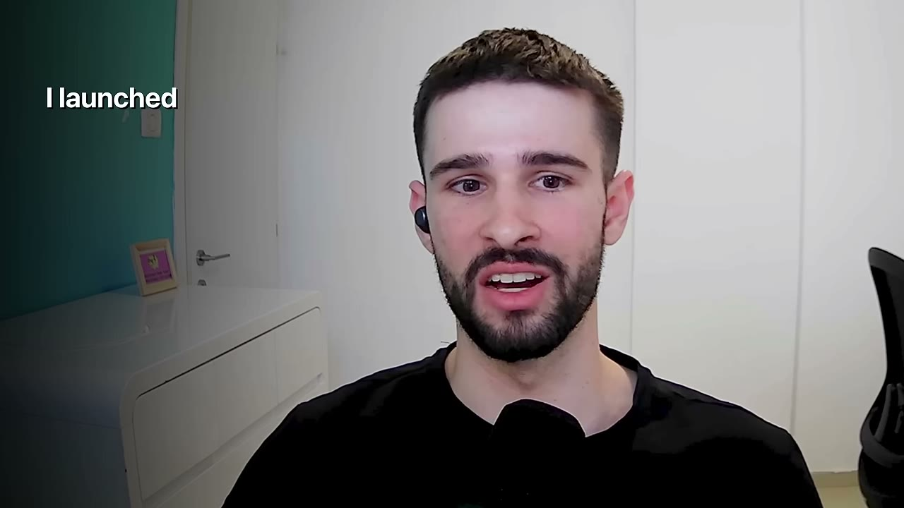
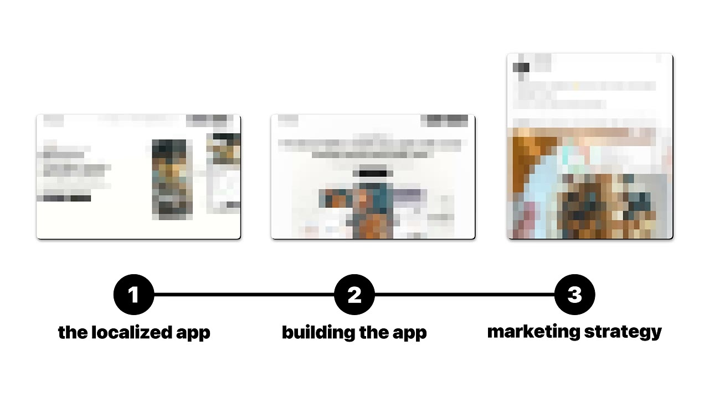
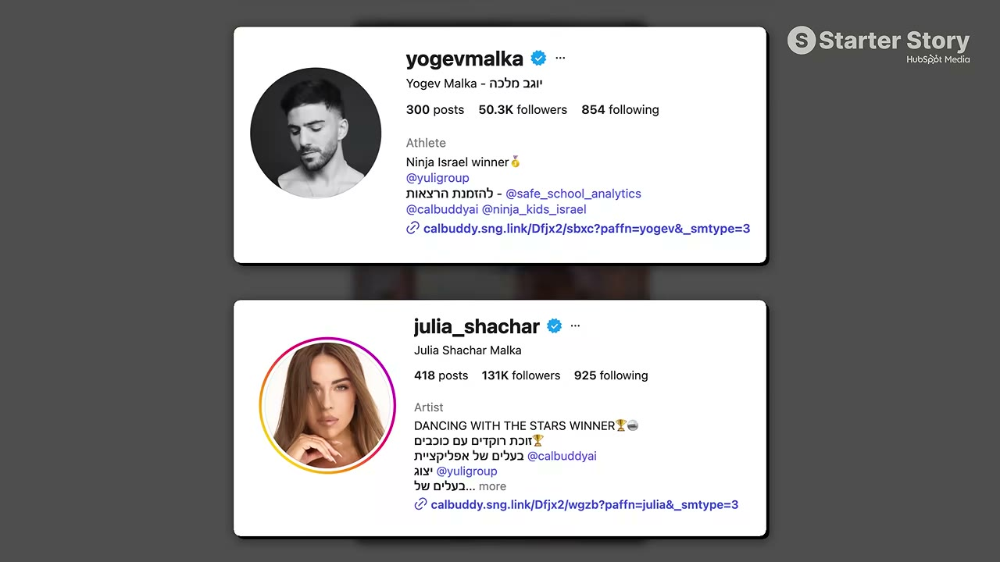
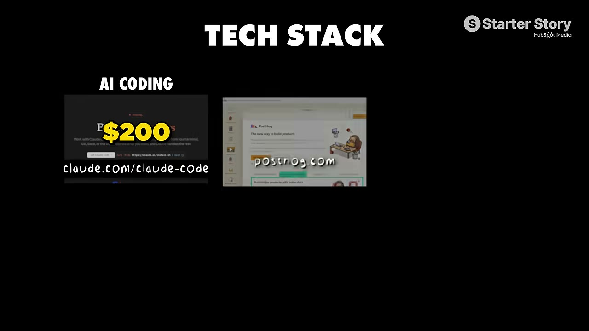

# I Copied A Huge App. Now I Make $80K/Month

✅ **Đã phân tích sâu** → [`case.md`](case.md)

| | |
|---|---|
| **Video** | <https://www.youtube.com/watch?v=GQ27QVp3SzQ> |
| **Đăng** | 09/08/2026 |
| **Thời lượng** | 13:45 |
| **Lượt xem** | 65,931 |
| **Lượt thích** | 2,005 |
| **Video ID** | `GQ27QVp3SzQ` |

## Trong thư mục này

| File | Nội dung |
|---|---|
| [`case.md`](case.md) | **Phân tích đầy đủ** — ý tưởng, validate, GTM, áp dụng ở VN |
| [`meta.json`](meta.json) | Metadata gốc (chapters, heatmap, mô tả) |
| [`screenshots/`](screenshots/) | 10 ảnh 720p |

## Mô tả gốc

Tomer took one of the most successful apps in the world and built it for his local market. Today, just 12 months after launching, he's already doing over $80K/month. 
This video breaks down his playbook for reverse-engineering a proven app idea and building your own. 
0:00 - You don’t need an original idea
1:04 - What’s your story?
1:38 - What’s the app?
2:15 - Founder background
3:03 - Build process
4:01 - Finding the app idea
4:43 - More app ideas!
5:32 - App differentiation 
6:40 - Growth and marketing
8:00 - Influencer strategy
9:05 - Partnership breakdown
9:54 - Tech stack
10:24 - Final a

## Số liệu bắt được từ transcript

> Các đoạn founder nhắc tới con số, kèm timestamp để tua thẳng tới đó trong video.

_(không bắt được con số nào)_

## Chương

- `00:00` You don’t need an original idea
- `01:04` What’s your story?
- `01:38` What’s the app?
- `02:15` Founder background
- `03:03` Build process
- `04:01` Finding the app idea
- `04:43` More app ideas!
- `05:32` App differentiation
- `06:40` Growth and marketing
- `08:00` Influencer strategy
- `09:05` Partnership breakdown
- `09:54` Tech stack
- `10:24` Final advice
- `11:05` Pat and Gus reflections: you don’t need a new idea!

## Ảnh

1. `01_00m15s_ch-you-don-t-need-an-original-idea.jpg` — 
2. `02_00m51s_usd-80-000.jpg` — 
3. `03_02m23s_usd-80-000.jpg` — 
4. `04_03m15s_ch-build-process.jpg` — 
5. `05_04m13s_ch-finding-the-app-idea.jpg` — 
6. `06_04m55s_ch-more-app-ideas.jpg` — 
7. `07_05m44s_ch-app-differentiation.jpg` — 
8. `08_07m13s_replay.jpg` — 
9. `09_07m54s_replay.jpg` — 
10. `10_10m10s_usd-200.jpg` — 

---

← [Quay lại index](../../index.md) · [Toàn bộ video](../README.md)
