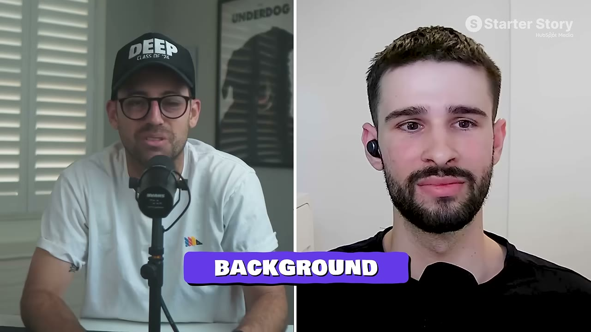
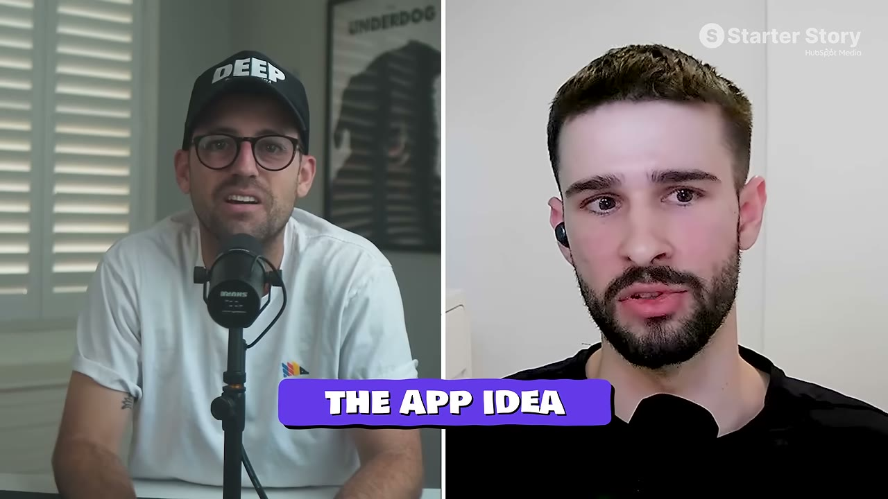
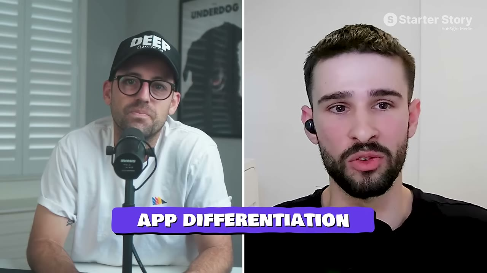
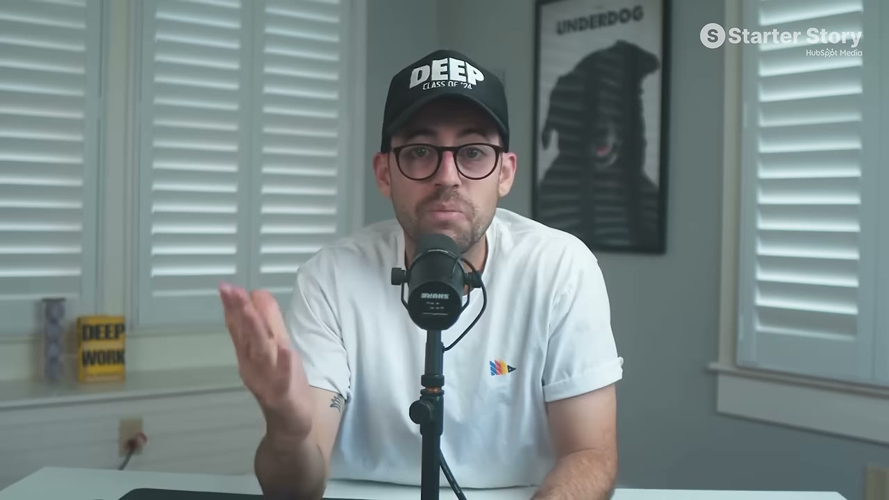

# CalBuddy — $81K/tháng bằng cách bản địa hoá một app đã thành công

> **Tóm tắt 30 giây:** Tomer làm marketing thuê, chán việc quảng bá sản phẩm của người khác. Anh nghe podcast về Cal AI (app đếm calo bằng ảnh, $1M+/tháng ở Mỹ) và nhận ra một điều đơn giản: **app đã tồn tại không quan trọng, nếu ở thị trường của tôi chưa ai biết đến nó.** Anh dùng Cursor build lại trong **2 tuần** dù không phải developer, ra mắt bản **tiếng Hebrew cho thị trường Israel**. Tháng đầu $1.000. Bốn tháng sau $20K nhờ paid ads (CPM nội địa rẻ hơn Mỹ rất nhiều). Rồi ký **chia doanh thu với influencer lớn** → **$81K/tháng**.



---

## 1. Vì sao đây là case quan trọng nhất cho người Việt

Đây là **chiến lược có tỉ lệ ăn cao nhất** trong toàn bộ knowledge base đối với một founder ngoài Mỹ. Nó không đòi hỏi ý tưởng mới, không đòi hỏi kỹ thuật cao, và có sẵn bằng chứng nhu cầu.

**Công thức:**
```
App đã kiếm tiền thật ở Mỹ
  + ngách đủ LỚN để sống được ở thị trường nhỏ
  + bản địa hoá ngôn ngữ & thói quen
  + CPM quảng cáo nội địa rẻ
  = lợi thế người đi trước ở một thị trường chưa ai phục vụ
```

| Giai đoạn | Thời gian | Doanh thu |
|---|---|---|
| Launch | 06/2025 | **$1.000** |
| Paid ads chạy đều | +4 tháng | **$20.000/tháng** |
| Ký rev-share với influencer | 04/2026 | **$81.000/tháng** |

---

## 2. Ý tưởng đến từ đâu

Tháng 3/2025 anh **đang chủ động đi tìm ý tưởng**. Nghe podcast của founder Cal AI kể chuyện scale lên hơn $1 triệu/tháng. Cú click xảy ra ngay lúc đó:

> **Việc app đã tồn tại không quan trọng — nếu ở thị trường nội địa của tôi chưa ai biết tới nó.**

Kế hoạch ban đầu của anh là làm gì đó lớn cho thị trường Mỹ. Nhưng anh nhìn ra: **lấy một sản phẩm đã được chứng minh và là người đầu tiên bản địa hoá nó là nước đi từ 0 lên 1 đơn giản nhất.**

> **App gốc mà anh sao chép có case riêng trong knowledge base:** [Cal AI](../2026-08-16_i-spent-24-hours-with-ios-millionaires/case.md) — đọc song song hai case này cho thấy rõ **hai vai trò khác nhau trong cùng một thị trường**: người tạo danh mục ở thị trường lớn, và người chiếm ngôn ngữ bị bỏ trống. Vai trò thứ hai rẻ hơn nhiều nhưng cũng có **trần thấp hơn nhiều** — Cal AI làm $1M+/tháng, CalBuddy làm $81K.

### Quy tắc chọn ngách — điều kiện bắt buộc ⭐

> **Nếu bản địa hoá cho một thị trường nhỏ, ngách phải RẤT LỚN. Thị trường đã nhỏ rồi thì không được chọn thêm một vertical hẹp.**

Fitness và dinh dưỡng là một trong những ngách lớn nhất thế giới — và anh **vốn hiểu rất rõ ngách này**. Khớp hoàn hảo.

**Áp dụng cho VN:** Việt Nam ~100 triệu dân, lớn hơn Israel (~10 triệu) nhiều. Nhưng nguyên tắc vẫn đúng: chọn ngách phổ quát (sức khoẻ, tài chính cá nhân, học tập, làm đẹp, nuôi con), không chọn ngách hẹp.



---

## 3. Build — 2 tuần code, 2 tháng lên store

Anh **không phải developer** (chỉ biết chút code từ hồi phổ thông và tự học). Cursor vừa ra mắt, anh muốn thử xem AI có thật sự làm được "phép màu" không.

- **2 tuần** sau khi bắt đầu: đã có bản chạy được với đầy đủ tính năng chính
- **~2 tháng** từ dòng code đầu tới khi live trên App Store

> **Điểm gây bất ngờ: code KHÔNG phải phần chậm nhất.** Thứ ngốn thời gian là **chờ Apple duyệt Developer Program và vượt qua App Store review.**

Pat khuyên thẳng: nếu đang build, **ship sang Apple sớm nhất có thể** — sẽ mất thêm cả tháng qua lại với họ.

**Việc cần làm ngay nếu anh định làm app iOS:** đăng ký Apple Developer Program **ngay hôm nay**, đừng đợi code xong.

---

## 4. Khác biệt hoá — bài học sâu nhất của case ⭐

Anh nói rất thẳng: sản phẩm **không phải bản sao 1:1**, nhưng lõi thì gần như y hệt — chĩa camera vào món ăn, nhận calo và macro.

Khác biệt về sản phẩm chỉ là: **ngôn ngữ Hebrew** + một loạt điều chỉnh nhỏ cho **cách người Israel thực sự ăn và nói về đồ ăn**.

**Nhưng khác biệt thật sự nằm ở chỗ khác — và anh muốn nói rõ vì cho rằng đa số builder đang bỏ lỡ:**

> **Khác biệt thật sự là THƯƠNG HIỆU và PHÂN PHỐI.**
>
> "Ai cũng build được app bằng Cursor trong 2 tuần. Nhưng nếu tôi mua được một user với **nửa chi phí** đối thủ phải trả, tôi có nhiều dòng tiền hơn họ — và nhiều dòng tiền nghĩa là tôi **chi nhiều hơn họ cho tăng trưởng**."

> **Đây là câu đáng nhớ nhất case này.** Trong thời đại ai cũng build được, **lợi thế cạnh tranh không nằm ở sản phẩm mà nằm ở chi phí thu hút khách hàng.** Bản địa hoá chính là cách hạ CAC — vì anh cạnh tranh ở một sân không ai đấu.

Pat so sánh rất chuẩn: cũng như **thợ sửa ống nước ở Mỹ và ở Israel là hai nghề khác nhau**, dù cùng tên gọi.



---

## 5. Go-to-market — hai chặng

### Chặng 1: Paid ads → $20K/tháng trong 4 tháng

Lợi thế lớn nhất của anh là **nền tảng marketing**. Quan điểm của anh:

> **Kênh nào cũng chạy được — influencer, paid ads, SEO. Câu hỏi đúng là: kênh nào HIỆU QUẢ NHẤT cho thị trường cụ thể của bạn.**

Anh chọn paid ads vì lý do rất cụ thể: **CPM ở Israel thấp hơn Mỹ rất nhiều** → chạy có lãi mà **không cần đốt nhiều vốn để test**.

**Cách làm creative — sao chép được ngay:**
1. Nghiên cứu **nội dung viral nhất của các app tương tự ở Mỹ**
2. Nghiên cứu **nội dung fitness/dinh dưỡng viral nhất ở Israel**
3. Ghép hai nguồn đó lại để làm creative

> Đây là **arbitrage nội dung**: lấy format đã được chứng minh ở thị trường trưởng thành, ghép với ngữ cảnh văn hoá bản địa. **Không cần sáng tạo từ đầu.**

**Áp dụng cho VN:** CPM Việt Nam thuộc nhóm rẻ nhất khu vực. Cùng logic đó áp dụng thẳng được.

> **Hai founder độc lập xác nhận cùng một điều:** [Timo / Chart Detector AI](../2026-07-23_i-make-50k-per-month-working-5-hours-a-week/case.md) nói gần như nguyên văn — *"rất nhiều người muốn chạy quảng cáo ở Mỹ trước, nhưng khi chúng tôi test ở các quốc gia khác, ROI tốt hơn nhiều."* Tomer và Timo không biết nhau, làm hai ngách khác nhau, và cùng đi đến một kết luận. **Điều kiện phân định giữa hai case:** Timo dùng CPM rẻ để bán **sản phẩm tiếng Anh** cho nhiều nước; Tomer dùng CPM rẻ để bán **sản phẩm tiếng bản địa** cho một nước. Hướng của Timo mở rộng dễ hơn; hướng của Tomer có hào bảo vệ tốt hơn.

### Chặng 2: Rev-share với influencer → $81K/tháng ⭐

Anh **luôn biết trước** rằng khi có traction và social proof, anh sẽ bắt tay với influencer để xây thương hiệu khó sao chép.

**Vấn đề:** influencer lớn đòi giá cắt cổ cho **một** story hoặc reel.

**Giải pháp — chỗ khôn ngoan nhất:** thay vì trả theo bài đăng, anh **hợp tác chia phần trăm doanh thu**.

| Trả theo bài đăng | Chia doanh thu |
|---|---|
| Chi phí cố định, rủi ro dồn về mình | Lợi ích **cùng chiều** |
| Họ đăng đúng số bài đã trả tiền rồi thôi | Họ **càng làm mình kiếm nhiều, họ càng kiếm nhiều** |
| Không có gương mặt đại diện | Có **gương mặt nổi tiếng gắn với app** |

Pat chỉ ra điểm cộng ẩn: vì họ **có phần trong cuộc chơi**, họ sẽ nhắc tới app **ngoài phạm vi bài đã trả tiền** — trên talkshow, trong phỏng vấn ở nơi khác.

**Cách kiểm soát rủi ro — chi tiết vận hành quan trọng:**

> Hợp đồng phải ràng theo **mốc thời gian công việc**: quy định rõ **bao nhiêu nội dung phải giao** và **bao nhiêu ngày quay/thu mỗi tháng**.

**Và điều kiện quan trọng nhất về thời điểm:**

> **Phải có social proof và chứng minh app đang chạy TRƯỚC khi tiếp cận influencer lớn.**

Anh giải thích rất thực tế: chính vì **đợi đến khi đạt $20K/tháng** mới đi đàm phán, anh mới **thương lượng được điều khoản tốt hơn nhiều** — thay vì phải chia 50/50 nếu tiếp cận từ đầu.

> **Bài học về đòn bẩy đàm phán:** traction chính là quyền thương lượng. Mỗi tháng anh tự đẩy doanh thu lên trước khi gọi influencer là mỗi tháng anh giữ lại được nhiều phần trăm hơn — vĩnh viễn.

Anh cũng thừa nhận một phần may mắn: anh **hiểu rất rõ ngách fitness ở Israel** và **quen sẵn người** đã ký hợp đồng.

---

## 6. Tech stack — $355/tháng

| Công cụ | Vai trò | Chi phí |
|---|---|---|
| **Claude** | Viết code + AI agent cho toàn business | $200/tháng |
| **Expo** | Cập nhật in-app | $100/tháng |
| **Supabase** | Database + storage | $35/tháng |
| **PostHog** | Product analytics | $20/tháng |
| **RevenueCat** | Quản lý subscription | — |
| **Cursor** | Công cụ build ban đầu | — |

---

## 7. Lời khuyên cuối

> **"Đừng sợ những gì mình chưa biết.** Phải có đủ tự tin rằng bất cứ thứ gì ập tới, mình cũng sẽ tìm ra cách. Luôn có trở ngại và thứ mới phải học, có cái nhìn rất phức tạp và đáng sợ — nhưng **anh tuyệt đối không được để bản thân trở thành nút thắt cổ chai của doanh nghiệp.**"

---

## 8. Cơ hội chung mà host chỉ ra ⭐

Producer chốt bài học chính: **không cần ý tưởng mới. Đừng nghĩ đây là ăn cắp — hãy hiểu là không cần phát minh lại bánh xe.**

Pat bổ sung hai điểm mở ra cơ hội:

1. **Nhiều thị trường quốc gia vẫn còn bỏ trống.** Anh dẫn chuyện nhiều founder khác cũng chạy ads ở thị trường ngoài Mỹ trước (ví dụ Argentina) vì **chỉ số tốt hơn**.
2. **Vấn đề mới liên tục xuất hiện.** Cal AI là ví dụ: AI xuất hiện → có API quét ảnh món ăn cho kết quả khá chính xác → một danh mục app mới ra đời.

> Gus lưu ý: App Store có **hàng trăm, hàng nghìn** app đếm calo và fitness. Anh đã dùng cả chục cái mà **không hề nghĩ chúng là bản sao của nhau.** Đây là bằng chứng thị trường còn thừa chỗ.

> **Xác nhận từ một case độc lập:** Michael của [Go Tall](../2026-07-19_this-stupidly-simple-app-makes-100k-month/case.md) nói đúng hiện tượng này — *"vẫn còn app đếm calo kiếm $30K/tháng trong khi đã có Cal AI, điều đó với tôi hoàn toàn vô lý"* — và anh dùng chính quan sát đó làm lý do để build. Ba case (Cal AI, CalBuddy, Go Tall) cùng chỉ về một kết luận: **thị trường đã có người dẫn đầu không phải là thị trường đã đóng.**
>
> ⚠️ **Nhưng có một case nói ngược hẳn:** Sarah của [Stella](../2026-07-12_she-built-this-340k-month-app-in-60-days/case.md) cho rằng *"ngành app có quá nhiều copy-paste"* và điều làm cô thắng là **phát minh thứ chưa tồn tại**. **Điều kiện phân định là phân phối:** cô có 4 triệu follower nên tự tạo được nhu cầu cho một danh mục mới; Tomer không có, nên anh cần một danh mục **đã được chứng minh có người trả tiền** rồi mới đổ ads vào. Nếu anh không có khán giả sẵn, lời khuyên "hãy phát minh" là lời khuyên đắt nhất anh có thể nghe theo.



---

## 9. Áp dụng cho tôi (indie hacker VN) — kế hoạch cụ thể

**Đây là chiến lược tôi khuyến nghị anh cân nhắc nghiêm túc nhất.** Việt Nam có đúng mọi điều kiện Israel có, ở quy mô lớn hơn 10 lần dân số.

**Quy trình 6 bước:**

| Bước | Việc làm |
|---|---|
| **1** | Lập danh sách app đang kiếm **$100K+/tháng ở Mỹ** trong các ngách phổ quát (dinh dưỡng, gym, tài chính cá nhân, học ngoại ngữ, làm đẹp, nuôi con, giấc ngủ) |
| **2** | Kiểm tra App Store VN: **đã có bản tiếng Việt tử tế chưa?** Chưa có = cửa sổ đang mở |
| **3** | Kiểm tra ngách có **đủ lớn** ở VN không (quy tắc bắt buộc của Tomer) |
| **4** | Build bằng Cursor/Claude Code. **Đăng ký Apple Developer ngay hôm nay** — đó mới là đường găng |
| **5** | Bản địa hoá **thật sự**: không chỉ dịch. Món ăn Việt, đơn vị đo, cách người Việt nói về vấn đề đó, thanh toán nội địa |
| **6** | Chạy ads (CPM VN rẻ) → đạt traction → **rồi mới** đàm phán rev-share với KOL |

**Lợi thế riêng của VN:**
- ✅ CPM Facebook/TikTok Việt Nam rất rẻ so với Mỹ
- ✅ Hệ sinh thái KOC/KOL dày, quen với mô hình chia hoa hồng
- ✅ Dữ liệu bản địa (món ăn Việt) là **hào bảo vệ thật** — app Mỹ khó và không muốn làm
- ✅ Có thể mở rộng sang thị trường Đông Nam Á tương tự sau đó

**Rào cản thật:**
- ⚠️ **ARPU Việt Nam thấp hơn Israel nhiều.** Israel có GDP/người ~$55K, Việt Nam ~$4,5K. Giá subscription phải khác hẳn → cần lượng user lớn hơn nhiều cho cùng doanh thu. **Đây là điểm khác biệt nghiêm trọng nhất, đừng bỏ qua.**
- ⚠️ Cần thanh toán nội địa (Momo, ZaloPay, thẻ nội địa), không chỉ App Store
- ⚠️ Cạnh tranh giá với app free có quảng cáo ở thị trường nhạy cảm về giá

**Cách xử lý rào cản ARPU — hai hướng:**
1. **Định giá theo sức mua**: gói tuần/tháng giá thấp thay vì gói năm giá cao; đánh vào lượng
2. **Bản địa hoá cho thị trường ARPU cao khác** thay vì VN — ví dụ Nhật, Hàn, Đức, Brazil, Indonesia. Anh vẫn ngồi ở VN nhưng bán cho thị trường trả tiền tốt hơn. Nguyên tắc của Tomer không bắt buộc phải là **quê nhà** — chỉ cần là **thị trường chưa ai phục vụ**.

### Khi KHÔNG nên dùng mô hình này

- **Khi sản phẩm có chi phí AI biến đổi theo lượt dùng mà thị trường đích không trả nổi mức giá tương ứng.** Đây là phép thử cứng, làm được trên giấy trước khi viết dòng code nào: *chi phí API cho một người dùng trong một tháng × 12 < giá gói năm anh thật sự bán được ở thị trường đó?* App đếm calo gọi vision API **mỗi lần người dùng chụp một bữa ăn** — chi phí này **không giảm khi anh đổi thị trường**, trong khi giá bán thì phải giảm. Israel có GDP/người ~$55K, Việt Nam ~$4,5K: nếu giá phải hạ 5 lần mà chi phí biến đổi giữ nguyên, biên lợi nhuận có thể **âm ở mọi quy mô** — và scale chỉ làm lỗ nhanh hơn. Bản địa hoá một sản phẩm **chi phí biên gần 0** (công cụ, tiện ích, nội dung) sang thị trường ARPU thấp thì được; bản địa hoá một sản phẩm **đốt token mỗi lần dùng** thì phải tính lại từ đầu.
- **Khi ngách anh chọn không đủ lớn ở thị trường đích.** Chính Tomer đặt điều kiện này thành luật: *"nếu bản địa hoá cho một thị trường nhỏ, ngách phải RẤT lớn."* Sai lầm hay gặp là **nhân hai cái nhỏ với nhau** — lấy một SaaS vertical hẹp (phần mềm cho phòng gym, cho nha sĩ, cho studio ảnh) rồi bản địa hoá sang một thị trường quốc gia. Tổng số khách hàng khả dĩ khi đó có thể chỉ vài trăm, và không có mức giá nào cứu được. Nếu ngách của anh không nằm trong nhóm phổ quát (sức khoẻ, tiền bạc, học tập, làm đẹp, nuôi con, hẹn hò), chiến lược đúng là **giữ ngách hẹp nhưng bán toàn cầu bằng tiếng Anh**, không phải bản địa hoá.
- **Khi anh không có quan hệ sẵn trong ngách để đàm phán rev-share.** Cần nhìn thẳng vào cấu trúc doanh thu: paid ads đưa anh tới **$20K/tháng**; **$61K còn lại — tức 75% doanh thu hiện tại — đến từ MỘT hợp đồng chia doanh thu với một influencer lớn**, và Tomer thừa nhận anh **vốn hiểu rõ ngách fitness Israel và quen sẵn người đó**. Không có mối quan hệ ấy, case này **dừng ở $20K/tháng** — vẫn tốt, nhưng là một business khác hẳn. Đừng lập kế hoạch dựa trên con số $81K nếu phần tạo ra nó là thứ anh không có và không mua được. Thêm một điều kiện đi kèm: hào bảo vệ ở đây là **lợi thế người đi trước**, không phải công nghệ — Cal AI có thể thêm tiếng Hebrew bất cứ lúc nào, nên thứ anh phải xây trong cửa sổ đó là **thương hiệu và quan hệ phân phối**, không phải tính năng.

---

## Nguồn

- Video: [I Copied A Huge App. Now I Make $80K/Month](https://www.youtube.com/watch?v=GQ27QVp3SzQ) — Starter Story, 09/08/2026, 13:45, 65K views
- App gốc được tham chiếu: Cal AI
- Transcript: [`_raw/transcripts/GQ27QVp3SzQ.md`](transcript.md) · Ảnh: [`screenshots/GQ27QVp3SzQ/`](screenshots/)
