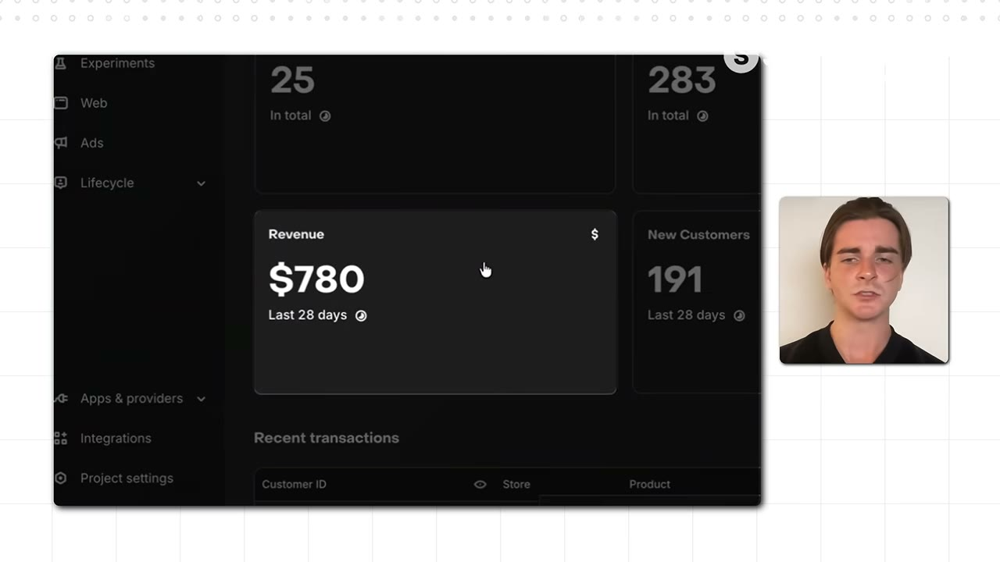
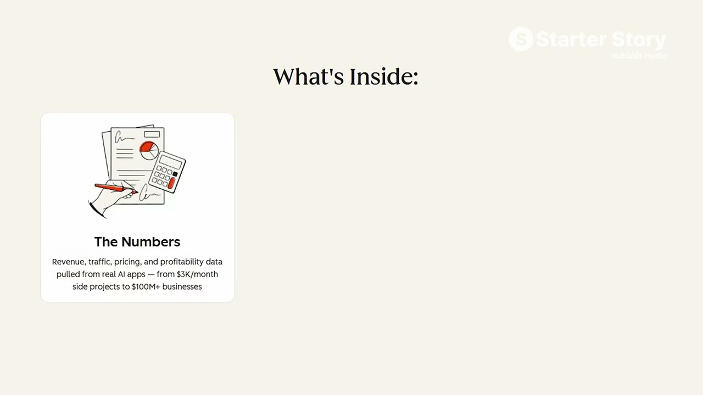
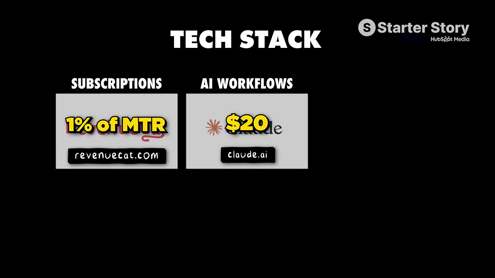
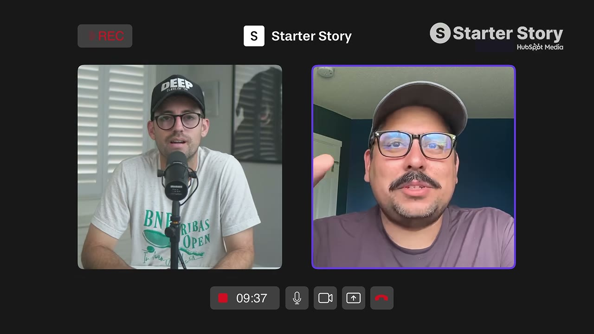

# The Lazy Method: How I Build $10K/Month Apps

✅ **Đã phân tích sâu** → [`case.md`](case.md)

| | |
|---|---|
| **Video** | <https://www.youtube.com/watch?v=zrsGDDLP7WM> |
| **Đăng** | 12/08/2026 |
| **Thời lượng** | 12:35 |
| **Lượt xem** | 36,533 |
| **Lượt thích** | 980 |
| **Video ID** | `zrsGDDLP7WM` |

## Trong thư mục này

| File | Nội dung |
|---|---|
| [`case.md`](case.md) | **Phân tích đầy đủ** — ý tưởng, validate, GTM, áp dụng ở VN |
| [`meta.json`](meta.json) | Metadata gốc (chapters, heatmap, mô tả) |
| [`screenshots/`](screenshots/) | 9 ảnh 720p |

## Mô tả gốc

Will Baker might be the laziest founder we’ve ever had on the show. He built an app and grew it to $10K/month… not by running a tiktok army, not with UGC, not building in public – none of that! He has an even SIMPLER playbook he followed to grow his apps to a combined $10K per month.
0:00 - The Lazy Method
1:02 - What’s your story?
1:24 - Business breakdown
2:01 - Will’s background
2:36 - “Lazy way” overview
3:30 - Why the lazy approach works
4:04 - Ad examples and results
4:44 - More app ideas
5:29 - The Lazy playbook
7:16 - How to learn paid ads
8:16 - Tech stack
8:36 - Final advice
9:26 - P

## Số liệu bắt được từ transcript

> Các đoạn founder nhắc tới con số, kèm timestamp để tua thẳng tới đó trong video.

_(không bắt được con số nào)_

## Chương

- `00:00` The Lazy Method
- `01:02` What’s your story?
- `01:24` Business breakdown
- `02:01` Will’s background
- `02:36` “Lazy way” overview
- `03:30` Why the lazy approach works
- `04:04` Ad examples and results
- `04:44` More app ideas
- `05:29` The Lazy playbook
- `07:16` How to learn paid ads
- `08:16` Tech stack
- `08:36` Final advice
- `09:26` Pat and Gus reflections: why paid ads work

## Ảnh

1. `01_00m15s_ch-the-lazy-method.jpg` — 
2. `02_01m14s_ch-what-s-your-story.jpg` — 
3. `03_01m58s_usd-800.jpg` — 
4. `04_02m45s_usd-10-000.jpg` — 
5. `05_04m04s_usd-10-000.jpg` — 
6. `06_05m07s_usd-10-000.jpg` — 
7. `07_07m28s_ch-how-to-learn-paid-ads.jpg` — 
8. `08_08m28s_ch-tech-stack.jpg` — 
9. `09_09m38s_ch-pat-and-gus-reflections-why-paid-ads-work.jpg` — 

---

← [Quay lại index](../../index.md) · [Toàn bộ video](../README.md)
