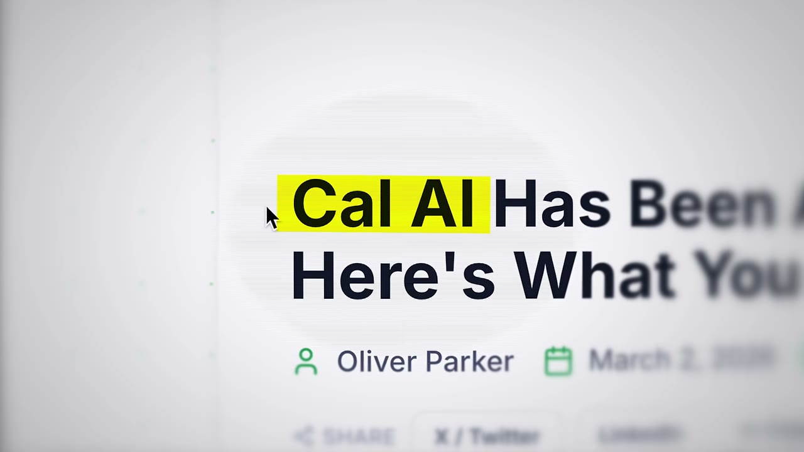
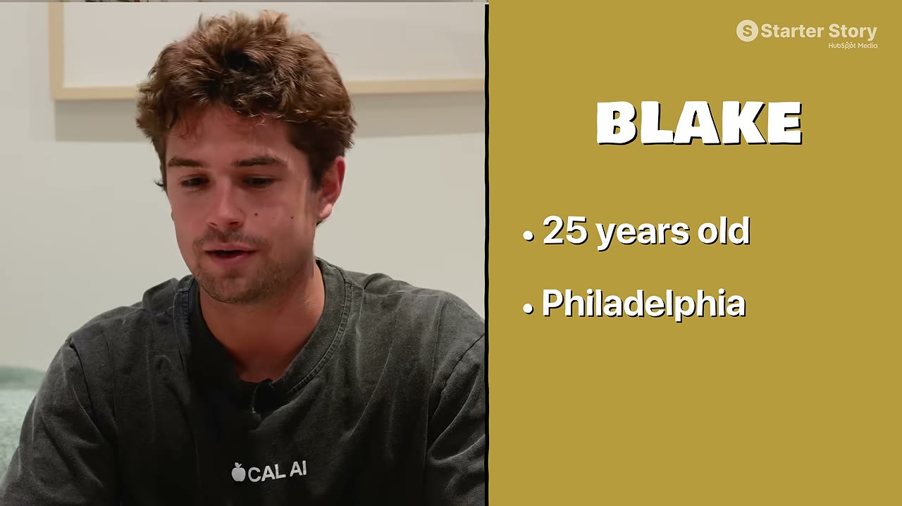
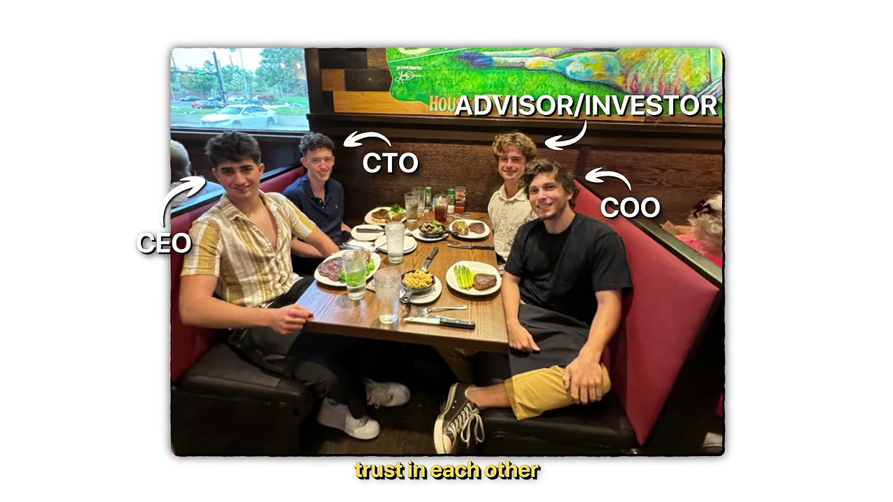
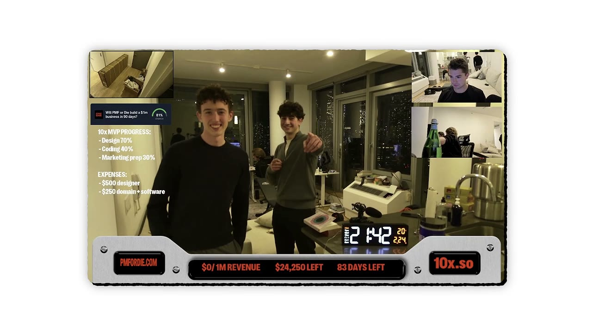
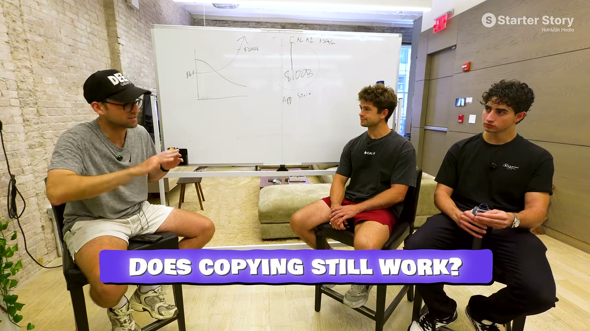
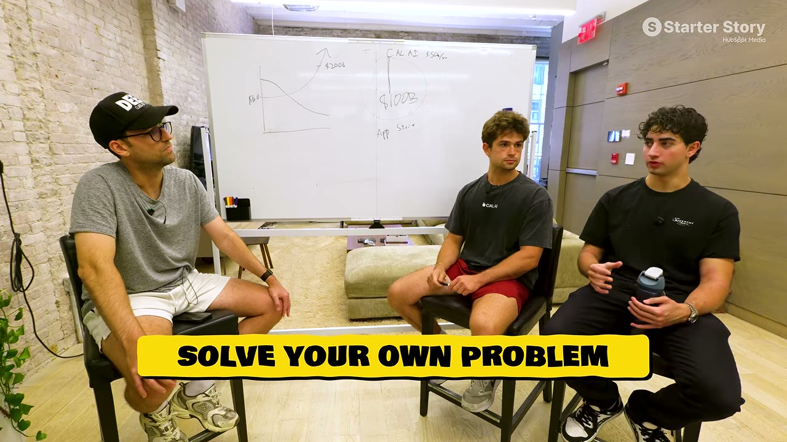

# I Spent 24 Hours With iOS Millionaires

✅ **Đã phân tích sâu** → [`case.md`](case.md)

| | |
|---|---|
| **Video** | <https://www.youtube.com/watch?v=sAr9FWEQZAk> |
| **Đăng** | 16/08/2026 |
| **Thời lượng** | 13:35 |
| **Lượt xem** | 69,201 |
| **Lượt thích** | 1,982 |
| **Video ID** | `sAr9FWEQZAk` |

## Trong thư mục này

| File | Nội dung |
|---|---|
| [`case.md`](case.md) | **Phân tích đầy đủ** — ý tưởng, validate, GTM, áp dụng ở VN |
| [`meta.json`](meta.json) | Metadata gốc (chapters, heatmap, mô tả) |
| [`screenshots/`](screenshots/) | 10 ảnh 720p |

## Mô tả gốc

I traveled to New York to spend 24 hours with the guys who built and sold Cal AI for millions. The video answers one main question: now that AI lets anyone build an app, is it still possible to build a successful one in 2026? Along the way, we talked about what it was like to build a company with your friends, and what they're doing now that they've sold.
0:00 - iOS Millionaires
1:20 - What’s your story?
2:24 - Numbers behind Cal AI
2:48 - Meet the other co-founders
3:36 - What was it like to work together?
3:59 - Did you know it’d be successful?
4:48 - Becoming co-founders
5:38 - Managing con

## Số liệu bắt được từ transcript

> Các đoạn founder nhắc tới con số, kèm timestamp để tua thẳng tới đó trong video.

_(không bắt được con số nào)_

## Chương

- `00:00` iOS Millionaires
- `01:20` What’s your story?
- `02:24` Numbers behind Cal AI
- `02:48` Meet the other co-founders
- `03:36` What was it like to work together?
- `03:59` Did you know it’d be successful?
- `04:48` Becoming co-founders
- `05:38` Managing conflict and trust
- `06:58` Build your own iOS app
- `07:39` Opportunity in apps in 2026
- `08:32` Does copying apps still work?
- `09:15` Advice for building apps
- `10:00` NYC office tour
- `10:25` What did it feel like to sell Cal AI?
- `10:58` The game of entrepreneurship
- `11:42` What are you working on now?
- `12:46` Final thoughts from Pat

## Ảnh

1. `01_00m15s_ch-ios-millionaires.jpg` — 
2. `02_01m32s_ch-what-s-your-story.jpg` — 
3. `03_02m36s_ch-numbers-behind-cal-ai.jpg` — 
4. `04_03m48s_ch-what-was-it-like-to-work-together.jpg` — 
5. `05_05m00s_ch-becoming-co-founders.jpg` — 
6. `06_05m50s_ch-managing-conflict-and-trust.jpg` — 
7. `07_07m10s_ch-build-your-own-ios-app.jpg` — 
8. `08_07m51s_ch-opportunity-in-apps-in-2026.jpg` — 
9. `09_08m34s_usd-10-000.jpg` — 
10. `10_09m27s_ch-advice-for-building-apps.jpg` — 

---

← [Quay lại index](../../index.md) · [Toàn bộ video](../README.md)
