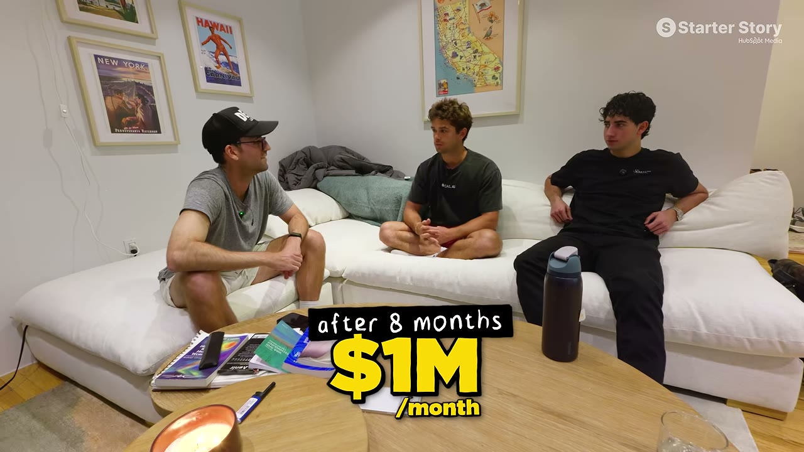
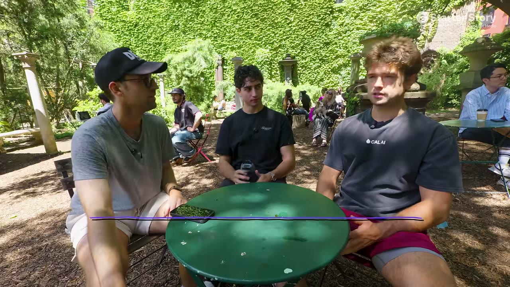
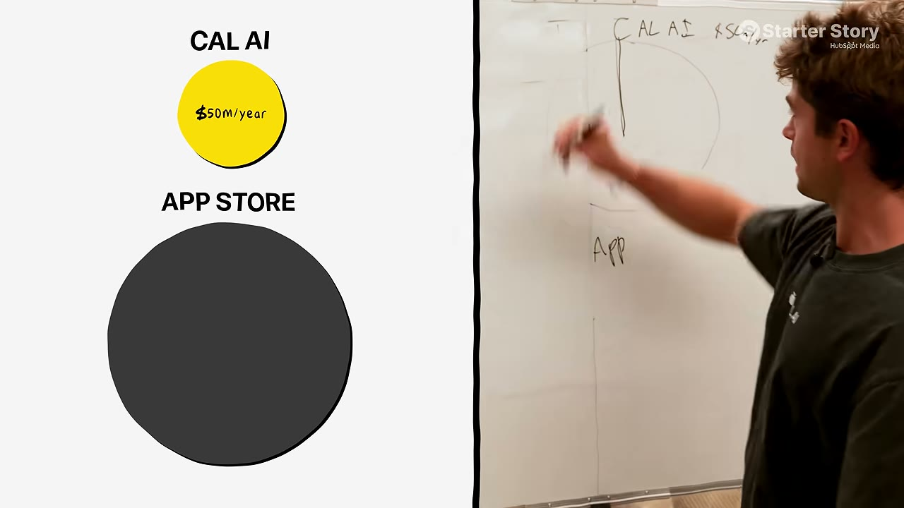

# Cal AI — 4 người bạn, $50M/năm, và câu hỏi "còn cơ hội không?"

> **Tóm tắt 30 giây:** Đây là app mà **rất nhiều case khác trên kênh nhắc tới như hình mẫu** — [CalBuddy](../2026-08-09_i-copied-a-huge-app-now-i-make-80k-month/case.md) bản địa hoá nó cho Israel, [Go Tall](../2026-07-19_this-stupidly-simple-app-makes-100k-month/case.md) lấy nó làm ví dụ "vẫn còn app đếm calo kiếm $30K/tháng". Bốn người bạn (18-31 tuổi) xây Cal AI — chụp ảnh món ăn, AI trả về calo và macro. **Tháng đầu $30K, tháng hai hơn $100K, tháng thứ tám đạt $1 triệu/tháng**, và đang trên đà **~$50 triệu/năm** khi bán. Video này không bóc tách tăng trưởng — nó bóc tách **cách bốn người bạn làm việc với nhau** và trả lời câu hỏi **năm 2026 còn cơ hội làm app không**.

---

## 1. Con số

| Mốc | Doanh thu |
|---|---|
| Tháng 1 | **$30.000** |
| Tháng 2 | **hơn $100.000** |
| **Tháng 8** | **$1.000.000/tháng** |
| Thời điểm quay | trên đà **~$50 triệu/năm** |
| Exit | bán với giá **hàng triệu đô** (không tiết lộ con số) |

**Đội hình 4 người, tuổi rất trẻ:**

| Người | Tuổi | Vai trò |
|---|---|---|
| Zach Yadegari | **19** | **CEO** — code từ năm 7 tuổi, đưa app đầu lên App Store năm 12 tuổi, lập công ty đầu năm lớp 10, scale lên 5 triệu người dùng và kiếm $60K/năm, **bán nó năm 16 tuổi** |
| Blake Anderson | 25 | Co-founder / nhà đầu tư / cố vấn — **các app đầu tiên của anh phần lớn thất bại**, rồi chuyển sang làm app AI |
| Jake Castillo | 31 | CMO/COO — marketing và vận hành |
| Henry | **18** | CTO — quản team kỹ thuật |

---

## 2. Vì sao đội này làm việc được với nhau ⭐

Câu trả lời rất gọn và đáng học:

> **Mỗi người có một lãnh địa chuyên môn riêng, và tất cả hoàn toàn tin tưởng nhau xử lý đúng phần việc đó. Đó là lý do gần như không có cãi vã — ai cũng tập trung vào đúng một thứ mà họ trở thành chuyên gia.**

**Cách họ quen nhau — không phải qua sự kiện networking:**
- Zach và Henry gặp nhau ở **trại lập trình khi 10 tuổi**, rồi chơi game với nhau gần như mỗi ngày. Tình bạn đó dẫn tới việc cùng làm dự án.
- Zach **nhắn DM cho Blake** để làm quen
- Khi Cal AI tăng tốc, họ cần một COO → Zach biết Jake đang làm tốt ở Study Buddy nên **mời vào**

> **Bài học: đội tốt thường đến từ quan hệ đã có sẵn nhiều năm, hoặc từ một cái DM.** Không có công thức phức tạp nào.

### Khoảnh khắc thử thách lớn nhất — và cách họ vượt qua

**Cuối 2024, họ nhận được các lời chào mua ở mức 8 chữ số thấp** (hàng chục triệu đô). Cả đội **mâu thuẫn**: một bên là số tiền đổi đời cho tất cả; một bên là sản phẩm họ thật sự quan tâm và tin còn dư địa tăng trưởng rất lớn.

**Cách giải quyết:**
> Họ **giữ trao đổi cực kỳ cởi mở**, gọi cho nhau liên tục suốt giai đoạn đó. Nhờ **niềm tin vào nhau**, họ đi tới quyết định tập thể: **không bán.**

> **"Trong một mối quan hệ co-founder mà không có mức độ tin tưởng đó, anh sẽ không bao giờ đưa công ty tới trần thật sự của nó."**

**Họ đã đúng.** Từ chối lời chào 8 chữ số thấp cuối 2024, và tới thời điểm quay video, công ty đang trên đà $50 triệu/năm.

Pat chốt lại lời khuyên cho ai đang tìm người cùng làm:
> **Hãy tìm người anh có thể tin tưởng.**

---

## 3. Quy mô cơ hội — con số đáng nhớ ⭐

Đây là phần đáng giá nhất cho ai đang phân vân *"App Store bão hoà rồi, còn cửa không?"*

> **"Người ta nghĩ Cal AI là một cái bánh khổng lồ mà chúng tôi đang ăn. Họ nói Cal AI $50 triệu/năm. Nhưng toàn bộ App Store — cả cái bánh — là 100 TỈ ĐÔ. Chúng tôi chiếm 1/2000 tổng cơ hội."**

| Chỉ số | Giá trị |
|---|---|
| Quy mô App Store hiện tại | **~$100 tỉ/năm** |
| Tốc độ tăng | **hơn 10%/năm** |
| Dự báo ~6 năm nữa | **hơn $200 tỉ**, chỉ riêng iOS App Store |
| Phần Cal AI chiếm | **1/2000** |

> **Cách đóng khung này rất hữu ích:** app thành công nhất mà kênh từng phỏng vấn chỉ chiếm **0,05%** thị trường. Việc "đã có người làm" gần như không có ý nghĩa gì về mặt dư địa.

---

## 4. Tranh luận về sao chép — góc nhìn đối lập ⭐⭐

Pat hỏi thẳng: vài năm trước có thể sao chép một app rồi gắn chiến lược phân phối tốt là chạy được — **giờ còn được không?**

**Câu trả lời của Blake:**

> **"Nó có thể đưa anh tới $10.000/tháng hoặc thậm chí $100.000/tháng. Nhưng thực tế là tôi thấy tiềm năng và kết quả LỚN HƠN NHIỀU khi anh xây một thứ mới."**

Và lý lẽ về mặt con người:
> **"Nếu tin nhắn đầu tiên Zach gửi tôi là 'này, tôi vừa làm một bản sao của app kia' thì tôi đã không trả lời, và chúng tôi đã không bao giờ làm việc cùng nhau. Tôi nghĩ rất nhiều người chuyên nghiệp thực thụ cũng nghĩ như vậy."**

> ⚠️ **Đây là mâu thuẫn trực tiếp với nhiều case khác trong knowledge base** — [CalBuddy](../2026-08-09_i-copied-a-huge-app-now-i-make-80k-month/case.md) ($81K/tháng nhờ bản địa hoá chính Cal AI), [Lazy Method](../2026-08-12_the-lazy-method-how-i-build-10k-month-apps/case.md) (*"designer lấy thứ đang chạy rồi làm tốt hơn"*), [Go Tall](../2026-07-19_this-stupidly-simple-app-makes-100k-month/case.md) (lấy ý tưởng từ acquire.com).
>
> **Cách hoà giải — và đây là điều quan trọng nhất:** hai bên đang nói về **hai mức trần khác nhau**.
> - **Sao chép + phân phối tốt = $10K-100K/tháng.** Blake **xác nhận** điều này chạy được. Với indie hacker, đây là mục tiêu hoàn toàn xứng đáng.
> - **$50 triệu/năm** thì cần thứ khác biệt thật.
>
> **Nếu mục tiêu của anh là $10-50K/tháng, đường sao chép/bản địa hoá vẫn hoàn toàn hợp lệ** — và có tỉ lệ thành công cao hơn nhiều. Đừng để lời khuyên nhắm tới mức $50 triệu làm anh bỏ qua con đường phù hợp với mình.

**Kết luận cuối cùng của Pat khi rời văn phòng — cách diễn đạt cân bằng nhất:**
> Cơ hội **vẫn còn**. Nhưng hãy **lấy những ý tưởng rõ ràng và đặt vào đó dấu ấn khác biệt của mình** — dù là tính năng khác, cách tiếp cận khác, hay **kênh phân phối khác**.

---

## 5. Lời khuyên tìm ý tưởng

Zach đưa lời khuyên anh thừa nhận là "nhiều người đã nói", nhưng giải thích **vì sao** nó hiệu quả:

> **Nếu anh thật sự giải vấn đề của chính mình, mọi thứ tự khớp vào đúng chỗ:**
> - Anh **biết chính xác mình muốn gì** từ sản phẩm → thiết kế app trở nên rất trực giác
> - Với marketing, anh **biết chính xác mình đang nói với ai** — vì anh đang nói với chính mình
> - Anh **biết chính xác những điểm đau nào cần đánh vào**
>
> **"Nếu chưa biết nên làm ý tưởng gì, đừng đi TÌM ý tưởng. Hãy tìm thứ thật sự giúp ích cho chính anh."**

> Cùng kết luận với [Kyle (CardStock)](../2026-06-07_i-built-two-apps-that-make-120k-month/case.md), [Kian (Tone Adapt)](../2026-06-14_the-first-app-i-ever-built-makes-25k-month/case.md), [Matt (Live Tourney)](../2026-07-15_i-quit-my-job-at-meta-to-build-a-30k-month-saas/case.md). **Đây là mẫu hình phổ biến nhất trong knowledge base.**

---

## 6. Sau khi bán — phần trung thực nhất

**Cảm giác lúc bán:**
> **Không "đã" ngay.** Một phần vì cả đội đang ở các bang khác nhau khi việc đó xảy ra — **không có buổi ăn mừng nào** để khép lại. Sáu tháng sau đó là **cảm giác nhẹ nhõm khổng lồ**: biết rằng dù có làm hỏng mọi thứ về sau, mình vẫn ở vị trí thoải mái.

**Vì sao vẫn tiếp tục làm dù đã có tiền:**
> Anh mê game từ bé, và nhìn **khởi nghiệp như trò chơi điện tử hay nhất thế giới**. Ngồi không, đi du thuyền — sẽ chán chết. Anh thích chơi trò này và muốn chơi tiếp.
>
> Blake bổ sung: **nếu đang chơi GTA, anh có bao giờ đặt nhân vật xuống rồi đi xem TV 4 tiếng không? Không đời nào.** Với họ, khởi nghiệp là trò chơi đó.

**Họ đang làm gì tiếp:**
- **Zach:** *10X App Builder* — anh mô tả là **"Shopify cho app"**: không chỉ viết code mà hỗ trợ cả quá trình lên ý tưởng, host backend, thiết kế trang Instagram
- **Blake:** *Flow* — bộ công cụ và sản phẩm cho năng suất và sức khoẻ. Anh **quay lại toàn bộ hành trình xây công ty này trên YouTube**, vì muốn cho người khác thấy **làm founder thật sự trông như thế nào** — điều anh luôn muốn biết khi còn trẻ

---

## 7. Cảnh báo thiên kiến nguồn

**Không có ảnh chụp doanh thu, và các founder tự mâu thuẫn với nhau ngay trên máy quay.** Đây là đoạn đáng chú ý nhất (02:26):

> Pat: *"Walk me through some of the numbers."*
> Zach: *"Tháng đầu bọn tôi làm 30k, tháng hai hơn 100."*
> *"Rồi trong 8 tháng bọn tôi đạt một triệu đô một tháng. Từ đó bọn tôi tăng lên — **năm nay đang trên đà bao nhiêu nhỉ? 60 triệu?**"*
> Người kia: *"**Chắc khoảng 50.**"*
> Pat: *"50 triệu năm nay?"*

Một khoảng chênh **$10 triệu** được chốt bằng một câu đoán trong ba giây, và Pat **không hỏi lại, không xin bằng chứng nào**. Con số `revenue_usd_month: 4000000` trong frontmatter là **suy ra từ $50M ÷ 12**, không phải con số ai đó công bố.

**Giá bán không được tiết lộ — và điều này làm hỏng một kết luận của case.** Pat nói thẳng: *"I know you can't share the exact amount."* Tiêu đề bán "iOS Millionaires" và "sold for multiple millions", nhưng "multiple millions" có thể là $3 triệu cũng như $80 triệu.

> ⚠️ **Hệ quả quan trọng:** mục 2 ở trên kết luận *"Họ đã đúng"* khi từ chối lời chào 8 chữ số thấp cuối 2024. **Kết luận đó không có bằng chứng.** Họ từ chối một lời chào $10-30 triệu, rồi bán với một mức giá **không ai biết**. Nếu giá bán thấp hơn lời chào bị từ chối, quyết định đó là sai — và không có cách nào kiểm tra. Hãy đọc đoạn "giữ lại và thắng lớn" như một **câu chuyện chưa đóng sổ**, không phải một bài học đã được chứng minh.

**Quảng cáo chèn giữa (06:56 → 07:39) — và đây là xung đột lợi ích rõ nhất trong nhóm case này.** Pat nói: *"we worked together with **HubSpot** to put together a free resource to help you ship your iOS app in 7 days"*, link `clickhubspot.com/bqt8`, mô tả video gọi nó là **"Free iOS Bootcamp"**.

Vấn đề không nằm ở nhà tài trợ, mà ở **vị trí đặt nó**: ad này được chèn **ngay trước** chương *"Opportunity in apps in 2026"* — tức đúng đoạn cả video được xây dựng để dẫn tới. Câu hỏi trung tâm mà video tự đặt ra ở 00:34 là *"năm 2026 còn cơ hội làm app iOS không?"*, và câu trả lời được đưa ra ngay sau một đoạn quảng cáo cho **một khoá học dạy làm app iOS**. **Kênh đang kiếm tiền từ chính niềm tin mà video này thuyết phục người xem tin vào.** Con số "$100 tỉ, Cal AI chỉ chiếm 1/2000" là con số thật và hữu ích — nhưng nó được phát ra từ một cấu trúc kinh tế có động cơ rõ ràng để bạn kết luận "vẫn còn cửa". Hãy dùng con số, và tự kiểm tra kết luận.

**Bối cảnh bị làm mờ — đáng kể:**
- **Zach:** code từ **7 tuổi**, đưa app lên App Store năm **12 tuổi**, lập công ty đầu năm lớp 10, **scale lên 5 triệu người dùng** và **bán công ty năm 16 tuổi**. Cal AI là **công ty thứ hai** của anh, không phải lần đầu.
- **Henry:** quen Zach ở **trại lập trình năm 10 tuổi** — tức họ đã làm việc cùng nhau **9 năm** trước Cal AI.
- **Blake:** đã xây danh mục app AI trước đó. Knowledge base có case riêng về anh: [RizzGPT + Umax + Cal AI](../2024-12-29_he-made-10m-with-3-iphone-apps/case.md) — **$10 triệu từ 3 app iPhone**. Video này **không nhắc tới** điều đó, chỉ nói *"các app đầu tiên của tôi phần lớn thất bại"*.
- Và một câu bị lướt qua ở 04:03: *"khi mới bắt đầu, bọn tôi **vẫn đang ăn lương làm cho một app khác**"* — họ có **thu nhập ổn định trong ngành app** trong lúc xây Cal AI. Đây không phải bốn người bắt đầu từ con số 0.

**Thiếu gần như toàn bộ số liệu vận hành:** video **không bóc tách marketing** (case đã ghi nhận), và cũng không có **lượt tải**, **CAC**, **ngân sách quảng cáo**, **churn**, **chi phí**, hay **biên lợi nhuận**. Với một app tiêu dùng ở quy mô $50M/năm, gần như chắc chắn phần lớn doanh thu quay lại thành chi phí thu hút người dùng — nhưng con số đó **không tồn tại trong video**. "$50M/năm" ở đây là **doanh thu gộp trên đà**, không phải tiền vào túi ai.

> 📄 Transcript là auto-caption và đọc tên sản phẩm sai suốt: "Cali AI", "Call AI" thay vì Cal AI.

---

## 8. Áp dụng cho tôi (indie hacker VN)

**Nhận định thẳng: đây KHÔNG phải case để sao chép.** Bốn co-founder trẻ đặc biệt tài năng (một người bán công ty đầu năm 16 tuổi), đúng thời điểm sóng AI, ở New York. Đọc nó để lấy **bối cảnh** và **cách nghĩ**, không phải playbook.

**Ba thứ tách ra dùng được:**

- ✅ **Con số quy mô thị trường.** Khi anh phân vân "đã có người làm rồi": app thành công nhất kênh này từng phỏng vấn chiếm **1/2000** thị trường. Dùng con số này để chống lại nỗi sợ bão hoà.
- ✅ **Nguyên tắc chọn co-founder: lãnh địa riêng biệt + tin tưởng hoàn toàn.** Không chồng lấn vai trò = không tranh chấp. Và mối quan hệ tốt nhất thường đến từ **quan hệ đã có nhiều năm**.
- ✅ **Mức trần thực tế của việc sao chép: $10K-100K/tháng** — được xác nhận bởi chính người xây app $50M. Với indie hacker Việt Nam, đây là mục tiêu tốt và con đường rõ ràng.

**Điều đáng lưu ý nhất về mặt chiến lược:**
> **Cal AI chính là thứ mà các case khác trong kho này SAO CHÉP để thành công.** [CalBuddy](../2026-08-09_i-copied-a-huge-app-now-i-make-80k-month/case.md) làm bản Hebrew → $81K/tháng. Nghĩa là: **giá trị lớn nhất của case này với anh không phải là bắt chước Cal AI — mà là nhận ra rằng những app $50M luôn để lại khoảng trống bản địa hoá cho người đến sau.**

**Rào cản:**
- ⚠️ Không có thông tin về cách họ tăng trưởng — video này không bóc tách marketing
- ⚠️ Không show dashboard như các case khác; con số theo lời kể
- ⚠️ Bối cảnh (tuổi tác, mạng lưới, thời điểm, vị trí) không tái lập được

### Khi KHÔNG nên dùng mô hình này

- **Khi anh làm một mình, hoặc chưa có một đội đã tin nhau nhiều năm.** Cơ chế "gần như không cãi vã" ở đây không phải kỹ năng giao tiếp — nó là **4 người × 4 lãnh địa không chồng lấn** (CEO, CTO, CMO/COO, đầu tư/cố vấn), dựng trên một tình bạn **9 năm** (Zach và Henry gặp nhau ở trại lập trình lúc 10 tuổi). Anh **không tạo ra được điều đó bằng cách đi tìm co-founder trong 3 tháng**. Với solo founder, cả mục 2 của case này không dùng được; tệ hơn, với hai người cùng mạnh về kỹ thuật và không ai nhận phần marketing, cấu trúc này **phản tác dụng** — không có lãnh địa riêng thì mọi quyết định đều thành tranh chấp.
- **Khi mục tiêu của anh là $10-50K/tháng.** Lời khuyên *"đừng sao chép, hãy xây thứ mới"* của Blake là lời khuyên **tối ưu cho mức trần $50 triệu/năm** — và chính anh nói rõ sao chép vẫn đưa được tới **$10K-100K/tháng**. Áp lời khuyên nhắm $50M vào một mục tiêu $10K/tháng là **chọn sai hàm mục tiêu**: anh nhận thêm toàn bộ rủi ro "chưa ai xác nhận có người trả tiền" mà không cần phần thưởng đi kèm. Nếu anh cần một business thay thế thu nhập chứ không cần một exit, [CalBuddy](../2026-08-09_i-copied-a-huge-app-now-i-make-80k-month/case.md) là mô hình đúng hơn case này.
- **Khi anh không ở vị thế nói "không" được với một lời chào mua.** Bài học "giữ lại và tin nhau" chỉ tồn tại vì cả bốn người **đã ở mức $1 triệu/tháng** và **vẫn đang ăn lương từ một app khác** khi ra quyết định — họ từ chối hàng chục triệu đô mà **không ai bị đe doạ về tài chính**. Nếu anh đang ở tình thế mà một lời chào $50.000 là số tiền đổi đời, "hold cho tới trần thật" không phải một lựa chọn anh có; nó là một đặc quyền của người đã an toàn. Bán sớm khi đang cần tiền là **quyết định hợp lý**, không phải thiếu niềm tin.

---

## Nguồn

- Video: [I Spent 24 Hours With iOS Millionaires](https://www.youtube.com/watch?v=sAr9FWEQZAk) — Starter Story, 16/08/2026, 13:35, 69K views
- Sản phẩm: Cal AI (đã bán) · dự án mới: 10X App Builder, Flow
- [`transcript.md`](transcript.md) · [`screenshots/`](screenshots/)
